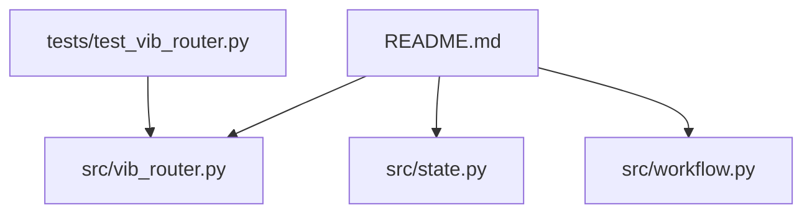
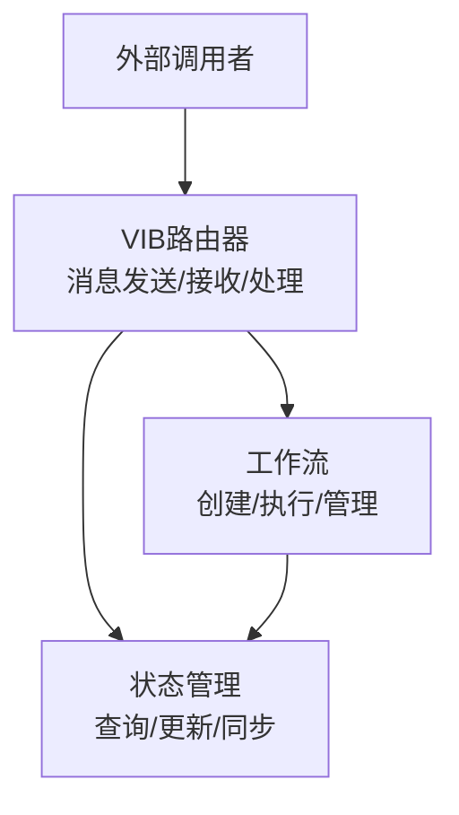
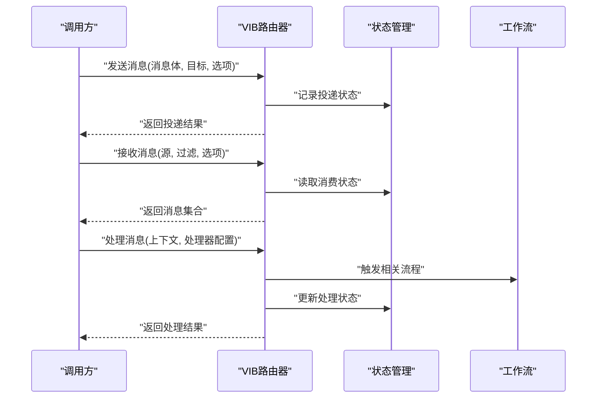
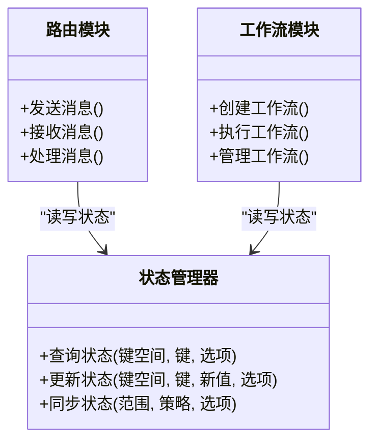
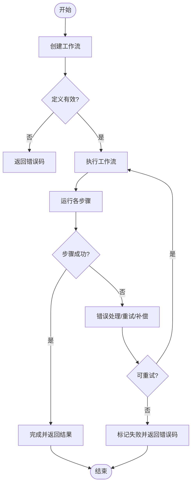

# API参考文档

<cite>
**本文档引用的文件**   
- [README.md](file://README.md)
- [src/vib_router.py](file://src/vib_router.py)
- [src/state.py](file://src/state.py)
- [src/workflow.py](file://src/workflow.py)
- [tests/test_vib_router.py](file://tests/test_vib_router.py)
</cite>

## 目录
1. [简介](#简介)
2. [项目结构](#项目结构)
3. [核心组件](#核心组件)
4. [架构总览](#架构总览)
5. [详细组件分析](#详细组件分析)
6. [依赖关系分析](#依赖关系分析)
7. [性能考虑](#性能考虑)
8. [故障排查指南](#故障排查指南)
9. [结论](#结论)
10. [附录](#附录)

## 简介
本API参考文档面向VIB-SparseCommunication系统，聚焦以下公共能力：
- VIB路由器的消息发送、接收与处理接口
- 状态管理的查询、更新与同步接口
- 工作流的创建、执行与管理接口

文档提供每个接口的函数签名、参数说明、返回值类型、错误码与异常处理建议、调用示例与最佳实践，并给出版本兼容性与迁移指南，以及测试方法与调试技巧。

## 项目结构
仓库采用分层组织方式，核心代码位于 src/ 下，测试位于 tests/ 下，顶层包含说明与验证脚本。

图表来源
- [README.md](file://README.md)
- [src/vib_router.py](file://src/vib_router.py)
- [src/state.py](file://src/state.py)
- [src/workflow.py](file://src/workflow.py)
- [tests/test_vib_router.py](file://tests/test_vib_router.py)

章节来源
- [README.md](file://README.md)
- [src/vib_router.py](file://src/vib_router.py)
- [src/state.py](file://src/state.py)
- [src/workflow.py](file://src/workflow.py)
- [tests/test_vib_router.py](file://tests/test_vib_router.py)

## 核心组件
本节概述三大核心模块的职责与对外暴露的API类别：
- VIB路由器（消息路由）：负责消息的发送、接收与处理流程编排
- 状态管理：提供状态的查询、更新与同步能力
- 工作流：支持工作流的创建、执行与管理

章节来源
- [src/vib_router.py](file://src/vib_router.py)
- [src/state.py](file://src/state.py)
- [src/workflow.py](file://src/workflow.py)

## 架构总览
下图展示了VIB路由器、状态管理与工作流之间的交互关系，以及外部调用者如何通过这些模块完成端到端任务。

图表来源
- [src/vib_router.py](file://src/vib_router.py)
- [src/state.py](file://src/state.py)
- [src/workflow.py](file://src/workflow.py)

## 详细组件分析

### VIB路由器API
VIB路由器提供消息生命周期相关的核心接口，包括发送、接收与处理。

- 发送消息
  - 功能：将消息投递到目标节点或通道
  - 输入参数：
    - 消息体：结构化数据对象
    - 目标标识：字符串或枚举，表示目标节点/通道
    - 可选参数：优先级、超时、重试策略等
  - 返回：
    - 成功：消息ID与投递结果
    - 失败：错误码与诊断信息
  - 错误码与异常：
    - 无效参数：参数校验失败
    - 目标不可达：目标不存在或离线
    - 超时：投递超过阈值
    - 内部错误：序列化/网络/资源问题
  - 使用示例路径：[tests/test_vib_router.py](file://tests/test_vib_router.py)

- 接收消息
  - 功能：从队列或订阅通道拉取消息
  - 输入参数：
    - 源标识：字符串或枚举，表示源节点/通道
    - 过滤条件：按标签、类型或内容筛选
    - 可选参数：批量大小、阻塞模式、超时
  - 返回：
    - 成功：消息列表或单条消息
    - 失败：错误码与诊断信息
  - 错误码与异常：
    - 无可用消息：空结果集
    - 订阅失效：源已关闭或权限不足
    - 解析失败：消息格式不合法
  - 使用示例路径：[tests/test_vib_router.py](file://tests/test_vib_router.py)

- 处理消息
  - 功能：对接收到的消息进行业务逻辑处理
  - 输入参数：
    - 消息上下文：消息体与元数据
    - 处理器配置：路由规则、转换映射、回调钩子
  - 返回：
    - 成功：处理结果与后续动作指示
    - 失败：错误码与恢复建议
  - 错误码与异常：
    - 处理器未注册：缺少对应处理器
    - 业务异常：业务校验失败
    - 幂等冲突：重复处理导致的状态不一致
  - 使用示例路径：[tests/test_vib_router.py](file://tests/test_vib_router.py)

图表来源
- [src/vib_router.py](file://src/vib_router.py)
- [src/state.py](file://src/state.py)
- [src/workflow.py](file://src/workflow.py)

章节来源
- [src/vib_router.py](file://src/vib_router.py)
- [tests/test_vib_router.py](file://tests/test_vib_router.py)

### 状态管理API
状态管理提供一致的查询、更新与同步能力，确保跨组件的数据一致性。

- 查询状态
  - 功能：读取当前系统或实体状态
  - 输入参数：
    - 键空间：命名空间或作用域
    - 键：唯一标识符
    - 可选参数：版本控制、快照范围
  - 返回：
    - 成功：状态对象或快照
    - 失败：错误码与诊断信息
  - 错误码与异常：
    - 键不存在：请求的资源缺失
    - 权限不足：访问受限
    - 版本冲突：并发写入导致的不一致
  - 使用示例路径：[src/state.py](file://src/state.py)

- 更新状态
  - 功能：原子性地修改状态值
  - 输入参数：
    - 键空间与键
    - 新值：结构化数据
    - 可选参数：比较条件、版本号、事务边界
  - 返回：
    - 成功：更新后的状态与操作结果
    - 失败：错误码与恢复建议
  - 错误码与异常：
    - 校验失败：新值不符合约束
    - 并发冲突：CAS失败
    - 持久化失败：存储层异常
  - 使用示例路径：[src/state.py](file://src/state.py)

- 同步状态
  - 功能：在多个副本或节点间同步状态
  - 输入参数：
    - 同步范围：全量或增量
    - 策略：拉取/推送、冲突解决策略
    - 可选参数：超时、重试次数
  - 返回：
    - 成功：同步结果与差异摘要
    - 失败：错误码与回滚建议
  - 错误码与异常：
    - 网络异常：连接中断或超时
    - 冲突不可解：策略无法达成一致
    - 部分失败：需要补偿或重试
  - 使用示例路径：[src/state.py](file://src/state.py)

图表来源
- [src/state.py](file://src/state.py)
- [src/vib_router.py](file://src/vib_router.py)
- [src/workflow.py](file://src/workflow.py)

章节来源
- [src/state.py](file://src/state.py)

### 工作流API
工作流模块支持定义、创建、执行与管理复杂业务流程。

- 创建工作流
  - 功能：定义工作流结构与步骤
  - 输入参数：
    - 名称与描述
    - 步骤序列：顺序、分支、并行
    - 输入输出映射：变量绑定与转换
    - 可选参数：超时、重试、错误处理策略
  - 返回：
    - 成功：工作流实例ID与初始状态
    - 失败：错误码与诊断信息
  - 错误码与异常：
    - 定义非法：步骤或映射不合法
    - 资源不足：创建失败
    - 权限不足：无权创建
  - 使用示例路径：[src/workflow.py](file://src/workflow.py)

- 执行工作流
  - 功能：运行已创建的工作流实例
  - 输入参数：
    - 工作流ID
    - 启动参数：输入数据与环境变量
    - 可选参数：优先级、调度策略
  - 返回：
    - 成功：执行结果与中间状态
    - 失败：错误码与恢复建议
  - 错误码与异常：
    - 实例不存在：ID无效
    - 步骤失败：单个节点异常
    - 超时：执行时间超限
  - 使用示例路径：[src/workflow.py](file://src/workflow.py)

- 管理工作流
  - 功能：查询、暂停、恢复、终止工作流实例
  - 输入参数：
    - 工作流ID
    - 操作类型：查询/暂停/恢复/终止
    - 可选参数：原因、审计信息
  - 返回：
    - 成功：操作结果与最新状态
    - 失败：错误码与诊断信息
  - 错误码与异常：
    - 状态不允许：当前状态不支持该操作
    - 并发冲突：多操作竞争
    - 权限不足：无权管理
  - 使用示例路径：[src/workflow.py](file://src/workflow.py)

图表来源
- [src/workflow.py](file://src/workflow.py)

章节来源
- [src/workflow.py](file://src/workflow.py)

## 依赖关系分析
VIB路由器依赖状态管理与工作流模块，形成松耦合的分层架构。

图表来源
- [src/vib_router.py](file://src/vib_router.py)
- [src/state.py](file://src/state.py)
- [src/workflow.py](file://src/workflow.py)

章节来源
- [src/vib_router.py](file://src/vib_router.py)
- [src/state.py](file://src/state.py)
- [src/workflow.py](file://src/workflow.py)

## 性能考虑
- 消息路由
  - 批处理：合并小消息以降低开销
  - 背压：在高负载时限制入队速率
  - 超时与重试：合理设置以避免雪崩
- 状态管理
  - 缓存热点键：减少远程访问
  - 版本控制：避免不必要的写放大
  - 增量同步：降低带宽与CPU消耗
- 工作流
  - 并行执行：提升吞吐
  - 幂等设计：保证重试安全
  - 资源隔离：防止长尾任务影响整体

## 故障排查指南
- 常见问题定位
  - 路由失败：检查目标可达性与权限
  - 状态不一致：查看版本冲突日志与同步策略
  - 工作流卡住：确认步骤依赖与资源可用性
- 调试技巧
  - 启用详细日志：记录关键路径与错误堆栈
  - 断点与追踪：在关键方法入口/出口打点
  - 回放与复现：保存消息与工作流上下文以便重现
- 错误码与异常处理建议
  - 统一错误码规范：区分客户端错误与服务端错误
  - 重试与退避：指数退避与抖动策略
  - 降级与熔断：保护核心链路

章节来源
- [tests/test_vib_router.py](file://tests/test_vib_router.py)

## 结论
VIB-SparseCommunication通过清晰的分层与模块化设计，提供了稳定的消息路由、一致的状态管理与灵活的工作流能力。遵循本文档的API约定与最佳实践，可有效提升系统的可靠性与可维护性。

## 附录

### 版本兼容性与迁移指南
- 兼容性原则
  - 向后兼容：新增字段默认值需明确
  - 废弃策略：旧版接口保留过渡期并提供替代方案
- 迁移步骤
  - 评估影响面：识别受影响的调用方
  - 灰度发布：逐步切换流量
  - 回滚预案：准备快速回滚机制
- 变更清单
  - 新增接口：提供完整文档与示例
  - 行为变更：说明差异与适配方法
  - 删除接口：提前公告与下线计划

### API测试方法
- 单元测试
  - 覆盖正常路径与异常路径
  - 模拟外部依赖：状态存储与工作流引擎
- 集成测试
  - 端到端场景：消息收发与状态同步
  - 压力测试：高并发下的稳定性
- 回归测试
  - 自动化用例库：持续集成中执行
  - 变更对比：确保行为一致

### 调试技巧
- 日志与指标
  - 结构化日志：便于检索与分析
  - 关键指标：延迟、错误率、吞吐量
- 工具链
  - 分布式追踪：串联跨服务调用
  - 快照与回放：捕获运行时状态