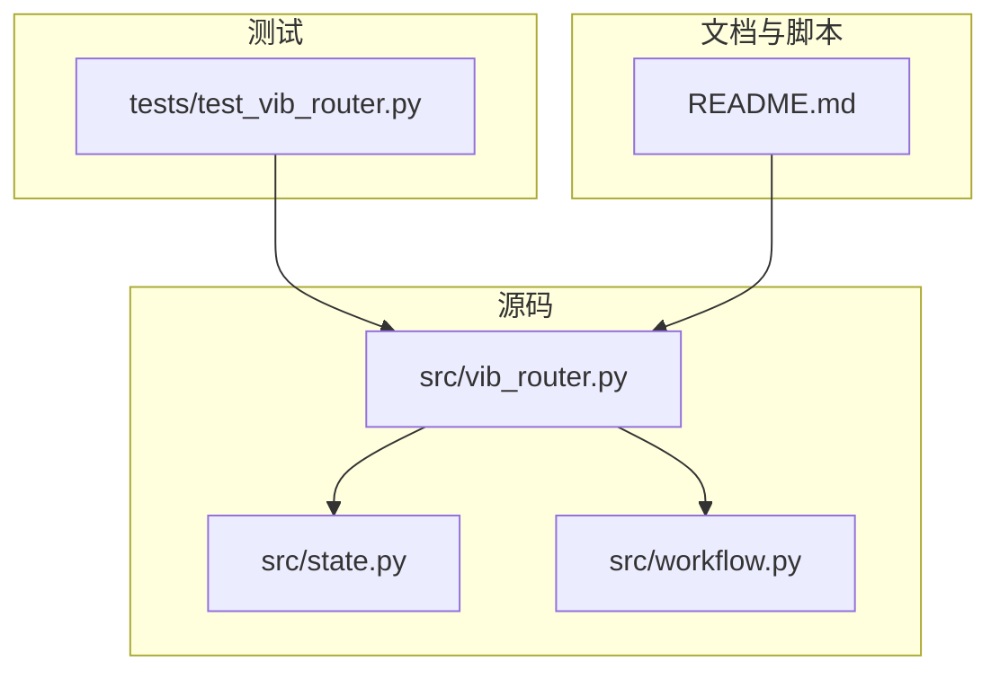
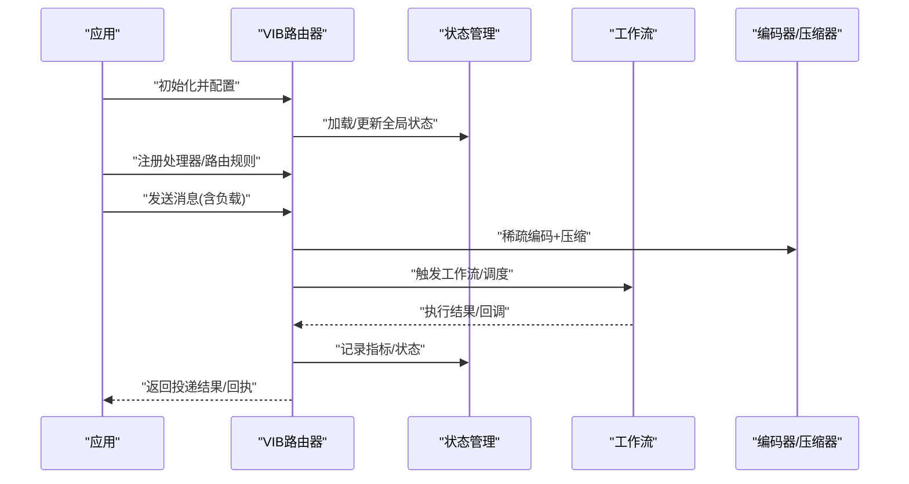
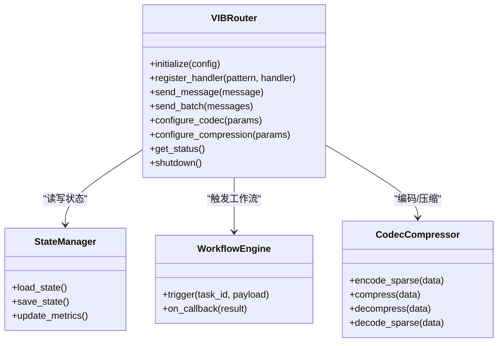
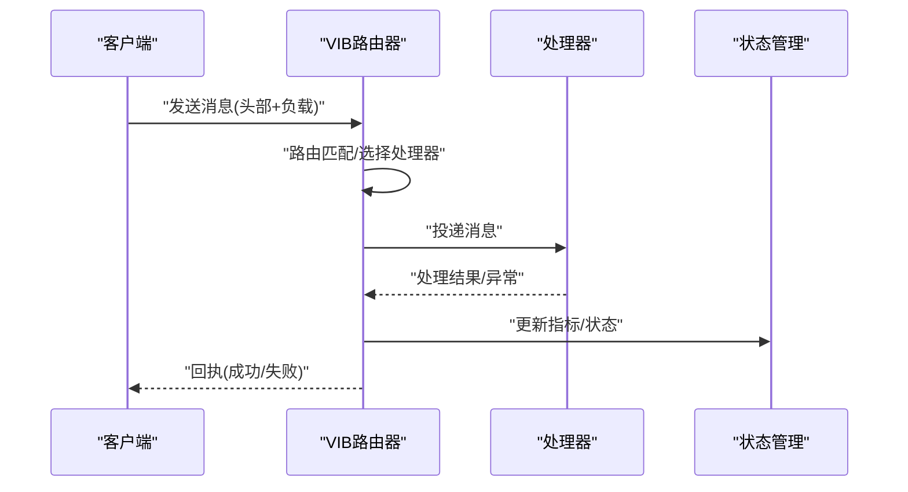
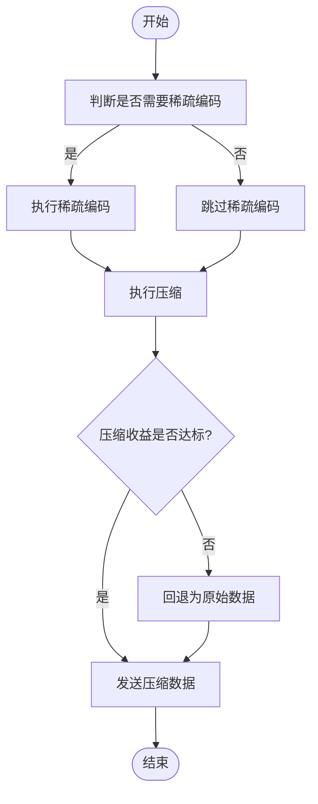
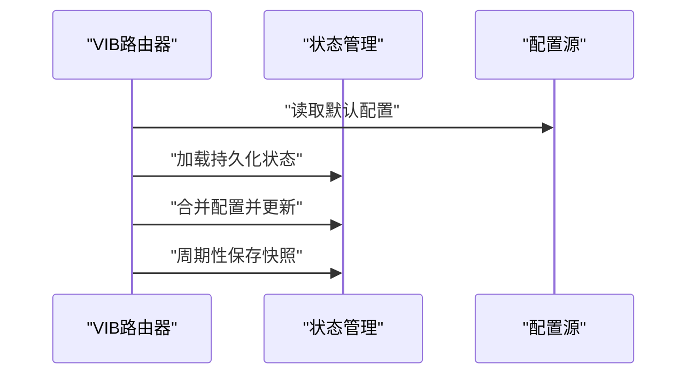
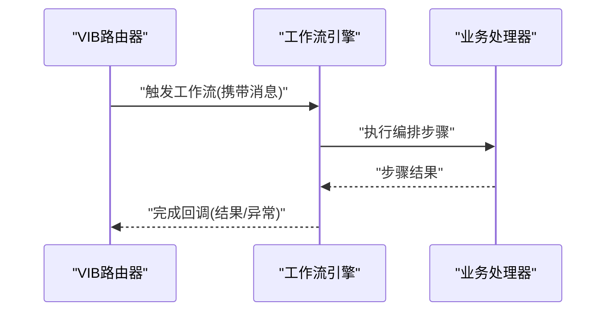
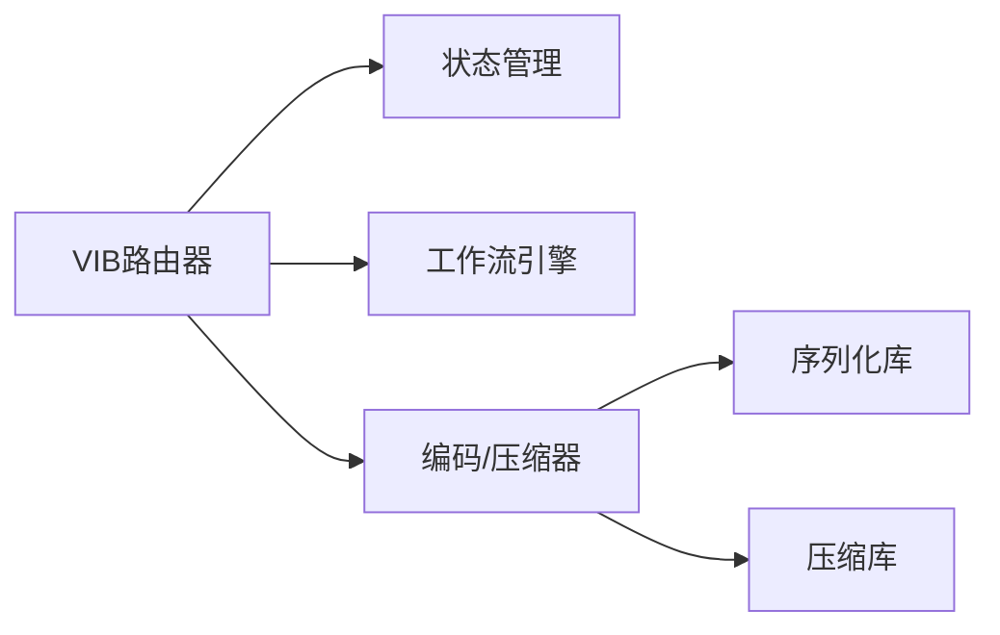

# VIB路由器API

<cite>
**本文引用的文件**   
- [vib_router.py](file://src/vib_router.py)
- [state.py](file://src/state.py)
- [workflow.py](file://src/workflow.py)
- [test_vib_router.py](file://tests/test_vib_router.py)
- [README.md](file://README.md)
</cite>

## 目录
1. [简介](#简介)
2. [项目结构](#项目结构)
3. [核心组件](#核心组件)
4. [架构总览](#架构总览)
5. [详细组件分析](#详细组件分析)
6. [依赖关系分析](#依赖关系分析)
7. [性能考虑](#性能考虑)
8. [故障排查指南](#故障排查指南)
9. [结论](#结论)
10. [附录](#附录)

## 简介
本文件为VIB路由器模块的API文档，聚焦消息路由、稀疏编码与压缩处理等核心能力。文档面向开发者与集成者，提供接口说明、参数与返回类型、异常与错误码、使用示例、性能优化建议以及与状态管理模块的集成方式与数据流说明。

## 项目结构
仓库采用分层组织：
- src：核心实现（路由器、状态、工作流）
- tests：单元测试与集成测试
- docs：辅助文档或脚本
- 根目录：说明与验证脚本

图表来源
- [vib_router.py](file://src/vib_router.py)
- [state.py](file://src/state.py)
- [workflow.py](file://src/workflow.py)
- [test_vib_router.py](file://tests/test_vib_router.py)
- [README.md](file://README.md)

章节来源
- [README.md](file://README.md)

## 核心组件
本节概述路由器对外暴露的主要能力与职责边界：
- 消息路由：负责将消息按策略投递到目标处理器或下游节点
- 稀疏编码：对消息载荷进行稀疏化表示，降低传输与存储开销
- 压缩处理：在发送前对数据进行压缩，在接收后解压还原
- 配置管理：集中管理路由规则、编码器/压缩器参数、重试与超时等
- 状态集成：与状态管理模块协作，持久化关键上下文与指标

章节来源
- [vib_router.py](file://src/vib_router.py)
- [state.py](file://src/state.py)
- [workflow.py](file://src/workflow.py)

## 架构总览
VIB路由器作为中间件层，向上暴露统一API，向下对接状态管理与工作流执行引擎。典型调用路径包括初始化、注册处理器、发送消息、路由决策、编码压缩、投递与回执。

图表来源
- [vib_router.py](file://src/vib_router.py)
- [state.py](file://src/state.py)
- [workflow.py](file://src/workflow.py)

## 详细组件分析

### 路由器类与公共接口
- 初始化与生命周期
  - 构造与销毁：创建实例、加载配置、启动后台任务、优雅关闭
  - 配置项：路由表、处理器映射、编码与压缩参数、重试与超时、日志级别
- 路由与投递
  - 发送消息：支持同步/异步投递，携带消息头与负载
  - 路由策略：基于键/主题/优先级/标签选择目标处理器
  - 批量操作：批量发送与合并回执
- 编码与压缩
  - 稀疏编码：将密集向量/矩阵转换为稀疏格式，减少体积
  - 压缩：可插拔压缩算法，支持配置压缩等级与阈值
- 状态与工作流集成
  - 状态读写：持久化路由表、计数器、错误统计
  - 工作流：触发编排任务、监听回调、失败重试
- 监控与诊断
  - 指标上报：吞吐、延迟、丢包率、压缩比
  - 健康检查：存活探针、依赖可用性检测

章节来源
- [vib_router.py](file://src/vib_router.py)

#### 类图（代码级）

图表来源
- [vib_router.py](file://src/vib_router.py)
- [state.py](file://src/state.py)
- [workflow.py](file://src/workflow.py)

### 消息模型与路由协议
- 消息结构
  - 头部：消息ID、时间戳、路由键、优先级、扩展字段
  - 负载：原始数据或已编码/压缩后的字节序列
- 路由协议
  - 匹配规则：精确匹配、前缀匹配、通配符匹配
  - 分发语义：至少一次、至多一次、恰好一次（由策略决定）
- 回执与确认
  - 成功回执：包含处理耗时与结果摘要
  - 失败回执：错误码、错误信息、是否可重试

章节来源
- [vib_router.py](file://src/vib_router.py)

#### 时序图（发送与回执）

图表来源
- [vib_router.py](file://src/vib_router.py)
- [state.py](file://src/state.py)

### 稀疏编码与压缩处理
- 稀疏编码
  - 输入：密集数组/张量
  - 输出：稀疏表示（索引+值），支持阈值过滤
  - 复杂度：线性扫描构建索引，空间随非零元素数量变化
- 压缩
  - 算法：可配置（如通用压缩库）
  - 参数：压缩等级、块大小、阈值
  - 回退：当压缩增益不足时回退为原始数据
- 解码与解压
  - 顺序：先解压再解码稀疏结构
  - 校验：完整性校验与版本兼容

章节来源
- [vib_router.py](file://src/vib_router.py)

#### 流程图（编码压缩流水线）

图表来源
- [vib_router.py](file://src/vib_router.py)

### 与状态管理模块的集成
- 状态内容
  - 运行时配置：路由表、处理器映射、编码/压缩参数
  - 运行指标：计数、延迟分布、错误统计
  - 持久化快照：周期性保存，崩溃恢复
- 一致性
  - 原子更新：配置变更以事务形式提交
  - 冲突解决：最后写入胜出或版本号控制
- 查询与订阅
  - 查询接口：获取当前状态与指标
  - 事件订阅：状态变更通知

章节来源
- [state.py](file://src/state.py)
- [vib_router.py](file://src/vib_router.py)

#### 状态交互时序

图表来源
- [state.py](file://src/state.py)
- [vib_router.py](file://src/vib_router.py)

### 与工作流模块的集成
- 触发机制
  - 事件驱动：消息到达即触发对应工作流
  - 批处理：聚合多条消息后触发
- 回调与重试
  - 回调：工作流完成后回调路由器
  - 重试：指数退避与最大重试次数
- 编排与监控
  - 步骤可视化：工作流步骤与状态
  - 告警：长时间阻塞或失败告警

章节来源
- [workflow.py](file://src/workflow.py)
- [vib_router.py](file://src/vib_router.py)

#### 工作流触发时序

图表来源
- [workflow.py](file://src/workflow.py)
- [vib_router.py](file://src/vib_router.py)

### 错误处理与错误码
- 分类
  - 配置错误：无效路由规则、缺失处理器
  - 编码/压缩错误：不支持的数据类型、压缩失败
  - 投递错误：目标不可达、超时、拒绝
  - 状态错误：持久化失败、版本冲突
- 错误码
  - 统一枚举：用于跨模块传递与日志追踪
  - 人类可读信息：附带上下文与修复建议
- 重试与降级
  - 可重试错误：网络抖动、临时资源占用
  - 不可重试错误：参数非法、数据损坏
  - 降级策略：回退到未压缩或本地队列

章节来源
- [vib_router.py](file://src/vib_router.py)

### 使用示例（端到端流程）
以下示例展示从初始化到发送消息的完整流程，便于快速上手：
- 初始化路由器并加载配置
- 注册处理器与路由规则
- 配置稀疏编码与压缩参数
- 发送单条消息并处理回执
- 批量发送与聚合回执
- 查询状态与指标
- 优雅关闭

章节来源
- [test_vib_router.py](file://tests/test_vib_router.py)
- [vib_router.py](file://src/vib_router.py)

## 依赖关系分析
- 内部依赖
  - 路由器依赖状态管理与工作流引擎
  - 编码器/压缩器作为可插拔组件
- 外部依赖
  - 序列化/反序列化库
  - 压缩库
  - 日志与监控后端
- 耦合与内聚
  - 路由器通过接口与状态/工作流解耦
  - 编码/压缩策略通过配置注入，提升内聚性

图表来源
- [vib_router.py](file://src/vib_router.py)
- [state.py](file://src/state.py)
- [workflow.py](file://src/workflow.py)

章节来源
- [vib_router.py](file://src/vib_router.py)
- [state.py](file://src/state.py)
- [workflow.py](file://src/workflow.py)

## 性能考虑
- 稀疏编码
  - 阈值调优：根据数据分布调整非零阈值，平衡精度与体积
  - 内存复用：重用索引与值缓冲区，减少分配
- 压缩
  - 算法选择：小数据优先轻量算法，大数据优先高压缩比算法
  - 并行化：批量压缩与分块并行
- 路由
  - 路由表索引：哈希/前缀树加速匹配
  - 背压与限流：防止过载导致堆积
- 状态
  - 增量更新：仅持久化差异，降低IO压力
  - 快照频率：权衡恢复时间与写入开销
- 监控
  - 采样指标：避免全量采集带来的额外开销
  - 异步上报：降低主路径延迟

[本节为通用指导，不直接分析具体文件]

## 故障排查指南
- 常见问题
  - 路由不命中：检查路由规则与消息头字段
  - 编码失败：确认数据类型与稀疏阈值
  - 压缩失败：检查可用磁盘空间与算法兼容性
  - 状态不一致：查看快照版本与并发写入冲突
- 定位手段
  - 日志关键字：路由匹配、编码压缩、投递回执
  - 指标看板：吞吐、延迟、错误率、压缩比
  - 回放工具：重放消息以复现问题
- 恢复策略
  - 回滚配置：恢复到上一个稳定版本
  - 清理积压：丢弃或归档过期消息
  - 重启服务：在安全窗口内滚动重启

章节来源
- [vib_router.py](file://src/vib_router.py)
- [state.py](file://src/state.py)

## 结论
VIB路由器通过统一API封装消息路由、稀疏编码与压缩能力，并与状态管理和工作流深度集成，形成可扩展、可观测、高性能的消息处理基础设施。合理配置与遵循最佳实践可显著提升系统吞吐与稳定性。

[本节为总结，不直接分析具体文件]

## 附录
- 术语
  - 稀疏编码：将密集数据结构转换为稀疏表示的技术
  - 压缩比：原始数据大小与压缩后大小的比值
  - 路由键：用于匹配路由规则的标识字段
- 参考
  - README中的安装与使用说明
  - 测试用例中的端到端示例

章节来源
- [README.md](file://README.md)
- [test_vib_router.py](file://tests/test_vib_router.py)