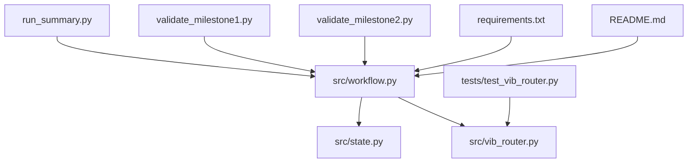
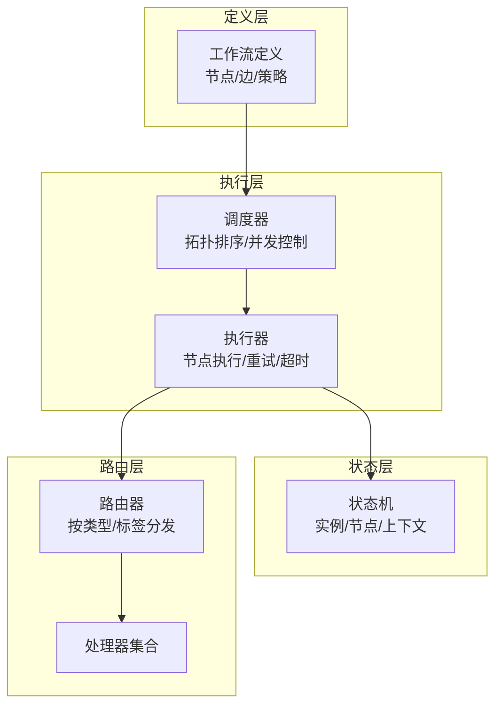
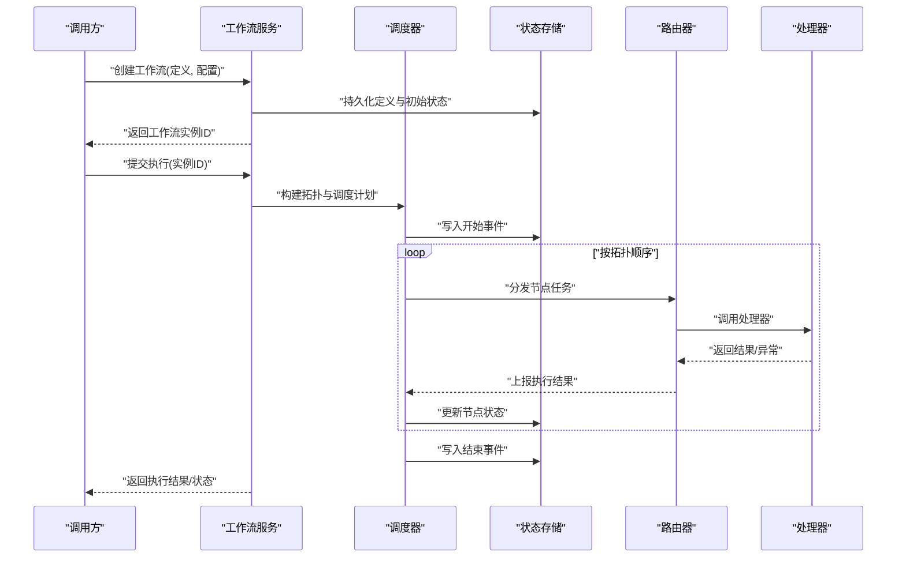
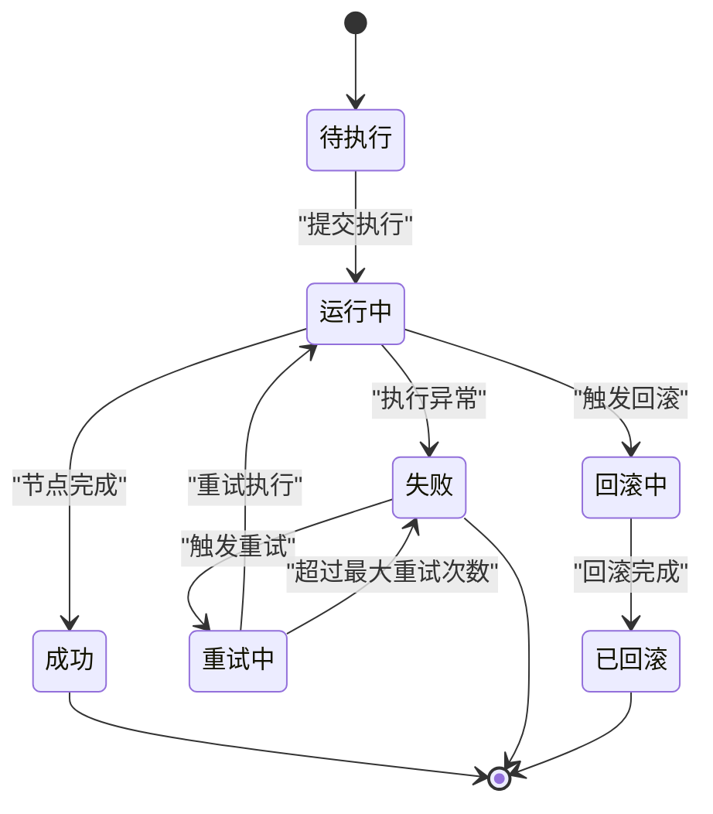
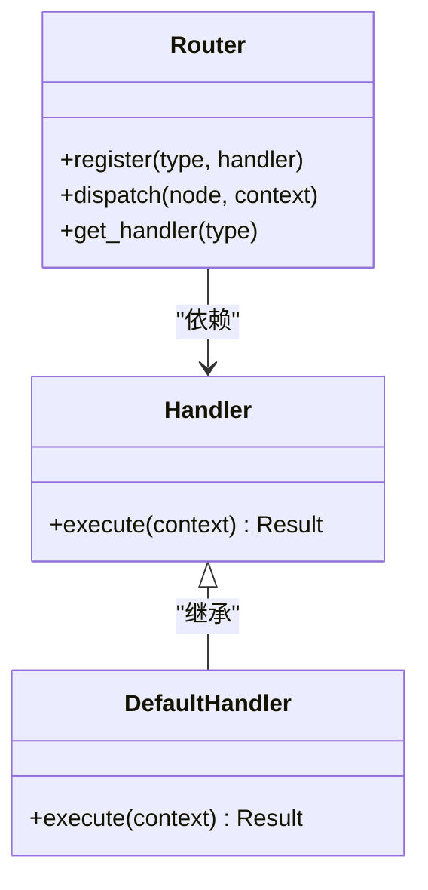
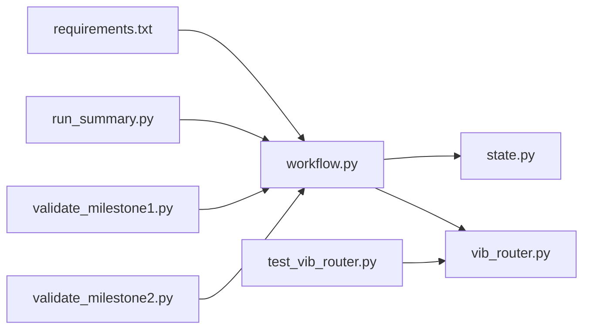

# 工作流API

<cite>
**本文引用的文件**   
- [README.md](file://README.md)
- [requirements.txt](file://requirements.txt)
- [src/workflow.py](file://src/workflow.py)
- [src/state.py](file://src/state.py)
- [src/vib_router.py](file://src/vib_router.py)
- [src/__init__.py](file://src/__init__.py)
- [tests/test_vib_router.py](file://tests/test_vib_router.py)
- [run_summary.py](file://run_summary.py)
- [validate_milestone1.py](file://validate_milestone1.py)
- [validate_milestone2.py](file://validate_milestone2.py)
</cite>

## 目录
1. [简介](#简介)
2. [项目结构](#项目结构)
3. [核心组件](#核心组件)
4. [架构总览](#架构总览)
5. [详细组件分析](#详细组件分析)
6. [依赖关系分析](#依赖关系分析)
7. [性能考虑](#性能考虑)
8. [故障排查指南](#故障排查指南)
9. [结论](#结论)
10. [附录](#附录)

## 简介
本文件为工作流引擎的API与实现文档，面向需要定义、创建、执行、监控与管理工作流的开发者。内容覆盖任务调度、依赖管理、错误处理机制，以及模板化工作流与自定义任务的开发指南；同时提供版本控制、回滚与重试策略的配置方法，并给出复杂编排示例与性能调优建议。

## 项目结构
仓库采用分层组织：
- src：核心实现（工作流、状态、路由）
- tests：测试用例
- 根目录：说明、依赖、运行脚本与验证脚本

图表来源
- [src/workflow.py](file://src/workflow.py)
- [src/state.py](file://src/state.py)
- [src/vib_router.py](file://src/vib_router.py)
- [tests/test_vib_router.py](file://tests/test_vib_router.py)
- [run_summary.py](file://run_summary.py)
- [validate_milestone1.py](file://validate_milestone1.py)
- [validate_milestone2.py](file://validate_milestone2.py)
- [requirements.txt](file://requirements.txt)
- [README.md](file://README.md)

章节来源
- [README.md](file://README.md)
- [requirements.txt](file://requirements.txt)
- [src/workflow.py](file://src/workflow.py)
- [src/state.py](file://src/state.py)
- [src/vib_router.py](file://src/vib_router.py)
- [tests/test_vib_router.py](file://tests/test_vib_router.py)
- [run_summary.py](file://run_summary.py)
- [validate_milestone1.py](file://validate_milestone1.py)
- [validate_milestone2.py](file://validate_milestone2.py)

## 核心组件
- 工作流定义与执行：负责声明节点、边、调度策略、重试与超时等配置，并提供创建与运行接口。
- 状态管理：维护工作流实例的运行态、节点完成态、上下文数据与审计日志。
- 路由与分发：根据节点类型或标签将任务分派到具体处理器，支持动态扩展。
- 测试与验证：通过单元测试与里程碑验证脚本确保工作流行为正确。

章节来源
- [src/workflow.py](file://src/workflow.py)
- [src/state.py](file://src/state.py)
- [src/vib_router.py](file://src/vib_router.py)
- [tests/test_vib_router.py](file://tests/test_vib_router.py)

## 架构总览
工作流引擎由“定义层—执行层—状态层—路由层”构成。定义层产出可序列化的工作流描述；执行层基于有向无环图进行拓扑排序与并发调度；状态层持久化运行快照；路由层将任务派发至处理器。

图表来源
- [src/workflow.py](file://src/workflow.py)
- [src/state.py](file://src/state.py)
- [src/vib_router.py](file://src/vib_router.py)

## 详细组件分析

### 工作流定义与执行（workflow.py）
- 职责
  - 定义工作流的结构（节点、边、入口/出口）。
  - 解析与校验依赖关系，生成可执行的调度计划。
  - 提供创建、提交、查询、取消、重试等生命周期接口。
  - 集成重试、超时、幂等与回滚策略。
- 关键流程
  - 创建工作流：接收定义与配置，返回工作流实例ID。
  - 执行工作流：按拓扑顺序调度节点，记录状态变更。
  - 查询与监控：获取实例状态、节点进度、上下文与日志。
  - 失败处理：触发重试、补偿或回滚，更新最终状态。
- 设计要点
  - 使用不可变的工作流定义对象，便于版本化与回放。
  - 执行过程以事件驱动，状态变更可审计。
  - 支持并行度与资源配额限制，避免过载。

章节来源
- [src/workflow.py](file://src/workflow.py)

#### 执行时序（创建→执行→监控）

图表来源
- [src/workflow.py](file://src/workflow.py)
- [src/state.py](file://src/state.py)
- [src/vib_router.py](file://src/vib_router.py)

### 状态管理（state.py）
- 职责
  - 维护工作流实例与节点的状态机（如待执行、运行中、成功、失败、回滚中）。
  - 保存上下文数据、输入输出、审计日志与时间戳。
  - 提供快照与恢复能力，支撑重试与回滚。
- 关键特性
  - 原子性状态迁移，保证一致性。
  - 可扩展的事件总线，用于监听与告警。
  - 轻量级持久化，支持快速查询与回放。

章节来源
- [src/state.py](file://src/state.py)

#### 状态机（简化）

图表来源
- [src/state.py](file://src/state.py)

### 路由与分发（vib_router.py）
- 职责
  - 根据节点类型或标签选择处理器。
  - 支持注册/注销处理器，实现热插拔。
  - 提供默认处理器与降级策略。
- 关键流程
  - 注册处理器：映射类型/标签到处理器函数或类。
  - 分发任务：查找处理器并调用，捕获异常并上报。
  - 负载均衡：在多个处理器实例间分配负载（可选）。

章节来源
- [src/vib_router.py](file://src/vib_router.py)

#### 路由类图（示意）

图表来源
- [src/vib_router.py](file://src/vib_router.py)

### 测试与验证（tests/test_vib_router.py）
- 目标
  - 验证路由器的注册、分发与异常路径。
  - 模拟处理器行为，断言状态变化与返回值。
- 方法
  - 构造最小工作流定义，注入处理器。
  - 触发执行并检查状态机迁移。
  - 注入异常场景，验证重试与回滚逻辑。

章节来源
- [tests/test_vib_router.py](file://tests/test_vib_router.py)

### 运行与验证脚本（run_summary.py / validate_milestone*.py）
- run_summary.py
  - 汇总运行结果，打印关键指标（成功率、耗时、重试次数）。
- validate_milestone1.py / validate_milestone2.py
  - 分阶段验证工作流功能与稳定性，作为回归基线。

章节来源
- [run_summary.py](file://run_summary.py)
- [validate_milestone1.py](file://validate_milestone1.py)
- [validate_milestone2.py](file://validate_milestone2.py)

## 依赖关系分析
- 内部依赖
  - workflow.py 依赖 state.py 与 vib_router.py。
  - 测试与脚本依赖上述模块以驱动端到端验证。
- 外部依赖
  - requirements.txt 列出运行时所需库，确保环境一致。

图表来源
- [requirements.txt](file://requirements.txt)
- [src/workflow.py](file://src/workflow.py)
- [src/state.py](file://src/state.py)
- [src/vib_router.py](file://src/vib_router.py)
- [tests/test_vib_router.py](file://tests/test_vib_router.py)
- [run_summary.py](file://run_summary.py)
- [validate_milestone1.py](file://validate_milestone1.py)
- [validate_milestone2.py](file://validate_milestone2.py)

章节来源
- [requirements.txt](file://requirements.txt)
- [src/workflow.py](file://src/workflow.py)
- [src/state.py](file://src/state.py)
- [src/vib_router.py](file://src/vib_router.py)
- [tests/test_vib_router.py](file://tests/test_vib_router.py)
- [run_summary.py](file://run_summary.py)
- [validate_milestone1.py](file://validate_milestone1.py)
- [validate_milestone2.py](file://validate_milestone2.py)

## 性能考虑
- 并发与吞吐
  - 合理设置节点并行度，避免资源争用。
  - 对I/O密集型节点启用异步执行。
- 批处理与批大小
  - 批量处理减少上下文切换开销。
- 缓存与复用
  - 对只读数据与中间结果做缓存，降低重复计算。
- 背压与限流
  - 在路由器或调度器层实施速率限制，保护下游系统。
- 监控与度量
  - 采集关键指标（延迟、错误率、重试次数），结合告警阈值优化。

[本节为通用指导，不直接分析具体文件]

## 故障排查指南
- 常见问题
  - 节点执行超时：检查处理器耗时与超时配置。
  - 重试风暴：确认指数退避与最大重试次数。
  - 状态不一致：核查状态迁移是否原子，是否存在并发写冲突。
  - 路由未命中：确认处理器注册与类型/标签匹配。
- 定位步骤
  - 查看状态机事件与审计日志。
  - 复现最小用例，隔离问题范围。
  - 使用验证脚本逐步回归。

章节来源
- [src/state.py](file://src/state.py)
- [src/vib_router.py](file://src/vib_router.py)
- [tests/test_vib_router.py](file://tests/test_vib_router.py)

## 结论
本工作流引擎围绕“定义—执行—状态—路由”四层展开，提供稳定的任务调度、依赖管理与错误处理能力。通过模板化定义与可插拔处理器，可实现灵活编排与持续演进。配合完善的测试与验证脚本，可在生产环境中获得高可用与可观测性。

[本节为总结，不直接分析具体文件]

## 附录

### API参考（概念性）
- 工作流定义
  - 字段：节点列表、边列表、入口/出口、策略（重试、超时、并发度）。
  - 约束：有向无环图、节点唯一标识、边指向合法节点。
- 生命周期接口
  - 创建：提交定义与配置，返回实例ID。
  - 提交执行：启动工作流，进入待执行→运行中。
  - 查询状态：获取实例与节点状态、上下文与日志。
  - 取消/暂停：中断执行并清理资源。
  - 重试：针对失败节点或实例进行重试。
- 监控接口
  - 指标：运行时长、成功率、重试次数、错误码分布。
  - 事件：状态变更事件流，便于外部系统集成。

[本节为概念性说明，不直接分析具体文件]

### 模板与自定义任务
- 模板
  - 提供常用模式（串行、并行汇聚、条件分支、循环展开）的可复用定义。
  - 参数化：通过变量替换实现不同业务场景的快速装配。
- 自定义任务
  - 实现处理器接口，注册到路由器。
  - 遵循幂等原则，妥善处理异常与补偿。
  - 编写单测，覆盖正常与异常路径。

[本节为概念性说明，不直接分析具体文件]

### 版本控制、回滚与重试策略
- 版本控制
  - 工作流定义包含版本号，支持多版本并存与灰度发布。
  - 通过别名（如latest）指向稳定版本。
- 回滚
  - 基于状态快照与补偿操作实现节点级或实例级回滚。
  - 回滚后保持审计轨迹，便于追溯。
- 重试策略
  - 固定间隔、线性退避、指数退避与抖动。
  - 最大重试次数与死信队列，防止无限重试。

[本节为概念性说明，不直接分析具体文件]

### 复杂编排示例（概念性）
- 数据管道：抽取→清洗→转换→加载，含并行汇聚与失败重试。
- 审批流：条件分支与人工节点，支持挂起与恢复。
- 事件驱动：基于事件触发工作流，跨系统协作。

[本节为概念性说明，不直接分析具体文件]