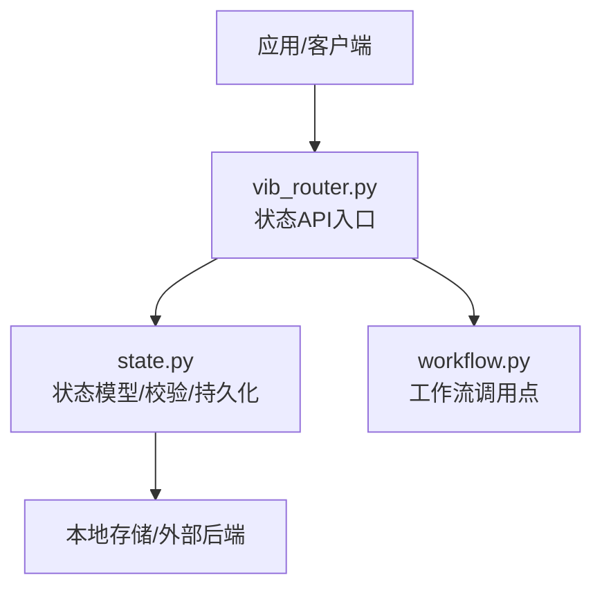
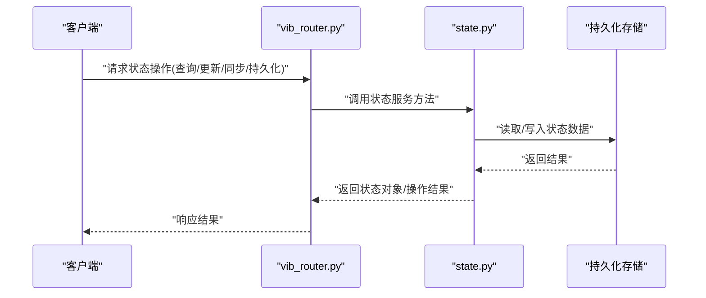
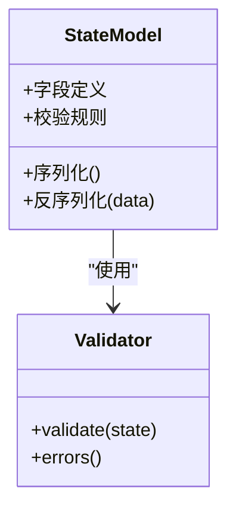
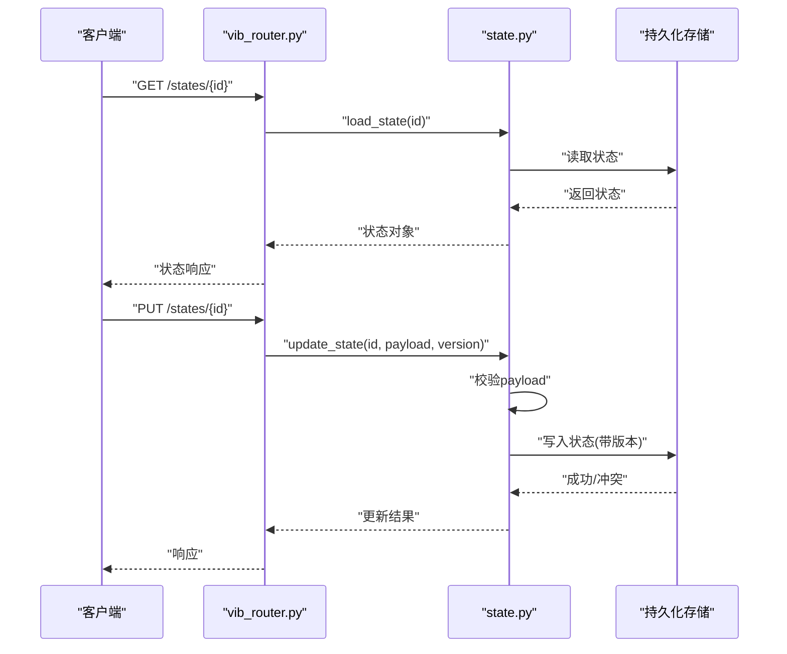
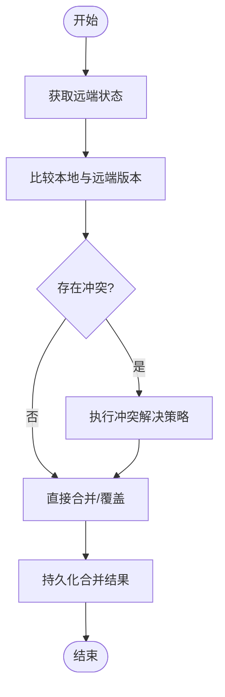
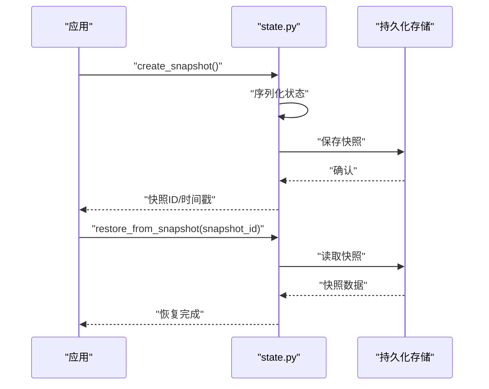
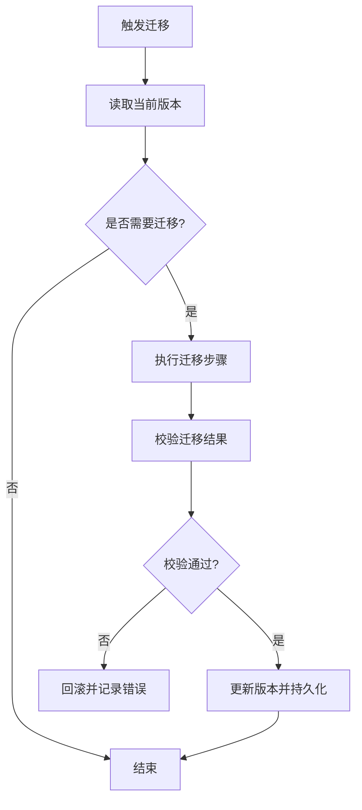
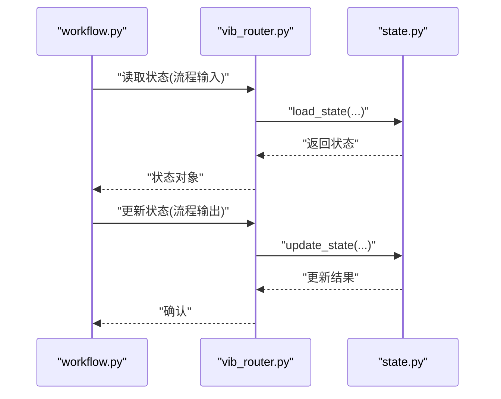

# 状态管理API

<cite>
**本文引用的文件**   
- [src/state.py](file://src/state.py)
- [src/vib_router.py](file://src/vib_router.py)
- [src/workflow.py](file://src/workflow.py)
- [README.md](file://README.md)
</cite>

## 目录
1. [简介](#简介)
2. [项目结构](#项目结构)
3. [核心组件](#核心组件)
4. [架构总览](#架构总览)
5. [详细组件分析](#详细组件分析)
6. [依赖关系分析](#依赖关系分析)
7. [性能考虑](#性能考虑)
8. [故障排查指南](#故障排查指南)
9. [结论](#结论)
10. [附录](#附录)

## 简介
本文件为“状态管理模块”的完整API参考文档，覆盖状态查询、更新、同步与持久化接口；说明状态数据结构、字段定义与验证规则；阐述一致性保证机制与并发访问处理方法；并提供状态恢复、备份与迁移相关接口。同时给出分布式环境下的使用场景与最佳实践建议。

## 项目结构
仓库中与状态管理相关的核心代码位于 src 目录：
- state.py：状态模型、校验、序列化/反序列化、持久化与快照等能力
- vib_router.py：路由层对外暴露的状态操作API（查询、更新、同步、持久化、恢复、备份、迁移）
- workflow.py：工作流编排中对状态的读取与写入调用点

图表来源
- [src/vib_router.py](file://src/vib_router.py)
- [src/state.py](file://src/state.py)
- [src/workflow.py](file://src/workflow.py)

章节来源
- [README.md](file://README.md)

## 核心组件
- 状态模型与校验
  - 负责定义状态的数据结构、字段类型、默认值与约束规则
  - 提供校验器用于入参合法性检查与错误信息聚合
- 状态查询与更新
  - 提供按键或条件查询、增量更新、全量替换等原子操作
  - 支持事务性更新以保证一致性
- 同步与一致性
  - 提供版本控制、冲突检测与合并策略
  - 在分布式环境下通过版本号或时间戳保障最终一致
- 持久化与快照
  - 将状态序列化为可持久化的格式并落盘或写入远端存储
  - 支持快照创建、加载与清理
- 恢复、备份与迁移
  - 从快照或备份恢复状态
  - 支持向后兼容的迁移逻辑以演进状态结构

章节来源
- [src/state.py](file://src/state.py)
- [src/vib_router.py](file://src/vib_router.py)

## 架构总览
状态管理采用分层设计：
- API层（vib_router.py）：统一对外暴露REST/内部RPC风格的状态操作接口
- 领域层（state.py）：封装状态模型、校验、持久化、快照、恢复、备份与迁移
- 编排层（workflow.py）：在工作流中按需读写状态，确保流程内状态可见性与顺序性

图表来源
- [src/vib_router.py](file://src/vib_router.py)
- [src/state.py](file://src/state.py)

## 详细组件分析

### 状态模型与校验（state.py）
- 数据结构
  - 包含主键、版本、时间戳、业务字段集合等
  - 字段具备类型约束与可选/必填标记
- 校验规则
  - 非空校验、范围校验、枚举校验、唯一性校验
  - 复合字段校验（如依赖字段组合）
- 序列化/反序列化
  - 提供稳定格式的序列化方案，便于跨进程/跨节点传输
  - 兼容旧版本的反序列化策略

图表来源
- [src/state.py](file://src/state.py)

章节来源
- [src/state.py](file://src/state.py)

### 状态查询与更新（vib_router.py + state.py）
- 查询接口
  - 按主键查询、条件查询、分页与排序
  - 返回状态对象及元信息（如版本、更新时间）
- 更新接口
  - 增量更新：仅修改指定字段
  - 全量替换：以新状态对象覆盖旧状态
  - 事务性更新：多字段原子变更
- 并发控制
  - 基于版本号的乐观锁
  - 冲突检测与重试策略

图表来源
- [src/vib_router.py](file://src/vib_router.py)
- [src/state.py](file://src/state.py)

章节来源
- [src/vib_router.py](file://src/vib_router.py)
- [src/state.py](file://src/state.py)

### 同步与一致性（vib_router.py + state.py）
- 同步接口
  - 拉取远端最新状态并合并本地差异
  - 推送本地变更到远端
- 一致性机制
  - 版本号/时间戳比较
  - 冲突检测与合并策略（字段级合并、策略选择）
  - 幂等性保证（重复提交不产生副作用）

图表来源
- [src/vib_router.py](file://src/vib_router.py)
- [src/state.py](file://src/state.py)

章节来源
- [src/vib_router.py](file://src/vib_router.py)
- [src/state.py](file://src/state.py)

### 持久化与快照（state.py）
- 持久化
  - 将状态对象序列化为稳定格式后写入存储
  - 支持批量写入与事务边界
- 快照
  - 创建当前状态的快照
  - 从快照恢复状态
  - 清理过期快照

图表来源
- [src/state.py](file://src/state.py)

章节来源
- [src/state.py](file://src/state.py)

### 恢复、备份与迁移（state.py + vib_router.py）
- 恢复
  - 从快照或备份恢复状态
  - 支持选择性恢复（部分字段/子图）
- 备份
  - 导出状态为可归档格式
  - 支持增量备份
- 迁移
  - 向后兼容的迁移脚本
  - 版本升级时的自动迁移流程

图表来源
- [src/state.py](file://src/state.py)
- [src/vib_router.py](file://src/vib_router.py)

章节来源
- [src/state.py](file://src/state.py)
- [src/vib_router.py](file://src/vib_router.py)

### 工作流中的状态使用（workflow.py）
- 在工作流节点中读取状态作为输入
- 在工作流结束时写回状态，确保流程内状态可见性
- 结合事务与重试保证流程可靠性

图表来源
- [src/workflow.py](file://src/workflow.py)
- [src/vib_router.py](file://src/vib_router.py)
- [src/state.py](file://src/state.py)

章节来源
- [src/workflow.py](file://src/workflow.py)
- [src/vib_router.py](file://src/vib_router.py)
- [src/state.py](file://src/state.py)

## 依赖关系分析
- 模块耦合
  - vib_router.py 依赖 state.py 提供的状态服务
  - workflow.py 通过 vib_router.py 间接使用 state.py
- 外部依赖
  - 持久化存储（本地文件或远程后端）
  - 可能的缓存层以提升读性能

图表来源
- [src/workflow.py](file://src/workflow.py)
- [src/vib_router.py](file://src/vib_router.py)
- [src/state.py](file://src/state.py)

章节来源
- [src/workflow.py](file://src/workflow.py)
- [src/vib_router.py](file://src/vib_router.py)
- [src/state.py](file://src/state.py)

## 性能考虑
- 读路径优化
  - 引入缓存层减少热点键的重复读取
  - 分页与投影查询降低网络与序列化开销
- 写路径优化
  - 批量更新与事务合并减少I/O次数
  - 增量更新避免全量覆盖
- 一致性权衡
  - 在高并发下优先保证最终一致性
  - 对强一致场景使用严格版本控制与短事务

## 故障排查指南
- 常见错误
  - 校验失败：检查字段类型、必填项与取值范围
  - 版本冲突：重试更新或采用合并策略
  - 持久化失败：检查存储可用性与权限
- 诊断手段
  - 启用详细日志记录关键操作与错误堆栈
  - 导出快照进行离线分析
  - 对比迁移前后状态差异定位问题

章节来源
- [src/state.py](file://src/state.py)
- [src/vib_router.py](file://src/vib_router.py)

## 结论
本状态管理模块通过清晰的分层设计与完善的校验、同步、持久化与迁移能力，提供了在单机与分布式环境中可靠的状态管理能力。建议在分布式部署中结合版本号与冲突解决策略，配合快照与备份机制，实现高可用与可恢复的状态服务。

## 附录
- 分布式使用建议
  - 使用统一的版本源与时间同步服务
  - 对关键状态开启审计日志与告警
  - 定期演练恢复与迁移流程以确保RTO/RPO目标达成
- 示例场景（描述性）
  - 用户会话状态：查询会话、更新活跃时间、同步至集群、定时快照
  - 任务执行上下文：工作流节点读取上下文、更新进度、冲突合并、失败恢复
  - 配置中心：拉取远端配置、本地缓存、增量同步、灰度迁移