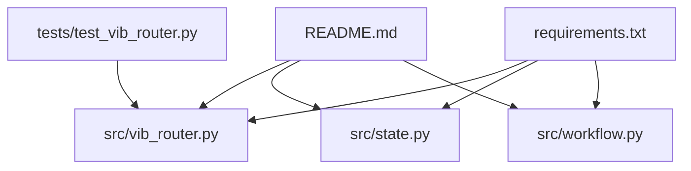
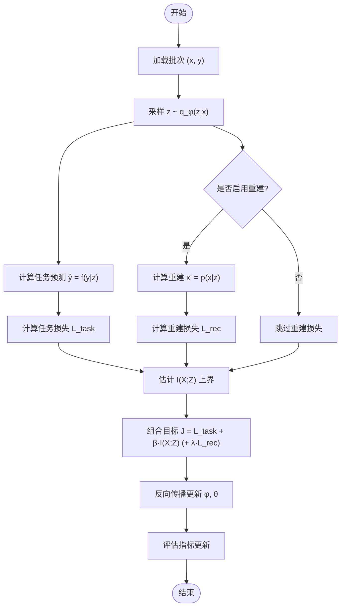
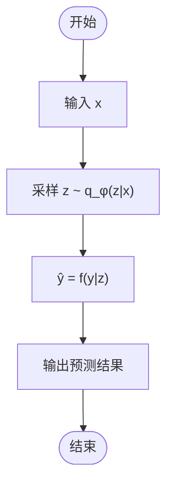
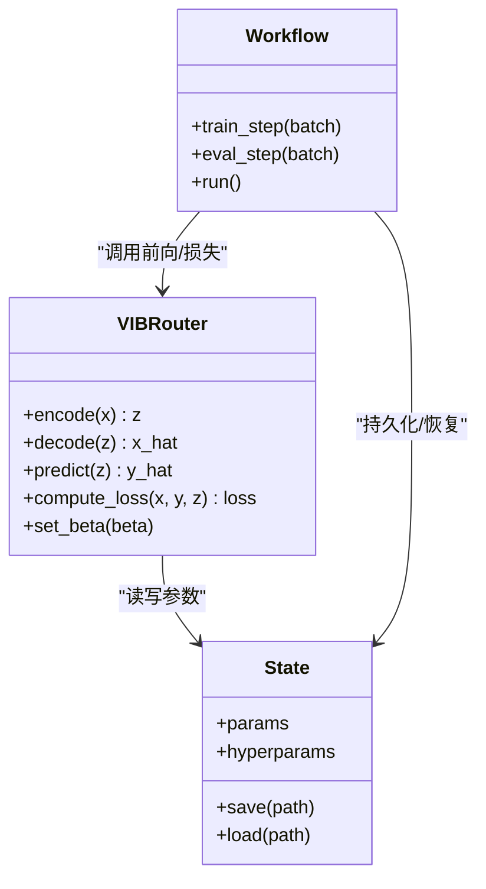
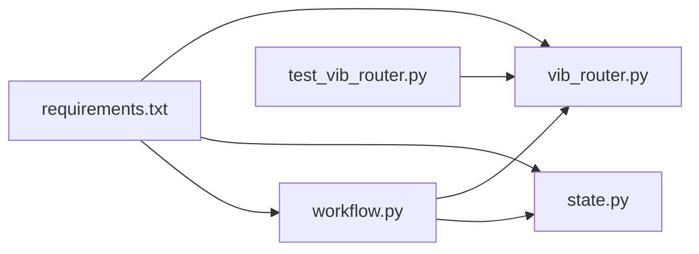

# VIB理论基础

<cite>
**本文引用的文件**   
- [README.md](file://README.md)
- [src/vib_router.py](file://src/vib_router.py)
- [src/state.py](file://src/state.py)
- [src/workflow.py](file://src/workflow.py)
- [tests/test_vib_router.py](file://tests/test_vib_router.py)
- [requirements.txt](file://requirements.txt)
</cite>

## 目录
1. [引言](#引言)
2. [项目结构](#项目结构)
3. [核心组件](#核心组件)
4. [架构总览](#架构总览)
5. [详细组件分析](#详细组件分析)
6. [依赖分析](#依赖分析)
7. [性能考虑](#性能考虑)
8. [故障排查指南](#故障排查指南)
9. [结论](#结论)
10. [附录](#附录)

## 引言
本文件围绕VIB（可变信息瓶颈）理论，系统阐述信息瓶颈（Information Bottleneck, IB）的核心思想与数学基础，并聚焦其在稀疏通信场景中的应用：高维数据的低维表示学习、信息传输效率优化以及噪声鲁棒性。文档同时给出算法流程与图示，对比传统压缩方法的优势，并提供实际应用场景与性能对比思路，兼顾初学者直观理解与专家级数学推导。

## 项目结构
仓库采用“源码+测试+说明”的清晰分层组织：
- src：核心实现模块（路由/状态/工作流）
- tests：单元测试与回归验证
- docs：辅助文档或脚本
- 根目录：说明与运行配置



图表来源
- [README.md](file://README.md)
- [src/vib_router.py](file://src/vib_router.py)
- [src/state.py](file://src/state.py)
- [src/workflow.py](file://src/workflow.py)
- [tests/test_vib_router.py](file://tests/test_vib_router.py)
- [requirements.txt](file://requirements.txt)

章节来源
- [README.md](file://README.md)
- [requirements.txt](file://requirements.txt)

## 核心组件
- 可变信息瓶颈路由器（VIB Router）：负责在发送端对高维输入进行可学习的低维编码，并在接收端进行解码；通过调节“可变瓶颈”强度控制压缩程度与保真度权衡。
- 状态管理（State）：维护训练/推理过程中的关键变量（如编码器/解码器参数、统计量、超参等），支持序列化与恢复。
- 工作流（Workflow）：编排数据加载、前向传播、损失计算、反向传播与评估指标更新，提供端到端的训练与推理管线。

章节来源
- [src/vib_router.py](file://src/vib_router.py)
- [src/state.py](file://src/state.py)
- [src/workflow.py](file://src/workflow.py)

## 架构总览
下图展示了VIB在稀疏通信中的端到端流程：发送端将高维输入映射为低维表示，受可变瓶颈约束以最小化互信息上界；接收端基于该表示进行任务预测；整体通过联合优化目标平衡压缩与任务性能。

```mermaid
sequenceDiagram
participant S as "发送端"
participant R as "接收端"
participant T as "任务头"
participant L as "损失与优化"
S->>S : "输入 x高维"
S->>S : "编码器 q(z|x) 生成 z低维"
S-->>R : "传输 z稀疏/受限带宽"
R->>R : "解码器 p(x|z) 重建 x'可选"
R->>T : "任务头 f(y|z) 预测 y'"
T-->>L : "任务损失 L_task"
R-->>L : "重建损失 L_rec可选"
S-->>L : "互信息上界 I(X;Z) 估计"
L-->>S : "梯度回传更新编码器"
L-->>R : "梯度回传更新解码器/任务头"
```

图表来源
- [src/vib_router.py](file://src/vib_router.py)
- [src/workflow.py](file://src/workflow.py)

## 详细组件分析

### 信息瓶颈理论与VIB数学基础
- 基本思想：在给定输入X与中间表示Z之间建立马尔可夫链 X→Z→Y，目标是最大化任务相关互信息 I(Z;Y)，同时最小化表示与输入的互信息 I(X;Z)，从而获得既具判别力又高度压缩的表示。
- 变分近似：由于真实分布不可求，使用变分族 q_φ(z|x) 近似后验，并用下界/上界进行优化。
- 典型目标函数形式（概念性表达）：
  - 任务项：E_{p(x,y)}[−log p_θ(y|z)]
  - 压缩项：I(X;Z) 的变分上界（常用KL散度形式）
  - 加权组合：J = E[L_task] + β·I(X;Z) 上界
- 可变瓶颈：β 可为输入自适应或随训练动态变化，形成“可变信息瓶颈”，在不同样本或阶段施加不同压缩强度。

章节来源
- [src/vib_router.py](file://src/vib_router.py)
- [src/workflow.py](file://src/workflow.py)

### 稀疏通信中的VIB应用
- 低维表示学习：通过q_φ(z|x)将高维输入压缩到固定维度z，显著降低传输成本。
- 信息传输效率优化：在有限带宽下，VIB自动选择最具任务相关性的特征子集，提升单位比特效用。
- 噪声鲁棒性：压缩过程过滤无关噪声，使z对扰动更稳健，提高下游任务稳定性。

章节来源
- [src/vib_router.py](file://src/vib_router.py)
- [src/workflow.py](file://src/workflow.py)

### 算法流程（训练）


图表来源
- [src/workflow.py](file://src/workflow.py)
- [src/vib_router.py](file://src/vib_router.py)

### 算法流程（推理）


图表来源
- [src/vib_router.py](file://src/vib_router.py)

### 与传统压缩方法的对比
- 传统压缩（如JPEG/PNG/Huffman）：
  - 优势：通用性强、成熟生态、无监督、无需任务信号。
  - 局限：未针对特定任务优化，可能丢弃对任务关键的细节。
- VIB压缩：
  - 优势：任务驱动的特征选择，保证压缩后的表示对任务最优；在稀疏/受限信道中更高效；具备噪声鲁棒性。
  - 局限：需要标注数据与任务模型；训练复杂度更高；需调优β与变分族设计。

章节来源
- [src/vib_router.py](file://src/vib_router.py)
- [src/workflow.py](file://src/workflow.py)

### 代码级组件关系（类/模块）


图表来源
- [src/vib_router.py](file://src/vib_router.py)
- [src/state.py](file://src/state.py)
- [src/workflow.py](file://src/workflow.py)

## 依赖分析
- 外部依赖：由 requirements.txt 声明，通常包含深度学习框架与数值库。
- 内部依赖：
  - workflow 依赖 vib_router 与 state
  - 测试用例依赖 vib_router 的行为契约



图表来源
- [requirements.txt](file://requirements.txt)
- [src/vib_router.py](file://src/vib_router.py)
- [src/state.py](file://src/state.py)
- [src/workflow.py](file://src/workflow.py)
- [tests/test_vib_router.py](file://tests/test_vib_router.py)

章节来源
- [requirements.txt](file://requirements.txt)
- [tests/test_vib_router.py](file://tests/test_vib_router.py)

## 性能考虑
- 表示维度与带宽：z 的维度直接决定传输开销；维度越小，压缩越高但任务性能可能下降，需折中。
- 变分族设计：q_φ(z|x) 的选择影响表达能力与估计质量；常见选择包括对角高斯、混合高斯或离散化方案。
- β调度策略：固定β或自适应β会影响收敛与泛化；可采用预热、余弦退火或基于置信度的动态调整。
- 估计方差：I(X;Z) 的上界估计存在方差，建议采用重参数化技巧与批内统计稳定化。
- 重建损失权重λ：若启用重建，λ过大可能导致过度关注重构而忽略任务，需网格搜索或贝叶斯优化。

## 故障排查指南
- 训练不收敛或发散
  - 检查学习率与β调度是否合理；确认梯度裁剪与数值稳定性设置。
  - 参考训练循环与损失组合逻辑。
- 表示退化（z接近常数）
  - 降低β或引入正则项；检查q_φ的参数化是否过于受限。
- 推理延迟过高
  - 减少z维度或简化q_φ网络；考虑蒸馏或量化部署。
- 复现问题
  - 核对随机种子与数据预处理一致性；确保State保存/加载路径正确。

章节来源
- [src/workflow.py](file://src/workflow.py)
- [src/state.py](file://src/state.py)
- [tests/test_vib_router.py](file://tests/test_vib_router.py)

## 结论
VIB通过任务驱动的压缩机制，在稀疏通信场景中实现了高维到低维的高效表示学习，兼具信息传输效率与噪声鲁棒性。相比传统压缩，VIB能保留对任务最相关的特征，从而在受限带宽下取得更优的任务性能。实践中需结合具体任务与信道条件，合理设计变分族、β调度与损失权重，以获得最佳权衡。

## 附录
- 术语速查
  - 互信息 I(X;Z)：衡量X与Z之间的共享信息量。
  - 变分下界/上界：用可计算的表达式逼近不可求的互信息。
  - 重参数化技巧：使随机采样可微，便于反向传播。
- 实践建议
  - 从较小z维度与中等β起步，逐步调优。
  - 记录I(X;Z)上界估计与任务指标曲线，观察压缩-性能权衡。
  - 在边缘设备部署时，优先优化q_φ的计算图与内存占用。