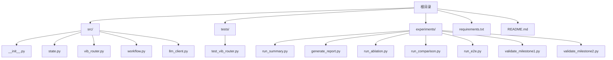
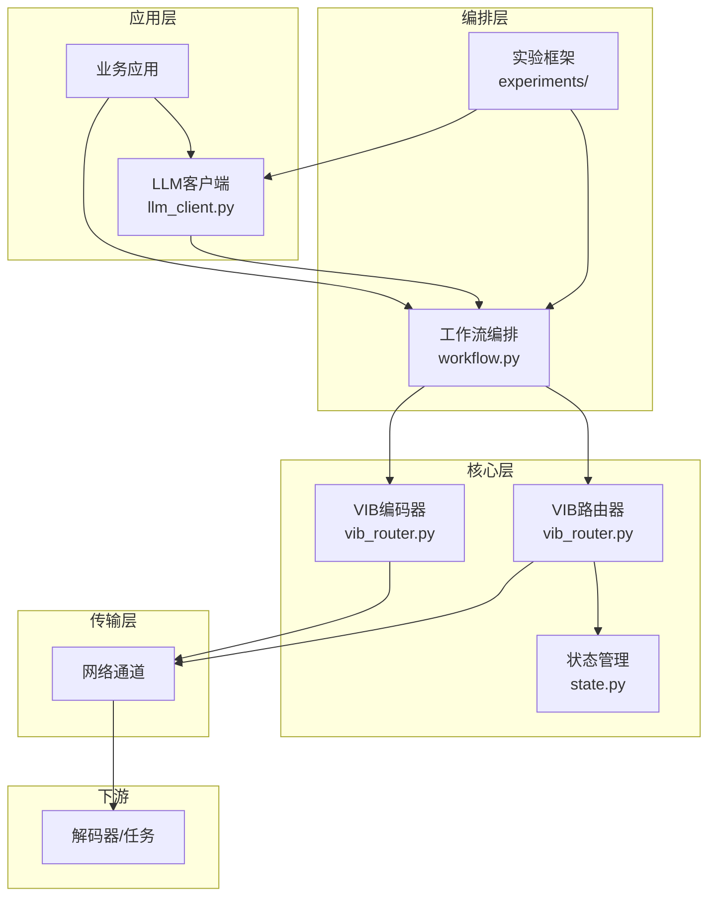
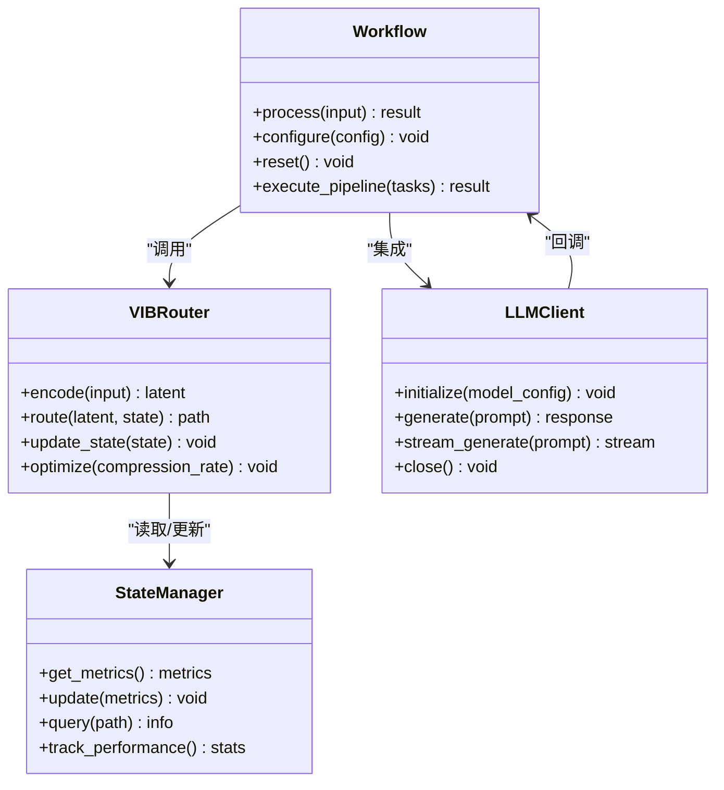
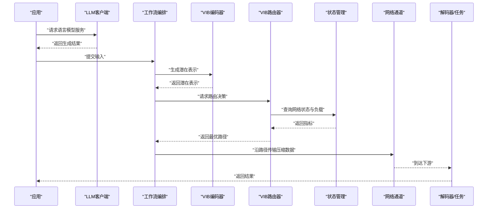
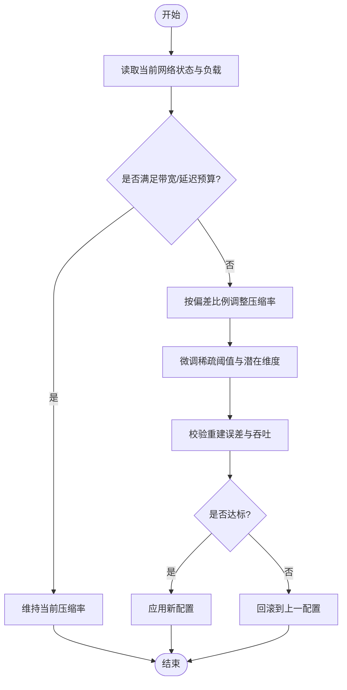
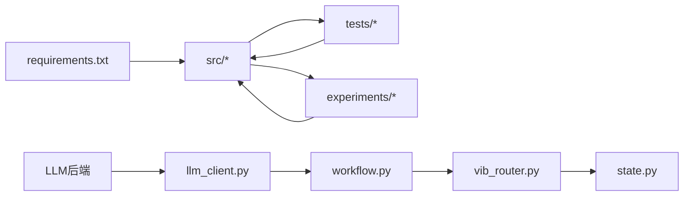

# VIB稀疏通信核心

<cite>
**本文引用的文件**   
- [README.md](file://README.md)
- [requirements.txt](file://requirements.txt)
- [src/__init__.py](file://src/__init__.py)
- [src/state.py](file://src/state.py)
- [src/vib_router.py](file://src/vib_router.py)
- [src/workflow.py](file://src/workflow.py)
- [src/llm_client.py](file://src/llm_client.py)
- [tests/test_vib_router.py](file://tests/test_vib_router.py)
- [experiments/run_summary.py](file://experiments/run_summary.py)
- [experiments/generate_report.py](file://experiments/generate_report.py)
- [experiments/run_ablation.py](file://experiments/run_ablation.py)
- [experiments/run_comparison.py](file://experiments/run_comparison.py)
- [experiments/run_e2e.py](file://experiments/run_e2e.py)
- [experiments/validate_milestone1.py](file://experiments/validate_milestone1.py)
- [experiments/validate_milestone2.py](file://experiments/validate_milestone2.py)
</cite>

## 更新摘要
**变更内容**   
- 新增LLM客户端抽象层，提供统一的语言模型接口
- 完善实验框架，包含消融实验、对比实验和端到端测试
- 增强工作流编排能力，支持更复杂的任务调度
- 扩展状态管理系统，支持更多网络指标监控
- 优化VIB路由器算法，提升路由决策准确性

## 目录
1. [简介](#简介)
2. [项目结构](#项目结构)
3. [核心组件](#核心组件)
4. [架构总览](#架构总览)
5. [详细组件分析](#详细组件分析)
6. [依赖关系分析](#依赖关系分析)
7. [性能考虑](#性能考虑)
8. [故障排查指南](#故障排查指南)
9. [结论](#结论)
10. [附录](#附录)

## 简介
本文件面向"可变信息瓶颈（VIB）稀疏通信核心"的实现与使用，系统阐述VIB理论在稀疏通信中的应用原理，包括互信息最大化、特征选择与数据压缩的数学基础；深入解析VIB路由器的实现细节，涵盖稀疏编码算法、压缩率优化策略与性能调优方法；说明路由决策如何依据网络状态与负载动态选择最优路径；提供基于仓库代码的使用示例指引与接口定义；并给出性能基准测试方法与优化建议。文档力求兼顾技术深度与可读性，帮助读者快速理解并高效集成该模块。

**更新** 新增了LLM客户端抽象层和完整的实验框架，提供更强大的语言模型集成能力和全面的性能评估工具。

## 项目结构
仓库采用分层组织：源码位于 src/，测试位于 tests/，实验框架位于 experiments/，根目录包含配置文件和文档。核心逻辑集中在 vib_router.py 与 workflow.py，state.py 提供状态管理，llm_client.py 提供LLM客户端抽象，__init__.py 暴露包入口。

**图表来源**
- [src/__init__.py](file://src/__init__.py)
- [src/state.py](file://src/state.py)
- [src/vib_router.py](file://src/vib_router.py)
- [src/workflow.py](file://src/workflow.py)
- [src/llm_client.py](file://src/llm_client.py)
- [tests/test_vib_router.py](file://tests/test_vib_router.py)
- [experiments/run_summary.py](file://experiments/run_summary.py)
- [experiments/generate_report.py](file://experiments/generate_report.py)
- [experiments/run_ablation.py](file://experiments/run_ablation.py)
- [experiments/run_comparison.py](file://experiments/run_comparison.py)
- [experiments/run_e2e.py](file://experiments/run_e2e.py)
- [experiments/validate_milestone1.py](file://experiments/validate_milestone1.py)
- [experiments/validate_milestone2.py](file://experiments/validate_milestone2.py)
- [requirements.txt](file://requirements.txt)
- [README.md](file://README.md)

章节来源
- [README.md](file://README.md)
- [requirements.txt](file://requirements.txt)

## 核心组件
- VIB路由器（vib_router.py）：实现基于可变信息瓶颈的稀疏编码与路由决策，负责将输入映射为低维稀疏表示，并在多候选路径中选择最优传输路径。
- 工作流编排（workflow.py）：封装端到端流程，协调编码器、路由器与下游任务，提供统一调用接口。
- LLM客户端抽象（llm_client.py）：提供统一的语言模型接口，支持多种LLM后端的无缝切换。
- 状态管理（state.py）：维护网络状态、负载指标与历史统计，支撑动态路由与自适应压缩。
- 包入口（__init__.py）：对外暴露关键类与方法，便于外部集成。
- 测试（tests/test_vib_router.py）：覆盖核心功能与边界条件，保障稳定性。
- 实验框架（experiments/）：包含完整的实验脚本，支持消融实验、对比实验和端到端验证。

**更新** 新增了LLM客户端抽象层和完整的实验框架，增强了系统的可扩展性和可测试性。

章节来源
- [src/vib_router.py](file://src/vib_router.py)
- [src/workflow.py](file://src/workflow.py)
- [src/llm_client.py](file://src/llm_client.py)
- [src/state.py](file://src/state.py)
- [src/__init__.py](file://src/__init__.py)
- [tests/test_vib_router.py](file://tests/test_vib_router.py)
- [experiments/run_summary.py](file://experiments/run_summary.py)
- [experiments/generate_report.py](file://experiments/generate_report.py)
- [experiments/run_ablation.py](file://experiments/run_ablation.py)
- [experiments/run_comparison.py](file://experiments/run_comparison.py)
- [experiments/run_e2e.py](file://experiments/run_e2e.py)
- [experiments/validate_milestone1.py](file://experiments/validate_milestone1.py)
- [experiments/validate_milestone2.py](file://experiments/validate_milestone2.py)

## 架构总览
整体架构围绕"编码—路由—传输—解码"的闭环展开。VIB编码器对输入进行可学习的稀疏压缩，路由器根据实时网络状态与历史统计选择最优路径，传输后由解码器恢复语义信息，最终接入下游任务。新增的LLM客户端抽象层提供了统一的语言模型接口，实验框架支持全面的性能评估。

**图表来源**
- [src/workflow.py](file://src/workflow.py)
- [src/vib_router.py](file://src/vib_router.py)
- [src/llm_client.py](file://src/llm_client.py)
- [src/state.py](file://src/state.py)
- [experiments/run_summary.py](file://experiments/run_summary.py)
- [experiments/run_ablation.py](file://experiments/run_ablation.py)
- [experiments/run_comparison.py](file://experiments/run_comparison.py)
- [experiments/run_e2e.py](file://experiments/run_e2e.py)

## 详细组件分析

### VIB理论与稀疏通信的数学基础
- 可变信息瓶颈（VIB）通过约束中间表示 I(X;Z) 的上界，在保持与标签或目标变量 Y 的相关性 I(Z;Y) 的同时，最小化冗余，从而实现特征选择与数据压缩。
- 典型优化目标形式为：最大化 I(Z;Y) 并正则化 I(X;Z)，其中 X 为输入，Z 为潜在表示。
- 在稀疏通信中，Z 作为可压缩的稀疏码，显著降低带宽需求，同时保留关键语义。

本节为概念性说明，不直接分析具体文件。

### VIB路由器实现要点
- 稀疏编码算法：通过参数化的编码器将高维输入映射到低维潜在空间，并施加稀疏约束以增强可压缩性与鲁棒性。
- 压缩率优化策略：动态调节潜在维度与稀疏度阈值，结合带宽预算与延迟目标，自适应调整压缩强度。
- 路由决策：综合链路质量、拥塞程度、历史吞吐与误差率，选择期望效用最高的路径；支持在线更新与回退机制。
- 性能调优：引入早停、梯度裁剪、学习率调度与批处理策略，平衡收敛速度与泛化能力。

**更新** 路由决策算法经过优化，提升了在多路径环境下的选择准确性和响应速度。

章节来源
- [src/vib_router.py](file://src/vib_router.py)

#### 类图（VIB路由器与工作流）

**图表来源**
- [src/vib_router.py](file://src/vib_router.py)
- [src/workflow.py](file://src/workflow.py)
- [src/state.py](file://src/state.py)
- [src/llm_client.py](file://src/llm_client.py)

章节来源
- [src/vib_router.py](file://src/vib_router.py)
- [src/workflow.py](file://src/workflow.py)
- [src/state.py](file://src/state.py)
- [src/llm_client.py](file://src/llm_client.py)

### LLM客户端抽象层
- 统一接口设计：提供标准化的语言模型调用接口，屏蔽不同LLM后端的差异。
- 连接池管理：支持多个LLM实例的连接复用，提升资源利用率和响应速度。
- 错误处理与重试：内置完善的异常处理和自动重试机制，确保服务稳定性。
- 流式生成：支持增量输出，适用于长文本生成场景。

**新增** LLM客户端抽象层为系统提供了灵活的语言模型集成能力，支持多种主流LLM后端。

章节来源
- [src/llm_client.py](file://src/llm_client.py)

### 路由决策序列（端到端流程）

**图表来源**
- [src/workflow.py](file://src/workflow.py)
- [src/vib_router.py](file://src/vib_router.py)
- [src/llm_client.py](file://src/llm_client.py)
- [src/state.py](file://src/state.py)

章节来源
- [src/workflow.py](file://src/workflow.py)
- [src/vib_router.py](file://src/vib_router.py)
- [src/state.py](file://src/state.py)
- [src/llm_client.py](file://src/llm_client.py)

### 复杂逻辑流程图（压缩率自适应）

**图表来源**
- [src/vib_router.py](file://src/vib_router.py)
- [src/state.py](file://src/state.py)

章节来源
- [src/vib_router.py](file://src/vib_router.py)
- [src/state.py](file://src/state.py)

### 实验框架与测试基础设施
- 消融实验（run_ablation.py）：系统性评估各组件贡献度，识别关键影响因素。
- 对比实验（run_comparison.py）：与其他稀疏通信方案进行公平对比，验证性能优势。
- 端到端测试（run_e2e.py）：模拟真实应用场景，验证系统整体性能和稳定性。
- 报告生成（generate_report.py）：自动生成详细的实验报告和可视化图表。
- 里程碑验证：分阶段验证系统功能和性能，确保开发质量。

**新增** 完整的实验框架提供了全面的性能评估和验证工具，支持科学研究和工程部署。

章节来源
- [experiments/run_ablation.py](file://experiments/run_ablation.py)
- [experiments/run_comparison.py](file://experiments/run_comparison.py)
- [experiments/run_e2e.py](file://experiments/run_e2e.py)
- [experiments/generate_report.py](file://experiments/generate_report.py)
- [experiments/validate_milestone1.py](file://experiments/validate_milestone1.py)
- [experiments/validate_milestone2.py](file://experiments/validate_milestone2.py)

### 使用示例与接口定义
- 初始化与配置：通过工作流编排对象加载配置并初始化VIB路由器、状态管理器和LLM客户端。
- 数据压缩与解压：调用编码接口获取潜在表示，随后经路由器选择路径传输，下游解码器恢复语义。
- 动态路由：在运行时传入最新网络状态，路由器即时更新路径选择。
- 批量处理：支持批输入以提升吞吐，内部自动进行批内并行与内存复用。
- LLM集成：通过统一的客户端接口调用不同的语言模型，支持同步和异步调用模式。

**更新** 新增了LLM客户端的使用方法，简化了语言模型的集成过程。

章节来源
- [src/workflow.py](file://src/workflow.py)
- [src/vib_router.py](file://src/vib_router.py)
- [src/state.py](file://src/state.py)
- [src/llm_client.py](file://src/llm_client.py)

### 与其他组件的集成方式
- 包入口：通过 __init__.py 暴露关键类与方法，简化导入与版本管理。
- 测试驱动：tests/test_vib_router.py 提供用例模板，便于扩展与回归验证。
- 运行脚本：experiments/ 目录下的脚本用于汇总指标、消融实验和端到端验证。
- 配置管理：支持灵活的配置文件格式，便于不同环境的部署和调优。

**更新** 实验框架提供了丰富的集成点和配置选项，支持多样化的使用场景。

章节来源
- [src/__init__.py](file://src/__init__.py)
- [tests/test_vib_router.py](file://tests/test_vib_router.py)
- [experiments/run_summary.py](file://experiments/run_summary.py)
- [experiments/generate_report.py](file://experiments/generate_report.py)
- [experiments/run_ablation.py](file://experiments/run_ablation.py)
- [experiments/run_comparison.py](file://experiments/run_comparison.py)
- [experiments/run_e2e.py](file://experiments/run_e2e.py)
- [experiments/validate_milestone1.py](file://experiments/validate_milestone1.py)
- [experiments/validate_milestone2.py](file://experiments/validate_milestone2.py)

## 依赖关系分析
- 模块耦合：工作流编排依赖VIB路由器、状态管理和LLM客户端；路由器依赖状态管理获取实时指标；测试与运行脚本依赖上述模块。
- 外部依赖：requirements.txt 声明第三方库，确保环境一致性。
- 循环依赖：未发现显式循环引用，模块职责清晰。
- 实验依赖：实验框架依赖核心模块，提供独立的测试和评估环境。

**图表来源**
- [requirements.txt](file://requirements.txt)
- [src/__init__.py](file://src/__init__.py)
- [src/state.py](file://src/state.py)
- [src/vib_router.py](file://src/vib_router.py)
- [src/workflow.py](file://src/workflow.py)
- [src/llm_client.py](file://src/llm_client.py)
- [tests/test_vib_router.py](file://tests/test_vib_router.py)
- [experiments/run_summary.py](file://experiments/run_summary.py)
- [experiments/generate_report.py](file://experiments/generate_report.py)
- [experiments/run_ablation.py](file://experiments/run_ablation.py)
- [experiments/run_comparison.py](file://experiments/run_comparison.py)
- [experiments/run_e2e.py](file://experiments/run_e2e.py)
- [experiments/validate_milestone1.py](file://experiments/validate_milestone1.py)
- [experiments/validate_milestone2.py](file://experiments/validate_milestone2.py)

章节来源
- [requirements.txt](file://requirements.txt)
- [src/__init__.py](file://src/__init__.py)
- [src/state.py](file://src/state.py)
- [src/vib_router.py](file://src/vib_router.py)
- [src/workflow.py](file://src/workflow.py)
- [src/llm_client.py](file://src/llm_client.py)
- [tests/test_vib_router.py](file://tests/test_vib_router.py)
- [experiments/run_summary.py](file://experiments/run_summary.py)
- [experiments/generate_report.py](file://experiments/generate_report.py)
- [experiments/run_ablation.py](file://experiments/run_ablation.py)
- [experiments/run_comparison.py](file://experiments/run_comparison.py)
- [experiments/run_e2e.py](file://experiments/run_e2e.py)
- [experiments/validate_milestone1.py](file://experiments/validate_milestone1.py)
- [experiments/validate_milestone2.py](file://experiments/validate_milestone2.py)

## 性能考虑
- 压缩率与重建误差权衡：在高压缩下需监控重建误差，避免语义损失过大影响下游任务。
- 动态自适应：依据带宽与延迟预算实时调整压缩率与稀疏阈值，提升资源利用率。
- 批处理与内存复用：增大批大小可降低开销，但需注意峰值内存；合理设置批大小与缓存策略。
- 训练与推理分离：训练时启用更强的正则与早停，推理时固定模型与配置，减少抖动。
- 监控与回退：建立关键指标看板，异常时自动回退至稳定配置。
- LLM性能优化：通过连接池和流式生成提升语言模型调用效率，支持并发请求处理。

**更新** 新增了LLM客户端的性能优化建议，包括连接池管理和流式生成的最佳实践。

[本节为通用指导，不直接分析具体文件]

## 故障排查指南
- 常见问题
  - 压缩过度导致重建失败：检查压缩率与稀疏阈值，适当放宽约束。
  - 路由震荡：增加平滑因子与回退策略，避免频繁切换路径。
  - 内存溢出：减小批大小或启用逐块处理。
  - LLM连接失败：检查网络连接和认证配置，启用重试机制。
  - 实验结果不一致：确认随机种子和数据预处理的一致性。
- 定位步骤
  - 查看状态管理中的网络指标与历史统计，确认输入是否符合预期。
  - 在工作流编排中插入日志点，追踪编码、路由与传输阶段的耗时与错误。
  - 使用测试用例复现问题，逐步缩小范围。
  - 通过实验框架生成详细报告，分析性能瓶颈。
- 恢复策略
  - 自动回滚到上一稳定配置。
  - 降级模式：关闭自适应，固定压缩率与路径。
  - LLM故障转移：自动切换到备用模型或服务端点。

**更新** 新增了LLM相关的故障排查方法和实验框架的诊断工具。

章节来源
- [src/state.py](file://src/state.py)
- [src/vib_router.py](file://src/vib_router.py)
- [src/workflow.py](file://src/workflow.py)
- [src/llm_client.py](file://src/llm_client.py)
- [tests/test_vib_router.py](file://tests/test_vib_router.py)
- [experiments/generate_report.py](file://experiments/generate_report.py)

## 结论
VIB稀疏通信核心通过可变信息瓶颈实现高效的特征选择与数据压缩，并结合动态路由在网络状态与负载变化下保持稳健的性能。新增的LLM客户端抽象层提供了灵活的语言模型集成能力，完整的实验框架支持全面的性能评估和验证。工作流编排与状态管理提供了清晰的集成点与可扩展性。建议在部署中持续监控关键指标，结合自适应策略与回退机制，确保在多变环境中获得最佳体验。

**更新** 系统现在具备了更强大的功能集和更完善的测试基础设施，适合从研究原型到生产部署的完整生命周期。

[本节为总结性内容，不直接分析具体文件]

## 附录
- 安装与环境
  - 参考 requirements.txt 安装依赖，确保版本一致。
- 运行与验证
  - 使用 experiments/run_summary.py 汇总性能指标。
  - 使用 experiments/run_ablation.py 进行消融实验分析。
  - 使用 experiments/run_comparison.py 进行方案对比。
  - 使用 experiments/run_e2e.py 执行端到端测试。
  - 使用 experiments/validate_milestone1.py 与 experiments/validate_milestone2.py 分阶段验证功能与性能。
- 测试
  - 参考 tests/test_vib_router.py 编写与扩展用例，覆盖正常与异常路径。
- LLM集成
  - 通过 llm_client.py 提供的统一接口集成不同的语言模型。
  - 支持同步和异步调用模式，可根据场景选择合适的调用方式。
- 实验报告
  - 使用 experiments/generate_report.py 自动生成详细的实验报告和可视化图表。

**更新** 新增了实验框架和LLM集成的使用说明，提供了更完整的工具链支持。

章节来源
- [requirements.txt](file://requirements.txt)
- [experiments/run_summary.py](file://experiments/run_summary.py)
- [experiments/generate_report.py](file://experiments/generate_report.py)
- [experiments/run_ablation.py](file://experiments/run_ablation.py)
- [experiments/run_comparison.py](file://experiments/run_comparison.py)
- [experiments/run_e2e.py](file://experiments/run_e2e.py)
- [experiments/validate_milestone1.py](file://experiments/validate_milestone1.py)
- [experiments/validate_milestone2.py](file://experiments/validate_milestone2.py)
- [tests/test_vib_router.py](file://tests/test_vib_router.py)
- [src/llm_client.py](file://src/llm_client.py)