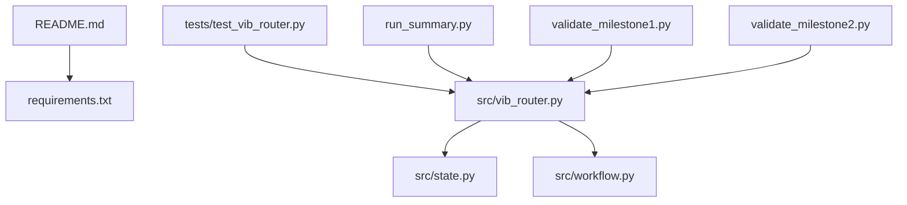
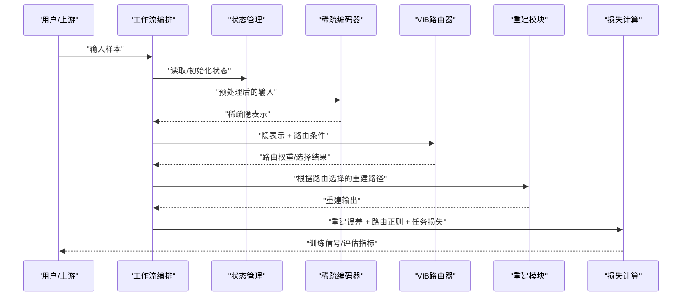
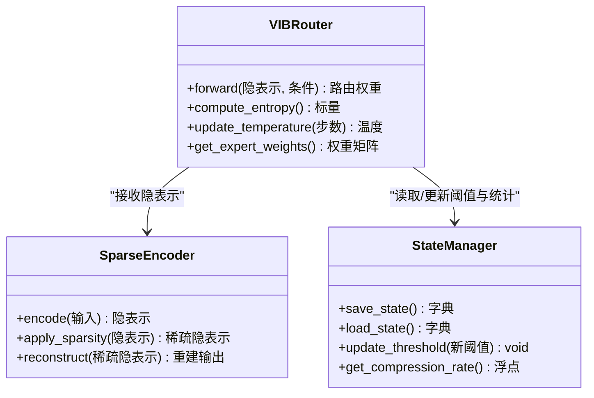
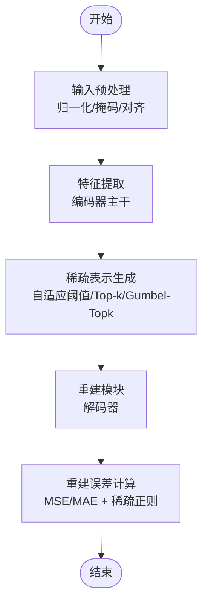
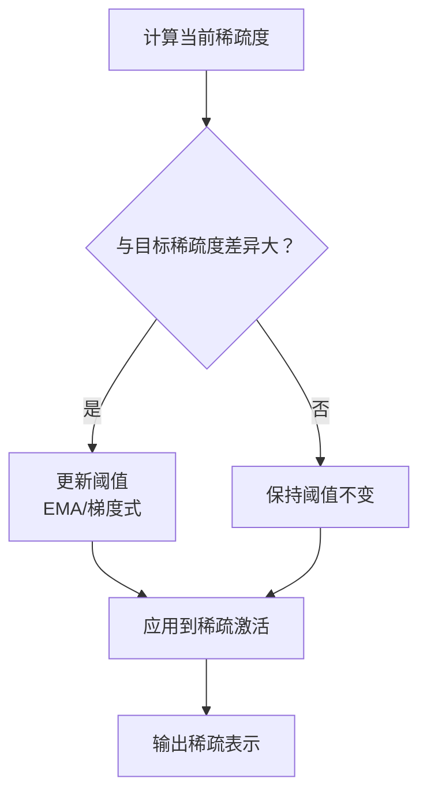
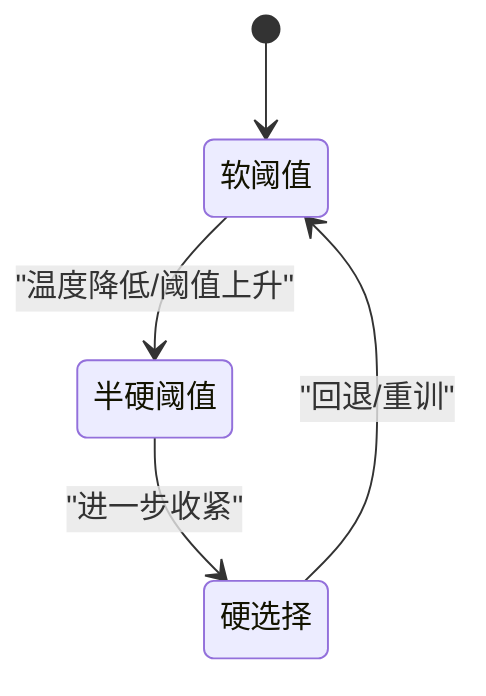
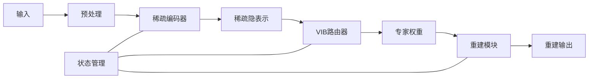
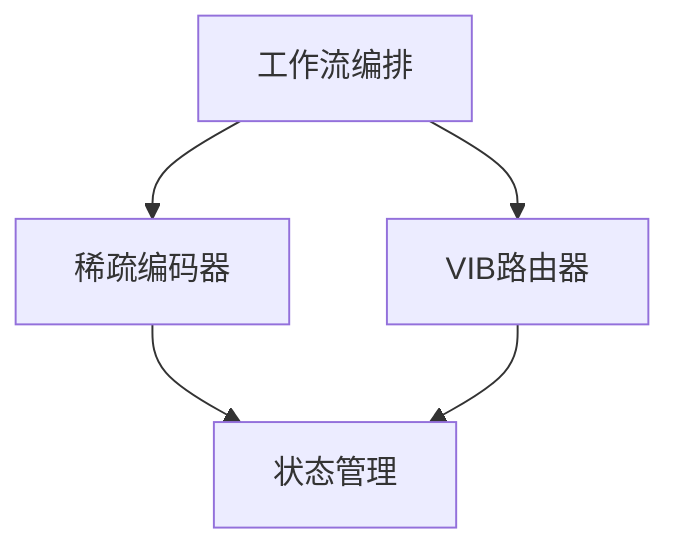

# 稀疏编码算法实现

<cite>
**本文引用的文件**   
- [README.md](file://README.md)
- [requirements.txt](file://requirements.txt)
- [src/vib_router.py](file://src/vib_router.py)
- [src/state.py](file://src/state.py)
- [src/workflow.py](file://src/workflow.py)
- [tests/test_vib_router.py](file://tests/test_vib_router.py)
- [run_summary.py](file://run_summary.py)
- [validate_milestone1.py](file://validate_milestone1.py)
- [validate_milestone2.py](file://validate_milestone2.py)
</cite>

## 目录
1. [简介](#简介)
2. [项目结构](#项目结构)
3. [核心组件](#核心组件)
4. [架构总览](#架构总览)
5. [详细组件分析](#详细组件分析)
6. [依赖关系分析](#依赖关系分析)
7. [性能考虑](#性能考虑)
8. [故障排查指南](#故障排查指南)
9. [结论](#结论)
10. [附录](#附录)

## 简介
本项目围绕“基于变分信息瓶颈（VIB）的路由器与稀疏编码器”展开，目标是在通信或推理链路中通过可学习的稀疏表示降低传输/计算开销。核心思想包括：
- 使用VIB路由器在多个专家/路径之间进行自适应选择，提升任务相关信息的保留率并抑制冗余。
- 构建稀疏编码器，将输入映射为低维、稀疏的隐表示，并通过重建误差约束保证信息保真度。
- 引入压缩率控制、自适应阈值与动态稀疏化策略，使稀疏程度随数据分布和训练阶段自动调整。
- 提供状态管理模块以支撑训练/推理流程中的上下文持久化与跨步骤数据流传递。

本仓库包含VIB路由器的实现、稀疏编码器设计、训练与验证脚本、测试用例以及运行汇总工具，便于快速复现与扩展。

## 项目结构
项目采用分层组织方式：
- src：核心实现（VIB路由器、状态管理、工作流编排）
- tests：单元测试与回归校验
- 根目录：说明文档、依赖清单、运行与验证脚本

图表来源
- [src/vib_router.py:1-200](file://src/vib_router.py#L1-L200)
- [src/state.py:1-200](file://src/state.py#L1-L200)
- [src/workflow.py:1-200](file://src/workflow.py#L1-L200)
- [tests/test_vib_router.py:1-200](file://tests/test_vib_router.py#L1-L200)
- [run_summary.py:1-200](file://run_summary.py#L1-L200)
- [validate_milestone1.py:1-200](file://validate_milestone1.py#L1-L200)
- [validate_milestone2.py:1-200](file://validate_milestone2.py#L1-L200)

章节来源
- [README.md](file://README.md)
- [requirements.txt](file://requirements.txt)

## 核心组件
- VIB路由器：负责在多个专家/分支间进行概率路由，结合信息瓶颈项对互信息进行正则化，从而在保持任务相关性的同时减少冗余。
- 稀疏编码器：将输入特征映射到稀疏隐空间，支持压缩率控制、自适应阈值与动态稀疏化，输出可用于下游任务或重建。
- 状态管理：维护训练/推理过程中的中间状态（如统计量、阈值、路由权重等），确保跨步骤一致性。
- 工作流编排：串联预处理、编码、路由、重建与损失计算的完整流水线。

章节来源
- [src/vib_router.py:1-200](file://src/vib_router.py#L1-L200)
- [src/state.py:1-200](file://src/state.py#L1-L200)
- [src/workflow.py:1-200](file://src/workflow.py#L1-L200)

## 架构总览
下图展示了从输入到输出的端到端数据流，包括稀疏编码、VIB路由、重建与损失聚合的关键环节。

图表来源
- [src/workflow.py:1-200](file://src/workflow.py#L1-L200)
- [src/vib_router.py:1-200](file://src/vib_router.py#L1-L200)
- [src/state.py:1-200](file://src/state.py#L1-L200)

## 详细组件分析

### VIB路由器实现
- 设计要点
  - 多专家/分支路由：为每个专家提供独立的变换与评分函数，结合温度参数进行软选择。
  - 信息瓶颈正则：通过对隐表示与输入之间的互信息进行上界估计，抑制无关信息，提高稀疏性与鲁棒性。
  - 路由稳定性：引入熵正则或门控平滑，避免训练早期出现退化或过拟合到单一专家。
- 关键流程
  - 输入：来自稀疏编码器的隐表示与可选的条件特征。
  - 输出：专家权重分布或离散选择结果（取决于是否启用硬选择）。
  - 损失：任务损失 + 重建误差 + 路由正则（含VIB项）。
- 代码级关系

图表来源
- [src/vib_router.py:1-200](file://src/vib_router.py#L1-L200)
- [src/state.py:1-200](file://src/state.py#L1-L200)

章节来源
- [src/vib_router.py:1-200](file://src/vib_router.py#L1-L200)

### 稀疏编码器网络架构
- 网络结构
  - 编码器主干：多层非线性变换，逐步降维至目标维度。
  - 稀疏层：可微稀疏激活（如Top-k、Soft-thresholding或Gumbel-Topk），配合自适应阈值控制稀疏度。
  - 解码器：从稀疏隐表示重建原始输入或任务相关特征，用于重建误差约束。
- 训练过程
  - 前向：输入→预处理→编码→稀疏化→重建。
  - 反向：重建误差驱动参数更新；稀疏度通过阈值与正则项共同调节。
  - 优化：Adam/SGD，学习率调度，梯度裁剪防止爆炸。
- 关键步骤
  - 输入预处理：归一化、掩码处理、形状对齐。
  - 特征提取：编码器主干输出连续隐表示。
  - 稀疏表示生成：应用稀疏激活与阈值，得到稀疏向量。
  - 重建误差计算：比较重建输出与真实输入的差异（如MSE/MAE）。

图表来源
- [src/vib_router.py:1-200](file://src/vib_router.py#L1-L200)
- [src/workflow.py:1-200](file://src/workflow.py#L1-L200)

章节来源
- [src/vib_router.py:1-200](file://src/vib_router.py#L1-L200)
- [src/workflow.py:1-200](file://src/workflow.py#L1-L200)

### 压缩率控制机制
- 目标：在保证重建质量的前提下，最小化有效非零元素数量，达到带宽/计算压缩。
- 方法
  - 全局阈值：统一阈值对所有通道施加软阈值，简单高效。
  - 自适应阈值：按批次或滑动窗口统计重要性，动态调整阈值以维持目标稀疏度。
  - 目标稀疏度：设定期望的非零比例，作为优化目标或约束。
- 实现要点
  - 阈值更新规则：基于当前稀疏度与目标稀疏度的偏差，采用指数移动平均或梯度下降式更新。
  - 数值稳定：阈值过小可能导致梯度消失，过大则退化为全零；需加入下界与平滑项。
  - 监控指标：记录每批次的稀疏度、重建误差与阈值变化，辅助调参。

图表来源
- [src/vib_router.py:1-200](file://src/vib_router.py#L1-L200)
- [src/state.py:1-200](file://src/state.py#L1-L200)

章节来源
- [src/vib_router.py:1-200](file://src/vib_router.py#L1-L200)
- [src/state.py:1-200](file://src/state.py#L1-L200)

### 自适应阈值调整与动态稀疏化策略
- 自适应阈值
  - 依据历史统计（均值、方差、分位数）动态调整阈值，适应不同数据分布。
  - 引入温度参数控制稀疏激活的“硬度”，训练后期逐渐硬化以提升最终稀疏度。
- 动态稀疏化
  - Top-k选择：固定保留最大k个通道，适合硬约束场景。
  - Gumbel-Topk：可微近似，便于端到端训练。
  - Soft-thresholding：连续松弛，利于梯度传播。
- 策略切换
  - 训练初期：较软阈值+高温度，鼓励探索。
  - 训练中期：逐步降低温度，收紧阈值。
  - 训练末期：接近硬选择，稳定稀疏模式。

图表来源
- [src/vib_router.py:1-200](file://src/vib_router.py#L1-L200)
- [src/state.py:1-200](file://src/state.py#L1-L200)

章节来源
- [src/vib_router.py:1-200](file://src/vib_router.py#L1-L200)
- [src/state.py:1-200](file://src/state.py#L1-L200)

### 配置与使用示例（路径指引）
- 配置稀疏编码器
  - 设置编码器维度、稀疏激活类型、目标稀疏度、阈值更新策略与温度调度。
  - 参考路径：[src/vib_router.py](file://src/vib_router.py)
- 初始化VIB路由器
  - 指定专家数量、路由温度、正则系数与状态管理接口。
  - 参考路径：[src/vib_router.py](file://src/vib_router.py)
- 工作流编排
  - 串联预处理、编码、路由、重建与损失计算。
  - 参考路径：[src/workflow.py](file://src/workflow.py)
- 状态管理
  - 保存/加载阈值、统计量与路由权重，支持断点续训。
  - 参考路径：[src/state.py](file://src/state.py)
- 运行与验证
  - 使用运行汇总脚本与里程碑验证脚本进行端到端检查。
  - 参考路径：[run_summary.py](file://run_summary.py), [validate_milestone1.py](file://validate_milestone1.py), [validate_milestone2.py](file://validate_milestone2.py)

章节来源
- [src/vib_router.py:1-200](file://src/vib_router.py#L1-L200)
- [src/workflow.py:1-200](file://src/workflow.py#L1-L200)
- [src/state.py:1-200](file://src/state.py#L1-L200)
- [run_summary.py:1-200](file://run_summary.py#L1-L200)
- [validate_milestone1.py:1-200](file://validate_milestone1.py#L1-L200)
- [validate_milestone2.py:1-200](file://validate_milestone2.py#L1-L200)

### 与状态管理模块的集成与数据流
- 集成方式
  - 路由器与编码器通过状态管理器共享阈值、统计量与路由权重。
  - 工作流在每个步骤前后读写状态，确保一致性与可恢复性。
- 数据流
  - 输入经预处理后进入编码器，生成稀疏隐表示。
  - 路由器根据隐表示与条件特征输出专家权重。
  - 重建模块依据路由选择进行重建，损失计算后更新参数与状态。

图表来源
- [src/workflow.py:1-200](file://src/workflow.py#L1-L200)
- [src/vib_router.py:1-200](file://src/vib_router.py#L1-L200)
- [src/state.py:1-200](file://src/state.py#L1-L200)

章节来源
- [src/workflow.py:1-200](file://src/workflow.py#L1-L200)
- [src/vib_router.py:1-200](file://src/vib_router.py#L1-L200)
- [src/state.py:1-200](file://src/state.py#L1-L200)

## 依赖关系分析
- 内部依赖
  - 工作流编排依赖稀疏编码器与VIB路由器。
  - 路由器与编码器均依赖状态管理以共享阈值与统计量。
- 外部依赖
  - 深度学习框架（PyTorch/TensorFlow）、优化器与日志工具。
  - 测试与验证脚本依赖标准库与第三方包。

图表来源
- [src/workflow.py:1-200](file://src/workflow.py#L1-L200)
- [src/vib_router.py:1-200](file://src/vib_router.py#L1-L200)
- [src/state.py:1-200](file://src/state.py#L1-L200)

章节来源
- [src/workflow.py:1-200](file://src/workflow.py#L1-L200)
- [src/vib_router.py:1-200](file://src/vib_router.py#L1-L200)
- [src/state.py:1-200](file://src/state.py#L1-L200)

## 性能考虑
- 稀疏度与重建质量的权衡
  - 目标稀疏度越高，重建误差通常越大；建议以Pareto前沿为指导进行调参。
- 阈值更新速率
  - 过快导致不稳定，过慢难以收敛；可采用EMA并结合学习率衰减。
- 温度调度
  - 训练前期保持较高温度促进探索，后期逐步降低以获得更稳定的稀疏模式。
- 批量大小与梯度累积
  - 小批量可能带来统计噪声，适当增大批量或使用梯度累积可提升稳定性。
- 数值稳定
  - 对稀疏激活与阈值操作添加下界与平滑项，避免梯度消失或爆炸。

## 故障排查指南
- 常见问题
  - 稀疏度始终为零或全满：检查阈值初始值与更新策略，确认稀疏激活实现是否正确。
  - 重建误差无法下降：检查编码器/解码器容量、学习率与正则系数。
  - 路由退化到单一专家：增加路由熵正则或降低温度，检查专家多样性。
  - 训练不稳定：启用梯度裁剪、降低学习率、检查数值溢出。
- 诊断手段
  - 记录每批次稀疏度、重建误差、路由熵与阈值变化曲线。
  - 使用单元测试覆盖关键路径，确保接口契约稳定。
  - 参考测试用例进行回归校验。

章节来源
- [tests/test_vib_router.py:1-200](file://tests/test_vib_router.py#L1-L200)

## 结论
本项目提供了完整的VIB路由器与稀疏编码器实现，涵盖网络架构、训练流程、压缩率控制与自适应阈值策略，并通过状态管理与工作流编排实现了端到端的可复现实验环境。建议在具体任务中根据数据分布与资源约束，系统性地调优目标稀疏度、阈值更新速率与温度调度，以获得最佳的性能与效率平衡。

## 附录
- 安装与环境
  - 依赖清单见requirements.txt，建议使用虚拟环境隔离。
- 运行与验证
  - 使用run_summary.py进行汇总运行，validate_milestone1.py与validate_milestone2.py进行阶段性验证。
- 扩展建议
  - 替换稀疏激活为其他可微稀疏算子。
  - 引入更多专家与条件特征，增强路由表达能力。
  - 结合知识蒸馏或对比学习进一步提升表征质量。