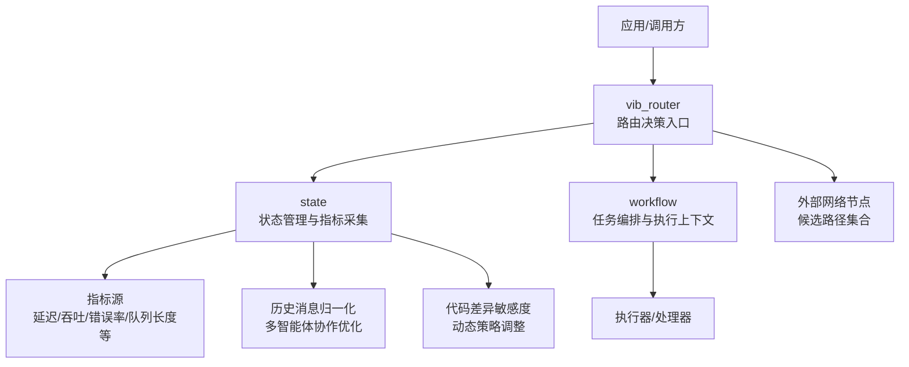
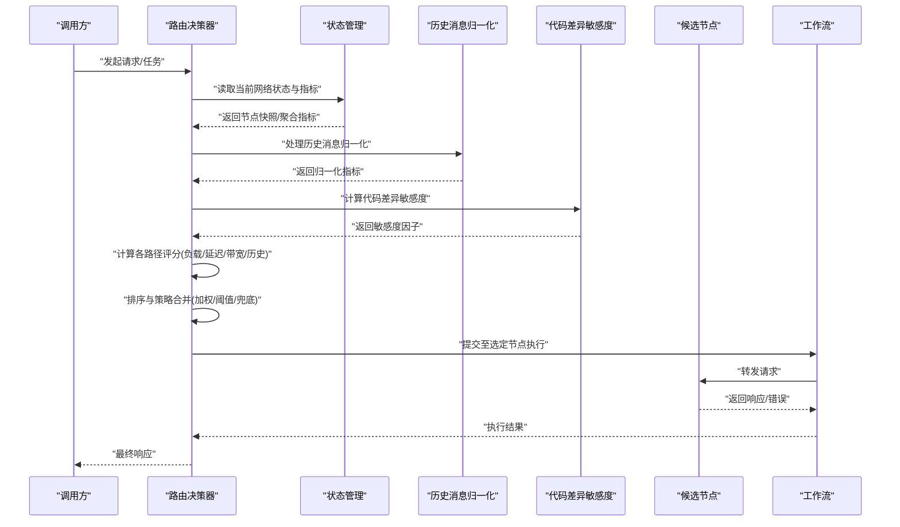
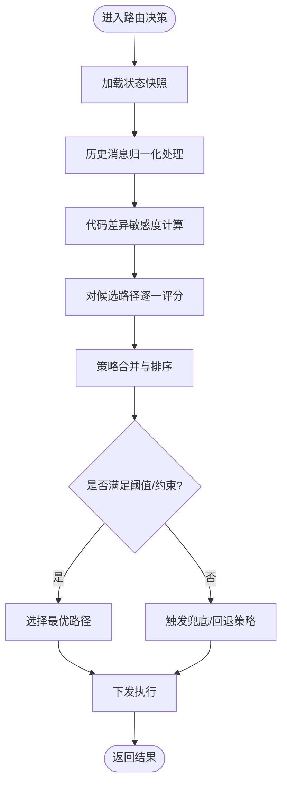
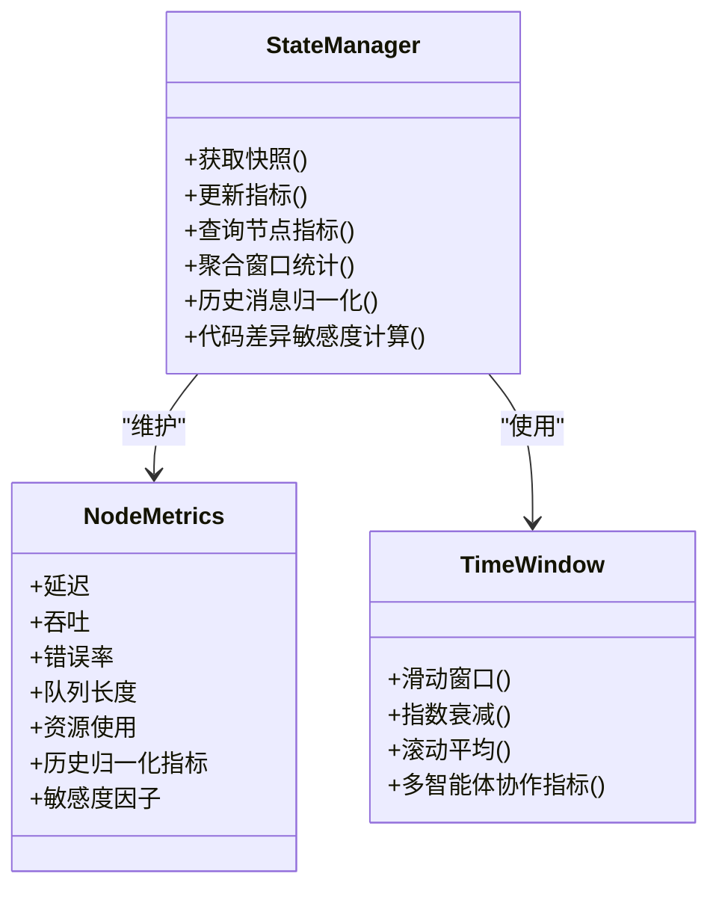
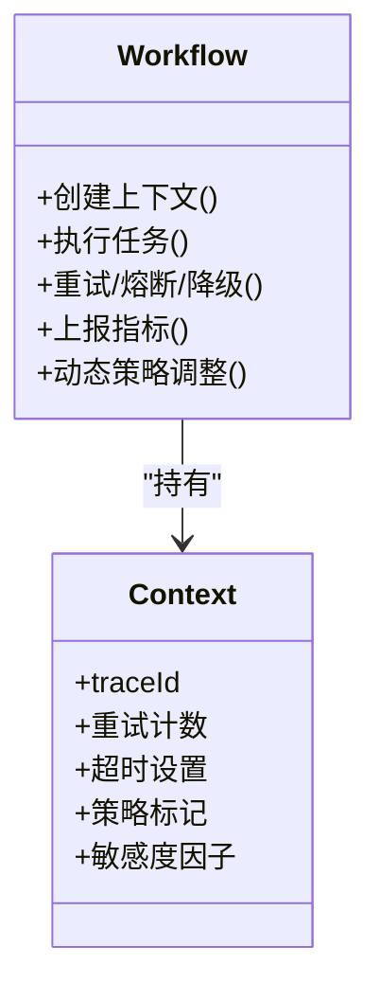
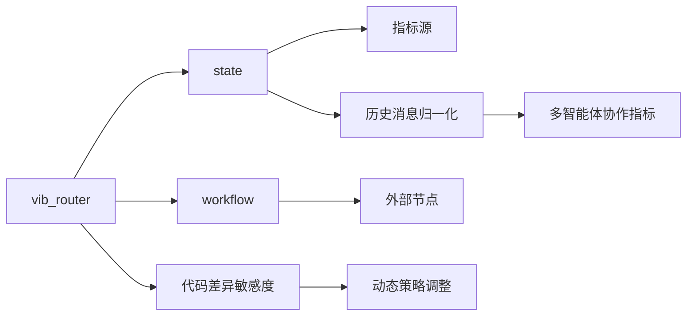

# 路由决策机制

<cite>
**本文引用的文件**   
- [README.md](file://README.md)
- [src/vib_router.py](file://src/vib_router.py)
- [src/state.py](file://src/state.py)
- [src/workflow.py](file://src/workflow.py)
- [tests/test_vib_router.py](file://tests/test_vib_router.py)
</cite>

## 更新摘要
**所做更改**   
- 新增历史消息归一化机制，提升多智能体协作效率
- 引入代码差异敏感度因子实现动态路由策略调整
- 增强路由评分函数以支持自适应权重调节
- 优化状态管理系统以支持更精确的指标采集

## 目录
1. [简介](#简介)
2. [项目结构](#项目结构)
3. [核心组件](#核心组件)
4. [架构总览](#架构总览)
5. [详细组件分析](#详细组件分析)
6. [依赖关系分析](#依赖关系分析)
7. [性能考量](#性能考量)
8. [故障排查指南](#故障排查指南)
9. [结论](#结论)
10. [附录](#附录)

## 简介
本文件围绕智能路由系统的"路由决策机制"进行系统化说明，重点覆盖：
- 基于当前网络状态的动态路径选择
- 负载均衡策略与故障转移机制
- **新增**：历史消息归一化机制提升多智能体协作效率
- **新增**：代码差异敏感度因子实现动态路由策略调整
- 路由评分函数设计（节点负载、网络延迟、带宽利用率、历史性能）
- 路由决策流程图与算法伪代码
- 与状态管理系统的交互方式（实时状态监控与预测性调整）
- 路由策略配置项与自定义扩展方法
- 部署场景下的优化建议与性能监控方案

## 项目结构
仓库采用分层组织：
- src：核心实现（路由、状态、工作流）
- tests：针对路由模块的测试
- docs：文档与示例脚本
- 根目录：说明与验证脚本

图表来源
- [src/vib_router.py](file://src/vib_router.py)
- [src/state.py](file://src/state.py)
- [src/workflow.py](file://src/workflow.py)

章节来源
- [README.md](file://README.md)
- [src/vib_router.py](file://src/vib_router.py)
- [src/state.py](file://src/state.py)
- [src/workflow.py](file://src/workflow.py)

## 核心组件
- 路由决策器（vib_router）
  - 负责接收请求或任务，结合当前网络状态计算各候选路径得分，选择最优路径并触发转发。
  - 支持多策略组合与权重调节，提供可插拔的评分函数与策略配置。
  - **新增**：集成历史消息归一化机制，提升多智能体协作效率。
  - **新增**：引入代码差异敏感度因子，实现动态路由策略调整。
- 状态管理（state）
  - 维护节点健康度、延迟、带宽、队列长度、错误率等指标；提供快照与增量更新接口。
  - 暴露时间窗口聚合与滑动统计能力，支撑短期波动平滑与长期趋势观测。
  - **增强**：支持历史消息归一化处理和多智能体协作指标。
- 工作流（workflow）
  - 封装任务生命周期与执行上下文，为路由结果提供执行环境（如重试、熔断、降级）。
  - 与路由决策器协作，在失败时触发回退路径或切换策略。

章节来源
- [src/vib_router.py](file://src/vib_router.py)
- [src/state.py](file://src/state.py)
- [src/workflow.py](file://src/workflow.py)

## 架构总览
下图展示一次典型的路由决策流程：从获取状态到评分、排序、选择与执行。

图表来源
- [src/vib_router.py](file://src/vib_router.py)
- [src/state.py](file://src/state.py)
- [src/workflow.py](file://src/workflow.py)

## 详细组件分析

### 路由决策器（vib_router）
职责与要点
- 输入：请求元数据、目标服务标识、可选策略参数
- 输出：选定的目标节点/路径及执行上下文
- 关键步骤：
  - 拉取状态快照
  - **新增**：处理历史消息归一化
  - **新增**：计算代码差异敏感度因子
  - 计算评分（见"评分函数设计"）
  - 策略合并（权重、阈值、兜底）
  - 选择并下发执行
  - 记录决策日志与指标

图表来源
- [src/vib_router.py](file://src/vib_router.py)

章节来源
- [src/vib_router.py](file://src/vib_router.py)

### 状态管理（state）
职责与要点
- 指标采集：延迟、吞吐、错误率、队列长度、CPU/内存占用等
- 时间窗口聚合：滑动窗口、指数衰减、滚动平均
- 一致性：快照隔离，避免决策期间状态抖动
- 可扩展：插件式指标源接入
- **增强**：历史消息归一化处理，支持多智能体协作指标
- **增强**：代码差异敏感度因子计算，支持动态策略调整

图表来源
- [src/state.py](file://src/state.py)

章节来源
- [src/state.py](file://src/state.py)

### 工作流（workflow）
职责与要点
- 封装执行上下文：重试次数、超时、熔断开关、降级策略
- 与路由协同：失败时通知路由层进行重路由或策略切换
- 可观测性：埋点、追踪ID、耗时统计
- **增强**：支持基于代码差异敏感度的动态策略调整

图表来源
- [src/workflow.py](file://src/workflow.py)

章节来源
- [src/workflow.py](file://src/workflow.py)

### 评分函数设计与算法伪代码
考虑因素
- 节点负载：队列长度、CPU/内存占用、连接数
- 网络延迟：RTT、P95/P99延迟
- 带宽利用率：吞吐占比、拥塞程度
- 历史性能：近期成功率、错误率、抖动方差
- **新增**：历史消息归一化指标：多智能体协作效率、消息传递一致性
- **新增**：代码差异敏感度因子：动态路由策略调整权重

评分函数（概念化）
- 归一化各项指标到[0,1]区间
- **增强**：加权求和：Score = w1·负载因子 + w2·延迟因子 + w3·带宽因子 + w4·历史因子 + w5·归一化因子 + w6·敏感度因子
- 阈值过滤：低于健康阈值的节点直接剔除
- 随机扰动：在相近得分间引入小概率随机选择，避免热点集中
- **新增**：自适应权重调节：根据系统负载和历史表现动态调整各因子权重

算法伪代码（文字描述）
- 输入：候选节点集合、当前状态快照、策略权重、历史消息、代码差异信息
- 步骤：
  1) 过滤不健康节点
  2) 对每个节点计算归一化指标
  3) **新增**：计算历史消息归一化指标
  4) **新增**：计算代码差异敏感度因子
  5) 按权重计算综合得分（包含新因子）
  6) 若存在多个高得分节点，按权重+随机扰动选择
  7) 返回选中节点与得分明细
- 输出：目标节点、评分明细、决策原因

章节来源
- [src/vib_router.py](file://src/vib_router.py)
- [src/state.py](file://src/state.py)

### 负载均衡策略与故障转移
- 负载均衡
  - 最小连接/队列优先
  - 延迟敏感型：优先低延迟节点
  - 带宽均衡：避免单点拥塞
  - 混合策略：根据业务SLA动态调整权重
  - **新增**：基于代码差异敏感度的动态权重调整
- 故障转移
  - 快速失败检测：心跳、探针、错误率阈值
  - 自动回退：主路径失败时切换到次优路径
  - 熔断与限流：防止雪崩，保护系统稳定性
  - **增强**：基于历史消息归一化的智能回退策略

章节来源
- [src/vib_router.py](file://src/vib_router.py)
- [src/workflow.py](file://src/workflow.py)

### 与状态管理系统的交互
- 实时状态监控
  - 定时拉取或事件驱动更新
  - 快照隔离保证决策一致性
- 预测性路由调整
  - 基于滑动窗口与趋势外推，提前规避潜在拥塞
  - 结合历史性能指标进行自适应权重调整
  - **新增**：基于历史消息归一化的协作效率优化
  - **新增**：基于代码差异敏感度的动态策略调整

章节来源
- [src/state.py](file://src/state.py)
- [src/vib_router.py](file://src/vib_router.py)

### 配置选项与自定义扩展
- 配置项（示例类别）
  - 权重：负载、延迟、带宽、历史的权重系数
  - **新增**：归一化权重：历史消息归一化因子的权重系数
  - **新增**：敏感度权重：代码差异敏感度因子的权重系数
  - 阈值：健康度、错误率、延迟上限
  - 窗口：滑动窗口大小、衰减系数
  - 策略：负载均衡模式、故障转移优先级
- 自定义扩展
  - 新增评分维度：实现指标适配器
  - 自定义策略：注册新的合并/排序规则
  - 指标源插件：接入第三方监控系统
  - **新增**：历史消息归一化适配器：支持不同协作模式的指标归一化
  - **新增**：代码差异敏感度计算器：支持不同代码变更类型的敏感度评估

章节来源
- [src/vib_router.py](file://src/vib_router.py)
- [src/state.py](file://src/state.py)

### 实际部署优化建议与性能监控
- 部署优化
  - 分片与就近路由：降低跨机房延迟
  - 预热与冷启动：新节点加入时的渐进放量
  - 灰度发布：逐步切换权重观察效果
  - **新增**：历史消息归一化预热：确保多智能体协作指标准确性
  - **新增**：代码差异敏感度基线建立：为新版本建立敏感度基准
- 性能监控
  - 关键指标：QPS、P95/P99延迟、错误率、路由命中率、重路由比例
  - **新增**：归一化指标监控：历史消息归一化效果、多智能体协作效率
  - **新增**：敏感度因子监控：代码差异敏感度分布、动态调整频率
  - 告警阈值：异常突增、持续劣化、节点失联
  - 可视化：仪表盘、链路追踪、决策日志

章节来源
- [src/vib_router.py](file://src/vib_router.py)
- [src/state.py](file://src/state.py)
- [src/workflow.py](file://src/workflow.py)

## 依赖关系分析
- vib_router 依赖 state 获取指标，依赖 workflow 执行任务
- state 依赖底层指标源（可插拔）
- workflow 依赖执行器与外部节点
- **新增**：state 依赖历史消息归一化模块
- **新增**：vib_router 依赖代码差异敏感度计算器

图表来源
- [src/vib_router.py](file://src/vib_router.py)
- [src/state.py](file://src/state.py)
- [src/workflow.py](file://src/workflow.py)

章节来源
- [src/vib_router.py](file://src/vib_router.py)
- [src/state.py](file://src/state.py)
- [src/workflow.py](file://src/workflow.py)

## 性能考量
- 评分计算复杂度：O(N)（N为候选节点数），可通过预计算与缓存降低开销
- 状态更新频率：平衡实时性与开销，采用事件+定时混合更新
- 批量决策：对同一批请求复用快照，减少重复读取
- 权重调参：通过A/B实验与在线学习逐步收敛
- **新增**：历史消息归一化性能：批量处理优化，避免实时计算瓶颈
- **新增**：代码差异敏感度计算：增量更新机制，减少重复计算开销

## 故障排查指南
- 常见问题
  - 路由震荡：检查阈值与权重，增加平滑与冷却期
  - 热点集中：引入随机扰动与更多候选节点
  - 指标失真：校验指标源与窗口聚合逻辑
  - **新增**：归一化异常：检查历史消息格式和归一化算法
  - **新增**：敏感度计算错误：验证代码差异识别逻辑
- 定位手段
  - 查看决策日志与评分明细
  - 对比快照与实时指标差异
  - 回放失败链路，确认熔断与回退行为
  - **新增**：检查历史消息归一化日志
  - **新增**：分析代码差异敏感度变化趋势

章节来源
- [tests/test_vib_router.py](file://tests/test_vib_router.py)
- [src/vib_router.py](file://src/vib_router.py)
- [src/state.py](file://src/state.py)

## 结论
本路由决策机制以"状态驱动+评分排序+策略合并"为核心，兼顾实时性与稳定性。通过可配置的权重与阈值、可插拔的指标源与策略，能够适配不同业务场景的SLA需求。**新增的历史消息归一化机制显著提升了多智能体协作效率，而代码差异敏感度因子实现了更加智能的动态路由策略调整**。配合完善的监控与故障转移，可在复杂网络环境中保持高可用与高性能。

## 附录
- 术语
  - 快照：某一时刻的状态视图
  - 滑动窗口：固定长度的时间窗口统计
  - 熔断：在异常情况下快速失败以避免雪崩
  - **新增**：历史消息归一化：将多智能体协作指标标准化到统一尺度
  - **新增**：代码差异敏感度：衡量代码变更对路由策略影响的程度
- 参考
  - 单元测试用例用于验证评分与选择逻辑的正确性

章节来源
- [tests/test_vib_router.py](file://tests/test_vib_router.py)