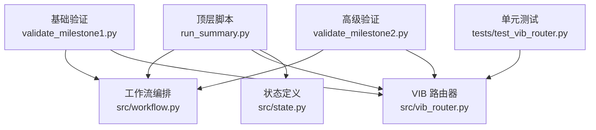
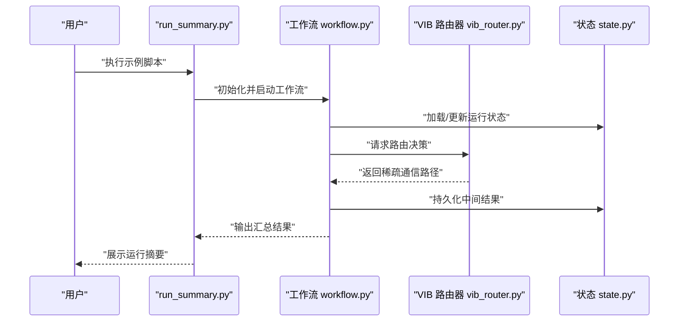
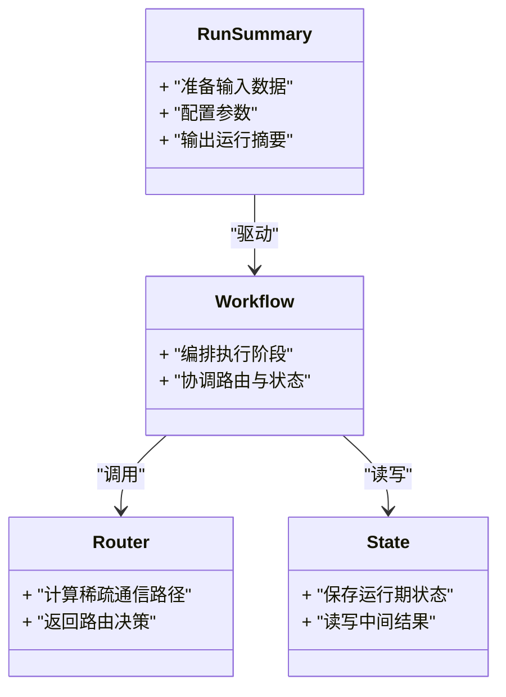
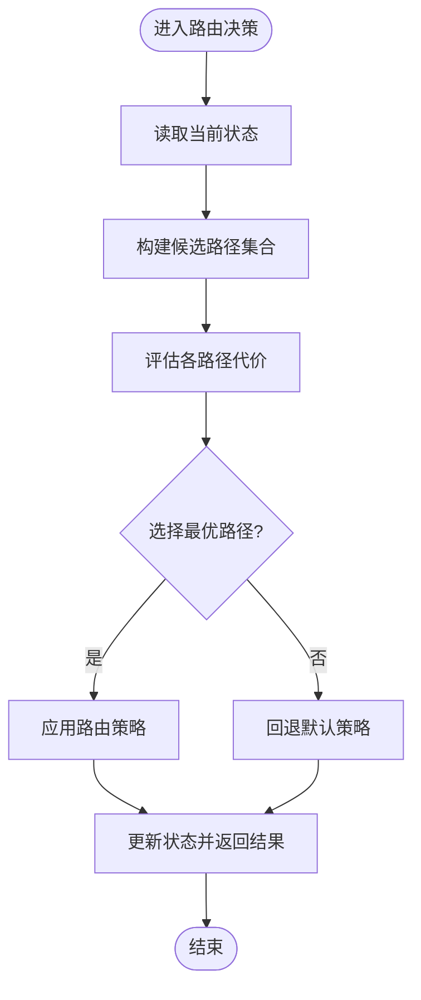
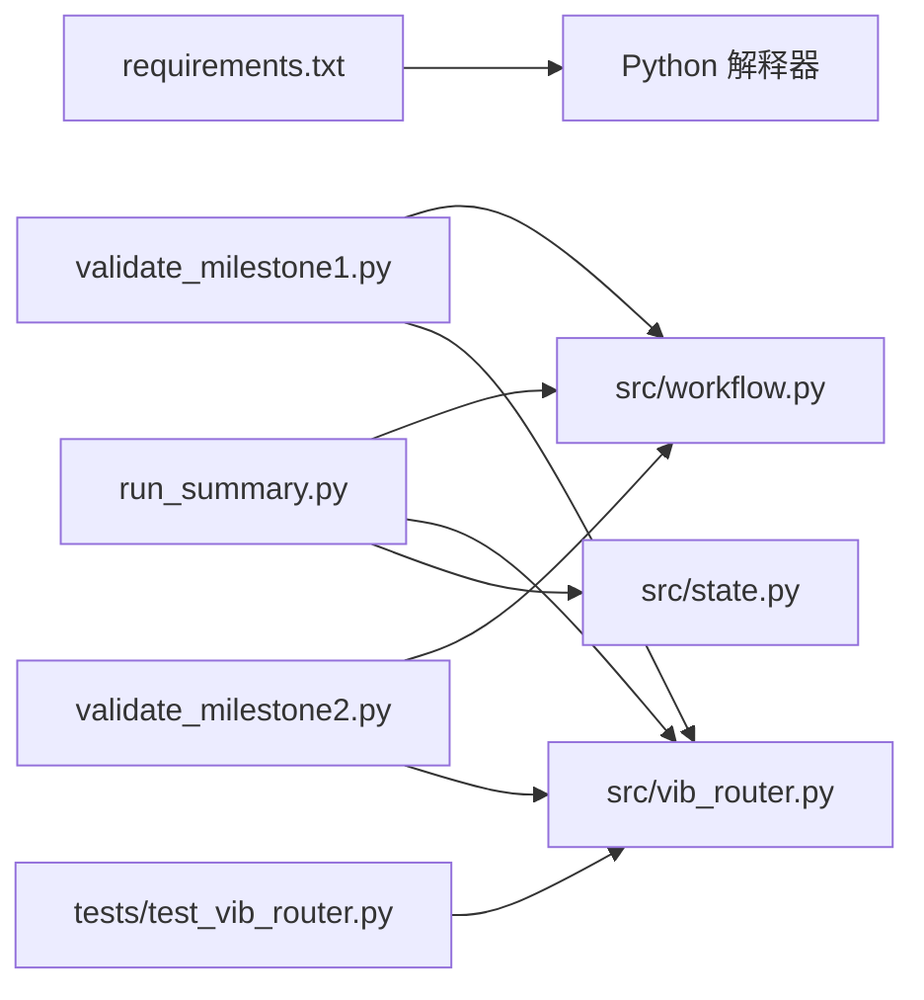

# 快速开始

<cite>
**本文引用的文件**   
- [README.md](file://README.md)
- [requirements.txt](file://requirements.txt)
- [run_summary.py](file://run_summary.py)
- [validate_milestone1.py](file://validate_milestone1.py)
- [validate_milestone2.py](file://validate_milestone2.py)
- [src/state.py](file://src/state.py)
- [src/vib_router.py](file://src/vib_router.py)
- [src/workflow.py](file://src/workflow.py)
- [tests/test_vib_router.py](file://tests/test_vib_router.py)
</cite>

## 目录
1. [简介](#简介)
2. [项目结构](#项目结构)
3. [核心组件](#核心组件)
4. [架构总览](#架构总览)
5. [详细组件分析](#详细组件分析)
6. [依赖关系分析](#依赖关系分析)
7. [性能注意事项](#性能注意事项)
8. [故障排除指南](#故障排除指南)
9. [结论](#结论)
10. [附录](#附录) 

## 简介
本快速开始指南面向首次接触 VIB-SparseCommunication 的用户，目标是在 30 分钟内完成环境准备、依赖安装与示例运行，并理解基础功能与高级功能的验证流程。你将通过以下脚本完成端到端体验：
- run_summary.py：完整系统运行示例（输入数据准备、参数配置、结果查看）
- validate_milestone1.py：基础功能验证
- validate_milestone2.py：高级功能验证

## 项目结构
仓库采用“入口脚本 + 核心源码 + 测试”的清晰分层组织方式：
- 顶层脚本提供一键式运行与验证能力
- src 目录包含状态管理、路由与工作流等核心模块
- tests 目录包含关键模块的单元测试

图表来源
- [run_summary.py](file://run_summary.py)
- [src/workflow.py](file://src/workflow.py)
- [src/vib_router.py](file://src/vib_router.py)
- [src/state.py](file://src/state.py)
- [validate_milestone1.py](file://validate_milestone1.py)
- [validate_milestone2.py](file://validate_milestone2.py)
- [tests/test_vib_router.py](file://tests/test_vib_router.py)

章节来源
- [README.md](file://README.md)
- [requirements.txt](file://requirements.txt)

## 核心组件
- 工作流编排（workflow）：负责整体任务调度、阶段划分与执行顺序控制
- VIB 路由器（vib_router）：实现稀疏通信路径选择与路由策略
- 状态管理（state）：集中维护运行期状态与中间结果
- 顶层脚本：封装典型使用场景，降低上手门槛

章节来源
- [src/workflow.py](file://src/workflow.py)
- [src/vib_router.py](file://src/vib_router.py)
- [src/state.py](file://src/state.py)

## 架构总览
下图展示了从用户脚本到核心模块的调用关系与数据流向。

图表来源
- [run_summary.py](file://run_summary.py)
- [src/workflow.py](file://src/workflow.py)
- [src/vib_router.py](file://src/vib_router.py)
- [src/state.py](file://src/state.py)

## 详细组件分析

### 运行示例：run_summary.py
该脚本用于演示完整系统的运行流程，包括：
- 输入数据准备：构造或加载必要的输入数据
- 参数配置：设置工作流与路由相关的关键参数
- 执行与汇总：驱动工作流执行并生成运行摘要

建议步骤
- 在仓库根目录执行脚本
- 观察控制台输出的运行摘要与关键指标
- 根据提示检查输出文件或日志位置

章节来源
- [run_summary.py](file://run_summary.py)

### 基础功能验证：validate_milestone1.py
该脚本用于验证基础能力，例如：
- 最小可用工作流链路
- 基本路由逻辑
- 状态读写与一致性

建议步骤
- 在仓库根目录执行脚本
- 确认所有断言通过且无异常抛出
- 若失败，参考“故障排除指南”定位问题

章节来源
- [validate_milestone1.py](file://validate_milestone1.py)

### 高级功能验证：validate_milestone2.py
该脚本用于验证更复杂的能力，例如：
- 多阶段工作流组合
- 稀疏通信路径优化
- 状态迁移与回滚

建议步骤
- 在仓库根目录执行脚本
- 关注高级用例是否按预期通过
- 记录失败分支以便后续排查

章节来源
- [validate_milestone2.py](file://validate_milestone2.py)

### 核心类与模块关系
下面的类图展示了核心模块之间的依赖关系与职责边界。

图表来源
- [src/state.py](file://src/state.py)
- [src/vib_router.py](file://src/vib_router.py)
- [src/workflow.py](file://src/workflow.py)
- [run_summary.py](file://run_summary.py)

章节来源
- [src/state.py](file://src/state.py)
- [src/vib_router.py](file://src/vib_router.py)
- [src/workflow.py](file://src/workflow.py)

### 算法流程：路由决策
下图以流程图形式展示路由决策的核心步骤，便于理解稀疏通信路径的选择过程。

图表来源
- [src/vib_router.py](file://src/vib_router.py)
- [src/state.py](file://src/state.py)

章节来源
- [src/vib_router.py](file://src/vib_router.py)
- [src/state.py](file://src/state.py)

## 依赖关系分析
- Python 版本要求与第三方库清单见 requirements.txt
- 建议在虚拟环境中安装依赖，避免污染全局环境
- 顶层脚本依赖 src 下的核心模块；测试依赖路由模块

图表来源
- [requirements.txt](file://requirements.txt)
- [run_summary.py](file://run_summary.py)
- [validate_milestone1.py](file://validate_milestone1.py)
- [validate_milestone2.py](file://validate_milestone2.py)
- [src/workflow.py](file://src/workflow.py)
- [src/vib_router.py](file://src/vib_router.py)
- [src/state.py](file://src/state.py)
- [tests/test_vib_router.py](file://tests/test_vib_router.py)

章节来源
- [requirements.txt](file://requirements.txt)

## 性能注意事项
- 合理设置路由评估阈值与候选路径规模，避免过大的搜索空间
- 对频繁读写的状态进行批处理或缓存，减少 I/O 开销
- 在大规模数据场景下，优先启用稀疏通信以减少冗余传输
- 监控关键阶段的耗时，必要时调整并行度或批大小

## 故障排除指南
- 依赖缺失或版本不兼容
  - 现象：导入错误或运行时异常
  - 处理：重新安装 requirements.txt 中的依赖，确保 Python 版本满足要求
- 输入数据格式错误
  - 现象：解析失败或断言不通过
  - 处理：核对输入字段与类型，参考脚本中数据准备部分的说明
- 路由决策失败或超时
  - 现象：未找到有效路径或执行时间过长
  - 处理：缩小候选路径范围、调低评估复杂度或增加资源配额
- 状态读写异常
  - 现象：状态不一致或写入失败
  - 处理：检查权限与路径，确保状态文件可写且未被占用
- 验证脚本失败
  - 现象：基础或高级验证未通过
  - 处理：先运行基础验证，再逐步切换到高级验证；记录失败分支与堆栈信息

章节来源
- [validate_milestone1.py](file://validate_milestone1.py)
- [validate_milestone2.py](file://validate_milestone2.py)
- [tests/test_vib_router.py](file://tests/test_vib_router.py)

## 结论
通过本指南，你已了解如何准备环境、安装依赖、运行完整示例以及验证基础与高级功能。建议在实际使用中结合日志与输出摘要持续优化参数与资源配置，以获得更好的性能与稳定性。

## 附录

### 环境与依赖安装
- 创建并激活虚拟环境（推荐）
- 安装依赖：使用 requirements.txt 安装所需包
- 确认 Python 版本满足要求

章节来源
- [requirements.txt](file://requirements.txt)

### 运行示例与输出说明
- 运行 run_summary.py 后，控制台将输出运行摘要与关键指标
- 如需进一步分析，请检查脚本指定的输出文件或日志位置

章节来源
- [run_summary.py](file://run_summary.py)

### 验证流程速查
- 基础验证：运行 validate_milestone1.py，确认全部通过
- 高级验证：运行 validate_milestone2.py，关注复杂用例与边界条件

章节来源
- [validate_milestone1.py](file://validate_milestone1.py)
- [validate_milestone2.py](file://validate_milestone2.py)