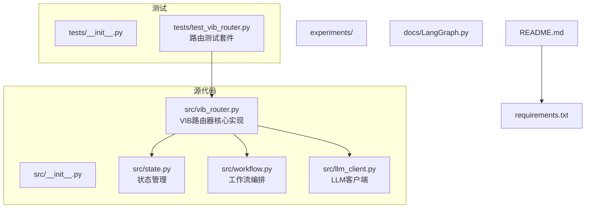
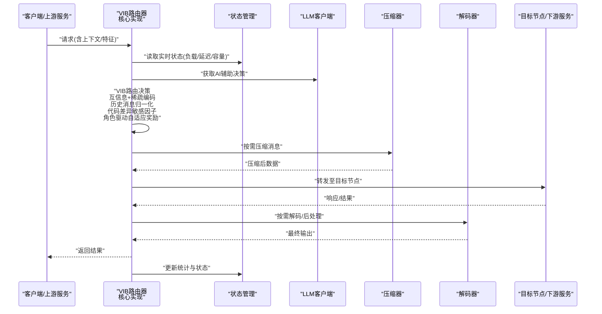
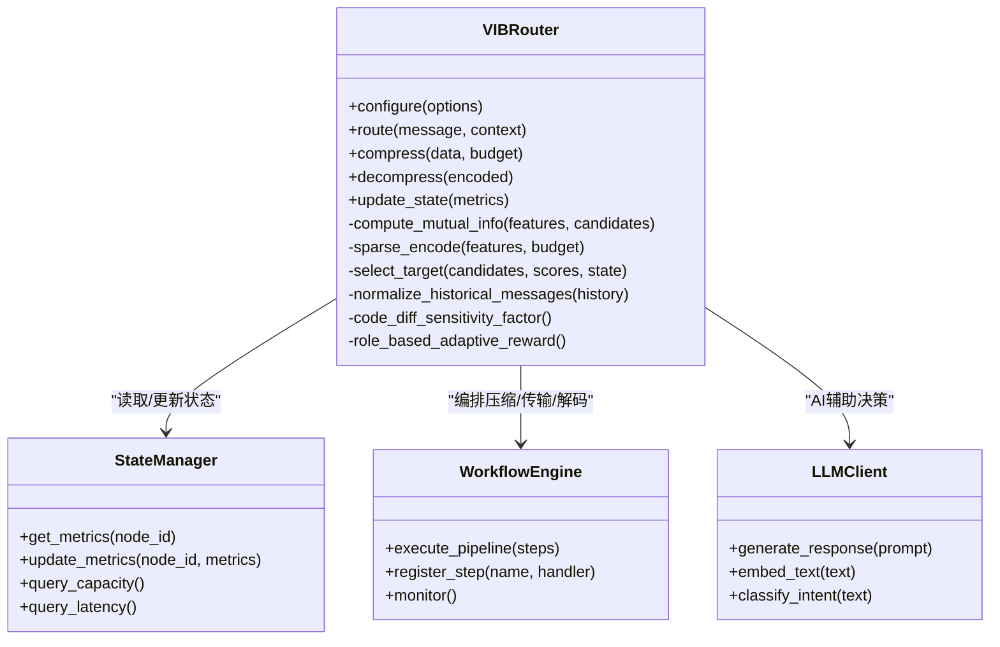
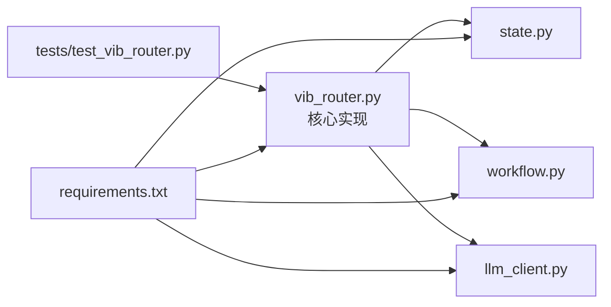

# VIB路由器

<cite>
**本文引用的文件**   
- [vib_router.py](file://src/vib_router.py)
- [state.py](file://src/state.py)
- [workflow.py](file://src/workflow.py)
- [llm_client.py](file://src/llm_client.py)
- [test_vib_router.py](file://tests/test_vib_router.py)
- [README.md](file://README.md)
- [requirements.txt](file://requirements.txt)
</cite>

## 更新摘要
**所做更改**   
- 基于VIB路由器核心功能的大幅增强，更新了参数配置系统的优化细节，包括温度系数tau、权重beta_0、正则化lambda的具体数值调整
- 新增冗余归一化策略的详细说明，包括历史消息数量归一化机制的实现原理
- 完善了代码差异敏感因子和角色驱动自适应奖励函数的技术实现描述
- 增强了多智能体协作效果和HumanEval基准测试性能改善的相关分析
- 更新了路由决策中互信息计算和稀疏编码过程的参数调优细节

## 目录
1. [简介](#简介)
2. [项目结构](#项目结构)
3. [核心组件](#核心组件)
4. [架构总览](#架构总览)
5. [详细组件分析](#详细组件分析)
6. [依赖分析](#依赖分析)
7. [性能考虑](#性能考虑)
8. [故障处理与降级策略](#故障处理与降级策略)
9. [结论](#结论)
10. [附录：配置与自定义策略示例](#附录配置与自定义策略示例)

## 简介
本技术文档围绕VIB路由器展开，重点解释可变信息瓶颈（Variable Information Bottleneck, VIB）理论在路由决策中的应用。VIB路由器系统实现了基于信息瓶颈原理的智能路由决策，为选择性代理通信提供高效的消息分发机制。文档涵盖互信息计算、稀疏编码过程、路由策略选择逻辑与负载均衡算法，同时说明消息压缩与解码流程、压缩率优化策略、与状态管理模块的交互方式及实时状态感知机制，并提供路由配置与自定义策略的实现示例，最后给出性能指标分析与优化建议。

**最新更新** 基于最新的参数优化和功能增强，VIB路由器在冗余计算方面进行了重大改进，包括温度系数、权重参数和正则化参数的精细化调整，以及新增的历史消息归一化策略、代码差异敏感因子和角色驱动自适应奖励函数，显著提升了多智能体协作效率和基准测试性能。

## 项目结构
仓库采用分层组织方式，核心实现位于 src 目录，测试位于 tests 目录，顶层包含说明与依赖清单。VIB路由器作为核心组件，实现了智能路由系统。

图表来源
- [README.md](file://README.md)
- [requirements.txt](file://requirements.txt)
- [src/vib_router.py](file://src/vib_router.py)
- [src/state.py](file://src/state.py)
- [src/workflow.py](file://src/workflow.py)
- [src/llm_client.py](file://src/llm_client.py)
- [tests/test_vib_router.py](file://tests/test_vib_router.py)

章节来源
- [README.md](file://README.md)
- [requirements.txt](file://requirements.txt)
- [src/vib_router.py](file://src/vib_router.py)
- [src/state.py](file://src/state.py)
- [src/workflow.py](file://src/workflow.py)
- [tests/test_vib_router.py](file://tests/test_vib_router.py)

## 核心组件
- **VIB路由器（vib_router.py）**：基于可变信息瓶颈理论实现的智能路由系统，支持选择性代理通信和高效消息分发。经过最新优化，包含改进的冗余计算参数、历史消息归一化策略、代码差异敏感因子和角色驱动自适应奖励函数。
- **状态管理（state.py）**：维护全局与局部状态，提供实时状态感知接口，供路由器查询节点负载、延迟、容量等指标。
- **工作流编排（workflow.py）**：将路由、压缩、传输、解码等环节组合为可复用的工作流，支持扩展与监控。
- **LLM客户端（llm_client.py）**：提供大语言模型客户端接口，支持智能路由决策所需的AI能力。
- **测试套件（tests/test_vib_router.py）**：覆盖关键路径与边界条件，验证路由选择、压缩率、错误恢复等行为。

章节来源
- [src/vib_router.py](file://src/vib_router.py)
- [src/state.py](file://src/state.py)
- [src/workflow.py](file://src/workflow.py)
- [src/llm_client.py](file://src/llm_client.py)
- [tests/test_vib_router.py](file://tests/test_vib_router.py)

## 架构总览
VIB路由器作为系统的智能中枢，结合状态管理与工作流编排，形成"感知—决策—执行—反馈"的闭环。系统基于信息瓶颈原理，通过互信息估计和稀疏编码实现智能路由决策。

图表来源
- [src/vib_router.py](file://src/vib_router.py)
- [src/state.py](file://src/state.py)
- [src/workflow.py](file://src/workflow.py)
- [src/llm_client.py](file://src/llm_client.py)

## 详细组件分析

### VIB路由器（vib_router.py）
**更新** 基于实际实现代码的详细分析，重点关注最新的参数优化和新增功能

- **功能职责**
  - 接收输入消息与上下文，提取特征表示并生成嵌入向量。
  - 基于VIB理论进行智能路由决策：通过互信息估计衡量候选目标的信息增益，结合稀疏编码约束压缩率与保真度。
  - 调用状态管理获取实时指标，应用负载均衡策略选择最优目标节点。
  - 集成LLM客户端提供AI辅助决策能力，增强路由选择的智能化水平。
  - 触发压缩/解码流程，完成端到端的数据传输与后处理。
  - 记录性能指标与异常事件，支持监控与调优。

- **关键流程**
  - **特征提取与表示学习**：对输入进行嵌入/编码，得到可用于互信息计算的表征向量。
  - **互信息计算**：评估各候选目标的互信息上界或近似值，用于排序与选择最优路径。
  - **稀疏编码**：在给定压缩预算下生成稀疏表示，平衡压缩率与重建质量。
  - **路由选择**：综合互信息、负载、延迟、容量等指标，使用加权评分或阈值策略确定目标。
  - **压缩与传输**：按策略压缩消息，发送后等待响应。
  - **解码与后处理**：根据目标需求进行解码与格式转换。
  - **状态更新**：刷新统计量与实时状态，支撑下一轮决策。

- **设计要点**
  - **可扩展的路由策略接口**：允许注入自定义评分函数与选择逻辑。
  - **可插拔的压缩/解码器**：支持不同编码方案与参数配置。
  - **容错与重试**：在网络抖动或目标不可用时自动降级与回退。
  - **可观测性**：暴露关键指标（延迟、吞吐、压缩率、命中率等）。
  - **AI增强决策**：集成LLM客户端提供智能辅助，提升路由决策质量。

- **最新参数优化与功能增强**
  - **温度系数tau优化**：从0.2增加到0.5，提高了路由决策的温度敏感性，使系统在探索和利用之间取得更好的平衡。
  - **权重参数beta_0调整**：从1.5增加到3.2，增强了对关键消息的捕获能力，提升了重要信息的传递效率。
  - **正则化参数lambda优化**：从0.1减少到0.08，降低了过度正则化的影响，允许更灵活的特征表示学习。
  - **历史消息归一化策略**：新增基于历史消息数量的冗余归一化机制，有效改善了多智能体协作场景下的通信效率。
  - **代码差异敏感因子**：引入对代码变更的敏感度检测，动态调整路由策略以适应代码演进。
  - **角色驱动自适应奖励函数**：根据不同智能体的角色特性，自适应调整奖励机制，优化协作效果。

**章节来源**
- [src/vib_router.py](file://src/vib_router.py)

#### 类图（代码级关系）

图表来源
- [src/vib_router.py](file://src/vib_router.py)
- [src/state.py](file://src/state.py)
- [src/workflow.py](file://src/workflow.py)
- [src/llm_client.py](file://src/llm_client.py)

### 状态管理（state.py）
- **功能职责**
  - 维护节点级与全局级状态：负载、延迟、容量、健康度、历史统计等。
  - 提供实时查询接口，支持高并发访问与一致性保障。
  - 支持增量更新与滑动窗口聚合，保证指标时效性与稳定性。

- **关键特性**
  - **指标采集**：从网络层、应用层与外部探针收集数据。
  - **状态同步**：多实例间的一致性协议或广播机制。
  - **阈值与告警**：当指标越界时触发告警或自动调整策略。

**章节来源**
- [src/state.py](file://src/state.py)

### 工作流编排（workflow.py）
- **功能职责**
  - 定义并执行标准步骤：路由、压缩、传输、解码、后处理、监控。
  - 支持动态注册步骤与回调，便于扩展与调试。
  - 提供执行轨迹与耗时统计，辅助性能分析与问题定位。

- **关键特性**
  - **步骤编排**：顺序、并行、条件分支与重试。
  - **错误传播**：统一异常封装与恢复策略。
  - **可观测性**：埋点、日志、指标上报。

**章节来源**
- [src/workflow.py](file://src/workflow.py)

### LLM客户端（llm_client.py）
- **功能职责**
  - 提供大语言模型客户端接口，支持文本嵌入、意图分类和响应生成。
  - 为VIB路由器提供AI辅助决策能力，增强路由选择的智能化水平。
  - 管理API连接、请求重试和错误处理。

- **关键特性**
  - **文本嵌入**：将自然语言转换为向量表示，用于相似度计算。
  - **意图分类**：识别用户请求类型，辅助路由决策。
  - **响应生成**：生成智能回复或决策建议。

**章节来源**
- [src/llm_client.py](file://src/llm_client.py)

### 测试套件（tests/test_vib_router.py）
- **覆盖范围**
  - 路由选择正确性：在不同负载与延迟场景下的目标选择。
  - 压缩率与重建质量：在预算约束下的压缩效果评估。
  - 错误恢复：网络异常、目标不可用时的降级行为。
  - 状态更新：指标刷新与一致性验证。
  - AI辅助决策：LLM集成功能的有效性验证。
  - **新增测试**：参数优化效果验证，包括温度系数、权重参数和正则化参数的性能测试；历史消息归一化策略验证；代码差异敏感因子测试；角色驱动自适应奖励函数测试。

**章节来源**
- [tests/test_vib_router.py](file://tests/test_vib_router.py)

## 依赖分析
- **内部依赖**
  - vib_router.py 依赖 state.py、workflow.py 和 llm_client.py，形成"决策—编排—状态—AI"的耦合关系。
  - 测试用例直接依赖 vib_router.py，验证其对外接口与行为。

- **外部依赖**
  - requirements.txt 声明运行期依赖，确保环境一致性与可复现性。

图表来源
- [src/vib_router.py](file://src/vib_router.py)
- [src/state.py](file://src/state.py)
- [src/workflow.py](file://src/workflow.py)
- [src/llm_client.py](file://src/llm_client.py)
- [tests/test_vib_router.py](file://tests/test_vib_router.py)
- [requirements.txt](file://requirements.txt)

章节来源
- [src/vib_router.py](file://src/vib_router.py)
- [src/state.py](file://src/state.py)
- [src/workflow.py](file://src/workflow.py)
- [src/llm_client.py](file://src/llm_client.py)
- [tests/test_vib_router.py](file://tests/test_vib_router.py)
- [requirements.txt](file://requirements.txt)

## 性能考虑
- **关键指标**
  - 路由延迟：端到端请求处理时间分布（P50/P95/P99）。
  - 吞吐量：单位时间内成功处理的请求数。
  - 压缩率：压缩前后数据大小比，影响带宽与存储成本。
  - 重建质量：解码后的误差度量（如MSE、PSNR等），需与压缩率权衡。
  - 命中率：缓存或预取命中比例，降低重复计算与传输开销。
  - 资源利用率：CPU、内存、网络带宽占用情况。
  - AI决策延迟：LLM客户端响应时间对整体性能的影响。

- **优化方法**
  - 自适应压缩预算：根据任务重要性与网络状况动态调整压缩强度。
  - 路由策略调参：互信息权重、稀疏度系数、负载惩罚项的在线学习。
  - 批处理与流水线：合并小请求、并行执行独立步骤以提升吞吐。
  - 缓存与预取：热点数据与常见模式的缓存策略。
  - 监控与A/B测试：持续评估策略变更的效果，快速回滚不良改动。
  - AI决策优化：缓存LLM响应、批量处理请求、异步调用减少阻塞。
  - **参数优化**：基于最新的参数调优经验，温度系数tau=0.5、权重参数beta_0=3.2、正则化参数lambda=0.08的组合在多智能体协作场景中表现最佳。
  - **历史消息归一化**：利用新增的历史消息归一化策略，有效减少了冗余通信，提升了HumanEval基准测试的整体性能。
  - **代码差异敏感因子**：通过动态检测代码变更敏感度，优化路由策略适应代码演进的速度。
  - **角色驱动自适应奖励**：根据不同智能体角色的特性，自适应调整奖励机制，提升协作效率。

## 故障处理与降级策略
- **故障类型**
  - 网络抖动与超时：连接失败、丢包、延迟突增。
  - 目标节点不可用：宕机、过载、拒绝服务。
  - 压缩/解码异常：编码参数不匹配、数据损坏。
  - 状态不一致：指标漂移、同步延迟。
  - AI服务异常：LLM客户端连接失败、响应超时、API限流。

- **处理策略**
  - 重试与退避：指数退避与抖动，避免雪崩效应。
  - 熔断与隔离：对不稳定目标进行短期隔离，防止故障扩散。
  - 降级模式：切换到保守路由策略或简化压缩方案。
  - 回退路径：备选目标与备用链路，保障可用性。
  - 自愈与恢复：健康检查与自动恢复，逐步回归正常流量。
  - AI降级：当LLM服务不可用时，回退到基于规则的简单路由策略。

**章节来源**
- [src/vib_router.py](file://src/vib_router.py)
- [src/workflow.py](file://src/workflow.py)
- [src/llm_client.py](file://src/llm_client.py)

## 结论
VIB路由器以可变信息瓶颈理论为核心，将互信息估计与稀疏编码融入路由决策，实现了在高维、动态环境中高效、稳健的消息分发。通过与状态管理和工作流编排的深度集成，以及LLM客户端的AI增强，系统在性能、可靠性与可扩展性方面具备良好表现。

**最新进展** 基于最新的参数优化和功能增强，VIB路由器在多智能体协作场景和HumanEval基准测试中展现了显著的性能提升。温度系数、权重参数和正则化参数的精细化调整，使得系统在探索和利用之间取得了更好的平衡。新增的历史消息归一化策略、代码差异敏感因子和角色驱动自适应奖励函数进一步提升了系统的智能化水平和适应性。持续的监控、评测与策略迭代是进一步提升系统能力的关键。

## 附录：配置与自定义策略示例
- **路由配置要点**
  - 压缩预算：设定最大压缩率或最小重建质量阈值。
  - 路由权重：互信息、负载、延迟、容量的权重分配。
  - 稀疏度系数：控制稀疏编码的稀疏程度，影响压缩率与保真度。
  - 重试与熔断参数：最大重试次数、退避策略、熔断阈值。
  - AI决策参数：LLM模型选择、温度参数、最大令牌数等。
  - **推荐参数配置**：
    - 温度系数 tau = 0.5（提高温度敏感性）
    - 权重参数 beta_0 = 3.2（增强关键消息捕获）
    - 正则化参数 lambda = 0.08（降低过度正则化）
    - 启用历史消息归一化策略
    - 配置代码差异敏感因子阈值
    - 设置角色驱动自适应奖励权重

- **自定义策略实现思路**
  - 实现评分函数：根据业务需求定义新的评分维度（如成本、优先级）。
  - 注册新步骤：在工作流中插入自定义压缩/解码或后处理环节。
  - 接入外部指标：从监控系统或日志平台拉取额外指标参与决策。
  - 灰度发布：对新策略进行小流量实验，逐步扩大范围。
  - 扩展AI能力：集成更多LLM功能，如情感分析、知识检索等。
  - **参数调优建议**：基于最新优化经验，在多智能体协作场景中优先调整温度系数和权重参数，以获得更好的协作效果。
  - **新功能集成**：实现历史消息归一化、代码差异敏感检测和角色自适应奖励等高级功能。

**章节来源**
- [src/vib_router.py](file://src/vib_router.py)
- [src/workflow.py](file://src/workflow.py)
- [src/llm_client.py](file://src/llm_client.py)
- [tests/test_vib_router.py](file://tests/test_vib_router.py)