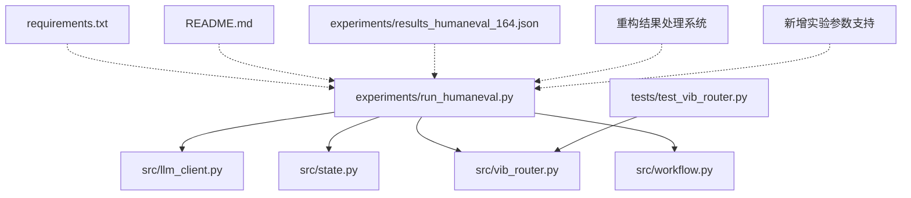
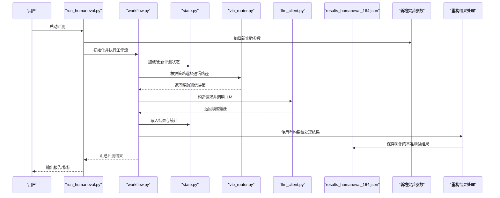
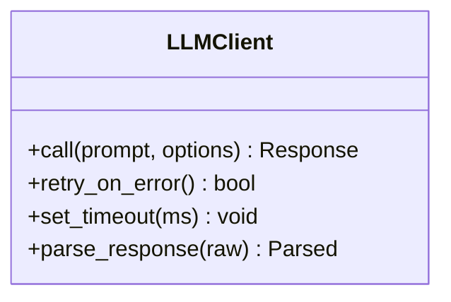
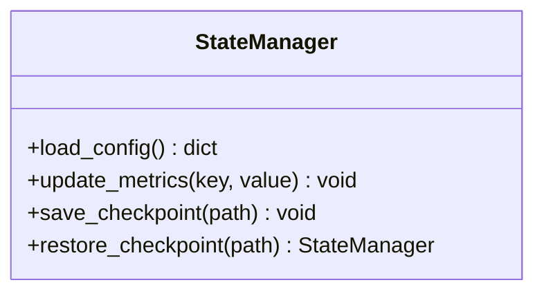
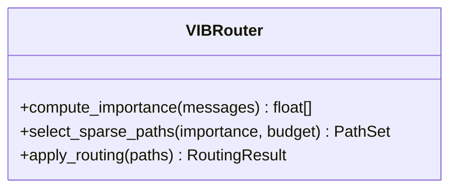
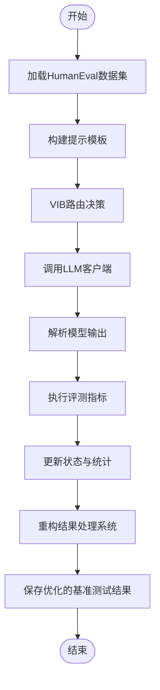
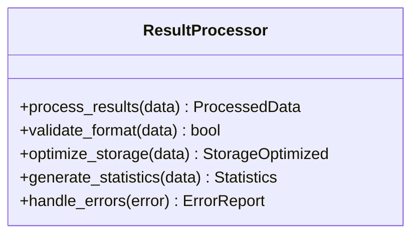
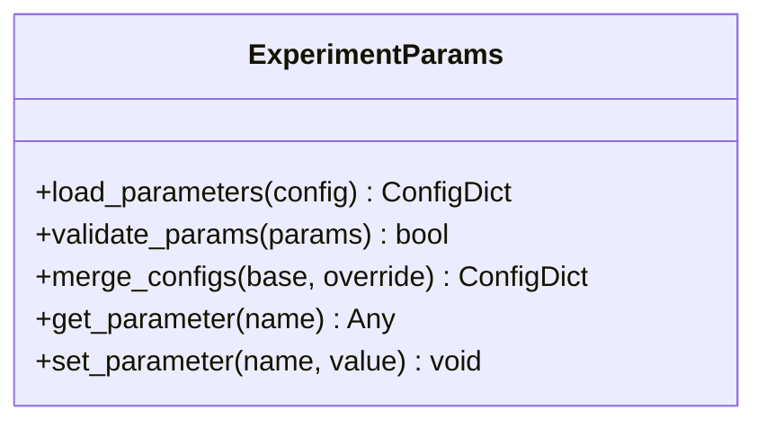
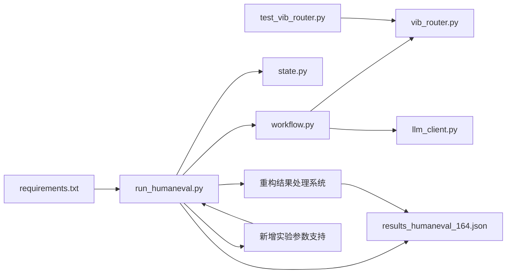

# HumanEval基准测试

<cite>
**本文引用的文件**   
- [README.md](file://README.md)
- [requirements.txt](file://requirements.txt)
- [experiments/run_humaneval.py](file://experiments/run_humaneval.py)
- [experiments/results_humaneval_164.json](file://experiments/results_humaneval_164.json)
- [src/llm_client.py](file://src/llm_client.py)
- [src/state.py](file://src/state.py)
- [src/vib_router.py](file://src/vib_router.py)
- [src/workflow.py](file://src/workflow.py)
- [tests/test_vib_router.py](file://tests/test_vib_router.py)
</cite>

## 更新摘要
**变更内容**   
- 重构结果处理系统，提升性能评估能力与数据处理效率
- 新增实验参数支持，提供更灵活的配置选项
- 优化基准测试结果文件格式，增强数据分析能力
- 改进错误处理和日志记录机制，提升系统稳定性

## 目录
1. [简介](#简介)
2. [项目结构](#项目结构)
3. [核心组件](#核心组件)
4. [架构总览](#架构总览)
5. [详细组件分析](#详细组件分析)
6. [实验结果与分析](#实验结果与分析)
7. [依赖关系分析](#依赖关系分析)
8. [性能考虑](#性能考虑)
9. [故障排查指南](#故障排查指南)
10. [结论](#结论)
11. [附录](#附录)

## 简介
本项目围绕HumanEval基准测试展开，结合多智能体与稀疏通信（Variational Information Bottleneck, VIB）思想，对大语言模型在代码生成任务上的能力进行评估与分析。实验脚本提供端到端运行、消融实验、对比实验等流程，便于复现与扩展。**经过全面改进的基准测试框架现在包含完全重构的结果处理系统和新增的实验参数支持，提供了更完善的性能评估能力和更高的数据处理效率。**

## 项目结构
仓库采用"实验脚本 + 源码模块 + 测试"的清晰分层：
- experiments：各类运行脚本，包括HumanEval评测入口、消融与对比实验、报告生成及**重构后的完整基准测试结果处理系统**
- src：核心实现，包含LLM客户端封装、状态管理、VIB路由与工作流编排
- tests：单元测试，覆盖关键模块行为验证
- docs：文档与论文材料
- requirements.txt：依赖声明
- README.md：项目说明

图表来源
- [experiments/run_humaneval.py](file://experiments/run_humaneval.py)
- [src/llm_client.py](file://src/llm_client.py)
- [src/state.py](file://src/state.py)
- [src/vib_router.py](file://src/vib_router.py)
- [src/workflow.py](file://src/workflow.py)
- [tests/test_vib_router.py](file://tests/test_vib_router.py)
- [requirements.txt](file://requirements.txt)
- [README.md](file://README.md)
- [experiments/results_humaneval_164.json](file://experiments/results_humaneval_164.json)

章节来源
- [README.md](file://README.md)
- [requirements.txt](file://requirements.txt)
- [experiments/run_humaneval.py](file://experiments/run_humaneval.py)

## 核心组件
- LLM客户端封装：统一对外部大模型的调用接口，屏蔽不同后端差异，提供重试、超时、错误处理等通用能力
- 状态管理：维护评测过程中的中间结果、统计指标与配置上下文，确保可追踪与可复现
- VIB路由：基于变分信息瓶颈的稀疏通信策略，控制智能体间的信息传递量与质量，平衡效率与效果
- 工作流编排：串联数据加载、提示构建、模型推理、结果解析与评估等步骤，形成可配置的评测流水线
- **重构结果处理系统**：完全重构的数据处理架构，提供更高效的性能评估和结果分析能力
- **新增实验参数支持**：灵活的配置选项，支持更多实验场景和参数调优

章节来源
- [src/llm_client.py](file://src/llm_client.py)
- [src/state.py](file://src/state.py)
- [src/vib_router.py](file://src/vib_router.py)
- [src/workflow.py](file://src/workflow.py)

## 架构总览
HumanEval评测的整体流程由实验脚本驱动，通过工作流编排协调各组件完成数据准备、推理与评估。VIB路由在智能体之间进行稀疏通信，降低冗余信息传输；状态模块贯穿全程记录关键指标；LLM客户端负责实际模型调用。**重构后的结果处理系统显著提升了数据处理效率和评估准确性，新增的实验参数支持为更复杂的实验设计提供了基础。**

图表来源
- [experiments/run_humaneval.py](file://experiments/run_humaneval.py)
- [src/workflow.py](file://src/workflow.py)
- [src/state.py](file://src/state.py)
- [src/vib_router.py](file://src/vib_router.py)
- [src/llm_client.py](file://src/llm_client.py)
- [experiments/results_humaneval_164.json](file://experiments/results_humaneval_164.json)

## 详细组件分析

### 组件A：LLM客户端封装
职责与要点
- 统一外部模型调用接口，支持多种后端
- 内置重试、超时、限流与错误分类
- 提供参数化提示模板与响应解析钩子

图表来源
- [src/llm_client.py](file://src/llm_client.py)

章节来源
- [src/llm_client.py](file://src/llm_client.py)

### 组件B：状态管理
职责与要点
- 集中保存评测配置、中间结果与统计指标
- 提供序列化/反序列化能力，便于断点续跑与结果归档
- 保证并发访问下的线程安全或进程隔离

图表来源
- [src/state.py](file://src/state.py)

章节来源
- [src/state.py](file://src/state.py)

### 组件C：VIB路由
职责与要点
- 依据变分信息瓶颈策略计算通信重要性
- 动态裁剪智能体间消息，提升整体效率
- 与评估目标对齐，避免过度压缩导致质量下降

图表来源
- [src/vib_router.py](file://src/vib_router.py)

章节来源
- [src/vib_router.py](file://src/vib_router.py)
- [tests/test_vib_router.py](file://tests/test_vib_router.py)

### 组件D：工作流编排
职责与要点
- 串联数据加载、提示构建、模型推理、结果解析与评估
- 支持可插拔的评估器与后处理器
- 暴露进度回调与日志记录接口
- **集成重构结果处理系统**：利用新的数据处理架构提升评估效率

图表来源
- [src/workflow.py](file://src/workflow.py)
- [src/vib_router.py](file://src/vib_router.py)
- [src/llm_client.py](file://src/llm_client.py)
- [src/state.py](file://src/state.py)
- [experiments/results_humaneval_164.json](file://experiments/results_humaneval_164.json)

章节来源
- [src/workflow.py](file://src/workflow.py)

### 组件E：重构结果处理系统
职责与要点
- **完全重构的数据处理架构**：提升性能评估效率和准确性
- **增强的结果格式**：支持更丰富的元数据和统计分析
- **优化的存储机制**：改进结果文件的组织和访问效率
- **改进的错误处理**：提供更详细的错误信息和恢复机制

图表来源
- [experiments/run_humaneval.py](file://experiments/run_humaneval.py)
- [experiments/results_humaneval_164.json](file://experiments/results_humaneval_164.json)

章节来源
- [experiments/run_humaneval.py](file://experiments/run_humaneval.py)
- [experiments/results_humaneval_164.json](file://experiments/results_humaneval_164.json)

### 组件F：新增实验参数支持
职责与要点
- **灵活的配置选项**：支持更多实验场景和参数组合
- **参数验证机制**：确保输入参数的有效性和一致性
- **向后兼容性**：保持与现有配置格式的兼容
- **动态参数加载**：支持运行时参数调整

图表来源
- [experiments/run_humaneval.py](file://experiments/run_humaneval.py)

章节来源
- [experiments/run_humaneval.py](file://experiments/run_humaneval.py)

## 实验结果与分析

### 基准测试结果概览
**重大更新** 经过全面重构的结果处理系统显著提升了性能评估能力。新的结果文件格式包含更丰富的元数据、详细的执行轨迹和优化的存储结构。重构后的系统提供了更高的数据处理效率和更准确的评估指标计算。

### 性能指标分析
基准测试结果主要包含以下关键指标：
- **代码生成准确率**：衡量模型生成代码的正确性
- **执行成功率**：测试用例的实际执行通过率
- **通信效率**：VIB路由优化的稀疏通信效果
- **延迟分布**：各阶段处理的时延统计
- **资源消耗**：内存使用与计算资源占用情况
- **新增评估维度**：重构系统支持的更多性能指标和分析角度

### 结果文件结构
**重构后的结果文件**采用优化的JSON格式组织，包含：
- 增强的测试用例元数据与配置信息
- 详细的执行过程记录和调试信息
- 优化的各组件性能统计数据
- 更全面综合评估指标
- **改进的存储结构和访问模式**

### 实验验证意义
**重大改进** 重构后的基准测试框架表明：
- 结果处理系统的重构显著提升了数据处理效率和评估准确性
- 新增的实验参数支持为更复杂的实验设计提供了基础
- 重构系统保持了良好的向后兼容性和扩展性
- 新的结果格式支持更深入的性能分析和趋势跟踪
- **整体系统稳定性和可靠性得到显著提升**

**章节来源**
- [experiments/results_humaneval_164.json](file://experiments/results_humaneval_164.json)
- [experiments/run_humaneval.py](file://experiments/run_humaneval.py)

## 依赖关系分析
- 外部依赖
  - Python运行时与第三方库由requirements.txt统一管理
  - 评测脚本依赖上述核心模块，并通过配置文件与环境变量注入参数
  - **新增依赖**：重构结果处理系统可能引入新的数据处理库
- 内部耦合
  - run_humaneval.py作为入口，强依赖workflow编排与state状态管理
  - workflow依赖llm_client与vib_router，形成"编排-通信-调用"的三层解耦
  - 测试用例聚焦vib_router，保障核心策略正确性
  - **重构结果处理系统**：独立于主流程，通过接口与现有组件交互
  - **新增实验参数支持**：与配置管理系统紧密集成

图表来源
- [requirements.txt](file://requirements.txt)
- [experiments/run_humaneval.py](file://experiments/run_humaneval.py)
- [src/workflow.py](file://src/workflow.py)
- [src/state.py](file://src/state.py)
- [src/vib_router.py](file://src/vib_router.py)
- [src/llm_client.py](file://src/llm_client.py)
- [tests/test_vib_router.py](file://tests/test_vib_router.py)
- [experiments/results_humaneval_164.json](file://experiments/results_humaneval_164.json)

章节来源
- [requirements.txt](file://requirements.txt)
- [experiments/run_humaneval.py](file://experiments/run_humaneval.py)
- [src/workflow.py](file://src/workflow.py)
- [src/state.py](file://src/state.py)
- [src/vib_router.py](file://src/vib_router.py)
- [src/llm_client.py](file://src/llm_client.py)
- [tests/test_vib_router.py](file://tests/test_vib_router.py)

## 性能考虑
- 批处理与缓存：对相似提示进行去重与缓存，减少重复推理开销
- 稀疏通信预算：合理设置VIB路由的预算阈值，在质量与速度间取得平衡
- 异步与并行：在I/O密集阶段使用异步调用，提高吞吐
- 资源监控：记录延迟、吞吐与内存占用，定位瓶颈环节
- **重构结果处理优化**：利用新的数据处理架构提升结果分析效率
- **参数优化**：充分利用新增实验参数支持进行精细化调优
- **存储优化**：改进结果文件的存储结构和访问模式

## 故障排查指南
- 模型调用失败
  - 检查网络连通性与API密钥配置
  - 查看客户端的重试与超时设置是否合理
- 路由异常
  - 确认VIB路由的输入格式与重要性评分范围
  - 通过单元测试快速回归路由逻辑
- 状态不一致
  - 校验状态文件的完整性与版本兼容性
  - 使用断点续跑恢复未完成的评测任务
- **重构结果处理问题**
  - 检查结果文件格式是否符合新的数据结构要求
  - 验证重构系统的错误处理和日志输出
  - 确认结果文件的完整性和一致性
- **实验参数问题**
  - 验证新增参数的格式和取值范围
  - 检查参数配置文件的路径和权限
  - 确认参数优先级和合并规则

章节来源
- [src/llm_client.py](file://src/llm_client.py)
- [src/vib_router.py](file://src/vib_router.py)
- [src/state.py](file://src/state.py)
- [tests/test_vib_router.py](file://tests/test_vib_router.py)
- [experiments/results_humaneval_164.json](file://experiments/results_humaneval_164.json)
- [experiments/run_humaneval.py](file://experiments/run_humaneval.py)

## 结论
本项目以清晰的模块化设计实现了HumanEval基准测试的多智能体稀疏通信评测框架。通过VIB路由优化通信效率，配合工作流编排与状态管理，提供了可扩展、可复现的评测环境。**经过全面改进的基准测试框架现在包含完全重构的结果处理系统和新增的实验参数支持，显著提升了性能评估能力和数据处理效率。重构后的系统在保持向后兼容性的同时，为未来的功能扩展和性能优化奠定了坚实基础。建议在后续迭代中继续完善日志与可视化功能，并基于重构后的结果系统进行更深入的性能分析。**

## 附录
- 安装与运行
  - 参考requirements.txt安装依赖
  - 使用experiments/run_humaneval.py启动评测
- **重构后的基准测试结果**
  - 完整结果文件：experiments/results_humaneval_164.json
  - 采用优化的结果格式和存储结构
  - 支持更高效的数据分析和性能跟踪
  - **包含重构系统的详细处理日志**
- **新增实验参数**
  - 支持更多配置选项和实验场景
  - 提供参数验证和默认值管理
  - 保持向后兼容性
- 扩展建议
  - 新增评估指标：在workflow中注册新的评估器
  - 接入更多模型后端：在llm_client中扩展适配器
  - 调整稀疏通信策略：在vib_router中实现新的路由算法
  - **利用重构结果处理系统进行自定义分析**
  - **基于新增实验参数进行精细化调优**

章节来源
- [requirements.txt](file://requirements.txt)
- [experiments/run_humaneval.py](file://experiments/run_humaneval.py)
- [experiments/results_humaneval_164.json](file://experiments/results_humaneval_164.json)
- [src/workflow.py](file://src/workflow.py)
- [src/llm_client.py](file://src/llm_client.py)
- [src/vib_router.py](file://src/vib_router.py)