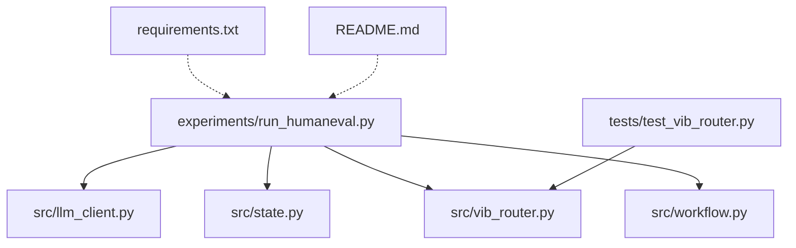
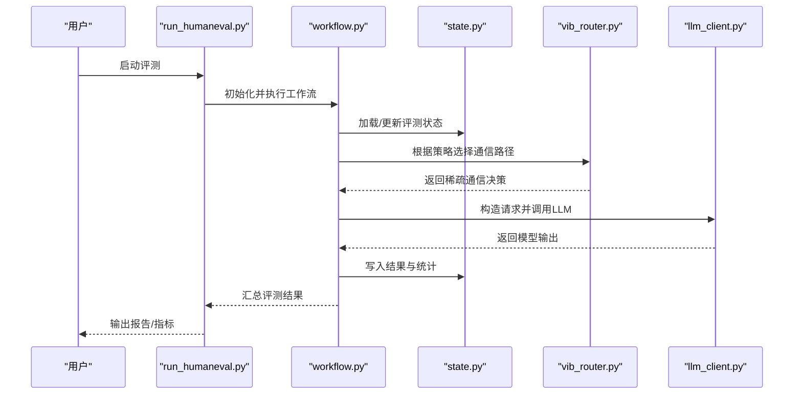
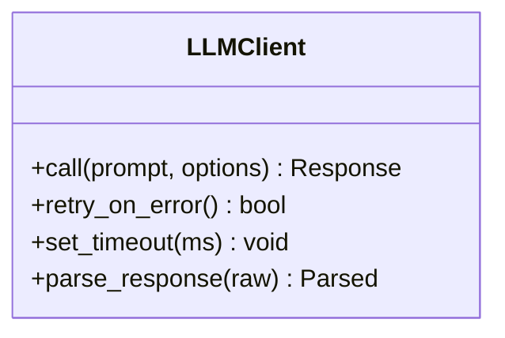
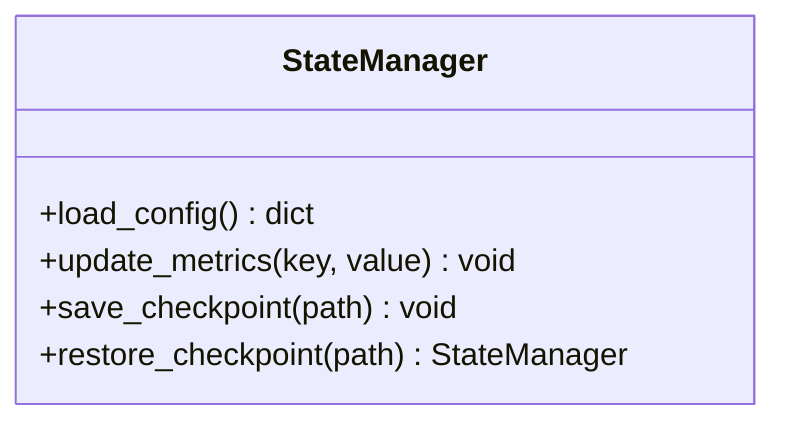
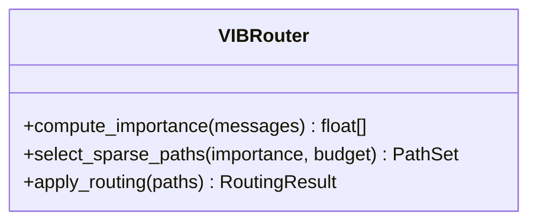
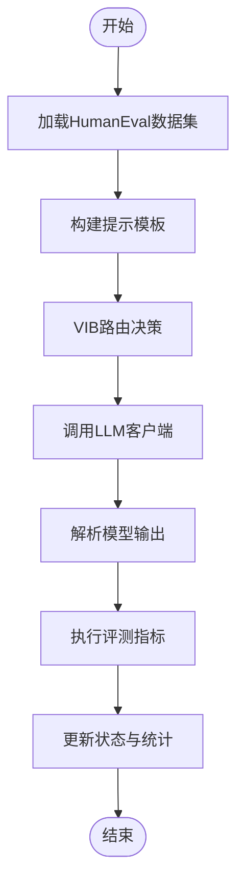
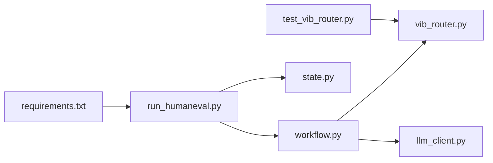

# HumanEval基准测试

<cite>
**本文引用的文件**   
- [README.md](file://README.md)
- [requirements.txt](file://requirements.txt)
- [experiments/run_humaneval.py](file://experiments/run_humaneval.py)
- [src/llm_client.py](file://src/llm_client.py)
- [src/state.py](file://src/state.py)
- [src/vib_router.py](file://src/vib_router.py)
- [src/workflow.py](file://src/workflow.py)
- [tests/test_vib_router.py](file://tests/test_vib_router.py)
</cite>

## 目录
1. [简介](#简介)
2. [项目结构](#项目结构)
3. [核心组件](#核心组件)
4. [架构总览](#架构总览)
5. [详细组件分析](#详细组件分析)
6. [依赖关系分析](#依赖关系分析)
7. [性能考虑](#性能考虑)
8. [故障排查指南](#故障排查指南)
9. [结论](#结论)
10. [附录](#附录)

## 简介
本项目围绕HumanEval基准测试展开，结合多智能体与稀疏通信（Variational Information Bottleneck, VIB）思想，对大语言模型在代码生成任务上的能力进行评估与分析。实验脚本提供端到端运行、消融实验、对比实验等流程，便于复现与扩展。

## 项目结构
仓库采用“实验脚本 + 源码模块 + 测试”的清晰分层：
- experiments：各类运行脚本，包括HumanEval评测入口、消融与对比实验、报告生成等
- src：核心实现，包含LLM客户端封装、状态管理、VIB路由与工作流编排
- tests：单元测试，覆盖关键模块行为验证
- docs：文档与论文材料
- requirements.txt：依赖声明
- README.md：项目说明

图表来源
- [experiments/run_humaneval.py](file://experiments/run_humaneval.py)
- [src/llm_client.py](file://src/llm_client.py)
- [src/state.py](file://src/state.py)
- [src/vib_router.py](file://src/vib_router.py)
- [src/workflow.py](file://src/workflow.py)
- [tests/test_vib_router.py](file://tests/test_vib_router.py)
- [requirements.txt](file://requirements.txt)
- [README.md](file://README.md)

章节来源
- [README.md](file://README.md)
- [requirements.txt](file://requirements.txt)
- [experiments/run_humaneval.py](file://experiments/run_humaneval.py)

## 核心组件
- LLM客户端封装：统一对外部大模型的调用接口，屏蔽不同后端差异，提供重试、超时、错误处理等通用能力
- 状态管理：维护评测过程中的中间结果、统计指标与配置上下文，确保可追踪与可复现
- VIB路由：基于变分信息瓶颈的稀疏通信策略，控制智能体间的信息传递量与质量，平衡效率与效果
- 工作流编排：串联数据加载、提示构建、模型推理、结果解析与评估等步骤，形成可配置的评测流水线

章节来源
- [src/llm_client.py](file://src/llm_client.py)
- [src/state.py](file://src/state.py)
- [src/vib_router.py](file://src/vib_router.py)
- [src/workflow.py](file://src/workflow.py)

## 架构总览
HumanEval评测的整体流程由实验脚本驱动，通过工作流编排协调各组件完成数据准备、推理与评估。VIB路由在智能体之间进行稀疏通信，降低冗余信息传输；状态模块贯穿全程记录关键指标；LLM客户端负责实际模型调用。

图表来源
- [experiments/run_humaneval.py](file://experiments/run_humaneval.py)
- [src/workflow.py](file://src/workflow.py)
- [src/state.py](file://src/state.py)
- [src/vib_router.py](file://src/vib_router.py)
- [src/llm_client.py](file://src/llm_client.py)

## 详细组件分析

### 组件A：LLM客户端封装
职责与要点
- 统一外部模型调用接口，支持多种后端
- 内置重试、超时、限流与错误分类
- 提供参数化提示模板与响应解析钩子

图表来源
- [src/llm_client.py](file://src/llm_client.py)

章节来源
- [src/llm_client.py](file://src/llm_client.py)

### 组件B：状态管理
职责与要点
- 集中保存评测配置、中间结果与统计指标
- 提供序列化/反序列化能力，便于断点续跑与结果归档
- 保证并发访问下的线程安全或进程隔离

图表来源
- [src/state.py](file://src/state.py)

章节来源
- [src/state.py](file://src/state.py)

### 组件C：VIB路由
职责与要点
- 依据变分信息瓶颈策略计算通信重要性
- 动态裁剪智能体间消息，提升整体效率
- 与评估目标对齐，避免过度压缩导致质量下降

图表来源
- [src/vib_router.py](file://src/vib_router.py)

章节来源
- [src/vib_router.py](file://src/vib_router.py)
- [tests/test_vib_router.py](file://tests/test_vib_router.py)

### 组件D：工作流编排
职责与要点
- 串联数据加载、提示构建、模型推理、结果解析与评估
- 支持可插拔的评估器与后处理器
- 暴露进度回调与日志记录接口

图表来源
- [src/workflow.py](file://src/workflow.py)
- [src/vib_router.py](file://src/vib_router.py)
- [src/llm_client.py](file://src/llm_client.py)
- [src/state.py](file://src/state.py)

章节来源
- [src/workflow.py](file://src/workflow.py)

## 依赖关系分析
- 外部依赖
  - Python运行时与第三方库由requirements.txt统一管理
  - 评测脚本依赖上述核心模块，并通过配置文件与环境变量注入参数
- 内部耦合
  - run_humaneval.py作为入口，强依赖workflow编排与state状态管理
  - workflow依赖llm_client与vib_router，形成“编排-通信-调用”的三层解耦
  - 测试用例聚焦vib_router，保障核心策略正确性

图表来源
- [requirements.txt](file://requirements.txt)
- [experiments/run_humaneval.py](file://experiments/run_humaneval.py)
- [src/workflow.py](file://src/workflow.py)
- [src/state.py](file://src/state.py)
- [src/vib_router.py](file://src/vib_router.py)
- [src/llm_client.py](file://src/llm_client.py)
- [tests/test_vib_router.py](file://tests/test_vib_router.py)

章节来源
- [requirements.txt](file://requirements.txt)
- [experiments/run_humaneval.py](file://experiments/run_humaneval.py)
- [src/workflow.py](file://src/workflow.py)
- [src/state.py](file://src/state.py)
- [src/vib_router.py](file://src/vib_router.py)
- [src/llm_client.py](file://src/llm_client.py)
- [tests/test_vib_router.py](file://tests/test_vib_router.py)

## 性能考虑
- 批处理与缓存：对相似提示进行去重与缓存，减少重复推理开销
- 稀疏通信预算：合理设置VIB路由的预算阈值，在质量与速度间取得平衡
- 异步与并行：在I/O密集阶段使用异步调用，提高吞吐
- 资源监控：记录延迟、吞吐与内存占用，定位瓶颈环节

[本节为通用指导，不直接分析具体文件]

## 故障排查指南
- 模型调用失败
  - 检查网络连通性与API密钥配置
  - 查看客户端的重试与超时设置是否合理
- 路由异常
  - 确认VIB路由的输入格式与重要性评分范围
  - 通过单元测试快速回归路由逻辑
- 状态不一致
  - 校验状态文件的完整性与版本兼容性
  - 使用断点续跑恢复未完成的评测任务

章节来源
- [src/llm_client.py](file://src/llm_client.py)
- [src/vib_router.py](file://src/vib_router.py)
- [src/state.py](file://src/state.py)
- [tests/test_vib_router.py](file://tests/test_vib_router.py)

## 结论
本项目以清晰的模块化设计实现了HumanEval基准测试的多智能体稀疏通信评测框架。通过VIB路由优化通信效率，配合工作流编排与状态管理，提供了可扩展、可复现的评测环境。建议在后续迭代中完善日志与可视化，增强对大规模集群的适配能力。

[本节为总结性内容，不直接分析具体文件]

## 附录
- 安装与运行
  - 参考requirements.txt安装依赖
  - 使用experiments/run_humaneval.py启动评测
- 扩展建议
  - 新增评估指标：在workflow中注册新的评估器
  - 接入更多模型后端：在llm_client中扩展适配器
  - 调整稀疏通信策略：在vib_router中实现新的路由算法

章节来源
- [requirements.txt](file://requirements.txt)
- [experiments/run_humaneval.py](file://experiments/run_humaneval.py)
- [src/workflow.py](file://src/workflow.py)
- [src/llm_client.py](file://src/llm_client.py)
- [src/vib_router.py](file://src/vib_router.py)