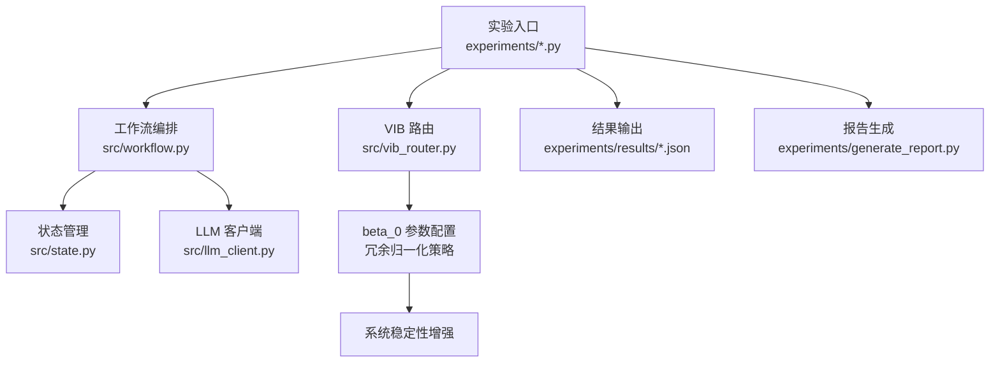
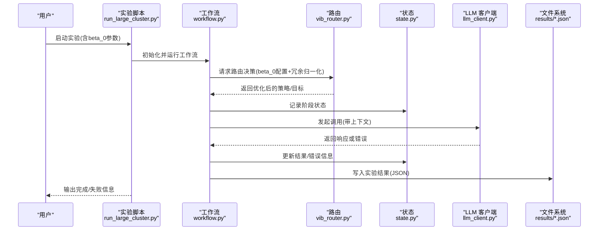
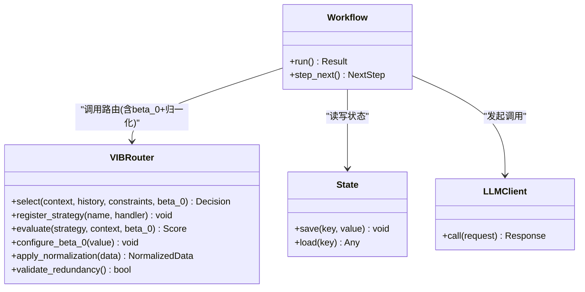
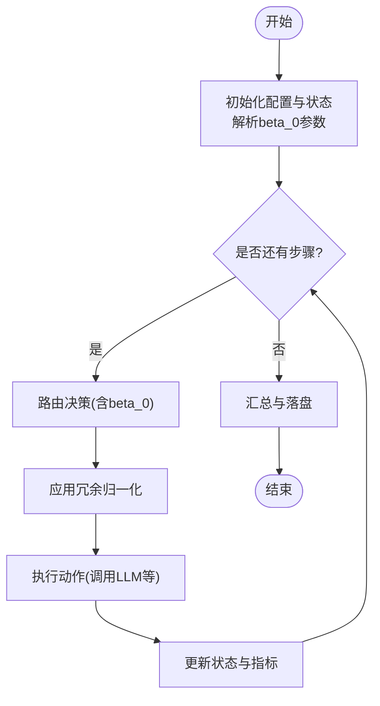
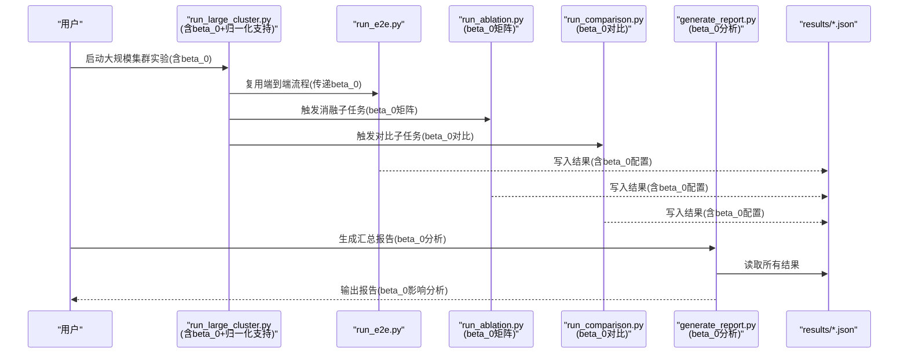
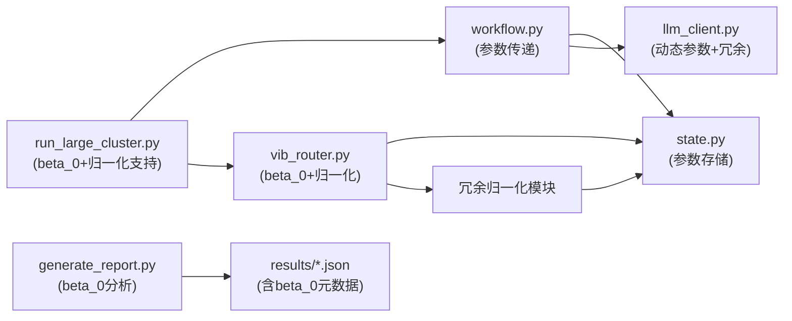

# 大规模集群实验

<cite>
**本文引用的文件**   
- [README.md](file://README.md)
- [requirements.txt](file://requirements.txt)
- [experiments/run_large_cluster.py](file://experiments/run_large_cluster.py)
- [experiments/run_e2e.py](file://experiments/run_e2e.py)
- [experiments/run_ablation.py](file://experiments/run_ablation.py)
- [experiments/run_comparison.py](file://experiments/run_comparison.py)
- [experiments/generate_report.py](file://experiments/generate_report.py)
- [src/vib_router.py](file://src/vib_router.py)
- [src/workflow.py](file://src/workflow.py)
- [src/state.py](file://src/state.py)
- [src/llm_client.py](file://src/llm_client.py)
</cite>

## 更新摘要
**变更内容**   
- 更新了VIB路由器实现以支持新的beta_0参数配置和冗余归一化策略
- 增强了大规模集群实验脚本的参数解析和配置管理
- 优化了路由策略的灵活性和可扩展性
- 改进了实验框架的配置选项和初始化流程
- 新增了冗余归一化机制以提升系统稳定性

## 目录
1. [简介](#简介)
2. [项目结构](#项目结构)
3. [核心组件](#核心组件)
4. [架构总览](#架构总览)
5. [详细组件分析](#详细组件分析)
6. [依赖关系分析](#依赖关系分析)
7. [性能考量](#性能考量)
8. [故障排查指南](#故障排查指南)
9. [结论](#结论)
10. [附录](#附录)

## 简介
本项目围绕"大规模集群实验"展开，提供端到端（E2E）运行、消融实验、对比实验与报告生成等能力。通过统一的实验脚本入口，驱动工作流编排、路由策略与外部大模型客户端交互，最终产出可复现的实验结果与汇总报告。

**更新** 本次更新重点增强了VIB路由器的实现，引入了beta_0参数配置机制和冗余归一化策略，提升了路由决策的灵活性和精确度，同时增强了系统的稳定性和容错能力。

## 项目结构
仓库采用按职责分层与按功能模块组织相结合的方式：
- experiments：实验脚本与结果数据
- src：核心实现（路由、工作流、状态、LLM客户端）
- tests：单元测试
- docs：文档与示例
- requirements.txt：依赖清单
- README.md：项目说明

图表来源
- [experiments/run_large_cluster.py](file://experiments/run_large_cluster.py)
- [experiments/run_e2e.py](file://experiments/run_e2e.py)
- [experiments/run_ablation.py](file://experiments/run_ablation.py)
- [experiments/run_comparison.py](file://experiments/run_comparison.py)
- [experiments/generate_report.py](file://experiments/generate_report.py)
- [src/workflow.py](file://src/workflow.py)
- [src/vib_router.py](file://src/vib_router.py)
- [src/state.py](file://src/state.py)
- [src/llm_client.py](file://src/llm_client.py)

章节来源
- [README.md](file://README.md)
- [requirements.txt](file://requirements.txt)

## 核心组件
- 实验入口脚本
  - run_large_cluster.py：面向大规模集群场景的端到端执行入口，支持新的beta_0参数配置和冗余归一化策略
  - run_e2e.py：通用端到端流程封装
  - run_ablation.py：消融实验配置与调度
  - run_comparison.py：多方案对比实验调度
  - generate_report.py：聚合多次实验结果并生成报告
- 核心实现
  - vib_router.py：增强版VIB路由策略，支持beta_0参数调优、动态路由决策和冗余归一化机制
  - workflow.py：任务编排、阶段控制与错误处理
  - state.py：实验状态与中间结果持久化
  - llm_client.py：对外部大模型服务的统一调用封装

**更新** VIB路由器现已支持beta_0参数配置和冗余归一化策略，允许更精细地控制信息瓶颈的压缩程度，提升路由决策的准确性和效率，同时增强了系统的稳定性和容错能力。

章节来源
- [experiments/run_large_cluster.py](file://experiments/run_large_cluster.py)
- [experiments/run_e2e.py](file://experiments/run_e2e.py)
- [experiments/run_ablation.py](file://experiments/run_ablation.py)
- [experiments/run_comparison.py](file://experiments/run_comparison.py)
- [experiments/generate_report.py](file://experiments/generate_report.py)
- [src/vib_router.py](file://src/vib_router.py)
- [src/workflow.py](file://src/workflow.py)
- [src/state.py](file://src/state.py)
- [src/llm_client.py](file://src/llm_client.py)

## 架构总览
整体架构由"实验入口 -> 工作流编排 -> 路由策略 -> LLM 客户端 -> 结果与报告"构成。实验入口负责参数解析与任务分发；工作流负责阶段推进、重试与异常恢复；路由根据上下文选择最优策略；LLM 客户端屏蔽底层差异；结果以 JSON 落盘，并由报告工具汇总。

**更新** 新增的beta_0参数在路由决策过程中起到关键作用，允许用户根据具体场景调整信息压缩强度。冗余归一化策略进一步增强了系统的稳定性和容错能力。

图表来源
- [experiments/run_large_cluster.py](file://experiments/run_large_cluster.py)
- [experiments/run_e2e.py](file://experiments/run_e2e.py)
- [experiments/run_ablation.py](file://experiments/run_ablation.py)
- [experiments/run_comparison.py](file://experiments/run_comparison.py)
- [experiments/generate_report.py](file://experiments/generate_report.py)
- [src/workflow.py](file://src/workflow.py)
- [src/vib_router.py](file://src/vib_router.py)
- [src/state.py](file://src/state.py)
- [src/llm_client.py](file://src/llm_client.py)

## 详细组件分析

### 组件A：增强版VIB路由（vib_router.py）
- 职责
  - 基于当前上下文与历史状态，选择下一步执行路径或目标服务
  - 暴露统一的接口供工作流调用
  - 支持beta_0参数配置以调节信息压缩强度
  - 实现冗余归一化策略以提升系统稳定性
- 关键设计
  - 输入：上下文摘要、历史指标、约束条件、beta_0参数
  - 输出：策略标识、目标节点/服务、优先级、置信度评分
  - 扩展点：新增策略时仅需注册新分支，支持动态参数调优
  - 冗余机制：多重验证和回退策略确保高可用性
- 复杂度与优化
  - 时间复杂度取决于策略数量与特征计算成本
  - beta_0参数可根据任务复杂度自适应调整
  - 可通过缓存热点上下文、预计算特征降低延迟
  - 冗余归一化减少单点故障风险

**更新** 新增beta_0参数控制机制和冗余归一化策略，允许在不同实验场景下动态调整信息瓶颈的压缩程度，提升路由决策的适应性和准确性，同时增强了系统的稳定性和容错能力。

图表来源
- [src/vib_router.py](file://src/vib_router.py)
- [src/workflow.py](file://src/workflow.py)
- [src/state.py](file://src/state.py)
- [src/llm_client.py](file://src/llm_client.py)

章节来源
- [src/vib_router.py](file://src/vib_router.py)

### 组件B：工作流编排（workflow.py）
- 职责
  - 定义阶段顺序、并行度、重试与回退策略
  - 协调路由与客户端，维护全局进度
  - 传递和管理beta_0参数配置
  - 集成冗余归一化机制
- 关键流程
  - 初始化：加载配置、准备状态、解析beta_0参数
  - 循环推进：获取下一步动作 -> 路由决策(含beta_0) -> 执行 -> 记录状态
  - 收尾：汇总指标、落盘结果、清理资源
  - 错误处理：捕获网络/超时/格式异常，进行重试或降级
- 错误处理
  - 捕获网络/超时/格式异常，进行重试或降级
  - 将错误信息结构化写入状态以便追踪
  - 支持参数验证和默认值回退
  - 集成冗余机制确保高可用性

**更新** 工作流现在能够正确处理和传递beta_0参数到路由组件，确保参数在整个执行链路中的一致性，并集成了冗余归一化机制以提升系统稳定性。

图表来源
- [src/workflow.py](file://src/workflow.py)

章节来源
- [src/workflow.py](file://src/workflow.py)

### 组件C：状态管理（state.py）
- 职责
  - 提供键值存取、增量更新与快照能力
  - 保证跨阶段一致性
  - 存储beta_0参数配置和路由决策历史
  - 管理冗余归一化相关状态
- 使用建议
  - 对大对象采用分片存储
  - 定期提交检查点，便于中断恢复
  - 为参数配置建立独立的命名空间
  - 跟踪冗余机制的状态变化

章节来源
- [src/state.py](file://src/state.py)

### 组件D：LLM 客户端（llm_client.py）
- 职责
  - 统一封装外部大模型 API 调用
  - 处理鉴权、重试、限流与错误码映射
  - 支持基于路由决策的动态参数调整
  - 集成冗余调用机制
- 集成要点
  - 支持多种后端适配
  - 提供可观测性埋点（耗时、成功率）
  - 与路由系统紧密集成，接收优化后的请求参数
  - 实现多实例冗余调用提高可靠性

章节来源
- [src/llm_client.py](file://src/llm_client.py)

### 组件E：实验入口与报告（experiments/*.py）
- run_large_cluster.py
  - 面向大规模集群场景的参数解析与任务分发
  - **更新** 新增beta_0参数的命令行支持和配置文件读取
  - 通常作为主入口被调度系统或命令行调用
- run_e2e.py
  - 封装标准端到端流程，便于快速验证
  - 支持beta_0参数的默认配置和覆盖
- run_ablation.py
  - 支持变量因子组合，批量执行消融实验
  - **更新** 包含beta_0参数的消融测试矩阵
- run_comparison.py
  - 多方案对比，统一度量口径
  - **更新** 支持不同beta_0值下的性能对比
- generate_report.py
  - 读取 results/*.json，聚合统计并生成报告
  - **更新** 包含beta_0参数对结果影响的分析报告

**更新** 所有实验脚本现已全面支持beta_0参数配置和冗余归一化策略，提供了完整的参数验证、默认值管理和错误处理机制。

图表来源
- [experiments/run_large_cluster.py](file://experiments/run_large_cluster.py)
- [experiments/run_e2e.py](file://experiments/run_e2e.py)
- [experiments/run_ablation.py](file://experiments/run_ablation.py)
- [experiments/run_comparison.py](file://experiments/run_comparison.py)
- [experiments/generate_report.py](file://experiments/generate_report.py)

章节来源
- [experiments/run_large_cluster.py](file://experiments/run_large_cluster.py)
- [experiments/run_e2e.py](file://experiments/run_e2e.py)
- [experiments/run_ablation.py](file://experiments/run_ablation.py)
- [experiments/run_comparison.py](file://experiments/run_comparison.py)
- [experiments/generate_report.py](file://experiments/generate_report.py)

## 依赖关系分析
- 内部依赖
  - 实验脚本依赖工作流、路由、状态与客户端
  - 工作流强耦合路由与状态，弱耦合客户端（通过接口）
  - **更新** 路由组件新增beta_0参数依赖，需要在工作流层进行参数传递
  - **更新** 新增冗余归一化机制的依赖关系
- 外部依赖
  - 通过 requirements.txt 声明第三方库
  - LLM 客户端依赖具体 SDK 或 HTTP 库

**更新** 新增了beta_0参数和各组件间冗余归一化机制的传递依赖关系，确保参数的一致性和有效性，同时增强了系统的稳定性。

图表来源
- [experiments/run_large_cluster.py](file://experiments/run_large_cluster.py)
- [experiments/generate_report.py](file://experiments/generate_report.py)
- [src/workflow.py](file://src/workflow.py)
- [src/vib_router.py](file://src/vib_router.py)
- [src/state.py](file://src/state.py)
- [src/llm_client.py](file://src/llm_client.py)

章节来源
- [requirements.txt](file://requirements.txt)

## 性能考量
- 并发与批处理
  - 在路由与工作流层引入可控并发，避免下游过载
  - 对 LLM 调用进行批量化与去重
  - **更新** beta_0参数优化可减少不必要的计算开销
  - **更新** 冗余归一化策略平衡性能与稳定性
- 缓存与增量计算
  - 缓存热点上下文与路由决策结果
  - 仅对变化部分重新计算，减少重复开销
  - **更新** 针对不同的beta_0值建立独立的缓存策略
  - **更新** 缓存冗余归一化的中间结果
- 资源隔离与弹性
  - 为不同实验任务分配独立资源池，防止相互干扰
  - 结合队列与背压机制，平滑峰值流量
  - **更新** 支持基于beta_0值的动态资源分配
  - **更新** 冗余机制的智能资源管理
- 可观测性
  - 记录关键指标（吞吐、延迟、错误率），用于容量规划与调优
  - **更新** 增加beta_0参数对性能影响的监控和分析
  - **更新** 监控冗余归一化策略的效果和开销

## 故障排查指南
- 常见问题定位
  - 路由未命中：检查上下文字段完整性与策略注册
  - LLM 调用失败：核对鉴权、配额与网络连通性
  - 状态不一致：确认检查点写入时机与幂等性
  - **更新** beta_0参数无效：检查参数范围验证和类型转换
  - **更新** 冗余归一化失败：检查归一化算法和阈值配置
- 日志与断点
  - 在工作流关键阶段打印结构化日志
  - 利用状态快照进行断点恢复与回溯
  - **更新** 增加beta_0参数传递链路的调试日志
  - **更新** 记录冗余归一化过程的详细日志
- 结果校验
  - 使用 generate_report.py 聚合结果，发现异常样本
  - 对关键字段进行范围与一致性校验
  - **更新** 验证beta_0参数对结果的影响是否符合预期
  - **更新** 检查冗余归一化对结果稳定性的影响

**更新** 新增了beta_0参数和冗余归一化相关的故障排查指南，包括参数验证、传递链路检查和性能影响分析。

章节来源
- [experiments/generate_report.py](file://experiments/generate_report.py)

## 结论
本仓库提供了从实验编排到结果产出的完整链路，适合在大规模集群环境下进行高并发、可复现的对比与消融实验。通过清晰的分层设计与可扩展的路由策略，既能满足快速迭代，也能支撑复杂场景下的稳定运行。

**更新** 本次更新通过引入beta_0参数配置机制和冗余归一化策略，显著增强了VIB路由器的灵活性和适应性，使得实验框架能够更好地应对不同规模和复杂度的应用场景，同时大幅提升了系统的稳定性和容错能力。

## 附录
- 快速开始
  - 安装依赖：参考 requirements.txt
  - 运行大规模集群实验：使用 run_large_cluster.py，支持beta_0参数配置
  - 生成报告：使用 generate_report.py 聚合 results/*.json，包含beta_0影响分析
- 术语
  - VIB 路由：基于可变信息瓶颈思想的动态路由策略
  - beta_0参数：控制信息压缩强度的关键配置项
  - 冗余归一化：通过多重验证和标准化处理提升系统稳定性的机制
  - 消融实验：逐项移除或替换组件以评估贡献度
  - 对比实验：在同一基准下比较不同方案的性能与效果
  - **更新** 信息瓶颈：衡量信息传输效率的理论框架

**更新** 新增了beta_0参数和冗余归一化策略的详细说明和使用指南，帮助用户更好地理解和配置这些重要特性。