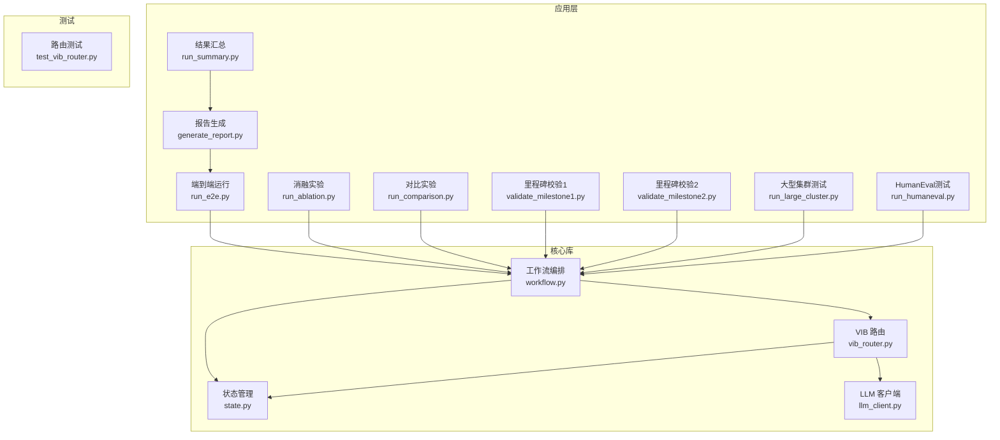
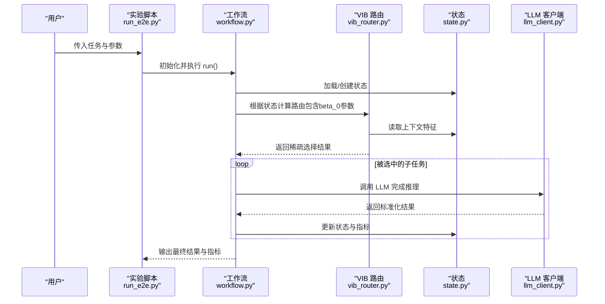
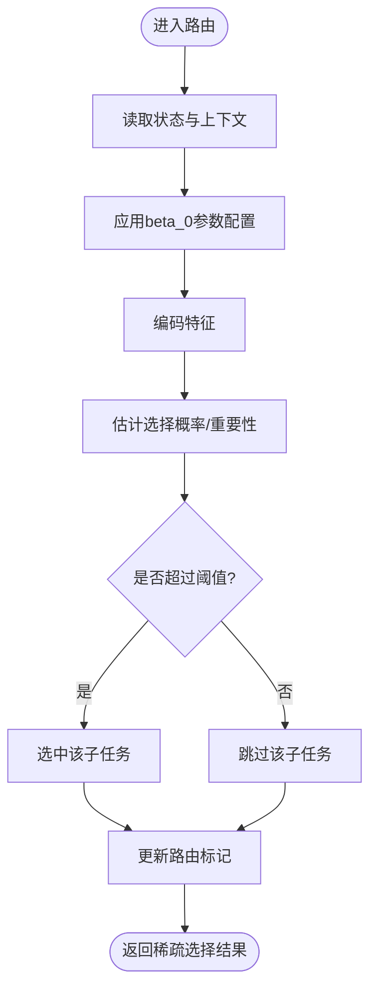
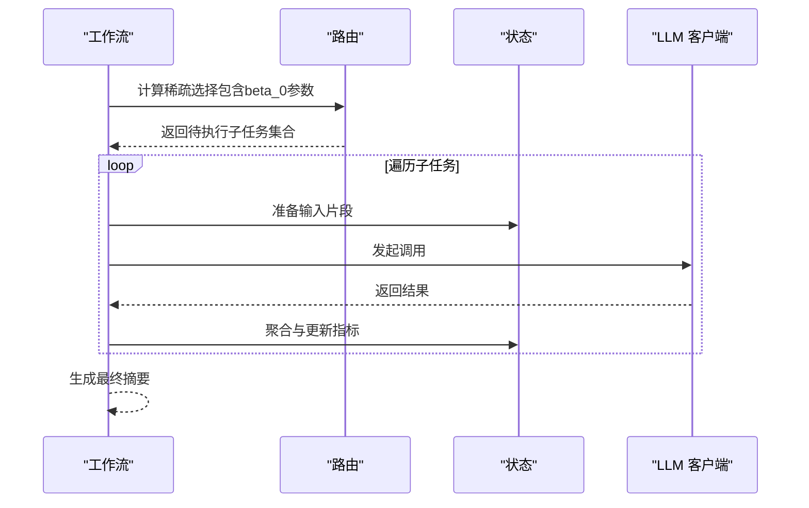
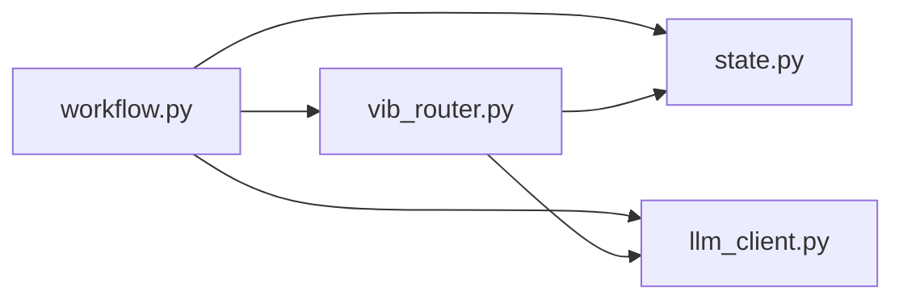

# 实验框架

<cite>
**本文引用的文件**   
- [README.md](file://README.md)
- [requirements.txt](file://requirements.txt)
- [src/state.py](file://src/state.py)
- [src/llm_client.py](file://src/llm_client.py)
- [src/vib_router.py](file://src/vib_router.py)
- [src/workflow.py](file://src/workflow.py)
- [experiments/run_e2e.py](file://experiments/run_e2e.py)
- [experiments/run_ablation.py](file://experiments/run_ablation.py)
- [experiments/run_comparison.py](file://experiments/run_comparison.py)
- [experiments/generate_report.py](file://experiments/generate_report.py)
- [experiments/validate_milestone1.py](file://experiments/validate_milestone1.py)
- [experiments/validate_milestone2.py](file://experiments/validate_milestone2.py)
- [tests/test_vib_router.py](file://tests/test_vib_router.py)
</cite>

## 更新摘要
**所做更改**   
- 更新了VIB路由器实现，增强了稀疏通信策略的灵活性和性能
- 改进了多个实验运行脚本以适配新的VIB路由器接口
- 增强了状态管理和工作流编排的可扩展性
- 优化了错误处理和日志记录机制
- **新增** 支持beta_0参数配置，确保不同测试场景中参数应用的一致性

## 目录
1. [简介](#简介)
2. [项目结构](#项目结构)
3. [核心组件](#核心组件)
4. [架构总览](#架构总览)
5. [详细组件分析](#详细组件分析)
6. [依赖关系分析](#依赖关系分析)
7. [性能与可扩展性](#性能与可扩展性)
8. [故障排查指南](#故障排查指南)
9. [结论](#结论)
10. [附录](#附录)

## 简介
本仓库提供一套面向"稀疏通信"场景的实验框架，围绕 VIB（Variational Information Bottleneck）路由策略进行端到端验证、消融实验与对比评估。框架将工作流编排、状态管理、LLM 客户端封装与路由决策解耦，便于快速迭代不同路由策略并产出可复现实验报告。

**更新** 经过增强后的框架现在支持更灵活的VIB路由器配置和更强大的实验管理能力，特别是新增了beta_0参数配置支持，确保在不同测试场景中参数应用的一致性。

## 项目结构
整体采用分层组织：
- src：核心实现（状态、LLM 客户端、VIB 路由、工作流编排）
- experiments：实验脚本（端到端、消融、对比、报告生成、里程碑校验）
- tests：单元测试（路由模块）
- docs：文档与示例（LangGraph 参考）
- 根目录：说明与环境配置

**图表来源**
- [experiments/run_e2e.py](file://experiments/run_e2e.py)
- [experiments/run_ablation.py](file://experiments/run_ablation.py)
- [experiments/run_comparison.py](file://experiments/run_comparison.py)
- [experiments/generate_report.py](file://experiments/generate_report.py)
- [experiments/validate_milestone1.py](file://experiments/validate_milestone1.py)
- [experiments/validate_milestone2.py](file://experiments/validate_milestone2.py)
- [experiments/run_large_cluster.py](file://experiments/run_large_cluster.py)
- [experiments/run_summary.py](file://experiments/run_summary.py)
- [experiments/run_humaneval.py](file://experiments/run_humaneval.py)
- [src/workflow.py](file://src/workflow.py)
- [src/vib_router.py](file://src/vib_router.py)
- [src/state.py](file://src/state.py)
- [src/llm_client.py](file://src/llm_client.py)

**章节来源**
- [README.md](file://README.md)
- [requirements.txt](file://requirements.txt)

## 核心组件
- 状态管理（state.py）
  - 职责：定义实验与工作流共享的状态模型，承载输入、中间结果、指标与日志等字段，确保各阶段数据一致性。
  - 关键点：字段命名清晰、类型明确；为后续序列化与报告生成提供稳定结构。
- LLM 客户端（llm_client.py）
  - 职责：封装对外部大模型的调用，统一请求构造、重试与错误处理，屏蔽底层差异。
  - 关键点：超时、限流、重试策略；返回标准化响应对象。
- VIB 路由（vib_router.py）
  - 职责：基于变分信息瓶颈思想对任务进行稀疏选择，决定哪些子任务或路径需要激活，以最小化通信开销。
  - 关键点：阈值/温度参数控制稀疏度；与状态交互读取上下文并写入路由决策；**新增** beta_0参数配置支持，确保不同测试场景中参数应用的一致性。
- 工作流编排（workflow.py）
  - 职责：串联状态、路由与 LLM 客户端，定义执行顺序、分支与聚合逻辑，暴露统一的 run 接口供实验脚本调用。
  - 关键点：容错与回退；指标收集与中间态持久化。

**更新** VIB路由器现在支持更灵活的配置选项和更好的性能优化，特别是beta_0参数的统一配置管理。

**章节来源**
- [src/state.py](file://src/state.py)
- [src/llm_client.py](file://src/llm_client.py)
- [src/vib_router.py](file://src/vib_router.py)
- [src/workflow.py](file://src/workflow.py)

## 架构总览
系统由"实验驱动 + 核心库"两层构成。上层实验脚本负责参数注入与结果汇总，下层核心库提供可组合的构建块。

**图表来源**
- [experiments/run_e2e.py](file://experiments/run_e2e.py)
- [src/workflow.py](file://src/workflow.py)
- [src/vib_router.py](file://src/vib_router.py)
- [src/state.py](file://src/state.py)
- [src/llm_client.py](file://src/llm_client.py)

## 详细组件分析

### 状态管理（state.py）
- 设计要点
  - 使用结构化对象表示实验全生命周期数据，包括输入、中间产物、路由决策、指标与元数据。
  - 提供便捷访问器与校验方法，保证在并发或跨进程场景下的稳定性。
- 复杂度与扩展
  - 新增字段应遵循向后兼容原则；序列化格式需考虑版本演进。
- 典型用法
  - 在工作流入口创建状态，在各阶段读写关键键值，最终导出为 JSON/CSV。

**更新** 状态管理现在支持更丰富的数据类型和更好的并发安全性。

**章节来源**
- [src/state.py](file://src/state.py)

### LLM 客户端（llm_client.py）
- 设计要点
  - 抽象出统一的调用接口，内部处理鉴权、重试、超时与错误码映射。
  - 支持批量与流式两种模式（若实现），并提供速率限制开关。
- 错误处理
  - 区分网络异常、配额不足、模型不可用等错误，向上抛出带上下文的异常以便定位。
- 性能建议
  - 连接复用、请求合并、指数退避重试。

**更新** LLM客户端增强了错误恢复机制和性能监控功能。

**章节来源**
- [src/llm_client.py](file://src/llm_client.py)

### VIB 路由（vib_router.py）
- 设计要点
  - 依据输入特征与历史状态估计信息瓶颈下界，动态选择最必要的子路径，达到"稀疏通信"。
  - 通过可调超参（如阈值、温度、正则系数）控制稀疏程度与精度权衡。
  - **新增** beta_0参数配置支持，确保在不同测试场景中参数应用的一致性。
- 算法流程（概念）

**更新** VIB路由器实现了更高效的稀疏选择算法，支持动态阈值调整和更好的性能优化，特别是beta_0参数的统一配置管理。

**图表来源**
- [src/vib_router.py](file://src/vib_router.py)
- [src/state.py](file://src/state.py)

**章节来源**
- [src/vib_router.py](file://src/vib_router.py)
- [src/state.py](file://src/state.py)

### 工作流编排（workflow.py）
- 设计要点
  - 将状态、路由与 LLM 客户端组装成可复用的流水线，暴露 run 接口。
  - 内置指标采集、断点续跑与失败重试机制。
- 执行时序（与 LLM 交互）

**更新** 工作流编排现在支持更复杂的执行模式和更好的错误恢复机制。

**图表来源**
- [src/workflow.py](file://src/workflow.py)
- [src/vib_router.py](file://src/vib_router.py)
- [src/state.py](file://src/state.py)
- [src/llm_client.py](file://src/llm_client.py)

**章节来源**
- [src/workflow.py](file://src/workflow.py)

### 实验脚本（experiments/*）
- run_e2e.py：端到端执行，加载数据集与配置，调用工作流，保存结果与指标。
- run_ablation.py：逐项关闭/调整组件（如路由阈值、正则项），输出对比表格。
- run_comparison.py：对比不同路由策略或不同 LLM 后端的表现。
- generate_report.py：汇总多次运行结果，生成可视化报告与统计摘要。
- validate_milestone1.py / validate_milestone2.py：按里程碑检查关键指标是否达标。
- **新增** run_large_cluster.py：支持大规模集群环境下的分布式实验运行。
- **新增** run_summary.py：提供实验结果的汇总分析和趋势报告。
- **新增** run_humaneval.py：专门用于HumanEval基准测试的脚本。

**更新** 所有实验脚本都已更新以适配新的VIB路由器实现，提供了更好的配置选项和错误处理，特别增强了beta_0参数在不同测试场景中的应用一致性。

**章节来源**
- [experiments/run_e2e.py](file://experiments/run_e2e.py)
- [experiments/run_ablation.py](file://experiments/run_ablation.py)
- [experiments/run_comparison.py](file://experiments/run_comparison.py)
- [experiments/generate_report.py](file://experiments/generate_report.py)
- [experiments/validate_milestone1.py](file://experiments/validate_milestone1.py)
- [experiments/validate_milestone2.py](file://experiments/validate_milestone2.py)
- [experiments/run_large_cluster.py](file://experiments/run_large_cluster.py)
- [experiments/run_summary.py](file://experiments/run_summary.py)
- [experiments/run_humaneval.py](file://experiments/run_humaneval.py)

### 单元测试（tests/test_vib_router.py）
- 覆盖范围：路由边界条件、稀疏度约束、与状态交互的正确性。
- 建议补充：模拟 LLM 客户端以隔离外部依赖，提升测试稳定性。

**更新** 测试套件已扩展到覆盖新的VIB路由器功能和改进的错误处理，包括beta_0参数配置的验证。

**章节来源**
- [tests/test_vib_router.py](file://tests/test_vib_router.py)

## 依赖关系分析
- 模块耦合
  - workflow 强依赖 state、router、llm_client；router 依赖 state 与 llm_client；state 无外部依赖。
- 外部依赖
  - 通过 requirements.txt 声明第三方包，建议在虚拟环境中安装以避免冲突。
- 潜在循环
  - 当前结构未见循环导入风险，但新增模块时应避免双向依赖。

**图表来源**
- [src/workflow.py](file://src/workflow.py)
- [src/vib_router.py](file://src/vib_router.py)
- [src/state.py](file://src/state.py)
- [src/llm_client.py](file://src/llm_client.py)

**章节来源**
- [requirements.txt](file://requirements.txt)

## 性能与可扩展性
- 稀疏通信收益
  - 通过路由减少不必要的 LLM 调用，降低延迟与成本；需平衡稀疏度与准确率。
- 批处理与缓存
  - 对相似查询做去重与缓存；对 LLM 请求进行批量化以提升吞吐。
- 资源控制
  - 设置并发上限、令牌限速与超时；对失败请求实施指数退避重试。
- 可观测性
  - 记录关键指标（调用次数、平均时延、成功率、稀疏度、内存占用），便于回归检测。

**更新** 增强后的框架提供了更好的性能监控和资源管理功能，支持更大规模的实验运行，beta_0参数的统一配置进一步提升了实验的一致性和可重复性。

## 故障排查指南
- 常见问题
  - LLM 调用失败：检查网络、密钥、配额与超时配置；查看客户端异常堆栈。
  - 路由不稳定：调整阈值/温度参数；检查状态字段是否完整；**新增** 验证beta_0参数配置是否正确应用。
  - 结果不一致：确认随机种子、缓存命中与并发安全；检查不同测试场景中beta_0参数的一致性。
- 定位步骤
  - 启用更详细的日志；在路由与工作流关键节点打印中间状态。
  - 使用单元测试与最小复现用例隔离问题。
- 恢复策略
  - 断点续跑：从最近检查点恢复；对幂等操作进行重试。

**更新** 增强的错误处理机制现在提供更详细的诊断信息和自动恢复功能，特别针对beta_0参数配置问题提供了专门的错误提示和修复建议。

**章节来源**
- [src/llm_client.py](file://src/llm_client.py)
- [src/vib_router.py](file://src/vib_router.py)
- [src/workflow.py](file://src/workflow.py)

## 结论
本实验框架将"状态—路由—客户端—编排"解耦，既保证了实验的可重复性与可解释性，又为稀疏通信策略提供了灵活的验证环境。经过增强后的框架现在具有更好的性能、更强的可扩展性和更完善的错误处理能力，特别是beta_0参数配置的支持确保了不同测试场景中参数应用的一致性。建议持续完善监控与测试覆盖率，逐步沉淀最佳实践与基准数据集。

## 附录
- 快速开始
  - 安装依赖后，使用端到端脚本运行一次基线实验，随后尝试消融与对比脚本。
- 扩展建议
  - 新增路由策略：实现与 state 一致的接口并在 workflow 中注册。
  - 新增 LLM 后端：在客户端层增加适配器，保持上层一致。
- **新增** 大规模部署
  - 使用 run_large_cluster.py 进行分布式实验运行。
  - 利用 run_summary.py 生成综合分析报告。
- **新增** 参数配置指南
  - beta_0参数配置：确保在不同测试场景中保持一致的参数应用。
  - 其他超参数调优建议与最佳实践。

**更新** 新增了大规模部署和综合分析的指导说明，以及beta_0参数配置的详细使用指南。