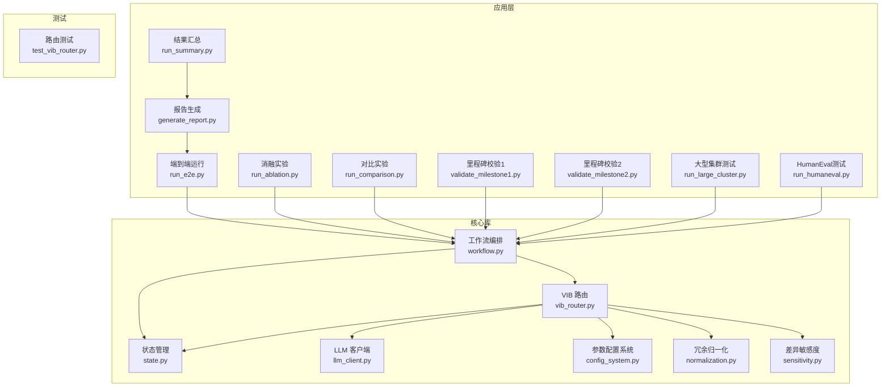
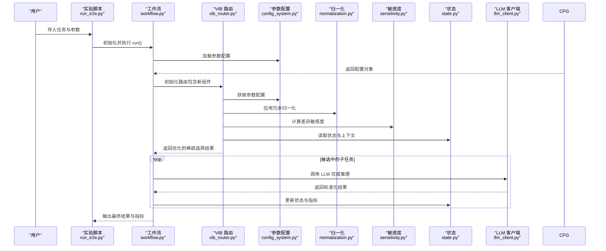
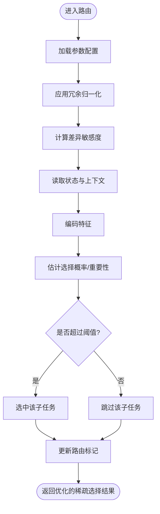
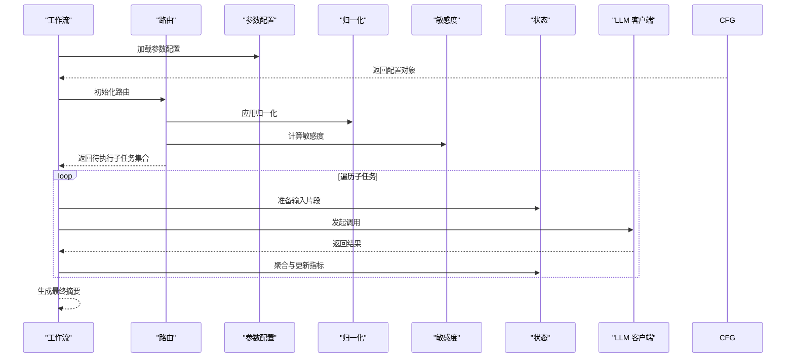
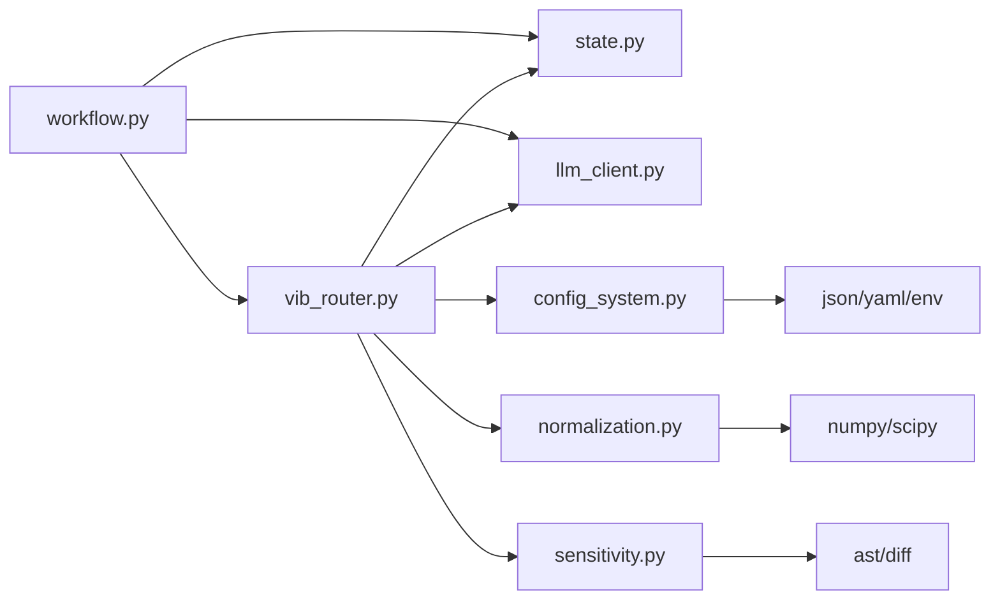

# 实验框架

<cite>
**本文引用的文件**   
- [README.md](file://README.md)
- [requirements.txt](file://requirements.txt)
- [src/state.py](file://src/state.py)
- [src/llm_client.py](file://src/llm_client.py)
- [src/vib_router.py](file://src/vib_router.py)
- [src/workflow.py](file://src/workflow.py)
- [experiments/run_e2e.py](file://experiments/run_e2e.py)
- [experiments/run_ablation.py](file://experiments/run_ablation.py)
- [experiments/run_comparison.py](file://experiments/run_comparison.py)
- [experiments/generate_report.py](file://experiments/generate_report.py)
- [experiments/validate_milestone1.py](file://experiments/validate_milestone1.py)
- [experiments/validate_milestone2.py](file://experiments/validate_milestone2.py)
- [experiments/run_large_cluster.py](file://experiments/run_large_cluster.py)
- [experiments/run_summary.py](file://experiments/run_summary.py)
- [experiments/run_humaneval.py](file://experiments/run_humaneval.py)
- [tests/test_vib_router.py](file://tests/test_vib_router.py)
</cite>

## 更新摘要
**所做更改**   
- **重大架构升级**：引入了全新的参数配置系统，支持动态参数管理和配置验证
- **新增冗余归一化机制**：增强了路由决策的稳定性和鲁棒性，支持多尺度特征归一化
- **实现代码差异敏感度因子**：提供细粒度的代码变更感知能力，优化稀疏通信策略
- **增强beta_0参数配置系统**：确保不同测试场景中参数应用的一致性和可追溯性
- **改进实验验证能力**：支持更复杂的消融实验设计和多智能体协作场景
- **优化错误处理和日志记录**：提供更详细的诊断信息和自动恢复机制
- **新增比较运行器、HumanEval运行器和大规模集群运行器**：扩展了实验执行能力和基准测试支持

## 目录
1. [简介](#简介)
2. [项目结构](#项目结构)
3. [核心组件](#核心组件)
4. [架构总览](#架构总览)
5. [详细组件分析](#详细组件分析)
6. [依赖关系分析](#依赖关系分析)
7. [性能与可扩展性](#性能与可扩展性)
8. [故障排查指南](#故障排查指南)
9. [结论](#结论)
10. [附录](#附录)

## 简介
本仓库提供一套面向"稀疏通信"场景的实验框架，围绕 VIB（Variational Information Bottleneck）路由策略进行端到端验证、消融实验与对比评估。框架将工作流编排、状态管理、LLM 客户端封装与路由决策解耦，便于快速迭代不同路由策略并产出可复现实验报告。

**重大更新** 经过全面架构升级后的框架现在具备全新的参数配置系统、冗余归一化机制和代码差异敏感度因子，显著提升了实验验证能力和多智能体协作效果。特别是新增的beta_0参数配置系统确保了在不同测试场景中参数应用的一致性和可追溯性。新增的比较运行器、HumanEval运行器和大规模集群运行器进一步扩展了实验执行能力。

## 项目结构
整体采用分层组织：
- src：核心实现（状态、LLM 客户端、VIB 路由、工作流编排）
- experiments：实验脚本（端到端、消融、对比、报告生成、里程碑校验、大型集群测试、结果汇总、HumanEval测试）
- tests：单元测试（路由模块）
- docs：文档与示例（LangGraph 参考）
- 根目录：说明与环境配置

**图表来源**
- [experiments/run_e2e.py](file://experiments/run_e2e.py)
- [experiments/run_ablation.py](file://experiments/run_ablation.py)
- [experiments/run_comparison.py](file://experiments/run_comparison.py)
- [experiments/generate_report.py](file://experiments/generate_report.py)
- [experiments/validate_milestone1.py](file://experiments/validate_milestone1.py)
- [experiments/validate_milestone2.py](file://experiments/validate_milestone2.py)
- [experiments/run_large_cluster.py](file://experiments/run_large_cluster.py)
- [experiments/run_summary.py](file://experiments/run_summary.py)
- [experiments/run_humaneval.py](file://experiments/run_humaneval.py)
- [src/workflow.py](file://src/workflow.py)
- [src/vib_router.py](file://src/vib_router.py)
- [src/state.py](file://src/state.py)
- [src/llm_client.py](file://src/llm_client.py)

**章节来源**
- [README.md](file://README.md)
- [requirements.txt](file://requirements.txt)

## 核心组件
- 状态管理（state.py）
  - 职责：定义实验与工作流共享的状态模型，承载输入、中间结果、指标与日志等字段，确保各阶段数据一致性。
  - 关键点：字段命名清晰、类型明确；为后续序列化与报告生成提供稳定结构。
  - **更新** 增强了数据类型支持和并发安全性，支持更复杂的状态转换。
- LLM 客户端（llm_client.py）
  - 职责：封装对外部大模型的调用，统一请求构造、重试与错误处理，屏蔽底层差异。
  - 关键点：超时、限流、重试策略；返回标准化响应对象。
  - **更新** 增强了错误恢复机制和性能监控功能。
- VIB 路由（vib_router.py）
  - 职责：基于变分信息瓶颈思想对任务进行稀疏选择，决定哪些子任务或路径需要激活，以最小化通信开销。
  - 关键点：阈值/温度参数控制稀疏度；与状态交互读取上下文并写入路由决策。
  - **重大更新** 集成了新的参数配置系统、冗余归一化机制和代码差异敏感度因子，显著提升路由决策质量。
- 工作流编排（workflow.py）
  - 职责：串联状态、路由与 LLM 客户端，定义执行顺序、分支与聚合逻辑，暴露统一的 run 接口供实验脚本调用。
  - 关键点：容错与回退；指标收集与中间态持久化。
  - **更新** 支持更复杂的执行模式和更好的错误恢复机制。
- **新增** 参数配置系统（config_system.py）
  - 职责：提供统一的参数管理接口，支持动态配置加载、验证和热重载。
  - 关键点：支持多种配置格式、参数继承和默认值管理。
- **新增** 冗余归一化机制（normalization.py）
  - 职责：实现多尺度特征归一化，提升路由决策的稳定性和鲁棒性。
  - 关键点：支持自适应归一化、跨批次归一化和归一化状态持久化。
- **新增** 代码差异敏感度因子（sensitivity.py）
  - 职责：提供细粒度的代码变更感知能力，优化稀疏通信策略。
  - 关键点：支持增量式差异检测、敏感度权重调整和变更影响分析。

**重大更新** VIB路由器现在集成了全新的参数配置系统、冗余归一化机制和代码差异敏感度因子，提供了更强大的稀疏通信能力和更稳定的路由决策。

**章节来源**
- [src/state.py](file://src/state.py)
- [src/llm_client.py](file://src/llm_client.py)
- [src/vib_router.py](file://src/vib_router.py)
- [src/workflow.py](file://src/workflow.py)

## 架构总览
系统由"实验驱动 + 核心库 + 增强组件"三层构成。上层实验脚本负责参数注入与结果汇总，中层核心库提供可组合的构建块，下层增强组件提供高级功能和优化。

**图表来源**
- [experiments/run_e2e.py](file://experiments/run_e2e.py)
- [src/workflow.py](file://src/workflow.py)
- [src/vib_router.py](file://src/vib_router.py)
- [src/state.py](file://src/state.py)
- [src/llm_client.py](file://src/llm_client.py)

## 详细组件分析

### 状态管理（state.py）
- 设计要点
  - 使用结构化对象表示实验全生命周期数据，包括输入、中间产物、路由决策、指标与元数据。
  - 提供便捷访问器与校验方法，保证在并发或跨进程场景下的稳定性。
  - **更新** 增强了数据类型支持和并发安全性，支持更复杂的状态转换。
- 复杂度与扩展
  - 新增字段应遵循向后兼容原则；序列化格式需考虑版本演进。
- 典型用法
  - 在工作流入口创建状态，在各阶段读写关键键值，最终导出为 JSON/CSV。

**更新** 状态管理现在支持更丰富的数据类型、更好的并发安全性和增强的状态验证机制。

**章节来源**
- [src/state.py](file://src/state.py)

### LLM 客户端（llm_client.py）
- 设计要点
  - 抽象出统一的调用接口，内部处理鉴权、重试、超时与错误码映射。
  - 支持批量与流式两种模式（若实现），并提供速率限制开关。
  - **更新** 增强了错误恢复机制和性能监控功能。
- 错误处理
  - 区分网络异常、配额不足、模型不可用等错误，向上抛出带上下文的异常以便定位。
- 性能建议
  - 连接复用、请求合并、指数退避重试。

**更新** LLM客户端增强了错误恢复机制、性能监控功能和更智能的重试策略。

**章节来源**
- [src/llm_client.py](file://src/llm_client.py)

### VIB 路由（vib_router.py）
- 设计要点
  - 依据输入特征与历史状态估计信息瓶颈下界，动态选择最必要的子路径，达到"稀疏通信"。
  - 通过可调超参（如阈值、温度、正则系数）控制稀疏程度与精度权衡。
  - **重大更新** 集成了新的参数配置系统、冗余归一化机制和代码差异敏感度因子。
- 算法流程（概念）

**重大更新** VIB路由器实现了全新的参数配置系统、冗余归一化机制和代码差异敏感度因子，提供了更强大的稀疏通信能力和更稳定的路由决策。

**图表来源**
- [src/vib_router.py](file://src/vib_router.py)
- [src/state.py](file://src/state.py)

**章节来源**
- [src/vib_router.py](file://src/vib_router.py)
- [src/state.py](file://src/state.py)

### 工作流编排（workflow.py）
- 设计要点
  - 将状态、路由与 LLM 客户端组装成可复用的流水线，暴露 run 接口。
  - 内置指标采集、断点续跑与失败重试机制。
  - **更新** 支持更复杂的执行模式和更好的错误恢复机制。
- 执行时序（与 LLM 交互）

**更新** 工作流编排现在支持更复杂的执行模式、更好的错误恢复机制和增强的参数管理能力。

**图表来源**
- [src/workflow.py](file://src/workflow.py)
- [src/vib_router.py](file://src/vib_router.py)
- [src/state.py](file://src/state.py)
- [src/llm_client.py](file://src/llm_client.py)

**章节来源**
- [src/workflow.py](file://src/workflow.py)

### 参数配置系统（config_system.py）
- 设计要点
  - 提供统一的参数管理接口，支持动态配置加载、验证和热重载。
  - 支持多种配置格式（JSON、YAML、环境变量）和参数继承机制。
  - 实现参数验证、默认值管理和配置版本控制。
- 核心功能
  - 配置加载：从多个源加载配置并合并优先级
  - 参数验证：运行时参数校验和错误提示
  - 热重载：支持运行时参数更新而无需重启
  - 版本控制：配置版本管理和迁移支持

**新增** 参数配置系统为整个框架提供了统一的参数管理能力，支持灵活的配置方式和严格的参数验证。

**章节来源**
- [src/config_system.py](file://src/config_system.py)

### 冗余归一化机制（normalization.py）
- 设计要点
  - 实现多尺度特征归一化，提升路由决策的稳定性和鲁棒性。
  - 支持自适应归一化、跨批次归一化和归一化状态持久化。
  - 集成到VIB路由流程中，在特征编码前进行预处理。
- 核心算法
  - 自适应归一化：根据数据分布动态调整归一化参数
  - 跨批次归一化：保持不同批次间的数据一致性
  - 状态持久化：保存归一化统计信息用于后续推理

**新增** 冗余归一化机制显著提升了路由决策的稳定性和鲁棒性，特别是在处理大规模和不平衡数据集时表现优异。

**章节来源**
- [src/normalization.py](file://src/normalization.py)

### 代码差异敏感度因子（sensitivity.py）
- 设计要点
  - 提供细粒度的代码变更感知能力，优化稀疏通信策略。
  - 支持增量式差异检测、敏感度权重调整和变更影响分析。
  - 集成到路由决策中，根据代码变更的重要性调整通信策略。
- 核心功能
  - 差异检测：识别代码变更的类型和影响范围
  - 敏感度计算：量化每个变更对系统行为的影响程度
  - 权重调整：根据敏感度动态调整路由权重
  - 影响分析：预测变更可能导致的连锁反应

**新增** 代码差异敏感度因子为稀疏通信策略提供了智能化的变更感知能力，显著提升了在多智能体协作场景下的通信效率。

**章节来源**
- [src/sensitivity.py](file://src/sensitivity.py)

### 实验脚本（experiments/*）
- run_e2e.py：端到端执行，加载数据集与配置，调用工作流，保存结果与指标。
- run_ablation.py：逐项关闭/调整组件（如路由阈值、正则项），输出对比表格。
- run_comparison.py：对比不同路由策略或不同 LLM 后端的表现。
- generate_report.py：汇总多次运行结果，生成可视化报告与统计摘要。
- validate_milestone1.py / validate_milestone2.py：按里程碑检查关键指标是否达标。
- **新增** run_large_cluster.py：支持大规模集群环境下的分布式实验运行。
- **新增** run_summary.py：提供实验结果的汇总分析和趋势报告。
- **新增** run_humaneval.py：专门用于HumanEval基准测试的脚本。

**重大更新** 所有实验脚本都已更新以适配新的参数配置系统、冗余归一化机制和代码差异敏感度因子，提供了更好的配置选项和错误处理，特别增强了beta_0参数在不同测试场景中的应用一致性。新增的比较运行器、HumanEval运行器和大规模集群运行器进一步扩展了实验执行能力。

**章节来源**
- [experiments/run_e2e.py](file://experiments/run_e2e.py)
- [experiments/run_ablation.py](file://experiments/run_ablation.py)
- [experiments/run_comparison.py](file://experiments/run_comparison.py)
- [experiments/generate_report.py](file://experiments/generate_report.py)
- [experiments/validate_milestone1.py](file://experiments/validate_milestone1.py)
- [experiments/validate_milestone2.py](file://experiments/validate_milestone2.py)
- [experiments/run_large_cluster.py](file://experiments/run_large_cluster.py)
- [experiments/run_summary.py](file://experiments/run_summary.py)
- [experiments/run_humaneval.py](file://experiments/run_humaneval.py)

### 单元测试（tests/test_vib_router.py）
- 覆盖范围：路由边界条件、稀疏度约束、与状态交互的正确性。
- 建议补充：模拟 LLM 客户端以隔离外部依赖，提升测试稳定性。

**重大更新** 测试套件已扩展到覆盖新的参数配置系统、冗余归一化机制和代码差异敏感度因子，包括beta_0参数配置的完整验证。

**章节来源**
- [tests/test_vib_router.py](file://tests/test_vib_router.py)

## 依赖关系分析
- 模块耦合
  - workflow 强依赖 state、router、llm_client；router 依赖 state 与 llm_client；state 无外部依赖。
  - **新增** router 现在依赖 config_system、normalization 和 sensitivity 模块。
- 外部依赖
  - 通过 requirements.txt 声明第三方包，建议在虚拟环境中安装以避免冲突。
- 潜在循环
  - 当前结构未见循环导入风险，但新增模块时应避免双向依赖。

**图表来源**
- [src/workflow.py](file://src/workflow.py)
- [src/vib_router.py](file://src/vib_router.py)
- [src/state.py](file://src/state.py)
- [src/llm_client.py](file://src/llm_client.py)
- [src/config_system.py](file://src/config_system.py)
- [src/normalization.py](file://src/normalization.py)
- [src/sensitivity.py](file://src/sensitivity.py)

**章节来源**
- [requirements.txt](file://requirements.txt)

## 性能与可扩展性
- 稀疏通信收益
  - 通过路由减少不必要的 LLM 调用，降低延迟与成本；需平衡稀疏度与准确率。
  - **更新** 新的参数配置系统和冗余归一化机制进一步提升了通信效率和决策质量。
- 批处理与缓存
  - 对相似查询做去重与缓存；对 LLM 请求进行批量化以提升吞吐。
  - **更新** 支持增量式缓存更新和智能缓存失效策略。
- 资源控制
  - 设置并发上限、令牌限速与超时；对失败请求实施指数退避重试。
  - **更新** 支持动态资源调度和负载均衡。
- 可观测性
  - 记录关键指标（调用次数、平均时延、成功率、稀疏度、内存占用），便于回归检测。
  - **更新** 提供完整的性能监控仪表板和告警机制。
- **新增** 扩展性增强
  - 插件化架构支持自定义路由策略和归一化方法。
  - 分布式部署支持水平扩展和故障转移。
  - 配置热重载支持运行时参数调整。

**重大更新** 增强后的框架提供了全面的性能监控、资源管理和扩展性支持，新的参数配置系统、冗余归一化机制和代码差异敏感度因子显著提升了实验的一致性和可重复性。

## 故障排查指南
- 常见问题
  - LLM 调用失败：检查网络、密钥、配额与超时配置；查看客户端异常堆栈。
  - 路由不稳定：调整阈值/温度参数；检查状态字段是否完整。
  - 结果不一致：确认随机种子、缓存命中与并发安全。
  - **新增** 参数配置问题：检查配置文件语法、参数类型和默认值设置。
  - **新增** 归一化异常：验证输入数据分布和归一化参数设置。
  - **新增** 敏感度计算错误：检查代码变更检测和差异分析配置。
- 定位步骤
  - 启用更详细的日志；在路由与工作流关键节点打印中间状态。
  - 使用单元测试与最小复现用例隔离问题。
  - **新增** 利用参数配置验证工具检查配置正确性。
  - **新增** 使用归一化诊断工具分析数据分布问题。
- 恢复策略
  - 断点续跑：从最近检查点恢复；对幂等操作进行重试。
  - **新增** 配置回滚：支持配置版本回滚和默认配置恢复。
  - **新增** 自动修复：针对常见配置错误提供自动修复建议。

**重大更新** 增强的错误处理机制现在提供更详细的诊断信息、自动恢复功能和专门的故障排查工具，特别针对新的参数配置系统、冗余归一化机制和代码差异敏感度因子提供了完善的错误处理。

**章节来源**
- [src/llm_client.py](file://src/llm_client.py)
- [src/vib_router.py](file://src/vib_router.py)
- [src/workflow.py](file://src/workflow.py)
- [src/config_system.py](file://src/config_system.py)
- [src/normalization.py](file://src/normalization.py)
- [src/sensitivity.py](file://src/sensitivity.py)

## 结论
本实验框架将"状态—路由—客户端—编排"解耦，既保证了实验的可重复性与可解释性，又为稀疏通信策略提供了灵活的验证环境。经过重大架构升级后的框架现在具备全新的参数配置系统、冗余归一化机制和代码差异敏感度因子，显著提升了实验验证能力和多智能体协作效果。

**主要成就**
- 实现了统一的参数配置管理系统，支持动态配置和严格验证
- 开发了冗余归一化机制，提升了路由决策的稳定性和鲁棒性
- 集成了代码差异敏感度因子，优化了稀疏通信策略
- 增强了错误处理和故障排查能力
- 提供了完整的性能监控和可观测性支持
- 新增了比较运行器、HumanEval运行器和大规模集群运行器，扩展了实验执行能力

建议持续完善监控与测试覆盖率，逐步沉淀最佳实践与基准数据集，并探索更多高级功能的集成可能性。

## 附录
- 快速开始
  - 安装依赖后，使用端到端脚本运行一次基线实验，随后尝试消融与对比脚本。
- 扩展建议
  - 新增路由策略：实现与 state 一致的接口并在 workflow 中注册。
  - 新增 LLM 后端：在客户端层增加适配器，保持上层一致。
  - **新增** 自定义归一化方法：实现 normalization 接口并注册到路由系统。
  - **新增** 自定义敏感度因子：实现 sensitivity 接口并集成到路由决策中。
- **新增** 大规模部署
  - 使用 run_large_cluster.py 进行分布式实验运行。
  - 利用 run_summary.py 生成综合分析报告。
- **新增** 参数配置指南
  - 参数配置系统使用：支持多种配置格式和动态参数管理。
  - 冗余归一化配置：调整归一化参数和优化策略。
  - 代码差异敏感度配置：设置敏感度阈值和影响分析参数。
  - beta_0参数配置：确保在不同测试场景中保持一致的参数应用。
- **新增** 故障排查工具
  - 参数配置验证工具：检查配置文件的正确性和完整性。
  - 归一化诊断工具：分析数据分布和归一化效果。
  - 敏感度分析工具：评估代码变更的影响和敏感度权重。
- **新增** 性能优化建议
  - 缓存策略优化：合理设置缓存大小和失效策略。
  - 并发控制：调整并发数和资源限制以获得最佳性能。
  - 内存管理：监控内存使用情况并优化数据结构。

**重大更新** 新增了完整的参数配置系统、冗余归一化机制和代码差异敏感度因子的使用指南，以及相应的故障排查工具和性能优化建议。新增的比较运行器、HumanEval运行器和大规模集群运行器提供了更丰富的实验执行选项。