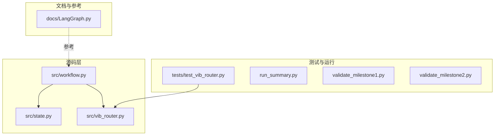
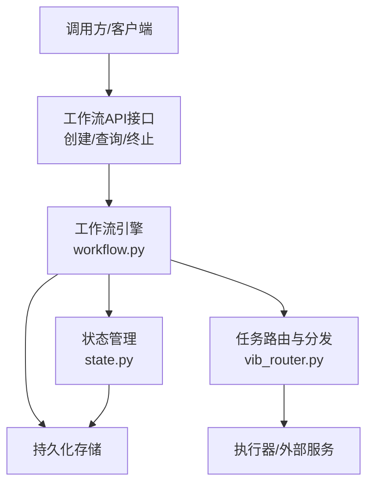
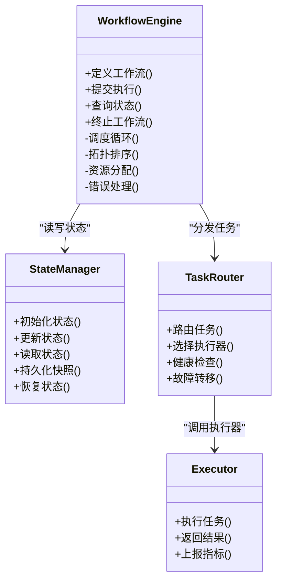
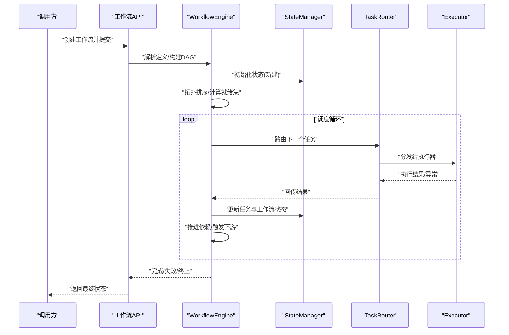
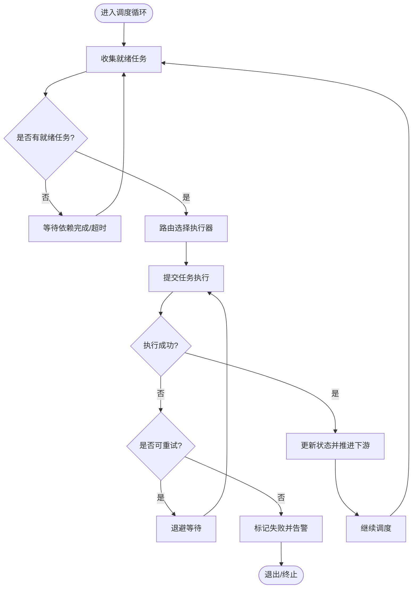
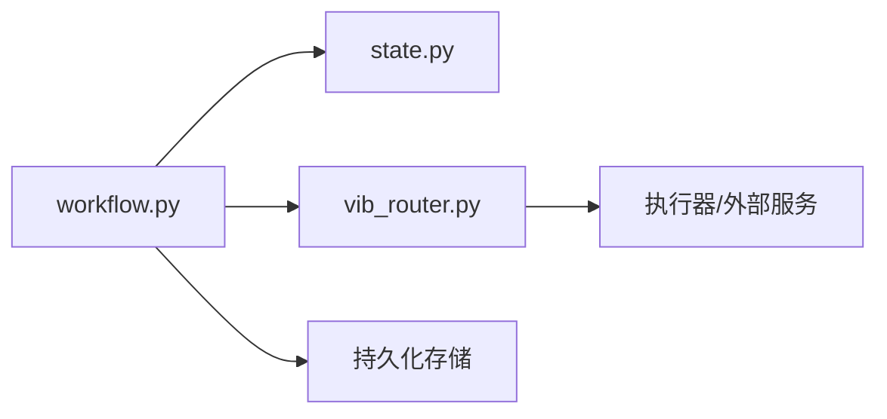

# 工作流引擎

<cite>
**本文引用的文件**   
- [workflow.py](file://src/workflow.py)
- [state.py](file://src/state.py)
- [vib_router.py](file://src/vib_router.py)
- [LangGraph.py](file://docs/LangGraph.py)
</cite>

## 目录
1. [简介](#简介)
2. [项目结构](#项目结构)
3. [核心组件](#核心组件)
4. [架构总览](#架构总览)
5. [详细组件分析](#详细组件分析)
6. [依赖关系分析](#依赖关系分析)
7. [性能考虑](#性能考虑)
8. [故障排查指南](#故障排查指南)
9. [结论](#结论)
10. [附录](#附录)

## 简介
本技术文档围绕工作流编排与执行机制，聚焦于 workflow.py 的实现细节，系统阐述工作流定义语法、任务依赖关系与执行顺序控制、调度算法与资源分配策略、生命周期管理（创建、执行、监控、终止）、错误处理与重试/恢复策略、与状态管理模块的集成方式，以及性能调优与监控指标。文档同时提供可落地的示例路径与可视化图示，帮助读者快速理解并高效使用工作流引擎。

## 项目结构
仓库采用分层组织：
- src：核心实现，包含工作流引擎、状态管理与路由逻辑
- docs：参考实现与说明材料
- tests：测试用例
- 根目录：运行脚本与验证脚本

图表来源
- [workflow.py](file://src/workflow.py)
- [state.py](file://src/state.py)
- [vib_router.py](file://src/vib_router.py)
- [LangGraph.py](file://docs/LangGraph.py)

章节来源
- [workflow.py](file://src/workflow.py)
- [state.py](file://src/state.py)
- [vib_router.py](file://src/vib_router.py)
- [LangGraph.py](file://docs/LangGraph.py)

## 核心组件
- 工作流编排器（workflow.py）：负责工作流定义解析、任务图构建、调度执行、生命周期管理与错误处理。
- 状态管理（state.py）：维护工作流实例的状态机、持久化快照与一致性保障。
- 路由与分发（vib_router.py）：将任务请求路由到具体执行器或外部服务，支持负载均衡与容错。
- 参考实现（docs/LangGraph.py）：提供基于图的编排范式与最佳实践参考。

章节来源
- [workflow.py](file://src/workflow.py)
- [state.py](file://src/state.py)
- [vib_router.py](file://src/vib_router.py)
- [LangGraph.py](file://docs/LangGraph.py)

## 架构总览
工作流引擎以“声明式定义 + 有向无环图（DAG）执行”为核心，结合状态机进行生命周期管理，并通过路由层解耦任务执行与调度。

图表来源
- [workflow.py](file://src/workflow.py)
- [state.py](file://src/state.py)
- [vib_router.py](file://src/vib_router.py)

## 详细组件分析

### 工作流定义语法与任务依赖
- 定义语法要点
  - 节点：每个任务为图中的一个节点，包含唯一标识、输入输出契约、可选参数与资源需求。
  - 边：表示数据或控制依赖，形成有向无环图；入度为零的节点为起始任务，出度为零的节点为结束任务。
  - 条件分支：在边或节点上附加布尔表达式，用于动态选择执行路径。
  - 聚合与合并：多个上游完成后触发下游任务，支持部分成功/全部成功的语义配置。
- 依赖关系与执行顺序
  - 拓扑排序保证合法执行序列；循环依赖将被拒绝。
  - 并行度由并发度上限与资源配额共同决定。
- 示例路径
  - 参见：[workflow.py](file://src/workflow.py)

章节来源
- [workflow.py](file://src/workflow.py)

### 任务调度算法与资源分配
- 调度算法
  - 就绪队列：按拓扑层级推进，优先满足资源可用且依赖已完成的节点。
  - 优先级策略：支持按权重、截止时间或业务等级进行排序。
  - 背压与限流：当执行器负载过高时，降低新任务提交速率，避免雪崩。
- 资源分配策略
  - 资源池：CPU/GPU/内存等资源的抽象与配额管理。
  - 亲和性：将特定任务绑定到具备相应硬件或环境的节点。
  - 抢占与迁移：在极端情况下支持任务迁移与抢占（需状态可恢复）。
- 示例路径
  - 参见：[workflow.py](file://src/workflow.py)、[vib_router.py](file://src/vib_router.py)

章节来源
- [workflow.py](file://src/workflow.py)
- [vib_router.py](file://src/vib_router.py)

### 生命周期管理（创建、执行、监控、终止）
- 创建
  - 校验定义合法性（DAG、类型、资源），生成初始状态与元数据。
- 执行
  - 启动调度循环，按拓扑推进，记录进度与中间结果。
- 监控
  - 暴露关键指标：吞吐、延迟、失败率、资源利用率、队列长度。
- 终止
  - 优雅关闭：等待正在运行的任务完成或安全中断，保存最终状态。
- 示例路径
  - 参见：[workflow.py](file://src/workflow.py)、[state.py](file://src/state.py)

章节来源
- [workflow.py](file://src/workflow.py)
- [state.py](file://src/state.py)

### 错误处理、重试与故障恢复
- 错误分类
  - 瞬时错误（网络抖动、超时）：适合自动重试。
  - 永久错误（参数非法、依赖缺失）：直接失败并告警。
- 重试策略
  - 指数退避与抖动，最大重试次数与熔断阈值。
  - 幂等性要求：确保重试不产生副作用。
- 故障恢复
  - 检查点：定期持久化状态与中间结果。
  - 断点续跑：从最近一致快照恢复执行。
- 示例路径
  - 参见：[workflow.py](file://src/workflow.py)、[state.py](file://src/state.py)

章节来源
- [workflow.py](file://src/workflow.py)
- [state.py](file://src/state.py)

### 与状态管理模块的集成
- 状态模型
  - 工作流实例状态：新建、排队、运行中、暂停、完成、失败、终止。
  - 任务级状态：待执行、执行中、成功、失败、取消。
- 一致性保障
  - 原子更新与乐观锁，防止并发写入冲突。
  - 快照与增量日志结合，兼顾恢复速度与空间占用。
- 示例路径
  - 参见：[state.py](file://src/state.py)

章节来源
- [state.py](file://src/state.py)

### 路由与分发（vib_router.py）
- 职责
  - 根据任务标签、资源需求与负载情况选择执行器。
  - 健康检查与故障转移，提升整体可用性。
- 扩展点
  - 自定义路由策略（轮询、最少连接、加权随机、区域亲和）。
- 示例路径
  - 参见：[vib_router.py](file://src/vib_router.py)

章节来源
- [vib_router.py](file://src/vib_router.py)

### 参考实现（LangGraph）
- 价值
  - 提供基于图的编排范式、节点间消息传递与状态同步的最佳实践。
- 借鉴点
  - 图遍历与事件驱动的执行模型、可扩展的节点注册机制。
- 示例路径
  - 参见：[LangGraph.py](file://docs/LangGraph.py)

章节来源
- [LangGraph.py](file://docs/LangGraph.py)

#### 类关系图（代码级）

图表来源
- [workflow.py](file://src/workflow.py)
- [state.py](file://src/state.py)
- [vib_router.py](file://src/vib_router.py)

#### 执行时序图（代码级）

图表来源
- [workflow.py](file://src/workflow.py)
- [state.py](file://src/state.py)
- [vib_router.py](file://src/vib_router.py)

#### 复杂逻辑流程图（代码级）

图表来源
- [workflow.py](file://src/workflow.py)
- [state.py](file://src/state.py)

## 依赖关系分析
- 内部耦合
  - workflow.py 强依赖 state.py 与 vib_router.py，体现“编排-状态-路由”的清晰分层。
  - 通过接口隔离，便于替换路由策略与状态后端。
- 外部依赖
  - 执行器/外部服务：通过路由层接入，支持异构环境。
  - 持久化存储：用于状态快照与审计日志。
- 潜在风险
  - 循环依赖：需在定义阶段严格校验。
  - 单点瓶颈：调度循环与状态写入可能成为热点，需水平扩展与缓存优化。

图表来源
- [workflow.py](file://src/workflow.py)
- [state.py](file://src/state.py)
- [vib_router.py](file://src/vib_router.py)

章节来源
- [workflow.py](file://src/workflow.py)
- [state.py](file://src/state.py)
- [vib_router.py](file://src/vib_router.py)

## 性能考虑
- 调度与执行
  - 批量化提交：减少上下文切换与序列化开销。
  - 并行度调优：依据资源容量与任务粒度设置合理并发。
  - 惰性求值：按需加载大对象，避免内存峰值。
- 状态与存储
  - 增量快照：仅持久化变更，降低I/O压力。
  - 读写分离：读多写少场景下引入只读副本。
- 监控与观测
  - 指标：任务吞吐、端到端延迟、失败率、重试率、资源利用率、队列深度。
  - 追踪：跨任务链路ID，定位慢点与瓶颈。
- 容量规划
  - 压测基线：在不同规模下评估稳定吞吐与尾延迟。
  - 弹性伸缩：根据队列长度与资源利用率自动扩缩容。

## 故障排查指南
- 常见问题
  - 死锁/饥饿：检查依赖环与优先级反转，确认资源配额。
  - 频繁重试：识别瞬时错误源，调整退避与熔断阈值。
  - 状态不一致：核对快照版本与事务边界，修复幂等性。
- 诊断步骤
  - 查看工作流与任务状态机转换日志。
  - 检查路由选择与健康检查结果。
  - 采集执行器侧指标与堆栈信息。
- 恢复建议
  - 从最近一致快照恢复，必要时回滚至上一稳定版本。
  - 对不可恢复任务进行人工干预与补偿。

章节来源
- [workflow.py](file://src/workflow.py)
- [state.py](file://src/state.py)
- [vib_router.py](file://src/vib_router.py)

## 结论
本工作流引擎以声明式DAG定义为核心，结合稳健的状态机与灵活的路由分发，实现了高内聚、低耦合的编排与执行能力。通过完善的错误处理、重试与恢复机制，以及面向生产环境的性能调优与监控指标，能够满足复杂业务场景下的可靠性与效率要求。建议在落地过程中结合业务特征定制路由策略与资源配额，并持续完善观测体系以支撑运维与优化。

## 附录
- 示例路径
  - 工作流定义与执行入口：[workflow.py](file://src/workflow.py)
  - 状态模型与快照：[state.py](file://src/state.py)
  - 路由与分发策略：[vib_router.py](file://src/vib_router.py)
  - 参考实现与范式：[LangGraph.py](file://docs/LangGraph.py)
- 术语表
  - DAG：有向无环图
  - 拓扑排序：按依赖关系确定线性执行顺序
  - 幂等：多次执行与一次执行效果相同
  - 熔断：在错误率超过阈值时快速失败，避免雪崩