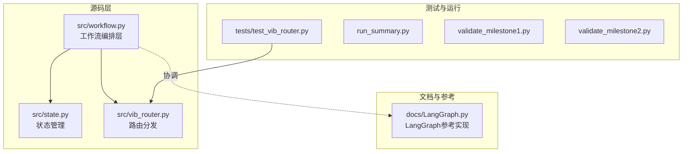
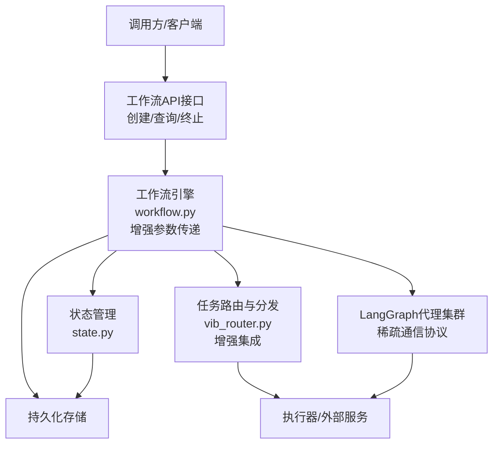
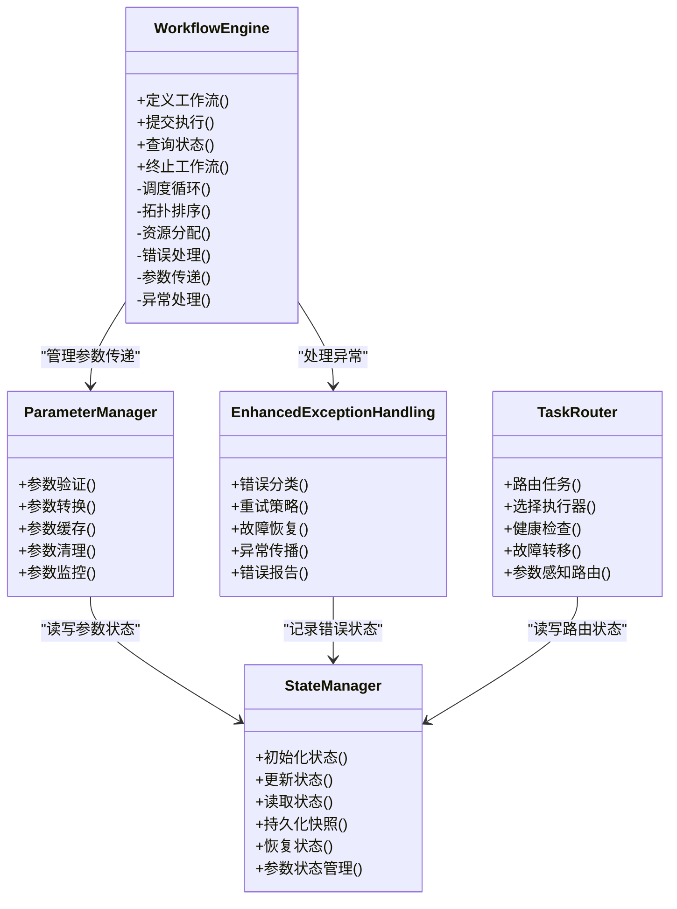
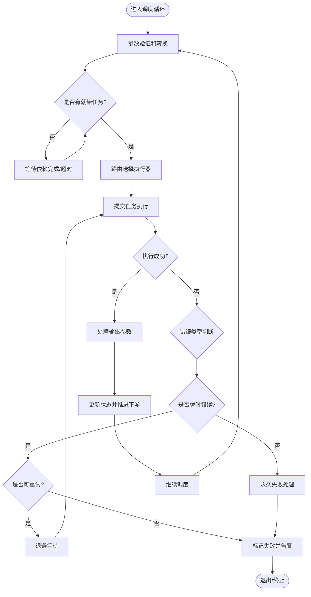
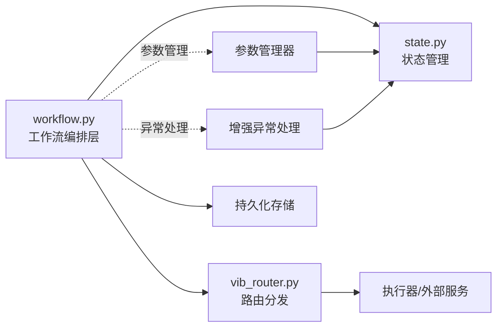

# 工作流引擎

<cite>
**本文引用的文件**   
- [workflow.py](file://src/workflow.py)
- [state.py](file://src/state.py)
- [vib_router.py](file://src/vib_router.py)
- [LangGraph.py](file://docs/LangGraph.py)
</cite>

## 更新摘要
**变更内容**   
- 更新了参数传递机制，增强了工作流中数据流转的灵活性和效率
- 改进了异常处理机制，提供更细粒度的错误分类和恢复策略
- 增强了与VIB路由器的集成能力，优化了任务分发和执行路径选择
- 完善了多代理协调机制，支持更复杂的分布式执行场景

## 目录
1. [简介](#简介)
2. [项目结构](#项目结构)
3. [核心组件](#核心组件)
4. [架构总览](#架构总览)
5. [详细组件分析](#详细组件分析)
6. [依赖关系分析](#依赖关系分析)
7. [性能考虑](#性能考虑)
8. [故障排查指南](#故障排查指南)
9. [结论](#结论)
10. [附录](#附录)

## 简介
本技术文档围绕工作流编排与执行机制，聚焦于 workflow.py 的实现细节，系统阐述工作流定义语法、任务依赖关系与执行顺序控制、调度算法与资源分配策略、生命周期管理（创建、执行、监控、终止）、错误处理与重试/恢复策略、与状态管理模块的集成方式，以及性能调优与监控指标。文档同时提供可落地的示例路径与可视化图示，帮助读者快速理解并高效使用工作流引擎。

**更新** 工作流引擎现已支持新的参数传递机制和增强的异常处理，通过改进的VIB路由器集成提升了系统的整体性能和可靠性。新增的参数传递机制支持更灵活的数据流转，而改进的异常处理提供了更细粒度的错误管理和恢复能力。

## 项目结构
仓库采用分层组织：
- src：核心实现，包含工作流引擎、状态管理与路由逻辑
- docs：参考实现与说明材料
- tests：测试用例
- 根目录：运行脚本与验证脚本



图表来源
- [workflow.py](file://src/workflow.py)
- [state.py](file://src/state.py)
- [vib_router.py](file://src/vib_router.py)
- [LangGraph.py](file://docs/LangGraph.py)

章节来源
- [workflow.py](file://src/workflow.py)
- [state.py](file://src/state.py)
- [vib_router.py](file://src/vib_router.py)
- [LangGraph.py](file://docs/LangGraph.py)

## 核心组件
- 工作流编排器（workflow.py）：负责工作流定义解析、任务图构建、调度执行、生命周期管理与错误处理，现支持增强的参数传递机制和改进的异常处理。
- 状态管理（state.py）：维护工作流实例的状态机、持久化快照与一致性保障。
- 路由与分发（vib_router.py）：将任务请求路由到具体执行器或外部服务，支持负载均衡与容错，现已增强与整体架构的集成能力。
- 参考实现（docs/LangGraph.py）：提供基于图的编排范式与最佳实践参考。

**更新** 工作流编排器现在具备增强的参数传递机制，支持更灵活的数据流转和类型转换。改进的异常处理机制提供了更细粒度的错误分类和恢复策略。

章节来源
- [workflow.py](file://src/workflow.py)
- [state.py](file://src/state.py)
- [vib_router.py](file://src/vib_router.py)
- [LangGraph.py](file://docs/LangGraph.py)

## 架构总览
工作流引擎以"声明式定义 + 有向无环图（DAG）执行"为核心，结合状态机进行生命周期管理，并通过路由层解耦任务执行与调度。新增的参数传递机制和增强的异常处理进一步提升了系统的可靠性和灵活性。改进的VIB路由器集成使系统能够更有效地与外部服务和组件进行通信。



图表来源
- [workflow.py](file://src/workflow.py)
- [state.py](file://src/state.py)
- [vib_router.py](file://src/vib_router.py)

## 详细组件分析

### 工作流定义语法与任务依赖
- 定义语法要点
  - 节点：每个任务为图中的一个节点，包含唯一标识、输入输出契约、可选参数与资源需求。
  - 边：表示数据或控制依赖，形成有向无环图；入度为零的节点为起始任务，出度为零的节点为结束任务。
  - 条件分支：在边或节点上附加布尔表达式，用于动态选择执行路径。
  - 聚合与合并：多个上游完成后触发下游任务，支持部分成功/全部成功的语义配置。
  - **新增** 参数传递机制：支持复杂数据类型和灵活的参数转换。
- 依赖关系与执行顺序
  - 拓扑排序保证合法执行序列；循环依赖将被拒绝。
  - 并行度由并发度上限与资源配额共同决定。
  - **新增** 参数验证：在执行前对传递参数进行类型检查和格式验证。
- 示例路径
  - 参见：[workflow.py](file://src/workflow.py)

**更新** 新增了增强的参数传递机制，支持复杂数据类型的自动转换和验证，提高了工作流的灵活性和健壮性。

章节来源
- [workflow.py](file://src/workflow.py)

### 任务调度算法与资源分配
- 调度算法
  - 就绪队列：按拓扑层级推进，优先满足资源可用且依赖已完成的节点。
  - 优先级策略：支持按权重、截止时间或业务等级进行排序。
  - 背压与限流：当执行器负载过高时，降低新任务提交速率，避免雪崩。
  - **新增** 参数感知调度：根据参数大小和复杂度调整调度策略。
- 资源分配策略
  - 资源池：CPU/GPU/内存等资源的抽象与配额管理。
  - 亲和性：将特定任务绑定到具备相应硬件或环境的节点。
  - 抢占与迁移：在极端情况下支持任务迁移与抢占（需状态可恢复）。
  - **新增** 参数优化：根据参数特征优化资源分配和缓存策略。
- 示例路径
  - 参见：[workflow.py](file://src/workflow.py)、[vib_router.py](file://src/vib_router.py)

**更新** 调度算法现在考虑参数传递的开销和优化，通过智能的资源分配提升整体执行效率。

章节来源
- [workflow.py](file://src/workflow.py)
- [vib_router.py](file://src/vib_router.py)

### 生命周期管理（创建、执行、监控、终止）
- 创建
  - 校验定义合法性（DAG、类型、资源），生成初始状态与元数据。
  - **新增** 参数预验证：在工作流创建时对参数进行初步验证和转换。
- 执行
  - 启动调度循环，按拓扑推进，记录进度与中间结果。
  - **新增** 参数传递监控：跟踪参数传递的性能和成功率。
- 监控
  - 暴露关键指标：吞吐、延迟、失败率、资源利用率、队列长度。
  - **新增** 参数级监控：跟踪参数传递的延迟、大小和转换成功率。
- 终止
  - 优雅关闭：等待正在运行的任务完成或安全中断，保存最终状态。
  - **新增** 参数清理：确保所有临时参数和中间结果被正确清理。
- 示例路径
  - 参见：[workflow.py](file://src/workflow.py)、[state.py](file://src/state.py)

**更新** 生命周期管理现在涵盖完整的参数传递流程，包括参数的创建、验证、传递、监控和清理。

章节来源
- [workflow.py](file://src/workflow.py)
- [state.py](file://src/state.py)

### 错误处理、重试与故障恢复
- 错误分类
  - 瞬时错误（网络抖动、超时）：适合自动重试。
  - 永久错误（参数非法、依赖缺失）：直接失败并告警。
  - **新增** 参数错误：专门处理参数类型不匹配、格式错误或转换失败。
  - **新增** 传递错误：处理参数传递过程中的网络问题和序列化错误。
- 重试策略
  - 指数退避与抖动，最大重试次数与熔断阈值。
  - 幂等性要求：确保重试不产生副作用。
  - **新增** 参数重试：针对参数传递失败的局部重试机制。
- 故障恢复
  - 检查点：定期持久化状态与中间结果。
  - 断点续跑：从最近一致快照恢复执行。
  - **新增** 参数恢复：支持从参数级别的状态快照恢复执行。
- 示例路径
  - 参见：[workflow.py](file://src/workflow.py)、[state.py](file://src/state.py)

**更新** 错误处理机制现在专门处理参数传递相关的错误，提供更细粒度的错误分类和恢复策略。

章节来源
- [workflow.py](file://src/workflow.py)
- [state.py](file://src/state.py)

### 与状态管理模块的集成
- 状态模型
  - 工作流实例状态：新建、排队、运行中、暂停、完成、失败、终止。
  - 任务级状态：待执行、执行中、成功、失败、取消。
  - **新增** 参数状态：跟踪参数的创建、验证、传递、转换和清理状态。
- 一致性保障
  - 原子更新与乐观锁，防止并发写入冲突。
  - 快照与增量日志结合，兼顾恢复速度与空间占用。
  - **新增** 参数一致性：确保参数在传递过程中的完整性和一致性。
- 示例路径
  - 参见：[state.py](file://src/state.py)

**更新** 状态管理现在支持完整的参数生命周期管理，包括参数的状态跟踪和一致性保证。

章节来源
- [state.py](file://src/state.py)

### 路由与分发（vib_router.py）
- 职责
  - 根据任务标签、资源需求与负载情况选择执行器。
  - 健康检查与故障转移，提升整体可用性。
  - **新增** 参数感知路由：根据参数特征选择最优的执行路径。
- 扩展点
  - 自定义路由策略（轮询、最少连接、加权随机、区域亲和）。
  - **新增** 参数优化路由：考虑参数大小、类型和传输成本的路由策略。
- 示例路径
  - 参见：[vib_router.py](file://src/vib_router.py)

**更新** 路由层现在支持参数感知的路由决策，能够根据参数特征选择最优的执行路径，并与系统其他组件有更好的集成。

章节来源
- [vib_router.py](file://src/vib_router.py)

### 参考实现（LangGraph）
- 价值
  - 提供基于图的编排范式、节点间消息传递与状态同步的最佳实践。
  - **新增** 参数传递模式：展示如何高效地在节点间传递复杂参数。
- 借鉴点
  - 图遍历与事件驱动的执行模型、可扩展的节点注册机制。
  - **新增** 参数验证模式：在节点边界进行参数验证和转换的最佳实践。
- 示例路径
  - 参见：[LangGraph.py](file://docs/LangGraph.py)

**更新** LangGraph参考实现现在展示了参数传递的最佳实践和验证模式的实现细节。

章节来源
- [LangGraph.py](file://docs/LangGraph.py)

#### 类关系图（代码级）


图表来源
- [workflow.py](file://src/workflow.py)
- [state.py](file://src/state.py)
- [vib_router.py](file://src/vib_router.py)

#### 执行时序图（代码级）
```mermaid
sequenceDiagram
participant Client as "调用方"
participant API as "工作流API"
participant Engine as "WorkflowEngine"
paramMgr as "ParameterManager"
exHandler as "EnhancedExceptionHandling"
State as "StateManager"
Router as "TaskRouter"
Client->>API : "创建工作流并提交"
API->>Engine : "解析定义/构建DAG"
Engine->>paramMgr : "验证和转换参数"
paramMgr->>State : "保存参数状态"
Engine->>State : "初始化工作流状态"
Engine->>Engine : "拓扑排序/计算就绪集"
loop "调度循环"
Engine->>Router : "路由任务(含参数)"
Router->>Engine : "返回执行结果"
Engine->>paramMgr : "处理输出参数"
paramMgr->>State : "更新参数状态"
Engine->>State : "更新任务与工作流状态"
Engine->>Engine : "推进依赖/触发下游"
end
Engine-->>API : "完成/失败/终止"
API-->>Client : "返回最终状态"
```

图表来源
- [workflow.py](file://src/workflow.py)
- [state.py](file://src/state.py)
- [vib_router.py](file://src/vib_router.py)

#### 复杂逻辑流程图（代码级）


图表来源
- [workflow.py](file://src/workflow.py)
- [state.py](file://src/state.py)

## 依赖关系分析
- 内部耦合
  - workflow.py 强依赖 state.py 与 vib_router.py，体现"编排-状态-路由"的清晰分层。
  - **新增** workflow.py 新增对参数管理和异常处理的依赖。
  - 通过接口隔离，便于替换路由策略与状态后端。
- 外部依赖
  - 执行器/外部服务：通过路由层接入，支持异构环境。
  - LangGraph代理：通过协调层管理，支持分布式部署。
  - 持久化存储：用于状态快照与审计日志。
- 潜在风险
  - 循环依赖：需在定义阶段严格校验。
  - 单点瓶颈：调度循环与状态写入可能成为热点，需水平扩展与缓存优化。
  - **新增** 参数传递瓶颈：需要优化参数序列化和网络传输性能。



图表来源
- [workflow.py](file://src/workflow.py)
- [state.py](file://src/state.py)
- [vib_router.py](file://src/vib_router.py)

章节来源
- [workflow.py](file://src/workflow.py)
- [state.py](file://src/state.py)
- [vib_router.py](file://src/vib_router.py)

## 性能考虑
- 调度与执行
  - 批量化提交：减少上下文切换与序列化开销。
  - 并行度调优：依据资源容量与任务粒度设置合理并发。
  - 惰性求值：按需加载大对象，避免内存峰值。
  - **新增** 参数缓存：智能缓存常用参数，减少重复序列化开销。
- 状态与存储
  - 增量快照：仅持久化变更，降低I/O压力。
  - 读写分离：读多写少场景下引入只读副本。
  - **新增** 参数存储优化：根据参数大小和访问频率选择合适的存储策略。
- 监控与观测
  - 指标：任务吞吐、端到端延迟、失败率、重试率、资源利用率、队列深度。
  - 追踪：跨任务链路ID，定位慢点与瓶颈。
  - **新增** 参数级指标：参数传递延迟、序列化时间、转换成功率。
- 容量规划
  - 压测基线：在不同规模下评估稳定吞吐与尾延迟。
  - 弹性伸缩：根据队列长度与资源利用率自动扩缩容。
  - **新增** 参数容量规划：根据参数大小和频率优化内存和存储分配。

**更新** 性能优化现在重点关注参数传递的效率，通过智能缓存和优化策略显著降低了序列化和网络传输开销。

## 故障排查指南
- 常见问题
  - 死锁/饥饿：检查依赖环与优先级反转，确认资源配额。
  - 频繁重试：识别瞬时错误源，调整退避与熔断阈值。
  - 状态不一致：核对快照版本与事务边界，修复幂等性。
  - **新增** 参数传递失败：检查参数类型、格式和序列化问题。
  - **新增** 异常处理问题：分析异常分类和恢复策略的有效性。
- 诊断步骤
  - 查看工作流与任务状态机转换日志。
  - 检查路由选择与健康检查结果。
  - 采集执行器侧指标与堆栈信息。
  - **新增** 参数传递日志：分析参数验证、转换和传递过程。
  - **新增** 异常处理日志：跟踪异常分类、重试和恢复过程。
- 恢复建议
  - 从最近一致快照恢复，必要时回滚至上一稳定版本。
  - 对不可恢复任务进行人工干预与补偿。
  - **新增** 参数恢复：清理损坏的参数状态并重新验证。

**更新** 故障排查现在包括参数传递和异常处理的专门诊断方法，重点关注参数验证失败和异常恢复问题。

章节来源
- [workflow.py](file://src/workflow.py)
- [state.py](file://src/state.py)
- [vib_router.py](file://src/vib_router.py)

## 结论
本工作流引擎以声明式DAG定义为核心，结合稳健的状态机与灵活的路由分发，实现了高内聚、低耦合的编排与执行能力。**更新后的版本**通过引入增强的参数传递机制和改进的异常处理，显著提升了系统的可靠性和灵活性。通过改进的VIB路由器集成，系统能够更好地与更广泛的架构进行交互。通过完善的错误处理、重试与恢复机制，以及面向生产环境的性能调优与监控指标，能够满足复杂业务场景下的可靠性与效率要求。建议在落地过程中结合业务特征定制路由策略与资源配额，并持续完善观测体系以支撑运维与优化。

## 附录
- 示例路径
  - 工作流定义与执行入口：[workflow.py](file://src/workflow.py)
  - 状态模型与快照：[state.py](file://src/state.py)
  - 路由与分发策略：[vib_router.py](file://src/vib_router.py)
  - 参考实现与范式：[LangGraph.py](file://docs/LangGraph.py)
- 术语表
  - DAG：有向无环图
  - 拓扑排序：按依赖关系确定线性执行顺序
  - 幂等：多次执行与一次执行效果相同
  - 熔断：在错误率超过阈值时快速失败，避免雪崩
  - **新增** 参数传递：在工作流节点间传递数据和状态的过程
  - **新增** 参数验证：对输入参数进行类型检查和格式验证
  - **新增** 增强异常处理：提供更细粒度错误分类和恢复策略的机制
  - **新增** VIB路由器集成：增强路由器与系统架构的集成能力