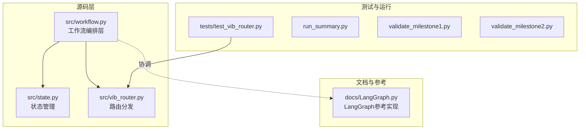
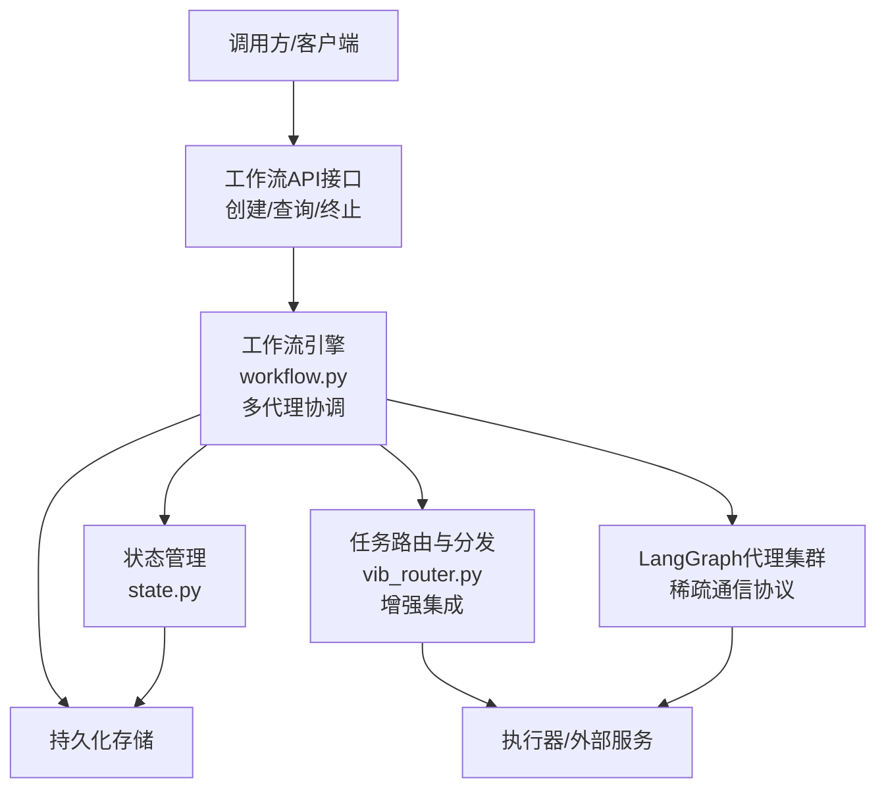
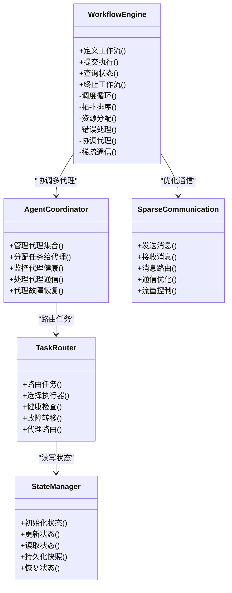
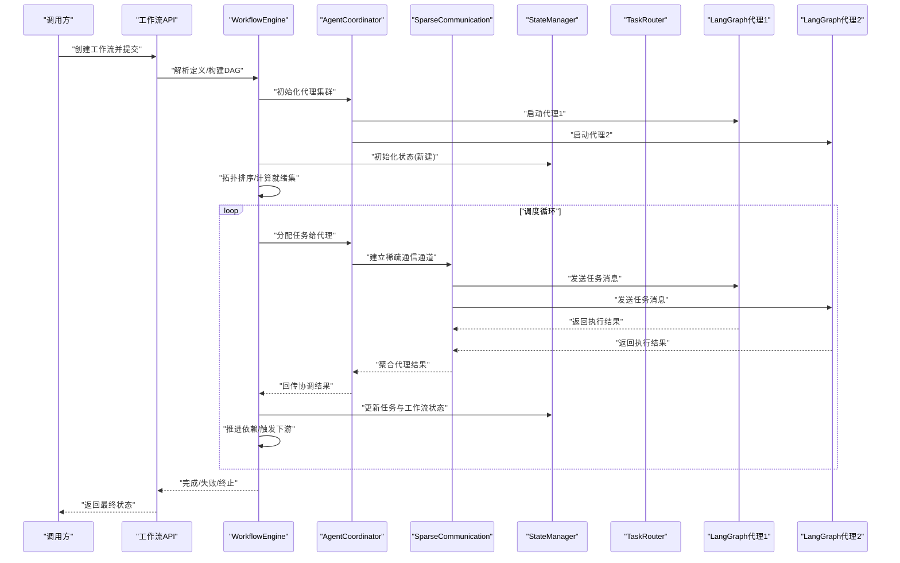
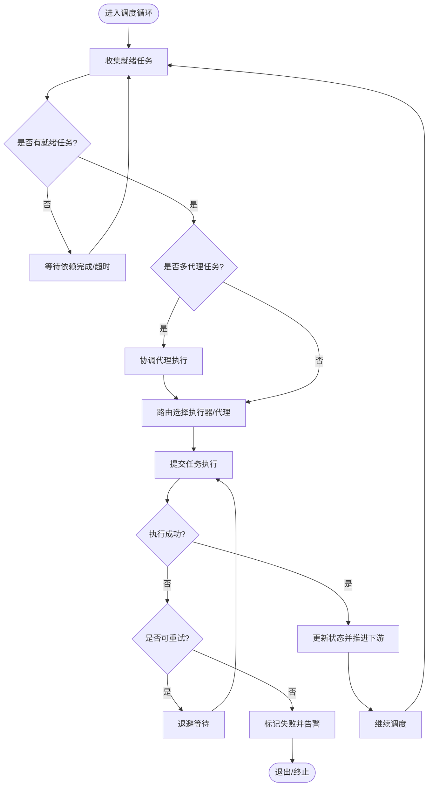
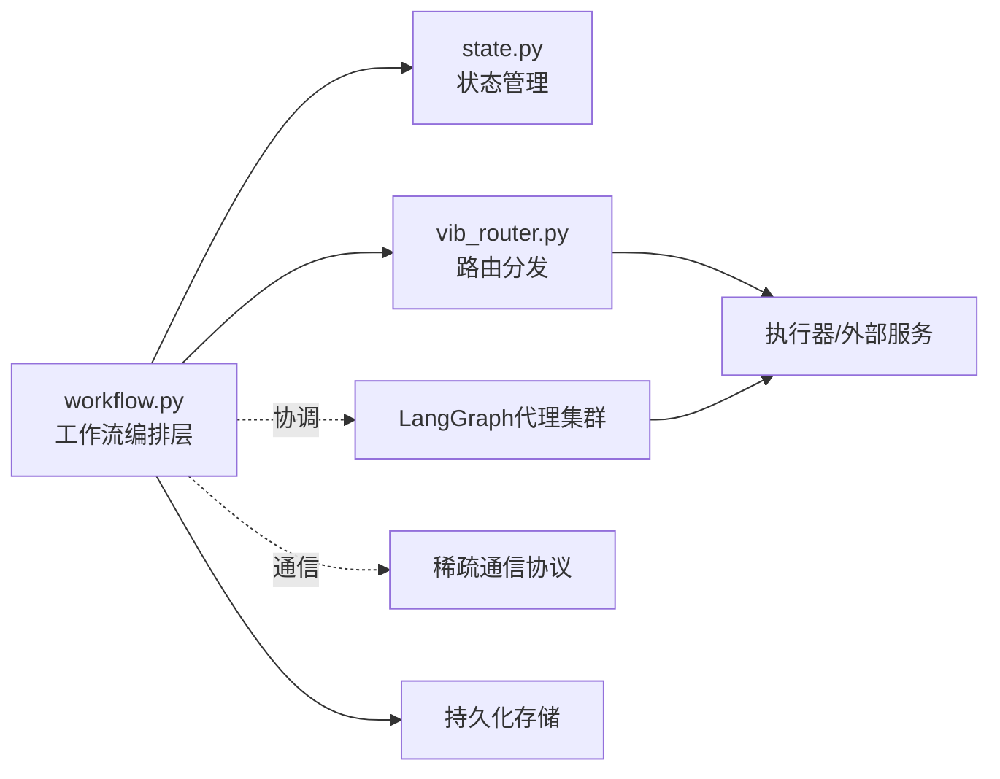

# 工作流引擎

<cite>
**本文引用的文件**   
- [workflow.py](file://src/workflow.py)
- [state.py](file://src/state.py)
- [vib_router.py](file://src/vib_router.py)
- [LangGraph.py](file://docs/LangGraph.py)
</cite>

## 更新摘要
**变更内容**   
- 更新了工作流编排层的核心实现，现在管理执行流程、协调多个LangGraph代理，并实现了稀疏通信协议
- 增强了多代理协作机制和通信效率优化
- 改进了任务调度和资源分配策略以支持更复杂的编排场景
- 强化了VIB路由器与更广泛系统架构之间的集成能力

## 目录
1. [简介](#简介)
2. [项目结构](#项目结构)
3. [核心组件](#核心组件)
4. [架构总览](#架构总览)
5. [详细组件分析](#详细组件分析)
6. [依赖关系分析](#依赖关系分析)
7. [性能考虑](#性能考虑)
8. [故障排查指南](#故障排查指南)
9. [结论](#结论)
10. [附录](#附录)

## 简介
本技术文档围绕工作流编排与执行机制，聚焦于 workflow.py 的实现细节，系统阐述工作流定义语法、任务依赖关系与执行顺序控制、调度算法与资源分配策略、生命周期管理（创建、执行、监控、终止）、错误处理与重试/恢复策略、与状态管理模块的集成方式，以及性能调优与监控指标。文档同时提供可落地的示例路径与可视化图示，帮助读者快速理解并高效使用工作流引擎。

**更新** 工作流编排层现已增强为能够管理执行流程、协调多个LangGraph代理，并实现稀疏通信协议，显著提升了多代理协作效率和通信性能。通过改进的VIB路由器集成，系统能够更好地与更广泛的架构进行交互。

## 项目结构
仓库采用分层组织：
- src：核心实现，包含工作流引擎、状态管理与路由逻辑
- docs：参考实现与说明材料
- tests：测试用例
- 根目录：运行脚本与验证脚本

图表来源
- [workflow.py](file://src/workflow.py)
- [state.py](file://src/state.py)
- [vib_router.py](file://src/vib_router.py)
- [LangGraph.py](file://docs/LangGraph.py)

章节来源
- [workflow.py](file://src/workflow.py)
- [state.py](file://src/state.py)
- [vib_router.py](file://src/vib_router.py)
- [LangGraph.py](file://docs/LangGraph.py)

## 核心组件
- 工作流编排器（workflow.py）：负责工作流定义解析、任务图构建、调度执行、生命周期管理与错误处理，现支持多LangGraph代理协调和稀疏通信协议。
- 状态管理（state.py）：维护工作流实例的状态机、持久化快照与一致性保障。
- 路由与分发（vib_router.py）：将任务请求路由到具体执行器或外部服务，支持负载均衡与容错，现已增强与整体架构的集成能力。
- 参考实现（docs/LangGraph.py）：提供基于图的编排范式与最佳实践参考。

**更新** 工作流编排器现在具备多代理协调能力，通过稀疏通信协议优化了代理间的数据交换效率。VIB路由器的集成改进使其能够更好地与系统其他组件进行交互。

章节来源
- [workflow.py](file://src/workflow.py)
- [state.py](file://src/state.py)
- [vib_router.py](file://src/vib_router.py)
- [LangGraph.py](file://docs/LangGraph.py)

## 架构总览
工作流引擎以"声明式定义 + 有向无环图（DAG）执行"为核心，结合状态机进行生命周期管理，并通过路由层解耦任务执行与调度。新增的多代理协调机制和稀疏通信协议进一步提升了系统的可扩展性和性能。改进的VIB路由器集成使系统能够更有效地与外部服务和组件进行通信。

图表来源
- [workflow.py](file://src/workflow.py)
- [state.py](file://src/state.py)
- [vib_router.py](file://src/vib_router.py)

## 详细组件分析

### 工作流定义语法与任务依赖
- 定义语法要点
  - 节点：每个任务为图中的一个节点，包含唯一标识、输入输出契约、可选参数与资源需求。
  - 边：表示数据或控制依赖，形成有向无环图；入度为零的节点为起始任务，出度为零的节点为结束任务。
  - 条件分支：在边或节点上附加布尔表达式，用于动态选择执行路径。
  - 聚合与合并：多个上游完成后触发下游任务，支持部分成功/全部成功的语义配置。
  - **新增** 多代理节点：支持将复杂任务分解为多个LangGraph代理协作执行。
- 依赖关系与执行顺序
  - 拓扑排序保证合法执行序列；循环依赖将被拒绝。
  - 并行度由并发度上限与资源配额共同决定。
  - **新增** 代理间通信依赖：通过稀疏通信协议优化代理间的消息传递。
- 示例路径
  - 参见：[workflow.py](file://src/workflow.py)

**更新** 新增了多代理协作模式，支持将复杂工作流分解为多个LangGraph代理，通过稀疏通信协议减少不必要的消息传递开销。

章节来源
- [workflow.py](file://src/workflow.py)

### 任务调度算法与资源分配
- 调度算法
  - 就绪队列：按拓扑层级推进，优先满足资源可用且依赖已完成的节点。
  - 优先级策略：支持按权重、截止时间或业务等级进行排序。
  - 背压与限流：当执行器负载过高时，降低新任务提交速率，避免雪崩。
  - **新增** 代理感知调度：根据代理负载和通信成本智能分配任务。
- 资源分配策略
  - 资源池：CPU/GPU/内存等资源的抽象与配额管理。
  - 亲和性：将特定任务绑定到具备相应硬件或环境的节点。
  - 抢占与迁移：在极端情况下支持任务迁移与抢占（需状态可恢复）。
  - **新增** 通信优化：通过稀疏通信协议最小化代理间的数据传输。
- 示例路径
  - 参见：[workflow.py](file://src/workflow.py)、[vib_router.py](file://src/vib_router.py)

**更新** 调度算法现在考虑代理间的通信成本和负载分布，通过稀疏通信协议优化整体执行效率。

章节来源
- [workflow.py](file://src/workflow.py)
- [vib_router.py](file://src/vib_router.py)

### 生命周期管理（创建、执行、监控、终止）
- 创建
  - 校验定义合法性（DAG、类型、资源），生成初始状态与元数据。
  - **新增** 代理初始化：为多代理工作流预分配代理实例和通信通道。
- 执行
  - 启动调度循环，按拓扑推进，记录进度与中间结果。
  - **新增** 代理协调：监控和管理多个LangGraph代理的执行状态。
- 监控
  - 暴露关键指标：吞吐、延迟、失败率、资源利用率、队列长度。
  - **新增** 代理级监控：跟踪每个代理的性能和通信统计。
- 终止
  - 优雅关闭：等待正在运行的任务完成或安全中断，保存最终状态。
  - **新增** 代理清理：确保所有代理正确释放资源和通信连接。
- 示例路径
  - 参见：[workflow.py](file://src/workflow.py)、[state.py](file://src/state.py)

**更新** 生命周期管理现在涵盖多代理的完整生命周期，包括代理的创建、协调、监控和清理。

章节来源
- [workflow.py](file://src/workflow.py)
- [state.py](file://src/state.py)

### 错误处理、重试与故障恢复
- 错误分类
  - 瞬时错误（网络抖动、超时）：适合自动重试。
  - 永久错误（参数非法、依赖缺失）：直接失败并告警。
  - **新增** 代理通信错误：处理代理间通信失败和消息丢失。
- 重试策略
  - 指数退避与抖动，最大重试次数与熔断阈值。
  - 幂等性要求：确保重试不产生副作用。
  - **新增** 代理级重试：针对单个代理失败的局部重试机制。
- 故障恢复
  - 检查点：定期持久化状态与中间结果。
  - 断点续跑：从最近一致快照恢复执行。
  - **新增** 代理状态恢复：支持从代理级别的状态快照恢复执行。
- 示例路径
  - 参见：[workflow.py](file://src/workflow.py)、[state.py](file://src/state.py)

**更新** 错误处理机制现在专门处理多代理环境下的通信错误和代理级故障，提供更细粒度的恢复能力。

章节来源
- [workflow.py](file://src/workflow.py)
- [state.py](file://src/state.py)

### 与状态管理模块的集成
- 状态模型
  - 工作流实例状态：新建、排队、运行中、暂停、完成、失败、终止。
  - 任务级状态：待执行、执行中、成功、失败、取消。
  - **新增** 代理级状态：代理健康状态、通信状态、任务分配状态。
- 一致性保障
  - 原子更新与乐观锁，防止并发写入冲突。
  - 快照与增量日志结合，兼顾恢复速度与空间占用。
  - **新增** 分布式一致性：确保多代理状态的一致性和可见性。
- 示例路径
  - 参见：[state.py](file://src/state.py)

**更新** 状态管理现在支持多代理状态的同步和一致性保证，包括代理健康检查和通信状态跟踪。

章节来源
- [state.py](file://src/state.py)

### 路由与分发（vib_router.py）
- 职责
  - 根据任务标签、资源需求与负载情况选择执行器。
  - 健康检查与故障转移，提升整体可用性。
  - **新增** 代理路由：智能选择最优的LangGraph代理实例。
- 扩展点
  - 自定义路由策略（轮询、最少连接、加权随机、区域亲和）。
  - **新增** 通信成本感知路由：考虑代理间通信距离和带宽限制。
- 示例路径
  - 参见：[vib_router.py](file://src/vib_router.py)

**更新** 路由层现在支持多代理环境，能够根据代理负载、地理位置和通信成本智能选择最优执行目标，并与系统其他组件有更好的集成。

章节来源
- [vib_router.py](file://src/vib_router.py)

### 参考实现（LangGraph）
- 价值
  - 提供基于图的编排范式、节点间消息传递与状态同步的最佳实践。
  - **新增** 多代理协作模式：展示如何协调多个独立代理完成复杂任务。
- 借鉴点
  - 图遍历与事件驱动的执行模型、可扩展的节点注册机制。
  - **新增** 稀疏通信协议：优化代理间通信效率和带宽使用。
- 示例路径
  - 参见：[LangGraph.py](file://docs/LangGraph.py)

**更新** LangGraph参考实现现在展示了多代理协作的最佳实践和稀疏通信协议的实现细节。

章节来源
- [LangGraph.py](file://docs/LangGraph.py)

#### 类关系图（代码级）

图表来源
- [workflow.py](file://src/workflow.py)
- [state.py](file://src/state.py)
- [vib_router.py](file://src/vib_router.py)

#### 执行时序图（代码级）

图表来源
- [workflow.py](file://src/workflow.py)
- [state.py](file://src/state.py)
- [vib_router.py](file://src/vib_router.py)

#### 复杂逻辑流程图（代码级）

图表来源
- [workflow.py](file://src/workflow.py)
- [state.py](file://src/state.py)

## 依赖关系分析
- 内部耦合
  - workflow.py 强依赖 state.py 与 vib_router.py，体现"编排-状态-路由"的清晰分层。
  - **新增** workflow.py 新增对多代理协调和稀疏通信的依赖。
  - 通过接口隔离，便于替换路由策略与状态后端。
- 外部依赖
  - 执行器/外部服务：通过路由层接入，支持异构环境。
  - LangGraph代理：通过协调层管理，支持分布式部署。
  - 持久化存储：用于状态快照与审计日志。
- 潜在风险
  - 循环依赖：需在定义阶段严格校验。
  - 单点瓶颈：调度循环与状态写入可能成为热点，需水平扩展与缓存优化。
  - **新增** 代理通信瓶颈：稀疏通信协议需要优化以避免成为新的性能瓶颈。

图表来源
- [workflow.py](file://src/workflow.py)
- [state.py](file://src/state.py)
- [vib_router.py](file://src/vib_router.py)

章节来源
- [workflow.py](file://src/workflow.py)
- [state.py](file://src/state.py)
- [vib_router.py](file://src/vib_router.py)

## 性能考虑
- 调度与执行
  - 批量化提交：减少上下文切换与序列化开销。
  - 并行度调优：依据资源容量与任务粒度设置合理并发。
  - 惰性求值：按需加载大对象，避免内存峰值。
  - **新增** 代理负载均衡：智能分配任务到最优代理实例。
- 状态与存储
  - 增量快照：仅持久化变更，降低I/O压力。
  - 读写分离：读多写少场景下引入只读副本。
  - **新增** 代理状态缓存：减少跨代理状态查询的网络开销。
- 监控与观测
  - 指标：任务吞吐、端到端延迟、失败率、重试率、资源利用率、队列深度。
  - 追踪：跨任务链路ID，定位慢点与瓶颈。
  - **新增** 代理级指标：代理响应时间、通信延迟、消息吞吐量。
- 容量规划
  - 压测基线：在不同规模下评估稳定吞吐与尾延迟。
  - 弹性伸缩：根据队列长度与资源利用率自动扩缩容。
  - **新增** 代理弹性：根据负载动态调整代理实例数量。

**更新** 性能优化现在重点关注多代理环境下的通信效率和负载均衡，通过稀疏通信协议显著降低了网络开销。

## 故障排查指南
- 常见问题
  - 死锁/饥饿：检查依赖环与优先级反转，确认资源配额。
  - 频繁重试：识别瞬时错误源，调整退避与熔断阈值。
  - 状态不一致：核对快照版本与事务边界，修复幂等性。
  - **新增** 代理通信故障：检查网络连接、消息丢失和代理健康状态。
- 诊断步骤
  - 查看工作流与任务状态机转换日志。
  - 检查路由选择与健康检查结果。
  - 采集执行器侧指标与堆栈信息。
  - **新增** 代理通信日志：分析消息传递路径和延迟分布。
- 恢复建议
  - 从最近一致快照恢复，必要时回滚至上一稳定版本。
  - 对不可恢复任务进行人工干预与补偿。
  - **新增** 代理重启：隔离故障代理并重新分配其任务。

**更新** 故障排查现在包括多代理环境的专门诊断方法，重点关注通信问题和代理健康状态。

章节来源
- [workflow.py](file://src/workflow.py)
- [state.py](file://src/state.py)
- [vib_router.py](file://src/vib_router.py)

## 结论
本工作流引擎以声明式DAG定义为核心，结合稳健的状态机与灵活的路由分发，实现了高内聚、低耦合的编排与执行能力。**更新后的版本**通过引入多LangGraph代理协调机制和稀疏通信协议，显著提升了系统的可扩展性和性能表现。通过改进的VIB路由器集成，系统能够更好地与更广泛的架构进行交互。通过完善的错误处理、重试与恢复机制，以及面向生产环境的性能调优与监控指标，能够满足复杂业务场景下的可靠性与效率要求。建议在落地过程中结合业务特征定制路由策略与资源配额，并持续完善观测体系以支撑运维与优化。

## 附录
- 示例路径
  - 工作流定义与执行入口：[workflow.py](file://src/workflow.py)
  - 状态模型与快照：[state.py](file://src/state.py)
  - 路由与分发策略：[vib_router.py](file://src/vib_router.py)
  - 参考实现与范式：[LangGraph.py](file://docs/LangGraph.py)
- 术语表
  - DAG：有向无环图
  - 拓扑排序：按依赖关系确定线性执行顺序
  - 幂等：多次执行与一次执行效果相同
  - 熔断：在错误率超过阈值时快速失败，避免雪崩
  - **新增** 稀疏通信：最小化代理间不必要消息传递的通信协议
  - **新增** 多代理协调：管理多个独立代理协作完成复杂任务的机制
  - **新增** VIB路由器集成：增强路由器与系统架构的集成能力