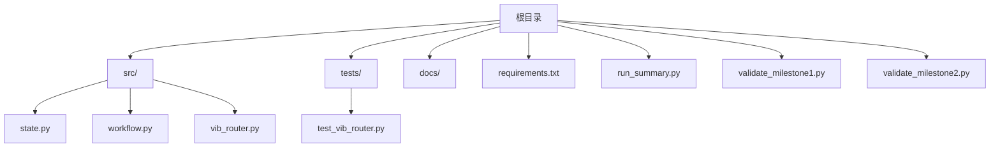
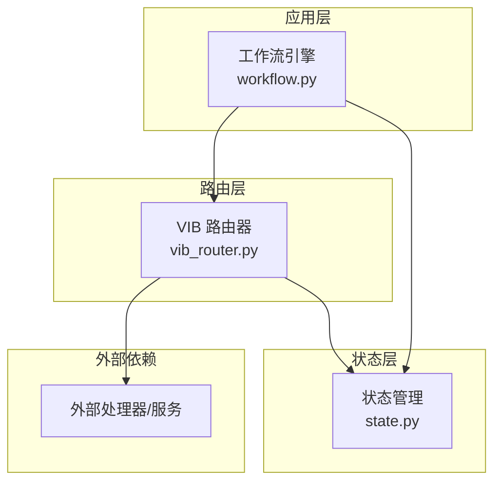
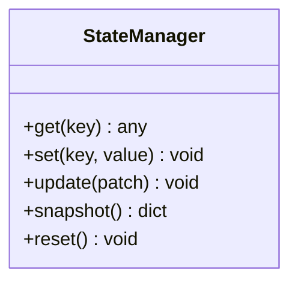
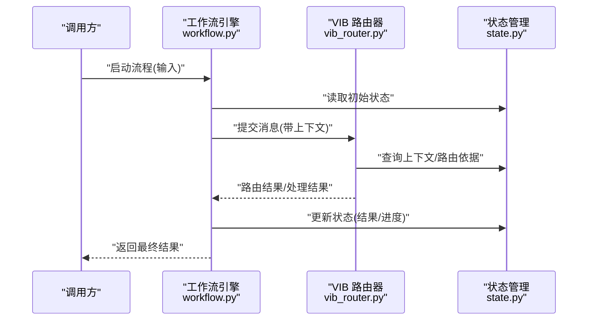
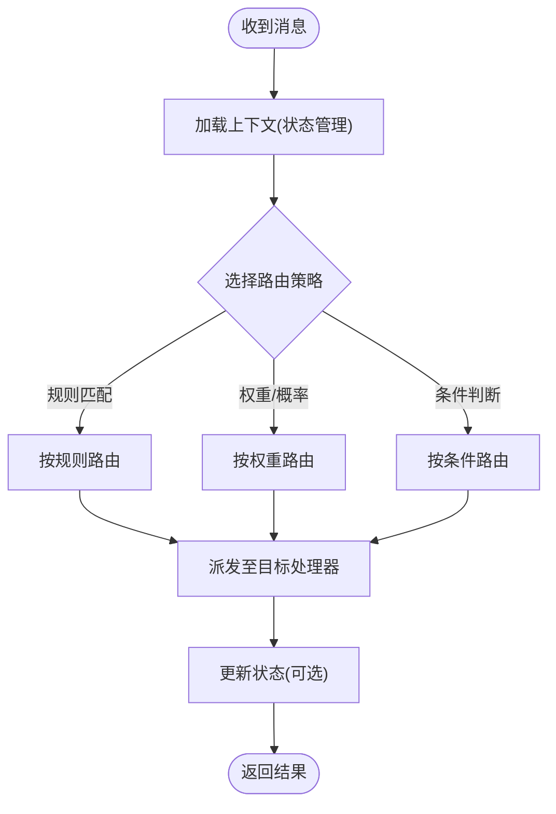
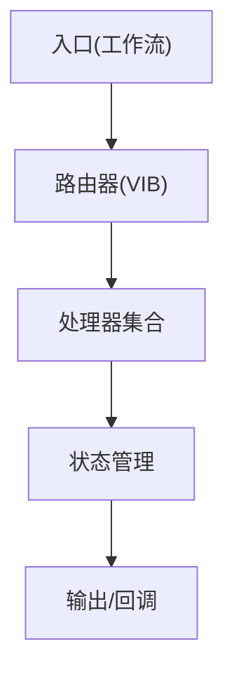

# 核心架构

<cite>
**本文引用的文件**   
- [README.md](file://README.md)
- [src/state.py](file://src/state.py)
- [src/workflow.py](file://src/workflow.py)
- [src/vib_router.py](file://src/vib_router.py)
- [tests/test_vib_router.py](file://tests/test_vib_router.py)
</cite>

## 目录
1. [简介](#简介)
2. [项目结构](#项目结构)
3. [核心组件](#核心组件)
4. [架构总览](#架构总览)
5. [详细组件分析](#详细组件分析)
6. [依赖关系分析](#依赖关系分析)
7. [性能考量](#性能考量)
8. [故障排查指南](#故障排查指南)
9. [结论](#结论)
10. [附录](#附录)

## 简介
本文件为 VIB-SparseCommunication 系统的核心架构文档，聚焦于整体设计模式与架构原则（模块化、分层、解耦），并围绕三大核心模块展开：状态管理（state.py）、工作流引擎（workflow.py）与 VIB 路由器（vib_router.py）。文档同时描述数据流向与控制流程（消息处理链路、状态更新机制），解释关键设计决策与技术选型理由，并提供架构图与数据流图辅助理解。最后给出扩展点与插件机制说明，帮助读者在保持系统稳定性的前提下进行能力扩展。

## 项目结构
仓库采用“源码/测试/文档”分离的组织方式，核心逻辑集中在 src 目录下，测试用例位于 tests 目录，顶层 README 提供项目概览与使用说明。

图表来源
- [README.md](file://README.md)
- [src/state.py](file://src/state.py)
- [src/workflow.py](file://src/workflow.py)
- [src/vib_router.py](file://src/vib_router.py)
- [tests/test_vib_router.py](file://tests/test_vib_router.py)

章节来源
- [README.md](file://README.md)

## 核心组件
- 状态管理模块（state.py）
  - 职责边界：维护全局状态对象，提供状态的读取、写入与一致性保障；作为工作流与路由器的共享事实源。
  - 交互关系：被工作流引擎与路由器读写；对外暴露最小化的状态变更接口，避免直接操作内部字段。
  - 设计要点：通过受控的访问器与变更器实现状态同步，确保并发安全与可观测性。

- 工作流引擎（workflow.py）
  - 职责边界：编排任务执行顺序、协调各阶段动作、触发状态更新与消息分发；对上层屏蔽底层细节。
  - 交互关系：调用状态管理模块更新状态；驱动 VIB 路由器进行智能消息分发；接收回调以推进流程。
  - 设计要点：将“流程控制”与“业务处理”解耦，便于替换具体处理器与策略。

- VIB 路由器（vib_router.py）
  - 职责边界：根据消息内容与上下文选择目标处理器或下游节点，实现稀疏通信与按需路由。
  - 交互关系：从工作流引擎接收待分发消息；必要时查询状态管理模块获取上下文；将结果回写至状态或返回给调用方。
  - 设计要点：路由策略可插拔，支持按规则/权重/条件动态选择目标，降低耦合度。

章节来源
- [src/state.py](file://src/state.py)
- [src/workflow.py](file://src/workflow.py)
- [src/vib_router.py](file://src/vib_router.py)

## 架构总览
系统采用分层与模块化相结合的设计：
- 表现/入口层：由工作流引擎作为统一入口，组织端到端流程。
- 路由层：VIB 路由器负责消息的智能分发与稀疏通信。
- 状态层：集中式状态管理保证一致性与可观测性。
- 扩展层：通过插件化处理器与策略注册表实现能力扩展。

图表来源
- [src/workflow.py](file://src/workflow.py)
- [src/vib_router.py](file://src/vib_router.py)
- [src/state.py](file://src/state.py)

## 详细组件分析

### 状态管理模块（state.py）
- 设计模式
  - 单例/集中式存储：全局唯一状态实例，避免多副本不一致。
  - 访问器/变更器：通过方法封装读写，便于校验、审计与事件发布。
- 数据结构与复杂度
  - 典型结构包含键值映射与元信息（如版本、时间戳），读写操作多为 O(1)。
- 并发与一致性
  - 通过锁或不可变快照保证并发安全；建议采用写时复制或乐观锁策略提升吞吐。
- 错误处理
  - 非法写入抛出明确异常；读不存在键返回默认值或空结构。
- 扩展点
  - 提供状态变更钩子（如 before/after），用于日志、指标与审计。

图表来源
- [src/state.py](file://src/state.py)

章节来源
- [src/state.py](file://src/state.py)

### 工作流引擎（workflow.py）
- 设计模式
  - 编排器/管道：将复杂任务拆分为阶段，逐阶段推进。
  - 观察者/回调：阶段完成时触发回调，驱动后续步骤。
- 控制流程
  - 初始化上下文 -> 加载状态 -> 调度路由 -> 执行业务处理 -> 更新状态 -> 返回结果。
- 与路由器和状态的协作
  - 通过状态管理器获取/保存上下文；通过路由器进行消息分发；根据返回结果决定下一步。
- 错误处理与重试
  - 捕获异常并记录；支持重试与降级策略；失败时回滚部分状态或进入补偿流程。
- 扩展点
  - 阶段处理器注册表；自定义中间件；可插拔的错误恢复策略。

图表来源
- [src/workflow.py](file://src/workflow.py)
- [src/vib_router.py](file://src/vib_router.py)
- [src/state.py](file://src/state.py)

章节来源
- [src/workflow.py](file://src/workflow.py)

### VIB 路由器（vib_router.py）
- 设计模式
  - 策略模式：路由策略可插拔，支持规则/权重/条件等策略。
  - 责任链：可按优先级依次尝试多个处理器，直到成功。
- 数据流
  - 入参：消息体 + 上下文（来自状态管理）；出参：目标处理器标识 + 处理结果。
- 稀疏通信
  - 仅向必要节点发送消息，减少冗余广播，提高可扩展性与性能。
- 错误处理
  - 路由失败时回退到默认策略或上报错误；记录诊断信息以便定位。
- 扩展点
  - 处理器注册表；动态策略加载；基于上下文的自适应路由。

图表来源
- [src/vib_router.py](file://src/vib_router.py)
- [src/state.py](file://src/state.py)

章节来源
- [src/vib_router.py](file://src/vib_router.py)

### 概念性总览
下图展示一个通用的“请求-路由-处理-状态更新”闭环，适用于多种场景（批处理、实时流、事件驱动）。

[此图为概念性流程图，不直接映射具体源码文件]

## 依赖关系分析
- 模块内聚与耦合
  - 状态管理独立且低耦合，被其他模块依赖。
  - 工作流引擎聚合路由器与状态管理，承担编排职责。
  - 路由器依赖状态管理获取上下文，但不反向依赖工作流。
- 外部依赖
  - 处理器/服务通过抽象接口接入，避免硬编码。
- 潜在循环依赖
  - 当前设计避免循环依赖；若引入回调需确保单向依赖。

图表来源
- [src/state.py](file://src/state.py)
- [src/workflow.py](file://src/workflow.py)
- [src/vib_router.py](file://src/vib_router.py)

章节来源
- [src/state.py](file://src/state.py)
- [src/workflow.py](file://src/workflow.py)
- [src/vib_router.py](file://src/vib_router.py)

## 性能考量
- 状态访问优化
  - 使用缓存热点键；批量更新合并；只读快照减少锁竞争。
- 路由效率
  - 预计算路由表；策略索引化；避免每次全量扫描。
- 稀疏通信
  - 按需投递，减少网络与序列化开销；合并小消息为批次。
- 可观测性
  - 埋点关键路径耗时与错误率；状态变更审计日志。

[本节为通用指导，无需源码引用]

## 故障排查指南
- 常见问题
  - 状态不一致：检查状态更新是否原子；确认并发访问是否加锁。
  - 路由失败：查看路由策略配置与上下文完整性；核对处理器注册情况。
  - 流程卡住：检查工作流阶段回调是否触发；确认异常是否被吞掉。
- 调试建议
  - 开启详细日志；打印关键状态快照；隔离问题阶段进行复现。
- 回归验证
  - 使用现有测试覆盖路由器行为；补充边界用例与异常路径。

章节来源
- [tests/test_vib_router.py](file://tests/test_vib_router.py)

## 结论
VIB-SparseCommunication 通过“状态管理—工作流编排—智能路由”的分层与解耦设计，实现了高内聚、低耦合的可扩展架构。状态层提供一致的事实源，工作流引擎负责端到端编排，VIB 路由器实现稀疏通信与按需分发。配合可插拔的策略与处理器注册表，系统在保持稳定的同时具备良好的演进能力。

## 附录
- 术语
  - 稀疏通信：仅向必要的目标发送消息，避免广播带来的资源浪费。
  - 策略模式：将算法族封装起来，使它们可以互相替换。
  - 编排器：协调多个组件按既定顺序执行，形成完整业务流程。
- 扩展建议
  - 新增处理器：实现标准接口并在注册表中登记。
  - 新增路由策略：实现策略接口并按需启用。
  - 增强状态管理：增加版本控制与冲突解决策略。