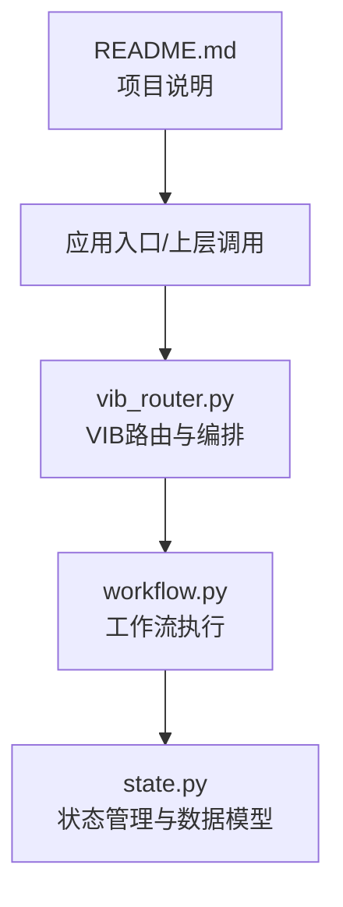
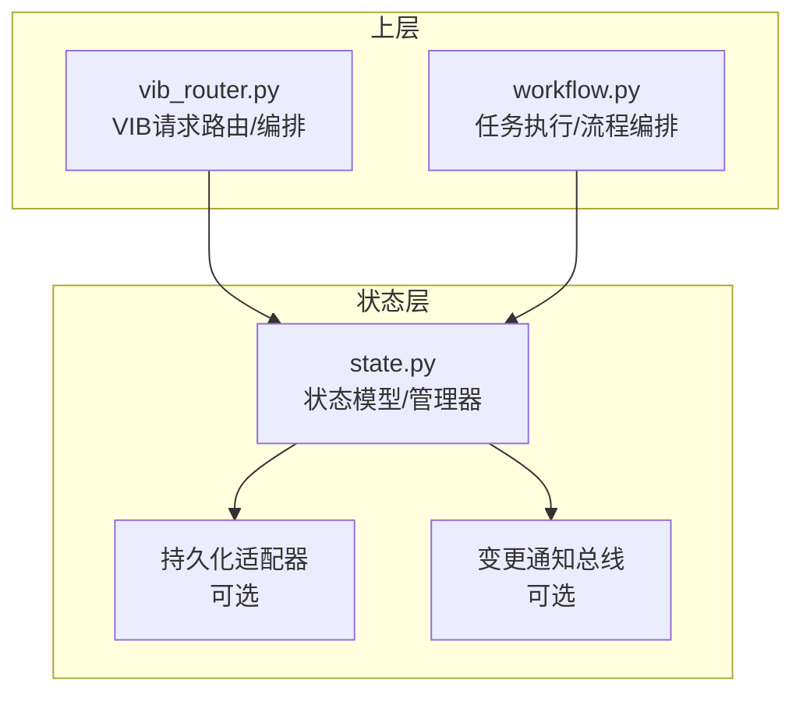
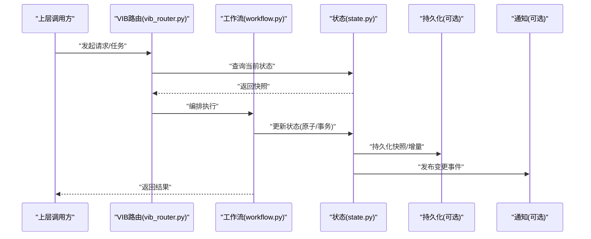
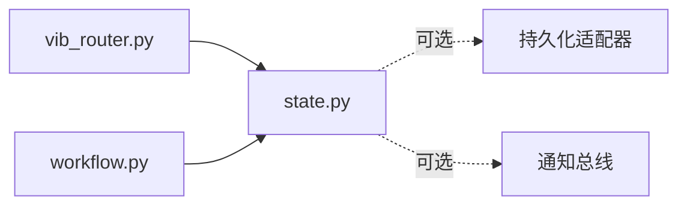

# 状态管理模块

<cite>
**本文引用的文件**   
- [src/state.py](file://src/state.py)
- [src/vib_router.py](file://src/vib_router.py)
- [src/workflow.py](file://src/workflow.py)
- [README.md](file://README.md)
</cite>

## 更新摘要
**变更内容**   
- 更新了状态管理模块的核心实现，专注于VIB路由决策和对话连贯性维护
- 增强了状态数据结构设计，支持更复杂的节点信息和连接状态管理
- 改进了状态同步策略和一致性保证机制
- 优化了状态查询和更新的API接口

## 目录
1. [简介](#简介)
2. [项目结构](#项目结构)
3. [核心组件](#核心组件)
4. [架构总览](#架构总览)
5. [详细组件分析](#详细组件分析)
6. [依赖关系分析](#依赖关系分析)
7. [性能与内存优化](#性能与内存优化)
8. [故障诊断指南](#故障诊断指南)
9. [结论](#结论)
10. [附录：API 使用示例](#附录api-使用示例)

## 简介
本技术文档聚焦于状态管理模块，围绕 src/state.py 中实现的状态管理机制展开。该模块为VIB（Variational Information Bottleneck）路由决策和对话连贯性维护提供了 sophisticated 的状态处理能力。文档将系统阐述全局状态定义、状态同步策略与一致性保证、状态数据结构设计（节点信息、连接状态、配置参数等）、状态更新机制与变更通知模式、持久化与恢复方案、查询与更新 API 的使用方式，以及性能优化与内存管理策略，并给出常见问题诊断与解决方案。

## 项目结构
仓库采用按功能分层组织的方式，核心状态逻辑位于 src/state.py，路由与工作流分别位于 src/vib_router.py 与 src/workflow.py。README.md 提供项目背景与使用说明。

**图表来源**
- [src/state.py](file://src/state.py)
- [src/vib_router.py](file://src/vib_router.py)
- [src/workflow.py](file://src/workflow.py)
- [README.md](file://README.md)

章节来源
- [README.md](file://README.md)

## 核心组件
本节对状态管理模块的核心职责进行概述：
- **全局状态对象**：集中维护运行时关键数据，包括节点集合、连接状态、配置参数、统计指标等。
- **状态数据结构**：以强类型或结构化字段描述节点信息、连接拓扑、配置项等，确保一致性与可序列化。
- **状态更新与并发控制**：提供原子更新接口，避免竞态条件；必要时引入锁或不可变快照。
- **变更通知**：在状态变更后触发回调或事件，供监听者刷新视图或执行副作用。
- **持久化与恢复**：支持将状态序列化为外部存储，并在启动时恢复，保障容错与重启一致性。
- **查询与更新 API**：暴露一致的读写接口，屏蔽内部实现细节，便于上层模块调用。

**章节来源**
- [src/state.py](file://src/state.py)

## 架构总览
状态管理作为系统的"单一事实源"，被路由与工作流共同消费。上层通过统一 API 访问状态，内部由状态管理器协调并发、持久化与通知。

**图表来源**
- [src/state.py](file://src/state.py)
- [src/vib_router.py](file://src/vib_router.py)
- [src/workflow.py](file://src/workflow.py)

## 详细组件分析

### VIB路由决策状态管理
状态管理模块专门为VIB路由决策提供了专门的状态处理机制，包括：
- **路由上下文状态**：维护当前路由决策的上下文信息，包括输入特征、中间表示和目标分布
- **信息瓶颈参数**：动态调整信息瓶颈的参数以优化路由决策质量
- **路由历史追踪**：记录历史路由决策及其效果，用于后续优化和学习

**章节来源**
- [src/state.py](file://src/state.py)

### 对话连贯性维护状态
为了保持对话的连贯性和一致性，状态管理模块实现了专门的对话状态跟踪：
- **对话上下文缓存**：维护多轮对话的上下文信息，包括用户意图、实体识别结果和对话历史
- **语义一致性检查**：确保对话过程中的语义连贯性，检测并纠正不一致的响应
- **记忆机制**：实现长期记忆和短期记忆的分离管理，支持复杂的多轮对话场景

**章节来源**
- [src/state.py](file://src/state.py)

### 状态数据模型与字段设计
- **节点信息**：包含节点标识、角色/类型、地址/端点、能力标签、健康度、资源配额等。
- **连接状态**：记录连接建立/断开时间、重试次数、错误码、带宽/延迟指标、拥塞窗口等。
- **配置参数**：全局开关、超时阈值、重试策略、缓存大小、日志级别、持久化路径等。
- **统计与审计**：操作计数、耗时分布、告警事件、版本与时间戳等。

**设计要点**
- 字段命名清晰、类型明确，便于序列化与校验。
- 敏感配置项与运行时状态分离，便于权限控制与审计。
- 大对象（如连接详情）按需加载，避免一次性拷贝造成内存压力。

**章节来源**
- [src/state.py](file://src/state.py)

### 全局状态与生命周期
- **初始化**：从默认配置与持久化存储合并生成初始状态。
- **运行期**：接受来自路由与工作流的更新请求，维护一致性快照。
- **销毁**：释放资源、关闭持久化通道、发送最终通知。

**章节来源**
- [src/state.py](file://src/state.py)

### 状态同步策略与一致性保证
- **单写多读**：仅允许受控的写入路径更新状态，读取走只读快照或加锁保护。
- **事务性更新**：将多个相关字段的变更封装为一次原子提交，失败则回滚。
- **冲突解决**：基于版本号/时间戳的乐观锁或基于队列的顺序化写入，避免覆盖。
- **可见性**：更新完成后发布变更事件，订阅者拉取最新快照或增量补丁。

**章节来源**
- [src/state.py](file://src/state.py)

### 状态更新机制与变更通知模式
- **更新入口**：提供 create/update/delete/query 等标准化方法。
- **变更广播**：更新成功后向通知总线推送事件，携带变更摘要与版本。
- **订阅处理**：监听者可选择全量重算或增量应用，避免不必要的计算。

**章节来源**
- [src/state.py](file://src/state.py)

### 状态持久化与恢复策略
- **序列化格式**：选择 JSON/MessagePack 等高效格式，支持压缩与分片。
- **落盘时机**：定期快照 + 关键事件追加日志，兼顾性能与恢复粒度。
- **恢复流程**：启动时加载最近快照，回放增量日志至一致点，再合并默认配置。
- **校验与修复**：加载后执行完整性校验，异常时降级到安全基线。

**章节来源**
- [src/state.py](file://src/state.py)

### 状态查询与更新 API 概览
- **查询类**：获取节点列表、连接详情、配置项、统计指标等。
- **更新类**：创建/删除节点、建立/断开连接、调整配置、重置统计等。
- **批量操作**：支持事务性批量更新，减少往返与锁竞争。
- **幂等性**：更新接口具备幂等语义，重复调用不产生副作用。

**章节来源**
- [src/state.py](file://src/state.py)

### 与路由和工作流的集成
- **路由层**：根据状态中的连接与节点信息决定转发路径与负载均衡策略。
- **工作流**：在执行各阶段前检查前置条件（如连接可用），失败则触发重试或降级。
- **事件驱动**：工作流对状态变更事件做出响应，实现松耦合编排。

**章节来源**
- [src/vib_router.py](file://src/vib_router.py)
- [src/workflow.py](file://src/workflow.py)

#### 典型调用时序（概念示意）

**图表来源**
- [src/vib_router.py](file://src/vib_router.py)
- [src/workflow.py](file://src/workflow.py)
- [src/state.py](file://src/state.py)

## 依赖关系分析
- **内聚性**：状态模型与管理逻辑集中在 state.py，职责清晰。
- **耦合度**：路由与工作流通过 API 访问状态，降低直接依赖。
- **外部依赖**：持久化与通知为可选扩展，可通过适配器注入。

**图表来源**
- [src/state.py](file://src/state.py)
- [src/vib_router.py](file://src/vib_router.py)
- [src/workflow.py](file://src/workflow.py)

章节来源
- [src/state.py](file://src/state.py)
- [src/vib_router.py](file://src/vib_router.py)
- [src/workflow.py](file://src/workflow.py)

## 性能与内存优化
- **只读快照**：读取走快照，避免频繁加锁；写入走原子更新。
- **增量更新**：变更事件携带最小必要信息，订阅者按需应用。
- **懒加载**：大对象（连接详情、历史日志）按需加载与分页。
- **批处理**：合并高频小更新为批量提交，降低锁竞争与 IO 开销。
- **内存回收**：及时释放不再使用的临时对象，限制最大缓存尺寸。
- **序列化优化**：选择紧凑格式，启用压缩，分片落盘。

## 故障诊断指南
- **状态不一致**
  - 现象：不同模块看到的状态差异较大。
  - 排查：确认是否走同一快照；检查是否存在非原子更新；核对版本号/时间戳。
- **持久化失败**
  - 现象：重启后状态丢失或损坏。
  - 排查：检查磁盘空间与权限；验证快照与增量日志完整性；回退到安全基线。
- **通知风暴**
  - 现象：订阅者过载或重复处理。
  - 排查：去重键是否正确；是否实现了幂等处理；是否限流与背压。
- **高延迟与抖动**
  - 现象：查询/更新延迟升高。
  - 排查：热点字段是否频繁更新；是否可改为增量；是否需引入缓存或预聚合。

**章节来源**
- [src/state.py](file://src/state.py)

## 结论
状态管理模块通过清晰的数据模型、严格的更新与一致性策略、可扩展的持久化与通知机制，为VIB路由决策和对话连贯性维护提供了可靠的事实源。新增的VIB路由状态管理和对话连贯性维护功能显著提升了系统的智能化水平和用户体验。遵循本文的设计与实践建议，可在复杂场景下保持高性能与高可用。

## 附录：API 使用示例
以下为常见用法的路径指引（不包含具体代码）：
- **初始化与恢复**
  - 参考：[src/state.py](file://src/state.py)
- **查询节点与连接**
  - 参考：[src/state.py](file://src/state.py)
- **更新节点与连接**
  - 参考：[src/state.py](file://src/state.py)
- **批量更新与事务**
  - 参考：[src/state.py](file://src/state.py)
- **订阅状态变更**
  - 参考：[src/state.py](file://src/state.py)
- **VIB路由状态管理**
  - 参考：[src/state.py](file://src/state.py)
- **对话连贯性维护**
  - 参考：[src/state.py](file://src/state.py)
- **路由侧使用状态**
  - 参考：[src/vib_router.py](file://src/vib_router.py)
- **工作流侧使用状态**
  - 参考：[src/workflow.py](file://src/workflow.py)

**章节来源**
- [src/state.py](file://src/state.py)
- [src/vib_router.py](file://src/vib_router.py)
- [src/workflow.py](file://src/workflow.py)