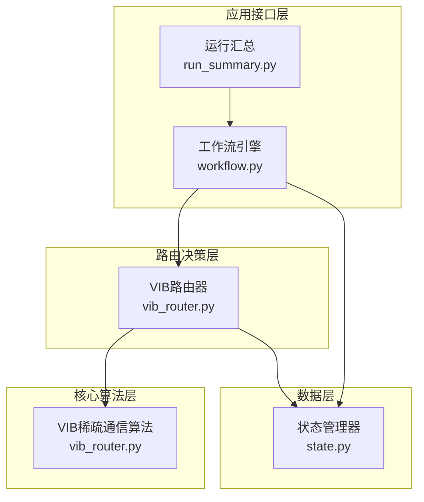
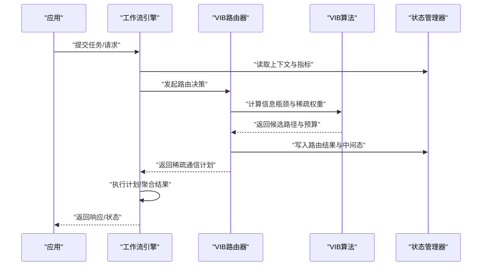
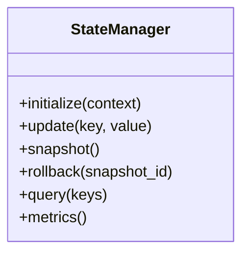
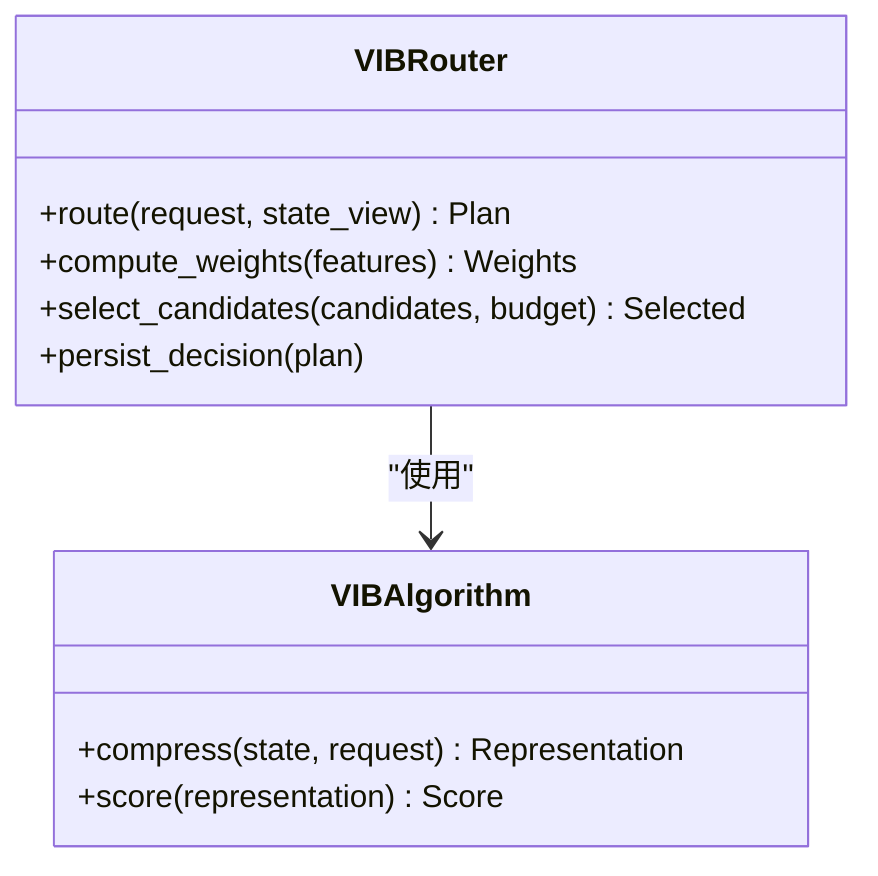
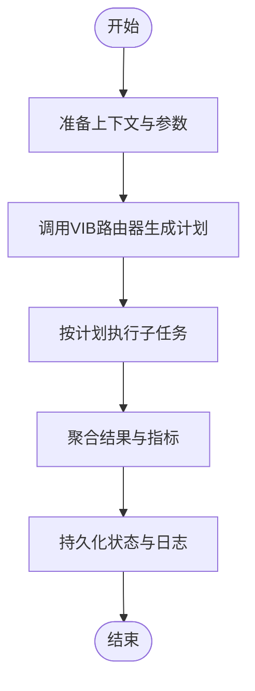
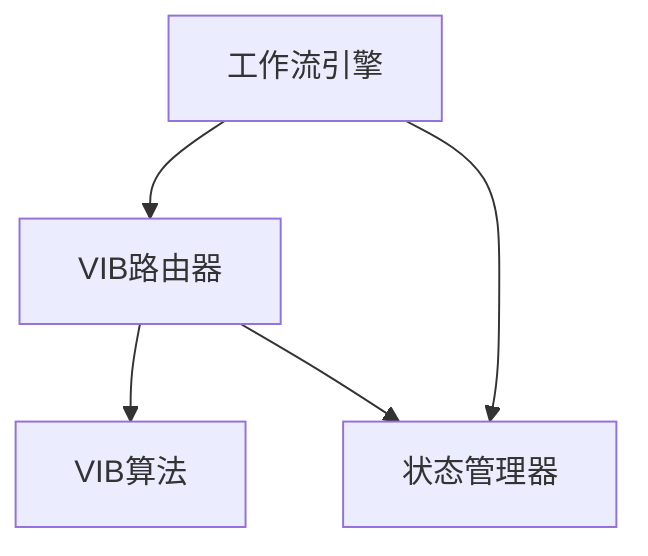

# 系统概览

<cite>
**本文引用的文件**   
- [README.md](file://README.md)
- [src/state.py](file://src/state.py)
- [src/vib_router.py](file://src/vib_router.py)
- [src/workflow.py](file://src/workflow.py)
- [tests/test_vib_router.py](file://tests/test_vib_router.py)
- [run_summary.py](file://run_summary.py)
- [validate_milestone1.py](file://validate_milestone1.py)
- [validate_milestone2.py](file://validate_milestone2.py)
</cite>

## 目录
1. [简介](#简介)
2. [项目结构](#项目结构)
3. [核心组件](#核心组件)
4. [架构总览](#架构总览)
5. [详细组件分析](#详细组件分析)
6. [依赖关系分析](#依赖关系分析)
7. [性能与约束](#性能与约束)
8. [故障排查指南](#故障排查指南)
9. [结论](#结论)
10. [附录](#附录)

## 简介
本系统围绕“可变信息瓶颈（VIB）稀疏通信”展开，旨在通过动态选择关键路径与最小化消息体积，降低分布式或模块化系统中的通信开销、提升端到端吞吐并改善资源利用。其核心价值在于：
- 以信息瓶颈理论为指导，自适应压缩状态表征，仅传输必要信息；
- 在路由层引入可学习的稀疏策略，减少冗余交互；
- 提供清晰的分层架构与可扩展接口，便于集成到不同应用。

适用场景包括：
- 多智能体协作与任务编排；
- 大模型/代理工作流中的跨模块通信；
- 对带宽、延迟敏感的服务间调用；
- 需要按需激活子图或子任务的复杂流程。

## 项目结构
仓库采用分层组织方式，核心代码位于 src 目录，测试与验证脚本位于 tests 与根目录。主要职责划分如下：
- 数据层：集中管理系统状态与上下文，供上层统一访问与更新；
- 核心算法层：实现 VIB 稀疏通信的编码/压缩与稀疏路由决策；
- 路由决策层：基于当前状态与目标语义，选择最优通信路径与目标节点；
- 应用接口层：暴露工作流编排与运行入口，串联各层能力。

图表来源
- [src/workflow.py](file://src/workflow.py)
- [src/vib_router.py](file://src/vib_router.py)
- [src/state.py](file://src/state.py)
- [run_summary.py](file://run_summary.py)

章节来源
- [README.md](file://README.md)
- [src/state.py](file://src/state.py)
- [src/vib_router.py](file://src/vib_router.py)
- [src/workflow.py](file://src/workflow.py)
- [run_summary.py](file://run_summary.py)

## 核心组件
- 状态管理器（State Manager）
  - 职责：维护全局/局部状态、会话上下文、指标与缓存；提供原子读写与一致性保障。
  - 关键点：支持增量更新、快照与回滚；为路由与算法层提供只读视图与写锁保护。
- VIB路由器（VIB Router）
  - 职责：根据输入请求与当前状态，计算信息瓶颈下的高价值路径，输出稀疏通信计划。
  - 关键点：融合内容感知与结构感知特征；输出目标节点、消息摘要与预算分配。
- 工作流引擎（Workflow Engine）
  - 职责：编排任务执行顺序、协调状态更新、触发路由决策与结果聚合。
  - 关键点：支持并行/串行混合调度；具备重试、超时与熔断机制。

章节来源
- [src/state.py](file://src/state.py)
- [src/vib_router.py](file://src/vib_router.py)
- [src/workflow.py](file://src/workflow.py)

## 架构总览
系统采用四层架构，强调低耦合与高内聚：
- 数据层：统一状态源，避免重复计算与不一致；
- 核心算法层：实现 VIB 压缩与稀疏度量；
- 路由决策层：将算法输出转化为可执行的通信计划；
- 应用接口层：对外暴露工作流 API，屏蔽内部复杂性。

图表来源
- [src/workflow.py](file://src/workflow.py)
- [src/vib_router.py](file://src/vib_router.py)
- [src/state.py](file://src/state.py)

## 详细组件分析

### 状态管理器（State Manager）
- 设计要点
  - 提供统一的读写接口，确保并发安全；
  - 支持版本化与快照，便于调试与回滚；
  - 暴露只读视图给路由与算法层，避免竞态条件。
- 典型操作
  - 初始化/加载上下文；
  - 增量更新字段；
  - 查询统计与指标；
  - 清理过期数据。

图表来源
- [src/state.py](file://src/state.py)

章节来源
- [src/state.py](file://src/state.py)

### VIB路由器（VIB Router）
- 设计要点
  - 结合当前状态与请求语义，评估各候选路径的信息增益与成本；
  - 输出稀疏通信计划：目标节点、消息摘要、预算分配与优先级；
  - 与状态管理器紧密协作，记录决策轨迹与指标。
- 关键流程
  - 解析输入与上下文；
  - 调用 VIB 算法计算权重；
  - 生成并校验稀疏计划；
  - 持久化决策日志与中间结果。

图表来源
- [src/vib_router.py](file://src/vib_router.py)

章节来源
- [src/vib_router.py](file://src/vib_router.py)

### 工作流引擎（Workflow Engine）
- 设计要点
  - 编排任务生命周期：准备、调度、执行、聚合、收尾；
  - 与 VIB路由器协作，按稀疏计划驱动执行；
  - 提供错误恢复、重试与超时控制。
- 典型步骤
  - 接收外部请求；
  - 构建执行图；
  - 调用路由与算法层；
  - 收集结果并返回。

图表来源
- [src/workflow.py](file://src/workflow.py)

章节来源
- [src/workflow.py](file://src/workflow.py)

### 概念性总览
下图展示“可变信息瓶颈稀疏通信”的概念流程：从原始状态出发，经信息瓶颈压缩得到精简表征，再据此进行稀疏路由与最小化通信。

[此图为概念示意，不直接映射具体源码文件]

## 依赖关系分析
- 模块内聚与耦合
  - 工作流引擎依赖 VIB路由器与状态管理器；
  - VIB路由器依赖 VIB算法与状态管理器；
  - 状态管理器被上层广泛引用，需保证稳定接口。
- 外部依赖
  - 序列化/反序列化库（用于状态快照与日志）；
  - 可选：向量检索或相似度计算库（用于候选评估）。

图表来源
- [src/workflow.py](file://src/workflow.py)
- [src/vib_router.py](file://src/vib_router.py)
- [src/state.py](file://src/state.py)

章节来源
- [src/workflow.py](file://src/workflow.py)
- [src/vib_router.py](file://src/vib_router.py)
- [src/state.py](file://src/state.py)

## 性能与约束
- 关键性能指标（建议）
  - 通信量：平均消息字节数、峰值带宽占用；
  - 延迟：端到端时延、P95/P99分位；
  - 吞吐：每秒任务完成数；
  - 稀疏度：被选中的边/节点比例；
  - 质量：任务成功率、结果一致性。
- 设计约束
  - 预算限制：单轮通信的消息总量上限；
  - 一致性：状态更新的原子性与可见性；
  - 可扩展：新增节点/任务无需重构核心逻辑；
  - 可观测：完整的决策轨迹与指标采集。

[本节为通用指导，不直接分析具体文件]

## 故障排查指南
- 常见问题定位
  - 路由失败：检查路由器输入特征与预算配置；
  - 状态不一致：核对快照版本与回滚点；
  - 性能退化：观察稀疏度与消息体积是否异常。
- 诊断工具
  - 运行汇总脚本：查看整体指标与趋势；
  - 里程碑验证脚本：确认关键功能与回归项。

章节来源
- [run_summary.py](file://run_summary.py)
- [validate_milestone1.py](file://validate_milestone1.py)
- [validate_milestone2.py](file://validate_milestone2.py)

## 结论
VIB-SparseCommunication 通过“信息瓶颈压缩 + 稀疏路由”的组合，有效降低了系统通信开销并提升了整体效率。分层架构使各组件职责清晰、易于扩展与维护。建议在真实场景中持续监控关键指标，并根据业务需求调整预算与阈值，以获得最佳平衡。

[本节为总结性内容，不直接分析具体文件]

## 附录
- 快速上手
  - 参考 README 获取安装与基本用法说明；
  - 使用运行汇总脚本查看示例输出；
  - 通过里程碑验证脚本确认环境正确性。

章节来源
- [README.md](file://README.md)
- [run_summary.py](file://run_summary.py)
- [validate_milestone1.py](file://validate_milestone1.py)
- [validate_milestone2.py](file://validate_milestone2.py)