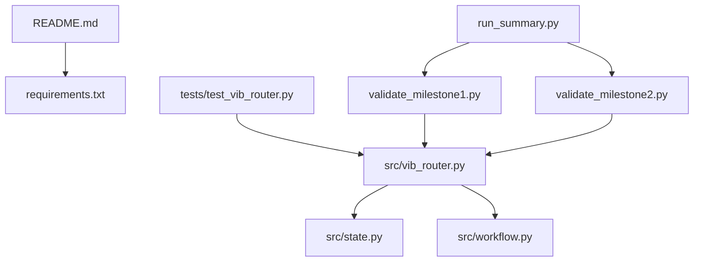
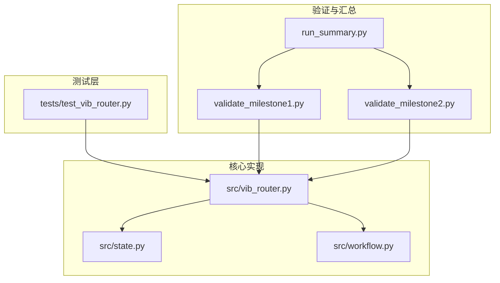
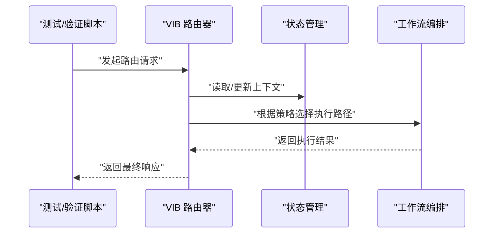
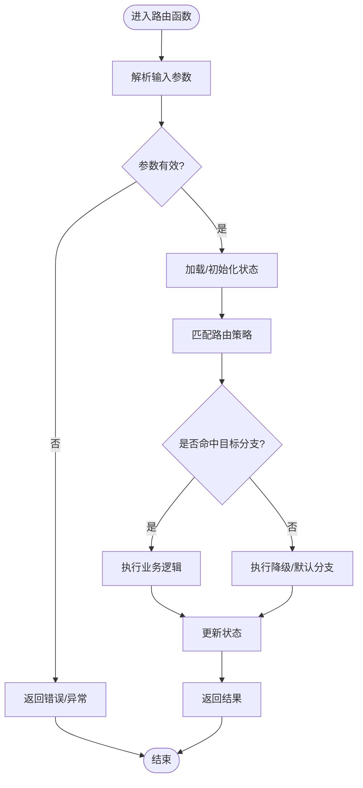
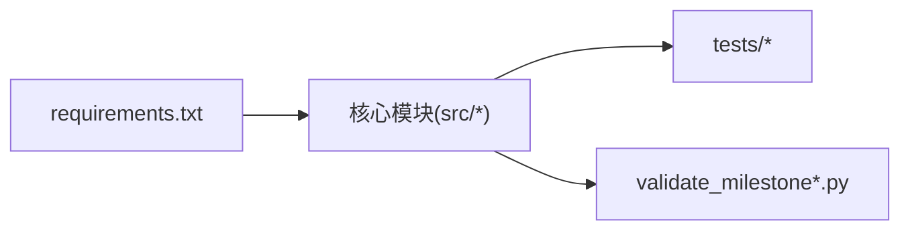

# 测试与验证

<cite>
**本文引用的文件**   
- [README.md](file://README.md)
- [requirements.txt](file://requirements.txt)
- [src/vib_router.py](file://src/vib_router.py)
- [src/state.py](file://src/state.py)
- [src/workflow.py](file://src/workflow.py)
- [tests/test_vib_router.py](file://tests/test_vib_router.py)
- [validate_milestone1.py](file://validate_milestone1.py)
- [validate_milestone2.py](file://validate_milestone2.py)
- [run_summary.py](file://run_summary.py)
</cite>

## 目录
1. [简介](#简介)
2. [项目结构](#项目结构)
3. [核心组件](#核心组件)
4. [架构总览](#架构总览)
5. [详细组件分析](#详细组件分析)
6. [依赖分析](#依赖分析)
7. [性能考虑](#性能考虑)
8. [故障排查指南](#故障排查指南)
9. [结论](#结论)
10. [附录](#附录)

## 简介
本文件面向VIB-SparseCommunication项目的测试与验证，目标是：
- 说明单元测试的编写方法与策略，并以 tests/test_vib_router.py 为例展示如何覆盖 VIB 路由器的核心功能。
- 解释里程碑验证脚本 validate_milestone1.py、validate_milestone2.py 的作用与执行流程。
- 提供性能基准测试的方法与工具建议（吞吐量、延迟、资源使用率）。
- 给出集成测试与端到端测试的实施思路。
- 指导测试数据准备与模拟环境搭建。
- 提供持续集成与自动化测试的配置示例。

## 项目结构
仓库采用“源码 + 测试 + 验证脚本”的清晰分层：
- src：核心实现（路由器、状态、工作流等）
- tests：单元测试与用例
- 根目录：里程碑验证脚本、汇总脚本、依赖清单与说明文档

图表来源
- [src/vib_router.py](file://src/vib_router.py)
- [src/state.py](file://src/state.py)
- [src/workflow.py](file://src/workflow.py)
- [tests/test_vib_router.py](file://tests/test_vib_router.py)
- [validate_milestone1.py](file://validate_milestone1.py)
- [validate_milestone2.py](file://validate_milestone2.py)
- [run_summary.py](file://run_summary.py)
- [requirements.txt](file://requirements.txt)
- [README.md](file://README.md)

章节来源
- [README.md](file://README.md)
- [requirements.txt](file://requirements.txt)

## 核心组件
- VIB 路由器（vib_router.py）：负责消息/请求的路由决策与分发，是系统的关键入口。
- 状态管理（state.py）：维护运行时上下文与中间结果，供路由器与工作流共享。
- 工作流编排（workflow.py）：定义任务执行顺序、分支与聚合逻辑，通常与路由器协同完成端到端流程。

章节来源
- [src/vib_router.py](file://src/vib_router.py)
- [src/state.py](file://src/state.py)
- [src/workflow.py](file://src/workflow.py)

## 架构总览
下图展示了从测试到核心实现的调用关系，以及里程碑验证脚本对核心模块的依赖。

图表来源
- [tests/test_vib_router.py](file://tests/test_vib_router.py)
- [src/vib_router.py](file://src/vib_router.py)
- [src/state.py](file://src/state.py)
- [src/workflow.py](file://src/workflow.py)
- [validate_milestone1.py](file://validate_milestone1.py)
- [validate_milestone2.py](file://validate_milestone2.py)
- [run_summary.py](file://run_summary.py)

## 详细组件分析

### 单元测试：以 test_vib_router.py 为例
目标
- 覆盖 VIB 路由器的关键路径：正常路由、异常输入、边界条件、并发与幂等性（如适用）。
- 隔离外部依赖：通过 Mock/Stub 替代网络、文件系统或第三方服务。
- 可重复与快速：避免真实 I/O，确保 CI 稳定运行。

建议的测试策略
- 单元级断言：对路由函数的输入输出进行精确断言；对状态对象在路由前后的变化进行断言。
- 场景化用例：按功能维度组织用例（例如不同路由键、权重、失败重试、超时处理）。
- 错误注入：构造异常路径（空输入、非法类型、缺失字段、下游不可用），验证健壮性与错误码。
- 随机与参数化：使用参数化驱动多组输入，提升覆盖率。
- 时间相关行为：对超时、重试、退避等逻辑使用可控的时间推进或打桩。

参考路径
- [tests/test_vib_router.py](file://tests/test_vib_router.py)

章节来源
- [tests/test_vib_router.py](file://tests/test_vib_router.py)

### 里程碑验证脚本：validate_milestone1.py 与 validate_milestone2.py
作用
- 里程碑1：验证基础能力（如基本路由、状态初始化、简单工作流链路）。
- 里程碑2：验证进阶能力（如复杂路由规则、容错与回退、性能基线达标等）。

典型执行流程
- 加载配置与环境变量
- 初始化状态与工作流
- 触发若干代表性用例并收集结果
- 输出报告与退出码（用于 CI 判定）

参考路径
- [validate_milestone1.py](file://validate_milestone1.py)
- [validate_milestone2.py](file://validate_milestone2.py)
- [run_summary.py](file://run_summary.py)

章节来源
- [validate_milestone1.py](file://validate_milestone1.py)
- [validate_milestone2.py](file://validate_milestone2.py)
- [run_summary.py](file://run_summary.py)

### 路由器核心流程（序列图）
以下序列图描述一次典型的路由调用链：测试/验证脚本 -> 路由器 -> 状态/工作流。

图表来源
- [src/vib_router.py](file://src/vib_router.py)
- [src/state.py](file://src/state.py)
- [src/workflow.py](file://src/workflow.py)

### 复杂逻辑流程图（示例：路由决策）
以下为路由决策的通用流程示意，便于理解分支与异常处理。

[此图为概念性流程，不直接映射具体代码文件]

## 依赖分析
- 运行时依赖：参见 requirements.txt，安装后确保测试与验证脚本可用。
- 模块耦合：路由器依赖状态与工作流；测试与验证脚本仅依赖路由器接口，保持松耦合。

图表来源
- [requirements.txt](file://requirements.txt)
- [src/vib_router.py](file://src/vib_router.py)
- [src/state.py](file://src/state.py)
- [src/workflow.py](file://src/workflow.py)
- [tests/test_vib_router.py](file://tests/test_vib_router.py)
- [validate_milestone1.py](file://validate_milestone1.py)
- [validate_milestone2.py](file://validate_milestone2.py)

章节来源
- [requirements.txt](file://requirements.txt)

## 性能考虑
- 指标定义
  - 吞吐量：单位时间内成功处理的请求数（QPS/TPS）。
  - 延迟：P50/P95/P99 分位延迟，平均延迟。
  - 资源使用率：CPU、内存、I/O 占用。
- 测量方法
  - 单进程压测：使用轻量压测框架或自定义循环计时，逐步增加并发度。
  - 分布式压测：在多核或多实例下评估扩展性。
  - 资源监控：结合系统工具（如 top、htop、vmstat、iostat）或语言内置 profiling。
- 基准设计
  - 固定数据集：保证可复现性。
  - 阶梯负载：低/中/高并发梯度，观察拐点。
  - 稳定性：长时运行检测内存泄漏与抖动。
- 结果记录
  - 统一导出为 CSV/JSON，便于回归对比与可视化。

[本节为通用指导，不直接分析具体文件]

## 故障排查指南
- 常见问题定位
  - 导入错误：检查 requirements.txt 与虚拟环境一致性。
  - 路由异常：打印/记录输入、状态快照与策略匹配日志。
  - 超时/重试：确认超时阈值与重试退避策略是否符合预期。
- 调试技巧
  - 最小化用例：将问题收敛到单一输入，逐步放大复杂度。
  - 断点与日志：在路由器入口、策略分支、状态更新处添加断点与结构化日志。
  - 隔离外部依赖：使用 Mock 排除网络/IO 干扰。
- 验证脚本辅助
  - 分别运行里程碑脚本，定位问题发生在哪个阶段。
  - 使用 run_summary.py 汇总多次运行结果，观察趋势。

章节来源
- [validate_milestone1.py](file://validate_milestone1.py)
- [validate_milestone2.py](file://validate_milestone2.py)
- [run_summary.py](file://run_summary.py)

## 结论
通过清晰的模块划分与完善的测试体系，VIB-SparseCommunication 可在保证正确性的同时具备良好的可观测性与可扩展性。建议持续完善用例覆盖、引入性能基线与自动化流水线，以提升交付质量与迭代效率。

## 附录

### 测试数据准备与模拟环境搭建
- 数据准备
  - 构造典型与边界输入集（合法、非法、缺失、超长、特殊字符等）。
  - 生成状态初始值与工作流种子数据，确保可复现实验。
- 模拟环境
  - 使用 Mock/Stub 替代外部服务（网络、数据库、消息队列）。
  - 控制时间与并发：使用可控时钟与线程池大小，保证可重复性。
  - 环境变量：集中管理开关、阈值与路径，便于切换不同场景。

[本节为通用指导，不直接分析具体文件]

### 持续集成与自动化测试（示例）
- 步骤建议
  - 安装依赖：pip install -r requirements.txt
  - 运行单元测试：python -m pytest tests/
  - 运行里程碑验证：python validate_milestone1.py && python validate_milestone2.py
  - 生成报告：汇总测试结果与性能摘要
- 示例命令（可按需调整）
  - pip install -r requirements.txt
  - python -m pytest tests/ -v --tb=short
  - python validate_milestone1.py
  - python validate_milestone2.py
  - python run_summary.py

章节来源
- [requirements.txt](file://requirements.txt)
- [validate_milestone1.py](file://validate_milestone1.py)
- [validate_milestone2.py](file://validate_milestone2.py)
- [run_summary.py](file://run_summary.py)