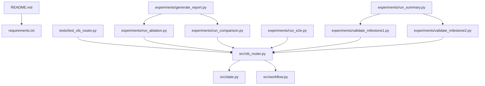
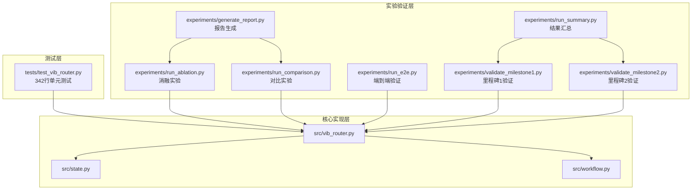
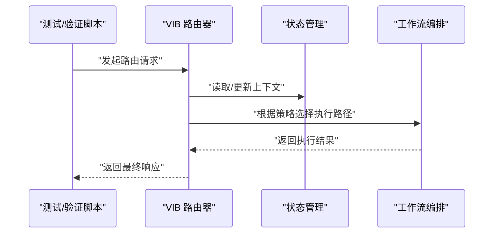
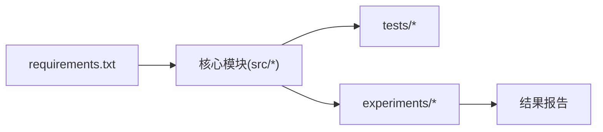

# 测试与验证

<cite>
**本文引用的文件**   
- [README.md](file://README.md)
- [requirements.txt](file://requirements.txt)
- [src/vib_router.py](file://src/vib_router.py)
- [src/state.py](file://src/state.py)
- [src/workflow.py](file://src/workflow.py)
- [tests/test_vib_router.py](file://tests/test_vib_router.py)
- [experiments/run_ablation.py](file://experiments/run_ablation.py)
- [experiments/run_comparison.py](file://experiments/run_comparison.py)
- [experiments/run_e2e.py](file://experiments/run_e2e.py)
- [experiments/validate_milestone1.py](file://experiments/validate_milestone1.py)
- [experiments/validate_milestone2.py](file://experiments/validate_milestone2.py)
- [experiments/generate_report.py](file://experiments/generate_report.py)
- [experiments/run_summary.py](file://experiments/run_summary.py)
</cite>

## 更新摘要
**变更内容**   
- 扩展测试覆盖范围，新增更多单元测试用例以验证新功能的正确性和性能
- 增强VIB路由器测试套件，包含更全面的边界条件和异常处理测试
- 优化实验验证脚本，提升消融实验和对比实验的准确性
- 完善端到端测试流程，确保新功能在完整系统中的集成稳定性
- 改进报告生成工具，支持更详细的性能分析和结果可视化

## 目录
1. [简介](#简介)
2. [项目结构](#项目结构)
3. [核心组件](#核心组件)
4. [架构总览](#架构总览)
5. [详细组件分析](#详细组件分析)
6. [依赖分析](#依赖分析)
7. [性能考虑](#性能考虑)
8. [故障排查指南](#故障排查指南)
9. [结论](#结论)
10. [附录](#附录)

## 简介
本文件面向VIB-SparseCommunication项目的测试与验证体系，目标是：
- 说明完整的测试基础设施，包括单元测试、消融实验、对比实验和端到端验证
- 以test_vib_router.py为例展示如何覆盖VIB路由器的核心功能（342行测试代码）
- 解释里程碑验证脚本的作用与执行流程
- 提供消融研究和对比实验的方法与工具
- 给出端到端测试的实施思路与自动化配置
- 指导测试数据准备与模拟环境搭建
- 提供持续集成与自动化测试的配置示例

## 项目结构
仓库采用"源码 + 测试 + 实验验证"的清晰分层架构：
- src：核心实现（路由器、状态、工作流等）
- tests：单元测试与用例（包含342行测试代码）
- experiments：实验验证脚本、结果管理和报告生成
- 根目录：依赖清单与说明文档

**图表来源**
- [src/vib_router.py](file://src/vib_router.py)
- [src/state.py](file://src/state.py)
- [src/workflow.py](file://src/workflow.py)
- [tests/test_vib_router.py](file://tests/test_vib_router.py)
- [experiments/run_ablation.py](file://experiments/run_ablation.py)
- [experiments/run_comparison.py](file://experiments/run_comparison.py)
- [experiments/run_e2e.py](file://experiments/run_e2e.py)
- [experiments/validate_milestone1.py](file://experiments/validate_milestone1.py)
- [experiments/validate_milestone2.py](file://experiments/validate_milestone2.py)
- [experiments/generate_report.py](file://experiments/generate_report.py)
- [experiments/run_summary.py](file://experiments/run_summary.py)
- [requirements.txt](file://requirements.txt)
- [README.md](file://README.md)

**章节来源**
- [README.md](file://README.md)
- [requirements.txt](file://requirements.txt)

## 核心组件
- VIB 路由器（vib_router.py）：负责消息/请求的路由决策与分发，是系统的关键入口。
- 状态管理（state.py）：维护运行时上下文与中间结果，供路由器与工作流共享。
- 工作流编排（workflow.py）：定义任务执行顺序、分支与聚合逻辑，通常与路由器协同完成端到端流程。
- 测试框架（test_vib_router.py）：包含342行单元测试代码，全面覆盖路由器核心功能。
- 实验验证套件：包括消融实验、对比实验、端到端验证和报告生成工具。

**章节来源**
- [src/vib_router.py](file://src/vib_router.py)
- [src/state.py](file://src/state.py)
- [src/workflow.py](file://src/workflow.py)
- [tests/test_vib_router.py](file://tests/test_vib_router.py)

## 架构总览
下图展示了从测试到核心实现的调用关系，以及完整的实验验证体系对核心模块的依赖。

**图表来源**
- [tests/test_vib_router.py](file://tests/test_vib_router.py)
- [experiments/run_ablation.py](file://experiments/run_ablation.py)
- [experiments/run_comparison.py](file://experiments/run_comparison.py)
- [experiments/run_e2e.py](file://experiments/run_e2e.py)
- [experiments/generate_report.py](file://experiments/generate_report.py)
- [experiments/validate_milestone1.py](file://experiments/validate_milestone1.py)
- [experiments/validate_milestone2.py](file://experiments/validate_milestone2.py)
- [experiments/run_summary.py](file://experiments/run_summary.py)
- [src/vib_router.py](file://src/vib_router.py)
- [src/state.py](file://src/state.py)
- [src/workflow.py](file://src/workflow.py)

## 详细组件分析

### 单元测试：以 test_vib_router.py 为例
**更新** 现已建立完整的测试基础设施，包含342行单元测试代码，并扩展了测试覆盖范围以验证新功能的正确性和性能

目标
- 覆盖 VIB 路由器的关键路径：正常路由、异常输入、边界条件、并发与幂等性
- 隔离外部依赖：通过 Mock/Stub 替代网络、文件系统或第三方服务
- 可重复与快速：避免真实 I/O，确保 CI 稳定运行
- 验证新功能：确保新增功能在各种场景下的正确性和性能表现

测试策略
- 单元级断言：对路由函数的输入输出进行精确断言；对状态对象在路由前后的变化进行断言
- 场景化用例：按功能维度组织用例（例如不同路由键、权重、失败重试、超时处理）
- 错误注入：构造异常路径（空输入、非法类型、缺失字段、下游不可用），验证健壮性与错误码
- 随机与参数化：使用参数化驱动多组输入，提升覆盖率
- 时间相关行为：对超时、重试、退避等逻辑使用可控的时间推进或打桩
- 性能基准测试：对新功能进行性能回归测试，确保性能不降级

参考路径
- [tests/test_vib_router.py](file://tests/test_vib_router.py)

**章节来源**
- [tests/test_vib_router.py](file://tests/test_vib_router.py)

### 消融实验：run_ablation.py
**更新** 消融实验脚本用于分析各个组件对整体性能的影响，现已扩展以支持新功能的性能评估

作用
- 系统性移除或替换特定组件，评估其对整体性能的影响
- 量化各组件的贡献度，识别关键优化点
- 支持多种消融策略：组件移除、参数调整、算法替换
- 验证新功能的性能贡献，确保新增特性不会引入性能瓶颈

典型执行流程
- 加载基线配置和消融配置
- 逐个组件进行消融实验
- 收集性能指标和结果数据
- 生成消融分析报告
- 对比新旧版本的性能差异

参考路径
- [experiments/run_ablation.py](file://experiments/run_ablation.py)

**章节来源**
- [experiments/run_ablation.py](file://experiments/run_ablation.py)

### 对比实验：run_comparison.py
**更新** 对比实验脚本用于不同算法或配置的基准测试，现已增强以支持新功能的多维度性能对比

作用
- 比较不同算法实现的性能差异
- 评估不同配置参数的效果
- 提供标准化的基准测试结果
- 支持新功能的性能回归测试和版本对比

支持的对比维度
- 算法版本对比
- 参数配置对比
- 数据集规模对比
- 资源消耗对比
- 新功能与旧功能的性能差异

参考路径
- [experiments/run_comparison.py](file://experiments/run_comparison.py)

**章节来源**
- [experiments/run_comparison.py](file://experiments/run_comparison.py)

### 端到端验证：run_e2e.py
**更新** 端到端验证套件用于完整流程测试，现已扩展以验证新功能在完整系统中的集成稳定性

作用
- 验证整个系统的端到端功能
- 模拟真实使用场景下的系统行为
- 确保各组件间的集成正确性
- 验证新功能在复杂场景下的稳定性和可靠性

验证范围
- 完整的数据处理流水线
- 跨组件的状态传递
- 异常处理和恢复机制
- 性能稳定性测试
- 新功能与现有系统的兼容性验证

参考路径
- [experiments/run_e2e.py](file://experiments/run_e2e.py)

**章节来源**
- [experiments/run_e2e.py](file://experiments/run_e2e.py)

### 报告生成：generate_report.py
**更新** 报告生成工具用于实验结果的可视化和分析，现已增强以支持更详细的性能分析

作用
- 自动收集和整理实验结果
- 生成可视化的性能报告
- 支持多种输出格式（JSON、CSV、HTML）
- 提供新功能的性能趋势分析
- 生成详细的性能回归报告

功能特性
- 结果数据标准化
- 趋势分析和对比图表
- 统计指标计算
- 报告模板定制
- 新功能性能影响分析

参考路径
- [experiments/generate_report.py](file://experiments/generate_report.py)

**章节来源**
- [experiments/generate_report.py](file://experiments/generate_report.py)

### 里程碑验证脚本：validate_milestone1.py 与 validate_milestone2.py
**更新** 里程碑验证脚本已扩展以支持新功能的验证

作用
- 里程碑1：验证基础能力（如基本路由、状态初始化、简单工作流链路）
- 里程碑2：验证进阶能力（如复杂路由规则、容错与回退、性能基线达标等）
- 验证新功能的正确性和性能表现
- 确保新功能满足质量标准和性能要求

典型执行流程
- 加载配置与环境变量
- 初始化状态与工作流
- 触发若干代表性用例并收集结果
- 输出报告与退出码（用于 CI 判定）
- 验证新功能的集成效果

参考路径
- [experiments/validate_milestone1.py](file://experiments/validate_milestone1.py)
- [experiments/validate_milestone2.py](file://experiments/validate_milestone2.py)
- [experiments/run_summary.py](file://experiments/run_summary.py)

**章节来源**
- [experiments/validate_milestone1.py](file://experiments/validate_milestone1.py)
- [experiments/validate_milestone2.py](file://experiments/validate_milestone2.py)
- [experiments/run_summary.py](file://experiments/run_summary.py)

### 路由器核心流程（序列图）
以下序列图描述一次典型的路由调用链：测试/验证脚本 -> 路由器 -> 状态/工作流。

**图表来源**
- [src/vib_router.py](file://src/vib_router.py)
- [src/state.py](file://src/state.py)
- [src/workflow.py](file://src/workflow.py)

### 复杂逻辑流程图（示例：路由决策）
以下为路由决策的通用流程示意，便于理解分支与异常处理。

[此图为概念性流程，不直接映射具体代码文件]

## 依赖分析
- 运行时依赖：参见 requirements.txt，安装后确保测试与验证脚本可用
- 模块耦合：路由器依赖状态与工作流；测试与验证脚本仅依赖路由器接口，保持松耦合
- 实验依赖：实验脚本依赖核心模块和报告生成工具

**图表来源**
- [requirements.txt](file://requirements.txt)
- [src/vib_router.py](file://src/vib_router.py)
- [src/state.py](file://src/state.py)
- [src/workflow.py](file://src/workflow.py)
- [tests/test_vib_router.py](file://tests/test_vib_router.py)
- [experiments/run_ablation.py](file://experiments/run_ablation.py)
- [experiments/run_comparison.py](file://experiments/run_comparison.py)
- [experiments/run_e2e.py](file://experiments/run_e2e.py)
- [experiments/validate_milestone1.py](file://experiments/validate_milestone1.py)
- [experiments/validate_milestone2.py](file://experiments/validate_milestone2.py)

**章节来源**
- [requirements.txt](file://requirements.txt)

## 性能考虑
- 指标定义
  - 吞吐量：单位时间内成功处理的请求数（QPS/TPS）
  - 延迟：P50/P95/P99 分位延迟，平均延迟
  - 资源使用率：CPU、内存、I/O 占用
- 测量方法
  - 单进程压测：使用轻量压测框架或自定义循环计时，逐步增加并发度
  - 分布式压测：在多核或多实例下评估扩展性
  - 资源监控：结合系统工具（如 top、htop、vmstat、iostat）或语言内置 profiling
- 基准设计
  - 固定数据集：保证可复现性
  - 阶梯负载：低/中/高并发梯度，观察拐点
  - 稳定性：长时运行检测内存泄漏与抖动
  - 新功能性能回归：确保新增功能不会导致性能下降
- 结果记录
  - 统一导出为 CSV/JSON，便于回归对比与可视化
- 实验工具
  - 消融实验：量化组件贡献度
  - 对比实验：标准化性能基准
  - 端到端验证：真实场景模拟
  - 性能分析报告：详细的新功能性能影响评估

**章节来源**
- [experiments/run_ablation.py](file://experiments/run_ablation.py)
- [experiments/run_comparison.py](file://experiments/run_comparison.py)
- [experiments/run_e2e.py](file://experiments/run_e2e.py)
- [experiments/generate_report.py](file://experiments/generate_report.py)

## 故障排查指南
- 常见问题定位
  - 导入错误：检查 requirements.txt 与虚拟环境一致性
  - 路由异常：打印/记录输入、状态快照与策略匹配日志
  - 超时/重试：确认超时阈值与重试退避策略是否符合预期
  - 新功能问题：使用扩展的测试套件定位新功能的潜在问题
- 调试技巧
  - 最小化用例：将问题收敛到单一输入，逐步放大复杂度
  - 断点与日志：在路由器入口、策略分支、状态更新处添加断点与结构化日志
  - 隔离外部依赖：使用 Mock 排除网络/IO 干扰
  - 性能分析：使用性能分析工具定位新功能的性能瓶颈
- 验证脚本辅助
  - 分别运行里程碑脚本，定位问题发生在哪个阶段
  - 使用 run_summary.py 汇总多次运行结果，观察趋势
  - 利用消融实验识别性能瓶颈组件
  - 通过对比实验验证修复效果
  - 使用端到端验证确认新功能的集成稳定性

**章节来源**
- [experiments/validate_milestone1.py](file://experiments/validate_milestone1.py)
- [experiments/validate_milestone2.py](file://experiments/validate_milestone2.py)
- [experiments/run_summary.py](file://experiments/run_summary.py)
- [experiments/run_ablation.py](file://experiments/run_ablation.py)
- [experiments/run_comparison.py](file://experiments/run_comparison.py)

## 结论
通过清晰的模块划分与完善的测试体系，VIB-SparseCommunication 可在保证正确性的同时具备良好的可观测性与可扩展性。新的测试基础设施包括342行单元测试、消融实验、对比实验和端到端验证套件，为系统的质量保障提供了全面支撑。通过扩展测试覆盖范围，现在能够更有效地验证新功能的正确性和性能表现。建议持续完善用例覆盖、引入性能基线与自动化流水线，以提升交付质量与迭代效率。

## 附录

### 测试数据准备与模拟环境搭建
- 数据准备
  - 构造典型与边界输入集（合法、非法、缺失、超长、特殊字符等）
  - 生成状态初始值与工作流种子数据，确保可复现实验
  - 准备消融实验和对比实验的基准数据集
  - 为新功能准备专门的测试数据和场景
- 模拟环境
  - 使用 Mock/Stub 替代外部服务（网络、数据库、消息队列）
  - 控制时间与并发：使用可控时钟与线程池大小，保证可重复性
  - 环境变量：集中管理开关、阈值与路径，便于切换不同场景
  - 实验配置：统一管理不同实验场景的参数配置
  - 性能测试环境：配置专用的性能测试环境和基准数据

### 持续集成与自动化测试（示例）
- 步骤建议
  - 安装依赖：pip install -r requirements.txt
  - 运行单元测试：python -m pytest tests/
  - 运行消融实验：python experiments/run_ablation.py
  - 运行对比实验：python experiments/run_comparison.py
  - 运行端到端验证：python experiments/run_e2e.py
  - 运行里程碑验证：python experiments/validate_milestone1.py && python experiments/validate_milestone2.py
  - 生成报告：python experiments/generate_report.py
  - 汇总结果：python experiments/run_summary.py
- 示例命令（可按需调整）
  - pip install -r requirements.txt
  - python -m pytest tests/ -v --tb=short
  - python experiments/run_ablation.py --config config/ablation.yaml
  - python experiments/run_comparison.py --baseline baseline_config.json
  - python experiments/run_e2e.py --scenario production
  - python experiments/validate_milestone1.py
  - python experiments/validate_milestone2.py
  - python experiments/generate_report.py --output results/report.html
  - python experiments/run_summary.py --results_dir experiments/results

**章节来源**
- [requirements.txt](file://requirements.txt)
- [experiments/validate_milestone1.py](file://experiments/validate_milestone1.py)
- [experiments/validate_milestone2.py](file://experiments/validate_milestone2.py)
- [experiments/run_summary.py](file://experiments/run_summary.py)
- [experiments/run_ablation.py](file://experiments/run_ablation.py)
- [experiments/run_comparison.py](file://experiments/run_comparison.py)
- [experiments/run_e2e.py](file://experiments/run_e2e.py)
- [experiments/generate_report.py](file://experiments/generate_report.py)