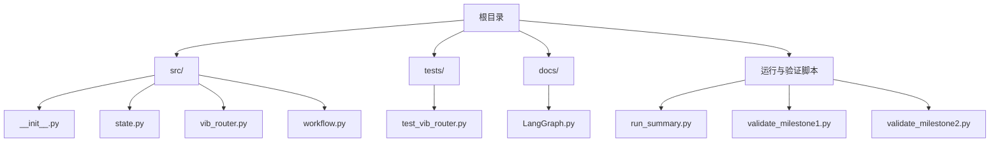
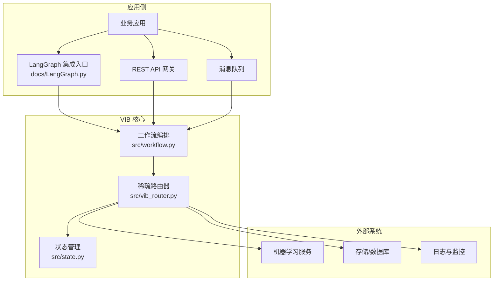
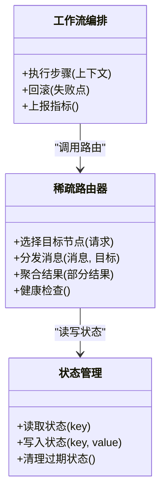
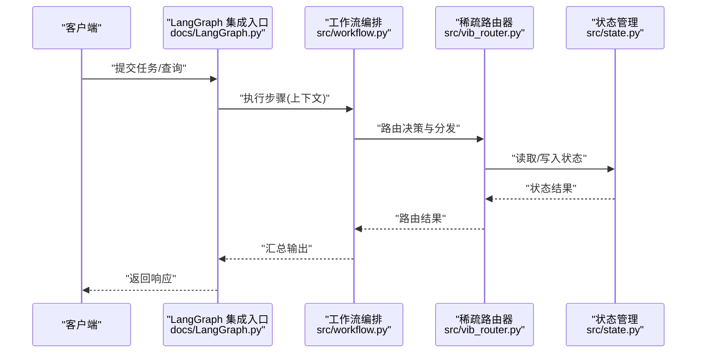
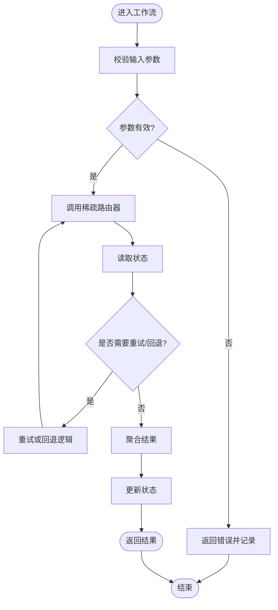
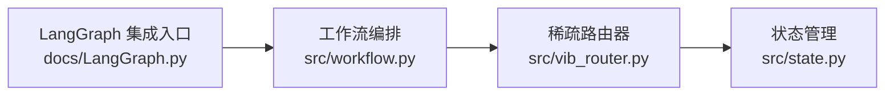

# 集成指南

<cite>
**本文引用的文件**   
- [README.md](file://README.md)
- [requirements.txt](file://requirements.txt)
- [run_summary.py](file://run_summary.py)
- [validate_milestone1.py](file://validate_milestone1.py)
- [validate_milestone2.py](file://validate_milestone2.py)
- [src/__init__.py](file://src/__init__.py)
- [src/state.py](file://src/state.py)
- [src/vib_router.py](file://src/vib_router.py)
- [src/workflow.py](file://src/workflow.py)
- [tests/test_vib_router.py](file://tests/test_vib_router.py)
- [docs/LangGraph.py](file://docs/LangGraph.py)
</cite>

## 目录
1. [简介](#简介)
2. [项目结构](#项目结构)
3. [核心组件](#核心组件)
4. [架构总览](#架构总览)
5. [详细组件分析](#详细组件分析)
6. [依赖分析](#依赖分析)
7. [性能考虑](#性能考虑)
8. [故障排查指南](#故障排查指南)
9. [结论](#结论)
10. [附录](#附录)

## 简介
本指南面向希望将 VIB-SparseCommunication（VIB 稀疏通信）系统集成到现有应用中的工程师与架构师。文档覆盖以下主题：
- 在 LangGraph 框架中的集成示例与最佳实践
- REST API 集成方案
- 消息队列集成模式
- 微服务架构下的部署策略
- 配置文件与环境变量管理
- 常见集成场景（机器学习管道、实时数据处理系统）
- 性能监控与日志集成
- 故障诊断与问题排查

## 项目结构
仓库采用清晰的分层组织，核心逻辑位于 src 目录，测试用例位于 tests，示例与文档位于 docs，根目录包含运行脚本与验证脚本。

图表来源
- [src/__init__.py](file://src/__init__.py)
- [src/state.py](file://src/state.py)
- [src/vib_router.py](file://src/vib_router.py)
- [src/workflow.py](file://src/workflow.py)
- [tests/test_vib_router.py](file://tests/test_vib_router.py)
- [docs/LangGraph.py](file://docs/LangGraph.py)
- [run_summary.py](file://run_summary.py)
- [validate_milestone1.py](file://validate_milestone1.py)
- [validate_milestone2.py](file://validate_milestone2.py)

章节来源
- [README.md](file://README.md)
- [requirements.txt](file://requirements.txt)

## 核心组件
- 路由与调度：负责消息的稀疏分发与聚合，支撑高吞吐与低延迟的通信路径选择。
- 状态管理：维护工作流与通信过程中的关键状态，确保幂等与可恢复性。
- 工作流编排：定义端到端处理流程，串联路由、状态与外部系统交互。
- 测试与验证：提供单元测试与里程碑验证脚本，保障集成稳定性。

章节来源
- [src/vib_router.py](file://src/vib_router.py)
- [src/state.py](file://src/state.py)
- [src/workflow.py](file://src/workflow.py)
- [tests/test_vib_router.py](file://tests/test_vib_router.py)

## 架构总览
下图展示了 VIB-SparseCommunication 在典型应用中的位置与交互关系，包括 LangGraph 集成入口、REST API 网关、消息队列与下游服务。

图表来源
- [docs/LangGraph.py](file://docs/LangGraph.py)
- [src/vib_router.py](file://src/vib_router.py)
- [src/state.py](file://src/state.py)
- [src/workflow.py](file://src/workflow.py)

## 详细组件分析

### 组件A：稀疏路由器（vib_router）
职责
- 根据负载、拓扑与策略进行稀疏路由决策
- 协调状态更新与结果汇聚
- 暴露内部接口供工作流与外部系统调用

类与方法关系

图表来源
- [src/vib_router.py](file://src/vib_router.py)
- [src/state.py](file://src/state.py)
- [src/workflow.py](file://src/workflow.py)

章节来源
- [src/vib_router.py](file://src/vib_router.py)
- [src/state.py](file://src/state.py)
- [src/workflow.py](file://src/workflow.py)

### 组件B：LangGraph 集成入口（docs/LangGraph.py）
职责
- 作为 LangGraph 与工作流的桥接层
- 将图节点映射为工作流步骤
- 统一错误处理与重试策略

序列图（LangGraph 调用链）

图表来源
- [docs/LangGraph.py](file://docs/LangGraph.py)
- [src/workflow.py](file://src/workflow.py)
- [src/vib_router.py](file://src/vib_router.py)
- [src/state.py](file://src/state.py)

章节来源
- [docs/LangGraph.py](file://docs/LangGraph.py)
- [src/workflow.py](file://src/workflow.py)

### 组件C：工作流编排（workflow）
职责
- 定义端到端处理流程
- 管理步骤顺序、分支与合并
- 集成异常处理与重试

流程图（工作流主路径）

图表来源
- [src/workflow.py](file://src/workflow.py)
- [src/vib_router.py](file://src/vib_router.py)
- [src/state.py](file://src/state.py)

章节来源
- [src/workflow.py](file://src/workflow.py)

### 组件D：状态管理（state）
职责
- 提供键值型状态存取
- 支持过期清理与一致性保证
- 为路由与工作流提供持久化上下文

章节来源
- [src/state.py](file://src/state.py)

### 组件E：测试与验证（tests 与验证脚本）
职责
- 对路由逻辑进行单元与集成测试
- 通过里程碑脚本验证阶段性功能

章节来源
- [tests/test_vib_router.py](file://tests/test_vib_router.py)
- [validate_milestone1.py](file://validate_milestone1.py)
- [validate_milestone2.py](file://validate_milestone2.py)

## 依赖分析
- 运行时依赖：参见 requirements.txt，用于安装第三方库与版本锁定。
- 模块耦合：
  - 工作流编排依赖稀疏路由器与状态管理
  - 稀疏路由器依赖状态管理
  - LangGraph 集成入口依赖工作流编排
- 外部依赖：
  - 机器学习服务、数据库、日志与监控系统通过路由器与工作流间接接入

图表来源
- [docs/LangGraph.py](file://docs/LangGraph.py)
- [src/workflow.py](file://src/workflow.py)
- [src/vib_router.py](file://src/vib_router.py)
- [src/state.py](file://src/state.py)

章节来源
- [requirements.txt](file://requirements.txt)

## 性能考虑
- 稀疏路由优化
  - 基于负载与拓扑的动态选择，减少热点与拥塞
  - 批量聚合与批处理窗口调优，提升吞吐
- 状态管理
  - 使用缓存与过期策略降低 I/O 压力
  - 避免频繁写放大，合并状态更新
- 工作流编排
  - 并行步骤与超时控制，提高整体时延表现
  - 幂等设计与去重，防止重复计算
- 监控与观测
  - 采集关键指标（QPS、P99 延迟、错误率、路由命中率）
  - 结构化日志与链路追踪，便于定位瓶颈

[本节为通用指导，不直接分析具体文件]

## 故障排查指南
- 常见问题
  - 路由失败：检查目标节点健康与容量，确认路由策略配置
  - 状态不一致：核对状态写入顺序与事务边界，必要时触发回滚
  - 工作流卡住：查看步骤超时与重试次数，确认外部依赖可用性
- 诊断步骤
  - 启用调试日志与链路追踪，定位失败节点
  - 使用验证脚本逐步回归里程碑，缩小问题范围
  - 结合监控面板观察指标异常，快速定位热点与瓶颈
- 恢复策略
  - 自动重试与降级路径
  - 人工介入开关与熔断保护

章节来源
- [tests/test_vib_router.py](file://tests/test_vib_router.py)
- [validate_milestone1.py](file://validate_milestone1.py)
- [validate_milestone2.py](file://validate_milestone2.py)

## 结论
通过将 VIB-SparseCommunication 的核心组件（路由、状态、工作流）与 LangGraph、REST API、消息队列及外部系统解耦集成，可在保持高性能与可扩展性的同时，实现稳定的端到端通信与处理。建议在生产环境完善监控与日志体系，并结合测试与验证脚本持续保障质量。

[本节为总结，不直接分析具体文件]

## 附录

### 安装与运行
- 依赖安装：参考 requirements.txt 安装所需包
- 运行脚本：使用 run_summary.py 汇总运行信息
- 验证里程碑：使用 validate_milestone1.py 与 validate_milestone2.py 分阶段验证

章节来源
- [requirements.txt](file://requirements.txt)
- [run_summary.py](file://run_summary.py)
- [validate_milestone1.py](file://validate_milestone1.py)
- [validate_milestone2.py](file://validate_milestone2.py)

### 配置文件与环境变量管理
- 配置文件
  - 集中存放路由策略、状态后端、工作流参数等
  - 按环境（开发/测试/生产）分离配置
- 环境变量
  - 敏感信息（密钥、连接串）通过环境变量注入
  - 启动前校验必要变量，缺失则拒绝启动
- 最佳实践
  - 使用只读挂载与最小权限原则
  - 变更配置后滚动重启，避免热加载风险

[本节为通用指导，不直接分析具体文件]

### REST API 集成方案
- 设计要点
  - 统一入口与鉴权中间件
  - 请求校验与限流
  - 异步任务与回调机制
- 与 VIB 集成
  - 将 API 请求转换为工作流上下文
  - 通过路由与状态管理完成分布式处理
  - 返回结构化响应与错误码

[本节为通用指导，不直接分析具体文件]

### 消息队列集成模式
- 模式选择
  - 点对点与发布订阅
  - 事件驱动与命令式
- 与 VIB 集成
  - 消费消息并触发工作流
  - 路由到合适节点，状态落盘保证可靠性
  - 死信队列与重试策略

[本节为通用指导，不直接分析具体文件]

### 微服务架构下的部署策略
- 容器化与编排
  - 镜像构建与多阶段构建
  - Kubernetes 部署与服务发现
- 弹性与容错
  - 水平扩展与负载均衡
  - 熔断、降级与隔离
- 可观测性
  - 指标导出与告警规则
  - 日志聚合与检索

[本节为通用指导，不直接分析具体文件]

### 常见集成场景与解决方案
- 机器学习管道
  - 特征预处理与模型推理流水线
  - 模型版本管理与灰度发布
- 实时数据处理
  - 流式计算与窗口聚合
  - 低延迟路由与状态快照

[本节为通用指导，不直接分析具体文件]

### 性能监控与日志集成最佳实践
- 指标
  - 业务指标与技术指标并重
  - 自定义维度与标签
- 日志
  - 结构化字段与统一格式
  - 分级输出与脱敏
- 链路追踪
  - 跨服务传播上下文
  - 采样策略与成本平衡

[本节为通用指导，不直接分析具体文件]