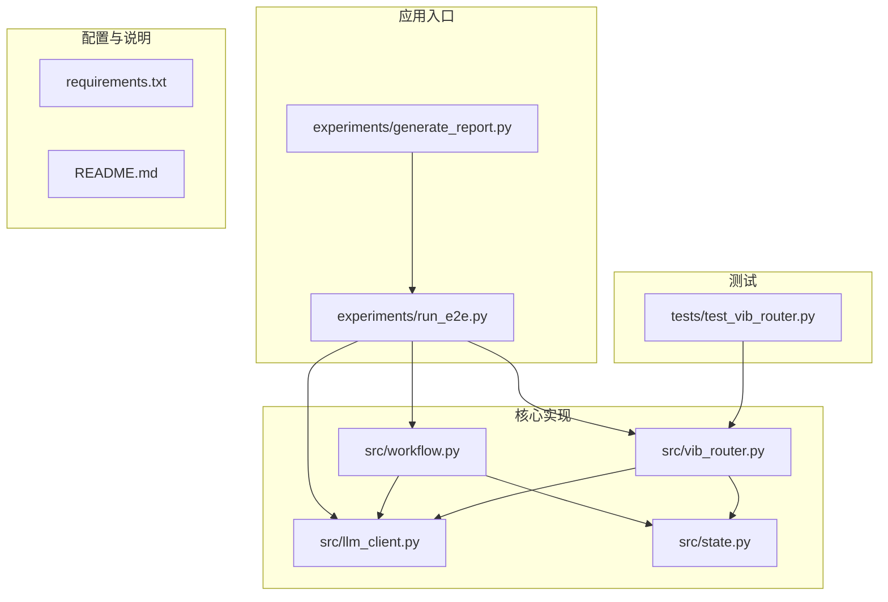
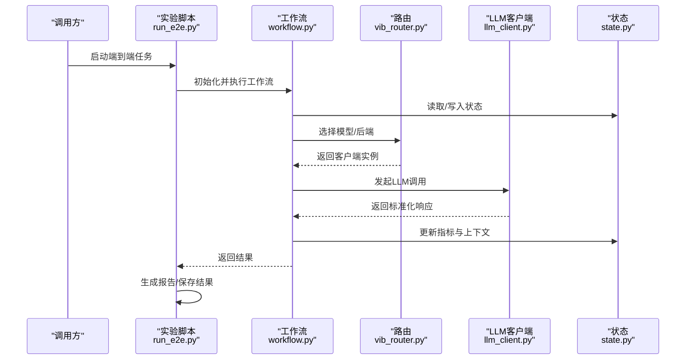
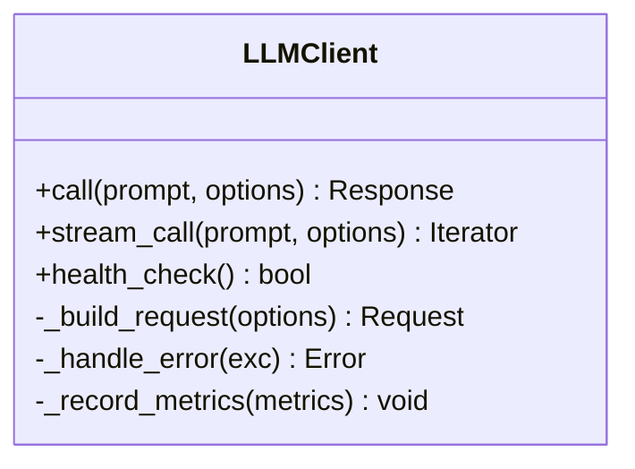
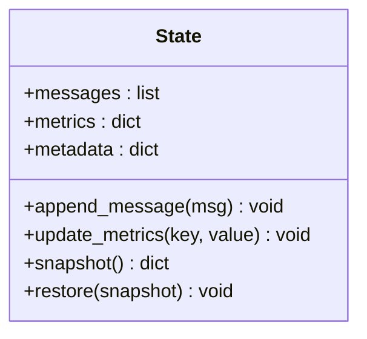
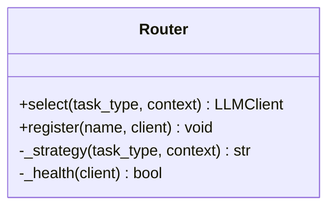
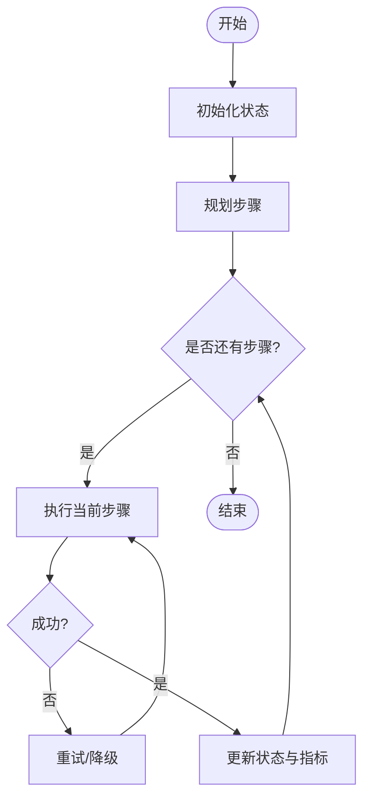
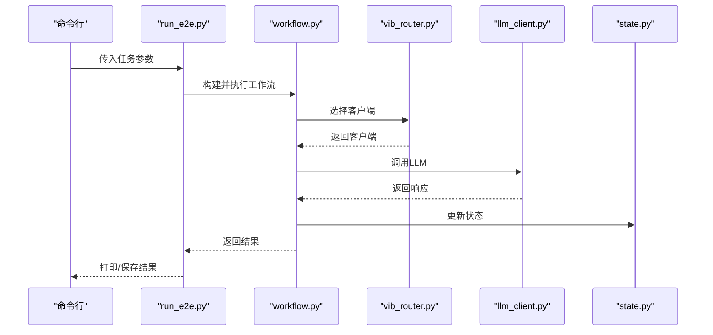
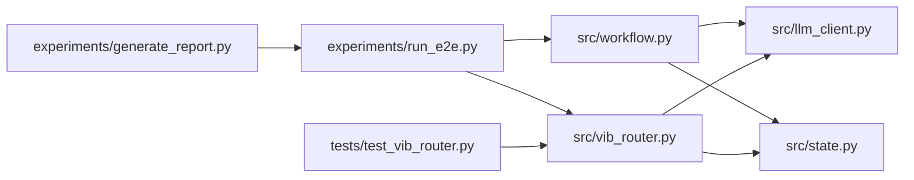

# LLM客户端集成

<cite>
**本文引用的文件**   
- [README.md](file://README.md)
- [requirements.txt](file://requirements.txt)
- [src/llm_client.py](file://src/llm_client.py)
- [src/state.py](file://src/state.py)
- [src/vib_router.py](file://src/vib_router.py)
- [src/workflow.py](file://src/workflow.py)
- [tests/test_vib_router.py](file://tests/test_vib_router.py)
- [experiments/run_e2e.py](file://experiments/run_e2e.py)
- [experiments/generate_report.py](file://experiments/generate_report.py)
</cite>

## 目录
1. [简介](#简介)
2. [项目结构](#项目结构)
3. [核心组件](#核心组件)
4. [架构总览](#架构总览)
5. [详细组件分析](#详细组件分析)
6. [依赖关系分析](#依赖关系分析)
7. [性能考虑](#性能考虑)
8. [故障排查指南](#故障排查指南)
9. [结论](#结论)
10. [附录](#附录)

## 简介
本项目围绕“LLM客户端集成”展开，提供统一的LLM调用封装、状态管理、路由与编排能力，并通过实验脚本串联端到端流程。整体目标是在多模型或多后端场景下，为上层工作流提供稳定、可观测、可扩展的LLM接入层。

## 项目结构
仓库采用分层组织：
- src：核心实现（LLM客户端、状态、路由、工作流）
- experiments：端到端运行与报告生成脚本
- tests：关键模块的单测
- docs：示例或参考文档
- requirements.txt：依赖声明
- README.md：项目说明

图表来源
- [experiments/run_e2e.py](file://experiments/run_e2e.py)
- [experiments/generate_report.py](file://experiments/generate_report.py)
- [src/llm_client.py](file://src/llm_client.py)
- [src/state.py](file://src/state.py)
- [src/vib_router.py](file://src/vib_router.py)
- [src/workflow.py](file://src/workflow.py)
- [tests/test_vib_router.py](file://tests/test_vib_router.py)
- [requirements.txt](file://requirements.txt)
- [README.md](file://README.md)

章节来源
- [README.md](file://README.md)
- [requirements.txt](file://requirements.txt)

## 核心组件
- LLM客户端封装：统一对外暴露调用接口，屏蔽不同后端差异，负责请求构造、重试、超时与错误归一化。
- 状态管理：维护会话上下文、历史消息、指标与中间结果，供工作流与路由共享。
- 路由：根据策略选择具体模型或后端，支持按任务类型、负载或A/B规则分流。
- 工作流：编排调用顺序、分支与聚合逻辑，将业务意图转化为对客户端与路由的调用序列。

章节来源
- [src/llm_client.py](file://src/llm_client.py)
- [src/state.py](file://src/state.py)
- [src/vib_router.py](file://src/vib_router.py)
- [src/workflow.py](file://src/workflow.py)

## 架构总览
系统以“工作流驱动”的方式组织调用链：工作流读取状态并决定下一步动作；通过路由选择具体LLM客户端实例；客户端执行网络请求并返回标准化结果；工作流更新状态并产出最终输出。

图表来源
- [experiments/run_e2e.py](file://experiments/run_e2e.py)
- [src/workflow.py](file://src/workflow.py)
- [src/vib_router.py](file://src/vib_router.py)
- [src/llm_client.py](file://src/llm_client.py)
- [src/state.py](file://src/state.py)

## 详细组件分析

### LLM客户端（src/llm_client.py）
职责与要点
- 统一抽象：对外暴露一致的调用方法，隐藏不同后端SDK差异。
- 错误处理：捕获网络异常、鉴权失败、限流等，进行重试与降级。
- 可观测性：记录耗时、token用量、错误码等指标，便于监控与排障。
- 配置注入：从环境变量或配置文件加载密钥、超时、并发等参数。

图表来源
- [src/llm_client.py](file://src/llm_client.py)

章节来源
- [src/llm_client.py](file://src/llm_client.py)

### 状态管理（src/state.py）
职责与要点
- 会话上下文：维护用户输入、历史对话、工具调用结果等。
- 指标收集：累计延迟、成功率、成本估算等。
- 线程安全：在并发工作流中保证读写一致性。
- 序列化：支持持久化与回放，便于调试与复现。

图表来源
- [src/state.py](file://src/state.py)

章节来源
- [src/state.py](file://src/state.py)

### 路由（src/vib_router.py）
职责与要点
- 策略选择：基于任务类型、负载、A/B分组等条件选择具体客户端。
- 健康检查：动态剔除不可用后端，提升鲁棒性。
- 扩展点：新增模型或后端只需注册新策略即可接入。

图表来源
- [src/vib_router.py](file://src/vib_router.py)

章节来源
- [src/vib_router.py](file://src/vib_router.py)
- [tests/test_vib_router.py](file://tests/test_vib_router.py)

### 工作流（src/workflow.py）
职责与要点
- 编排控制：定义步骤、分支、循环与聚合逻辑。
- 状态交互：在执行前后读写状态，确保上下文一致。
- 容错与重试：对单步失败进行补偿或回退。
- 可观测：在每个阶段记录指标与日志。

图表来源
- [src/workflow.py](file://src/workflow.py)
- [src/state.py](file://src/state.py)

章节来源
- [src/workflow.py](file://src/workflow.py)
- [src/state.py](file://src/state.py)

### 端到端实验（experiments/run_e2e.py）
职责与要点
- 组装工作流、路由与客户端，完成一次完整推理链路。
- 参数化输入与配置，便于批量对比与消融实验。
- 输出结构化结果，供报告生成脚本消费。

图表来源
- [experiments/run_e2e.py](file://experiments/run_e2e.py)
- [src/workflow.py](file://src/workflow.py)
- [src/vib_router.py](file://src/vib_router.py)
- [src/llm_client.py](file://src/llm_client.py)
- [src/state.py](file://src/state.py)

章节来源
- [experiments/run_e2e.py](file://experiments/run_e2e.py)

### 报告生成（experiments/generate_report.py）
职责与要点
- 汇总多次运行的结果，计算统计指标与可视化数据。
- 输出JSON/CSV等格式，便于后续分析与归档。

章节来源
- [experiments/generate_report.py](file://experiments/generate_report.py)

## 依赖关系分析
- 外部依赖由 requirements.txt 统一管理，建议锁定版本以保证可复现性。
- 模块间耦合遵循“工作流依赖路由与客户端，路由依赖客户端，状态被广泛共享”的层次结构，避免反向依赖。

图表来源
- [experiments/run_e2e.py](file://experiments/run_e2e.py)
- [src/workflow.py](file://src/workflow.py)
- [src/vib_router.py](file://src/vib_router.py)
- [src/llm_client.py](file://src/llm_client.py)
- [src/state.py](file://src/state.py)
- [tests/test_vib_router.py](file://tests/test_vib_router.py)
- [experiments/generate_report.py](file://experiments/generate_report.py)

章节来源
- [requirements.txt](file://requirements.txt)

## 性能考虑
- 连接复用与池化：客户端应复用底层HTTP连接，减少握手开销。
- 并发与限流：合理设置并发度与令牌桶，避免触发后端限流。
- 缓存与去重：对相同请求做短期缓存，降低重复调用成本。
- 批处理与流式：对长文本采用流式返回，缩短首字节时延。
- 指标采集：在关键路径埋点，监控P95/P99延迟与错误率。

## 故障排查指南
常见问题与定位思路
- 鉴权失败：检查密钥与环境变量注入是否正确，确认后端服务可用。
- 超时与重试：调整超时阈值与重试次数，观察是否因网络抖动导致。
- 限流与配额：关注速率限制与配额告警，必要时切换路由策略。
- 状态不一致：核对状态快照与恢复逻辑，确保并发写安全。
- 路由异常：验证健康检查与策略函数，确认模型注册表正确。

建议的排障步骤
- 开启详细日志与指标上报，定位失败阶段。
- 使用最小可复现实例隔离问题域。
- 通过状态快照回放，还原现场。
- 针对特定后端单独验证，逐步缩小范围。

章节来源
- [src/llm_client.py](file://src/llm_client.py)
- [src/vib_router.py](file://src/vib_router.py)
- [src/state.py](file://src/state.py)
- [src/workflow.py](file://src/workflow.py)

## 结论
本方案通过“客户端抽象+路由策略+工作流编排+状态管理”的分层设计，实现了LLM集成的解耦与可扩展。配合实验脚本与报告生成，能够快速开展对比与消融实验，并为生产环境的可观测性与稳定性打下基础。

## 附录
- 快速开始
  - 安装依赖：参考 requirements.txt 安装所需包。
  - 配置环境变量：设置后端密钥、超时与并发等参数。
  - 运行端到端：执行 experiments/run_e2e.py 指定任务参数。
  - 生成报告：使用 experiments/generate_report.py 汇总结果。

章节来源
- [requirements.txt](file://requirements.txt)
- [experiments/run_e2e.py](file://experiments/run_e2e.py)
- [experiments/generate_report.py](file://experiments/generate_report.py)