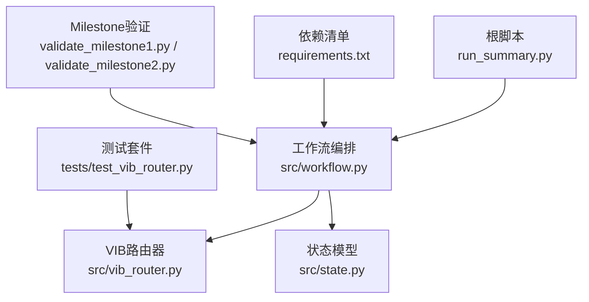
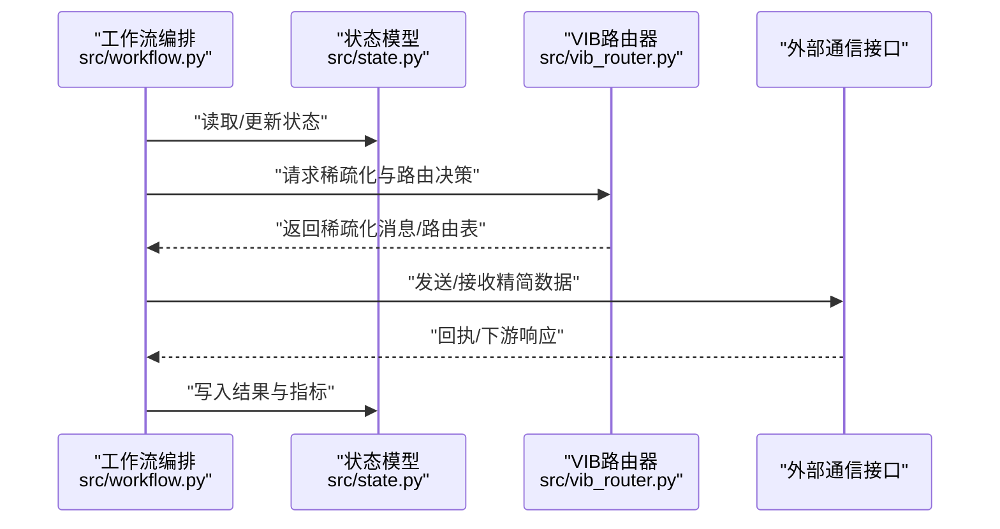
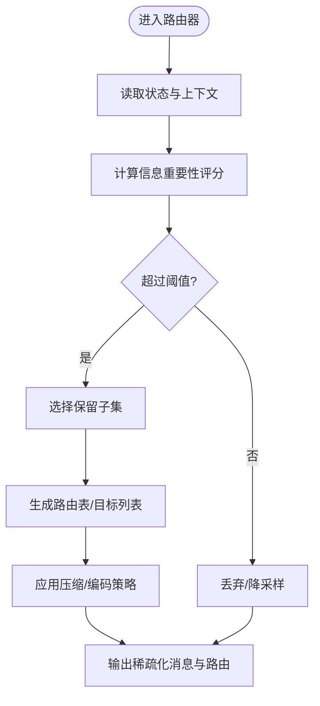
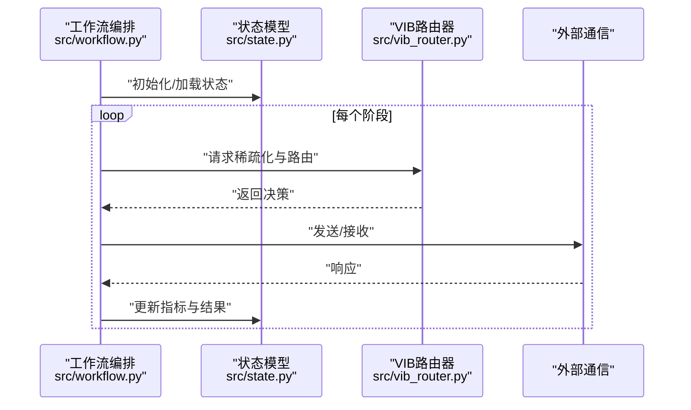
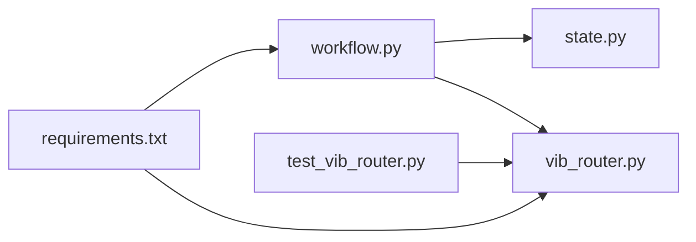

# 项目概述

<cite>
**本文引用的文件**   
- [README.md](file://README.md)
- [requirements.txt](file://requirements.txt)
- [src/__init__.py](file://src/__init__.py)
- [src/state.py](file://src/state.py)
- [src/vib_router.py](file://src/vib_router.py)
- [src/workflow.py](file://src/workflow.py)
- [tests/test_vib_router.py](file://tests/test_vib_router.py)
- [run_summary.py](file://run_summary.py)
- [validate_milestone1.py](file://validate_milestone1.py)
- [validate_milestone2.py](file://validate_milestone2.py)
</cite>

## 目录
1. [简介](#简介)
2. [项目结构](#项目结构)
3. [核心组件](#核心组件)
4. [架构总览](#架构总览)
5. [详细组件分析](#详细组件分析)
6. [依赖关系分析](#依赖关系分析)
7. [性能与可扩展性](#性能与可扩展性)
8. [故障排查指南](#故障排查指南)
9. [结论](#结论)
10. [附录](#附录)

## 简介
VIB-SparseCommunication 聚焦于“可变信息瓶颈（Variable Information Bottleneck, VIB）稀疏通信”的理论与工程实践，旨在在分布式系统中通过动态选择关键信息、压缩冗余数据并智能路由，降低跨节点通信开销，提升整体吞吐与时延表现。其核心价值在于：
- 以“信息瓶颈”思想对通信内容进行自适应筛选与压缩，减少带宽占用与序列化/反序列化成本。
- 基于工作流状态与上下文进行“稀疏化”决策，仅在必要时传输高价值信息。
- 提供可插拔的路由策略与压缩优化机制，适配不同网络拓扑与任务特征。

适用场景包括：大规模参数同步、多智能体协作、边缘-云协同推理、事件驱动微服务间的高效消息传递等。目标用户涵盖需要优化分布式通信开销的研究人员与工程师。

[本节为概念性介绍，不直接分析具体代码文件]

## 项目结构
仓库采用清晰的分层组织方式：
- src：核心实现，包含状态管理、VIB路由器与工作流编排。
- tests：针对关键模块的单元测试。
- 根脚本：运行汇总、里程碑验证与依赖声明。

图表来源
- [src/workflow.py](file://src/workflow.py)
- [src/vib_router.py](file://src/vib_router.py)
- [src/state.py](file://src/state.py)
- [tests/test_vib_router.py](file://tests/test_vib_router.py)
- [requirements.txt](file://requirements.txt)
- [run_summary.py](file://run_summary.py)
- [validate_milestone1.py](file://validate_milestone1.py)
- [validate_milestone2.py](file://validate_milestone2.py)

章节来源
- [src/__init__.py](file://src/__init__.py)
- [src/state.py](file://src/state.py)
- [src/vib_router.py](file://src/vib_router.py)
- [src/workflow.py](file://src/workflow.py)
- [tests/test_vib_router.py](file://tests/test_vib_router.py)
- [requirements.txt](file://requirements.txt)
- [run_summary.py](file://run_summary.py)
- [validate_milestone1.py](file://validate_milestone1.py)
- [validate_milestone2.py](file://validate_milestone2.py)

## 核心组件
- 状态模型（state.py）：定义工作流与通信过程中的共享状态对象，承载上下文、指标与中间结果，供路由器与工作流读取与更新。
- VIB路由器（vib_router.py）：依据当前状态与策略计算“是否稀疏化”以及“如何路由”，输出稀疏化的消息或路由决策。
- 工作流编排（workflow.py）：串联状态初始化、路由器调用、压缩/序列化、发送/接收与结果聚合，形成端到端的数据通路。
- 测试（tests/test_vib_router.py）：覆盖路由器的关键路径与边界条件，保障稀疏化与路由逻辑的正确性与稳定性。
- 运行与验证脚本（run_summary.py、validate_milestone*.py）：提供一键运行与阶段性验收能力，便于复现实验与回归检查。

章节来源
- [src/state.py](file://src/state.py)
- [src/vib_router.py](file://src/vib_router.py)
- [src/workflow.py](file://src/workflow.py)
- [tests/test_vib_router.py](file://tests/test_vib_router.py)
- [run_summary.py](file://run_summary.py)
- [validate_milestone1.py](file://validate_milestone1.py)
- [validate_milestone2.py](file://validate_milestone2.py)

## 架构总览
系统围绕“状态—决策—执行”的闭环展开：工作流维护状态并驱动流程；VIB路由器根据状态做出稀疏化与路由决策；最终将精简后的信息发送至目标节点或服务。

图表来源
- [src/workflow.py](file://src/workflow.py)
- [src/state.py](file://src/state.py)
- [src/vib_router.py](file://src/vib_router.py)

## 详细组件分析

### 状态模型（state.py）
职责
- 封装工作流所需的全局与局部状态，如任务标识、上下文摘要、历史指标、阈值与策略参数。
- 提供安全的读写接口，确保并发访问下的可见性与一致性。

设计要点
- 将“可观测指标”与“控制参数”解耦，便于后续引入在线学习与自适应阈值。
- 支持增量更新，避免全量拷贝带来的额外开销。

章节来源
- [src/state.py](file://src/state.py)

### VIB路由器（vib_router.py）
职责
- 基于当前状态与策略，判断是否需要稀疏化、选择哪些字段/通道进行传输、以及目标路由。
- 输出结构化决策（例如：保留集合、压缩级别、优先级），供工作流执行。

算法思路
- 使用信息瓶颈思想评估各候选信息的“边际贡献”，结合网络拥塞与延迟估计进行权衡。
- 支持多种策略（启发式、规则、学习式），可通过配置切换。

图表来源
- [src/vib_router.py](file://src/vib_router.py)

章节来源
- [src/vib_router.py](file://src/vib_router.py)
- [tests/test_vib_router.py](file://tests/test_vib_router.py)

### 工作流编排（workflow.py）
职责
- 协调状态、路由器与外部通信，完成一次完整的“稀疏通信”周期。
- 负责错误处理、重试、超时与回退策略，保证鲁棒性。

交互关系
- 从状态模型读取上下文，调用路由器获取稀疏化方案，执行发送/接收，并将结果写回状态。

图表来源
- [src/workflow.py](file://src/workflow.py)
- [src/state.py](file://src/state.py)
- [src/vib_router.py](file://src/vib_router.py)

章节来源
- [src/workflow.py](file://src/workflow.py)

### 测试与验证
- 单元测试（tests/test_vib_router.py）：覆盖路由器的关键分支与异常路径，确保稀疏化与路由逻辑稳定。
- 里程碑验证（validate_milestone1.py、validate_milestone2.py）：用于阶段性功能验收与回归测试。
- 运行汇总（run_summary.py）：统一入口，便于快速复现与对比实验。

章节来源
- [tests/test_vib_router.py](file://tests/test_vib_router.py)
- [validate_milestone1.py](file://validate_milestone1.py)
- [validate_milestone2.py](file://validate_milestone2.py)
- [run_summary.py](file://run_summary.py)

## 依赖关系分析
- requirements.txt 声明了运行时依赖，建议优先安装以满足环境一致性。
- 模块内聚性良好：state、router、workflow 职责清晰，耦合度低，便于替换与扩展。

图表来源
- [requirements.txt](file://requirements.txt)
- [src/workflow.py](file://src/workflow.py)
- [src/vib_router.py](file://src/vib_router.py)
- [src/state.py](file://src/state.py)
- [tests/test_vib_router.py](file://tests/test_vib_router.py)

章节来源
- [requirements.txt](file://requirements.txt)
- [src/workflow.py](file://src/workflow.py)
- [src/vib_router.py](file://src/vib_router.py)
- [src/state.py](file://src/state.py)
- [tests/test_vib_router.py](file://tests/test_vib_router.py)

## 性能与可扩展性
- 稀疏化收益：通过选择性传输与压缩，显著降低带宽与CPU开销，尤其在高维状态或高频同步场景下效果明显。
- 可扩展点：
  - 路由器策略可插拔：支持新增评分函数、阈值策略与路由算法。
  - 压缩器可插拔：可按数据类型选择最优编码/量化方案。
  - 状态模型可扩展：增加新的上下文维度与指标，支撑更精细的决策。
- 监控与调优：建议在状态中记录关键指标（如稀疏率、压缩比、端到端时延），以便离线分析与在线自适应。

[本节为通用指导，不直接分析具体代码文件]

## 故障排查指南
常见问题与建议
- 稀疏过度导致下游不可用：检查路由器阈值与评分函数，适当放宽条件或引入保护阈值。
- 路由失败或超时：确认外部通信接口可用性、重试与回退策略是否生效。
- 状态不一致：核对状态更新顺序与并发访问保护，确保原子性与可见性。
- 性能退化：观察稀疏率与压缩比，定位热点路径，考虑调整策略或更换编码器。

章节来源
- [src/vib_router.py](file://src/vib_router.py)
- [src/workflow.py](file://src/workflow.py)
- [src/state.py](file://src/state.py)
- [tests/test_vib_router.py](file://tests/test_vib_router.py)

## 结论
VIB-SparseCommunication 以“可变信息瓶颈”为核心，将稀疏化与智能路由融入分布式通信链路，有效缓解带宽与时延瓶颈。其模块化设计与可插拔策略使其具备良好的可扩展性与工程落地潜力。建议在生产环境中结合业务特征持续调优阈值与策略，并完善监控与告警体系。

[本节为总结性内容，不直接分析具体代码文件]

## 附录
- 许可证信息：请参见仓库根目录的 LICENSE 文件（若存在）。
- 贡献指南：请参见仓库根目录的 CONTRIBUTING.md（若存在）。
- 依赖安装：参考 requirements.txt 中的依赖声明。

章节来源
- [requirements.txt](file://requirements.txt)