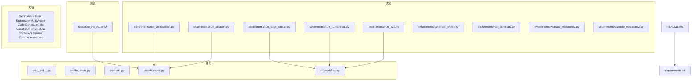
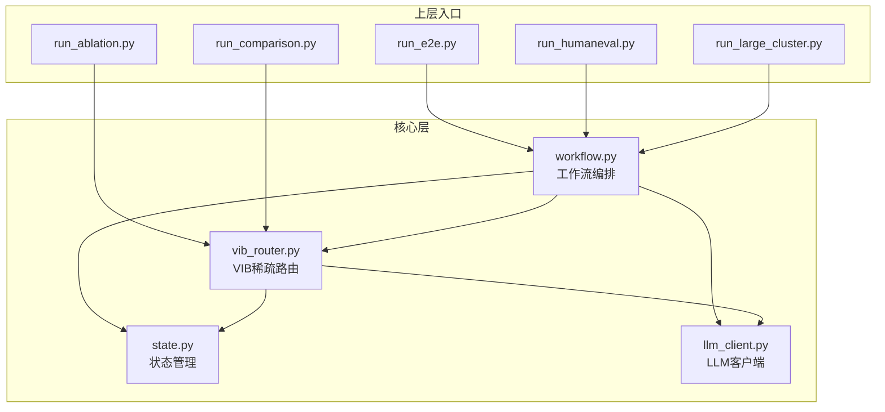
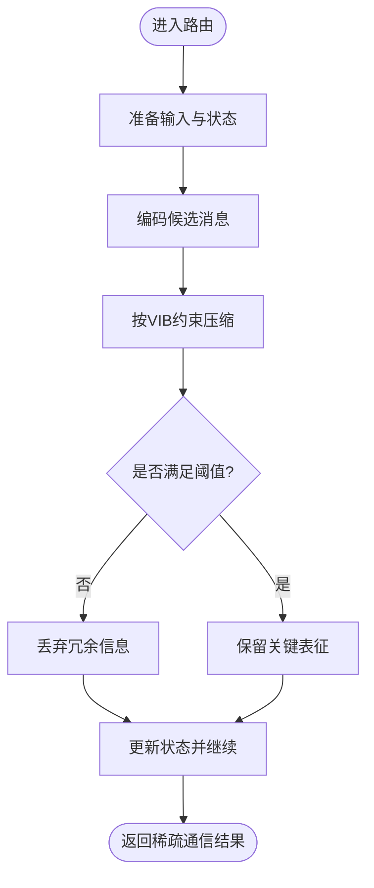
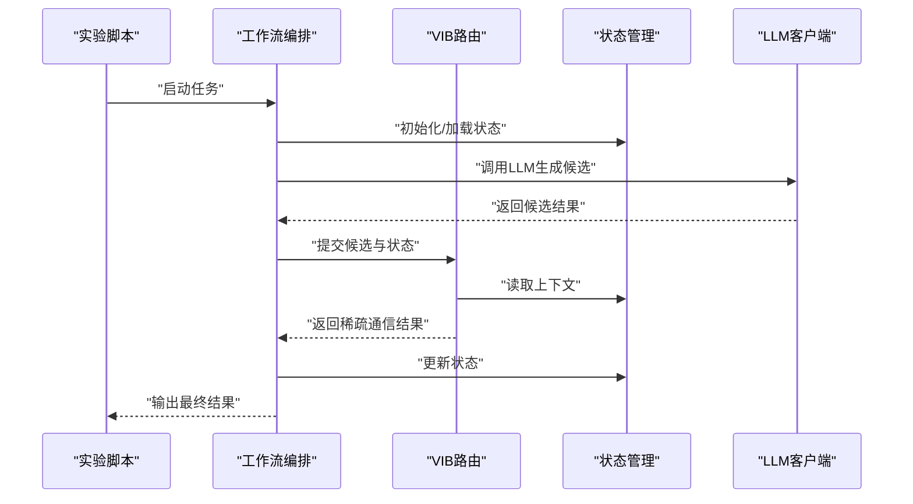
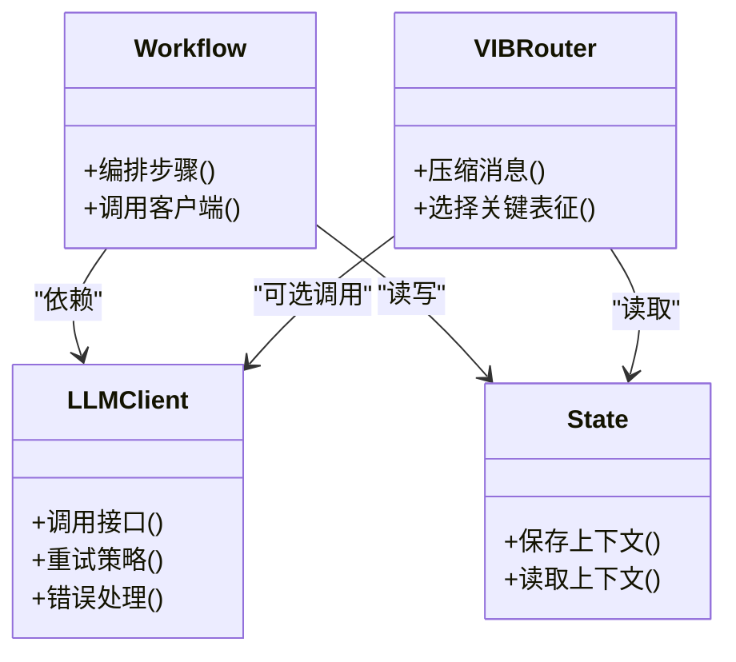
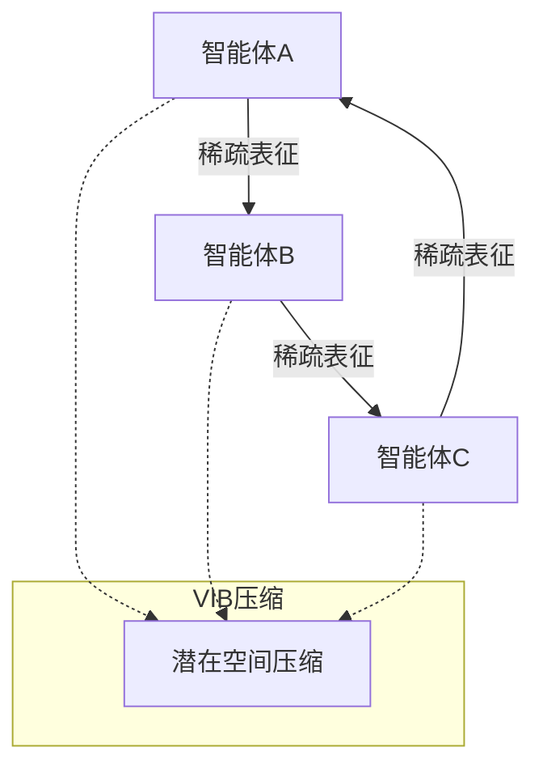
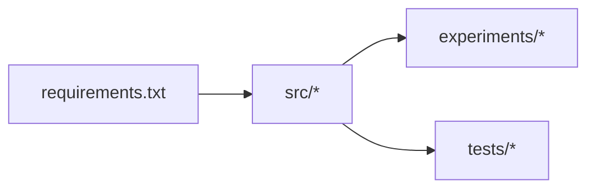

# 研究论文：少即是多

<cite>
**本文引用的文件**   
- [README.md](file://README.md)
- [requirements.txt](file://requirements.txt)
- [src/__init__.py](file://src/__init__.py)
- [src/llm_client.py](file://src/llm_client.py)
- [src/state.py](file://src/state.py)
- [src/vib_router.py](file://src/vib_router.py)
- [src/workflow.py](file://src/workflow.py)
- [tests/test_vib_router.py](file://tests/test_vib_router.py)
- [experiments/run_e2e.py](file://experiments/run_e2e.py)
- [experiments/run_ablation.py](file://experiments/run_ablation.py)
- [experiments/run_comparison.py](file://experiments/run_comparison.py)
- [experiments/run_humaneval.py](file://experiments/run_humaneval.py)
- [experiments/run_large_cluster.py](file://experiments/run_large_cluster.py)
- [experiments/generate_report.py](file://experiments/generate_report.py)
- [experiments/run_summary.py](file://experiments/run_summary.py)
- [experiments/validate_milestone1.py](file://experiments/validate_milestone1.py)
- [experiments/validate_milestone2.py](file://experiments/validate_milestone2.py)
- [docs/Less is More: Enhancing Multi-Agent Code Generation via Variational Information Bottleneck Sparse Communication.md](file://docs/Less is More: Enhancing Multi-Agent Code Generation via Variational Information Bottleneck Sparse Communication.md)
</cite>

## 目录
1. [简介](#简介)
2. [项目结构](#项目结构)
3. [核心组件](#核心组件)
4. [架构总览](#架构总览)
5. [详细组件分析](#详细组件分析)
6. [依赖关系分析](#依赖关系分析)
7. [性能考量](#性能考量)
8. [故障排查指南](#故障排查指南)
9. [结论](#结论)
10. [附录](#附录)

## 简介
本项目围绕“少即是多”的研究主题，探索在多智能体代码生成任务中，通过变分信息瓶颈（VIB）实现稀疏通信的增强方法。核心思想是：在智能体之间仅传递高度压缩、判别性强的信息表征，从而降低通信开销、提升整体效率与可解释性。仓库包含实验脚本、测试与文档，便于复现实验结果与扩展新场景。

## 项目结构
仓库采用分层组织方式：
- src：核心实现模块（LLM客户端、状态管理、VIB路由、工作流编排）
- experiments：端到端与消融实验脚本
- tests：单元测试
- docs：论文与LangGraph示例
- requirements.txt：依赖清单
- README.md：项目说明

图表来源
- [README.md](file://README.md)
- [requirements.txt](file://requirements.txt)
- [src/__init__.py](file://src/__init__.py)
- [src/llm_client.py](file://src/llm_client.py)
- [src/state.py](file://src/state.py)
- [src/vib_router.py](file://src/vib_router.py)
- [src/workflow.py](file://src/workflow.py)
- [experiments/run_e2e.py](file://experiments/run_e2e.py)
- [experiments/run_ablation.py](file://experiments/run_ablation.py)
- [experiments/run_comparison.py](file://experiments/run_comparison.py)
- [experiments/run_humaneval.py](file://experiments/run_humaneval.py)
- [experiments/run_large_cluster.py](file://experiments/run_large_cluster.py)
- [experiments/generate_report.py](file://experiments/generate_report.py)
- [experiments/run_summary.py](file://experiments/run_summary.py)
- [experiments/validate_milestone1.py](file://experiments/validate_milestone1.py)
- [experiments/validate_milestone2.py](file://experiments/validate_milestone2.py)
- [tests/test_vib_router.py](file://tests/test_vib_router.py)
- [docs/Less is More: Enhancing Multi-Agent Code Generation via Variational Information Bottleneck Sparse Communication.md](file://docs/Less is More: Enhancing Multi-Agent Code Generation via Variational Information Bottleneck Sparse Communication.md)

章节来源
- [README.md](file://README.md)
- [requirements.txt](file://requirements.txt)

## 核心组件
- LLM客户端：封装对外部大语言模型的调用接口，负责请求构建、重试与错误处理。
- 状态管理：维护多智能体协作过程中的上下文与中间结果，确保跨阶段一致性。
- VIB路由：基于变分信息瓶颈的稀疏通信策略，对智能体间消息进行压缩与选择。
- 工作流编排：串联各步骤（如提示构造、模型调用、路由决策、结果聚合），提供统一入口。

章节来源
- [src/llm_client.py](file://src/llm_client.py)
- [src/state.py](file://src/state.py)
- [src/vib_router.py](file://src/vib_router.py)
- [src/workflow.py](file://src/workflow.py)

## 架构总览
系统以“工作流”为中枢，协调“LLM客户端”、“状态管理”和“VIB路由”。实验脚本作为上层入口，驱动不同评测与对比场景。

图表来源
- [experiments/run_e2e.py](file://experiments/run_e2e.py)
- [experiments/run_ablation.py](file://experiments/run_ablation.py)
- [experiments/run_comparison.py](file://experiments/run_comparison.py)
- [experiments/run_humaneval.py](file://experiments/run_humaneval.py)
- [experiments/run_large_cluster.py](file://experiments/run_large_cluster.py)
- [src/workflow.py](file://src/workflow.py)
- [src/vib_router.py](file://src/vib_router.py)
- [src/state.py](file://src/state.py)
- [src/llm_client.py](file://src/llm_client.py)

## 详细组件分析

### 组件A：VIB路由（稀疏通信）
VIB路由负责在智能体之间进行信息筛选与压缩，以实现“少即是多”的通信目标。其典型流程包括：
- 输入：候选消息集合与当前状态
- 编码：将消息映射到潜在空间
- 压缩：依据信息瓶颈约束选择关键表征
- 输出：稀疏化的通信令牌或摘要

图表来源
- [src/vib_router.py](file://src/vib_router.py)
- [src/state.py](file://src/state.py)

章节来源
- [src/vib_router.py](file://src/vib_router.py)
- [tests/test_vib_router.py](file://tests/test_vib_router.py)

### 组件B：工作流编排（端到端流程）
工作流编排串联提示构造、模型调用、路由决策与结果聚合，形成稳定的执行管线。

图表来源
- [experiments/run_e2e.py](file://experiments/run_e2e.py)
- [src/workflow.py](file://src/workflow.py)
- [src/vib_router.py](file://src/vib_router.py)
- [src/state.py](file://src/state.py)
- [src/llm_client.py](file://src/llm_client.py)

章节来源
- [src/workflow.py](file://src/workflow.py)
- [experiments/run_e2e.py](file://experiments/run_e2e.py)

### 组件C：LLM客户端（外部服务集成）
LLM客户端封装对外部大模型的调用细节，包括参数组装、超时与重试策略、错误分类等，确保上层稳定。

图表来源
- [src/llm_client.py](file://src/llm_client.py)
- [src/workflow.py](file://src/workflow.py)
- [src/state.py](file://src/state.py)
- [src/vib_router.py](file://src/vib_router.py)

章节来源
- [src/llm_client.py](file://src/llm_client.py)
- [src/state.py](file://src/state.py)

### 概念总览
下图展示“少即是多”的多智能体稀疏通信理念：智能体仅在必要时交换高信息密度的表征，减少冗余通信，提高整体效率与鲁棒性。

[本图为概念示意，不直接对应具体源文件]

## 依赖关系分析
- 内部依赖
  - 工作流编排依赖VIB路由、状态管理与LLM客户端
  - VIB路由依赖状态管理与可选的LLM客户端
  - 实验脚本依赖工作流与VIB路由
- 外部依赖
  - 由requirements.txt声明的外部库（例如HTTP客户端、序列化、日志等）被上层模块间接使用

图表来源
- [requirements.txt](file://requirements.txt)
- [src/workflow.py](file://src/workflow.py)
- [src/vib_router.py](file://src/vib_router.py)
- [src/state.py](file://src/state.py)
- [src/llm_client.py](file://src/llm_client.py)
- [experiments/run_e2e.py](file://experiments/run_e2e.py)
- [tests/test_vib_router.py](file://tests/test_vib_router.py)

章节来源
- [requirements.txt](file://requirements.txt)

## 性能考量
- 通信压缩：通过VIB在潜在空间进行压缩，显著降低传输量与延迟
- 选择性转发：仅保留高判别性的表征，避免噪声累积
- 批处理与缓存：在工作流层面合并请求与复用中间结果
- 容错与重试：在LLM客户端层面对不稳定网络或服务波动进行恢复
- 评估指标：建议关注通信比特数、端到端时延、成功率与质量指标

[本节为通用指导，不直接分析具体文件]

## 故障排查指南
- 常见问题
  - 外部服务不可用：检查网络连通性与认证配置
  - 超时与限流：调整重试次数与退避策略
  - 路由异常：确认VIB阈值与压缩维度设置
  - 状态不一致：检查工作流状态写入与读取顺序
- 定位手段
  - 启用日志与追踪，记录关键节点输入输出
  - 使用最小化用例复现问题
  - 逐步注释排除法隔离问题模块

章节来源
- [src/llm_client.py](file://src/llm_client.py)
- [src/vib_router.py](file://src/vib_router.py)
- [src/workflow.py](file://src/workflow.py)
- [src/state.py](file://src/state.py)

## 结论
本项目以“少即是多”为核心思想，通过VIB稀疏通信在多智能体代码生成场景中实现了高效协作。模块化设计使系统具备良好的可扩展性与可观测性，配合完善的实验脚本与测试，便于持续迭代与验证。

[本节为总结性内容，不直接分析具体文件]

## 附录
- 实验脚本概览
  - run_e2e.py：端到端流程演示
  - run_ablation.py：消融实验（如关闭VIB、改变阈值）
  - run_comparison.py：基线对比（全连接通信 vs 稀疏通信）
  - run_humaneval.py：HumanEval评测
  - run_large_cluster.py：大规模集群运行
  - generate_report.py：报告生成
  - run_summary.py：汇总统计
  - validate_milestone1.py / validate_milestone2.py：里程碑验证
- 论文与示例
  - docs/Less is More: Enhancing Multi-Agent Code Generation via Variational Information Bottleneck Sparse Communication.md：论文全文
  - docs/LangGraph.py：LangGraph相关示例

章节来源
- [experiments/run_e2e.py](file://experiments/run_e2e.py)
- [experiments/run_ablation.py](file://experiments/run_ablation.py)
- [experiments/run_comparison.py](file://experiments/run_comparison.py)
- [experiments/run_humaneval.py](file://experiments/run_humaneval.py)
- [experiments/run_large_cluster.py](file://experiments/run_large_cluster.py)
- [experiments/generate_report.py](file://experiments/generate_report.py)
- [experiments/run_summary.py](file://experiments/run_summary.py)
- [experiments/validate_milestone1.py](file://experiments/validate_milestone1.py)
- [experiments/validate_milestone2.py](file://experiments/validate_milestone2.py)
- [docs/Less is More: Enhancing Multi-Agent Code Generation via Variational Information Bottleneck Sparse Communication.md](file://docs/Less is More: Enhancing Multi-Agent Code Generation via Variational Information Bottleneck Sparse Communication.md)