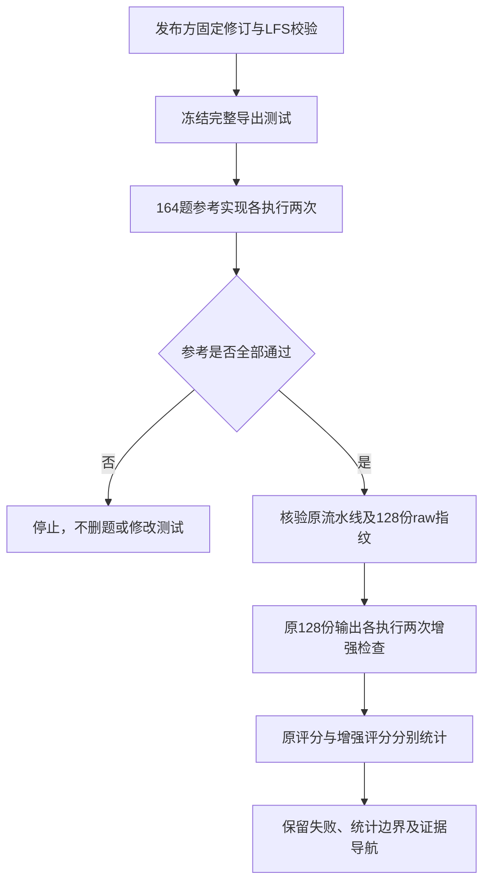

# 冻结反馈输出的增强重评

目标是检查上一轮16题、128份最终输出的满分是否受原测试覆盖限制。只重评已收到的代码，不重新请求模型、不修复、不选优、不按失败删题，也不修改原通过标签或生成账目。

## 修订前状态

全164题参考源审计已执行：163题通过，HumanEval/32失败。其原样导出断言试图将`find_zero`返回的浮点数用`*`解包，独立复现为`TypeError: Value after * must be an iterable, not float`。

因此，预声明的全库参考守卫没有放行：**128份候选增强评分未执行，增强准确率不可用**。原100%不改，也不把未执行填成0或100%。不因32不在本16题中而事后放宽已冻结的验收范围。先交付源审计结果；需取得并验收正确来源后才能另行执行增强重评。

用户随后授权本地修订，并明确确认精度保护及32题验收参考例外。该独立版本已完成128份原输出重评：Full/VIB各32/32，随机31/32，余弦30/32；并非原发布方协议的成绩。修订前目录仍保持暂停和未执行，详细口径见[本地修订方法](local_plus_repair.md)与[独立结果](../results/feedback_plus_repaired_20261029/README.md)。

## 数据来源

发布方：`evalplus/humanevalplus`。固定Hugging Face修订：

```text
d32357cf319e50e9c8d8dab5ea876c72b0fd321b
```

镜像下载文件的SHA-256与发布方该修订的LFS对象一致：

```text
908377f1daf28dcb36846db73a5662b2e05a9907407c2696c89ad9d3b0b04492
```

数据原文完整保留，含164道题的导出`check(candidate)`、参考实现与题面。发布方声明Apache-2.0许可。这里使用的是固定HF导出测试，并非已经认证的GitHub release `v0.1.10`，也不冒称执行了EvalPlus官方CLI。

静态AST统计：全164题共125,037组输入；原反馈16题共13,243组输入。输入组数不是独立样本量，也不证明覆盖全部输入域。这仍是同一HumanEval题目上的更强测试，不是独立新数据集。

## 执行流程



所有执行在`python -I -S`独立解释器内完成，候选代码不在父进程执行。为导出测试的NumPy比较显式加入已绑定的依赖目录，不启用site初始化；子进程不继承模型凭证，数学库固定单线程。

每份代码在两个独立解释器中使用相同Python与NumPy随机种子。断言失败、运行异常和整体30秒超时分别记录，两次状态不一致视为设施错误，不投票。

本地超时口径是每个评分进程的整体墙钟30秒，与EvalPlus CLI按参考运行时间缩放的逐输入超时不同。它是进程、环境与状态隔离，不是恶意代码网络或文件系统安全沙箱。

代码只沿用既有代码围栏提取规则，没有按测试修复。官方参考实现使用`prompt + canonical_solution`拼接，只用于评分验收；不用于修改模型输出、生成提示或抽样。

## 恢复与统计

每份参考和候选的评分记录独立保存，并绑定源数据、旧raw、实现、运行环境及测试指纹。中断后复用已完成的本地评分，已完成分析有内容hash；缓存漂移会停机，不静默重算。

原16题、四策略、每策略两次最终输出不变。每题两次成功率先平均，统计单位仍为16题。主比较沿用VIB减随机数量匹配，10000次任务bootstrap和精确方向检验；此处是在生成后增加的覆盖审计，不当作新预注册确认性实验。其他比较探索性未校正，跨零或退化区间不表示等效。

## 运行命令

```bash
python -m experiments.rescore_feedback_plus \
  --source results/feedback_plus_rescore_20261029/publisher_test.jsonl \
  --output-dir results/feedback_plus_rescore_20261029
```

新模型请求为0，原生成usage与历史代理费用不变。新增的是本地评分时间，而非模型调用费用。

## 一键导航

| 内容 | 入口 |
|---|---|
| 双口径结果 | [重评报告](../results/feedback_plus_rescore_20261029/README.md) |
| 当前完整参考源审计 | [source_audit.json](../results/feedback_plus_rescore_20261029/source_audit.json) |
| 离线来源报告 | [report.html](../results/feedback_plus_rescore_20261029/report.html) |
| 缓存及原证据验收 | [acceptance.json](../results/feedback_plus_rescore_20261029/acceptance.json) |
| 固定数据原文 | [publisher_test.jsonl](../results/feedback_plus_rescore_20261029/publisher_test.jsonl) |
| 冻结协议与旧证据 | [manifest.json](../results/feedback_plus_rescore_20261029/manifest.json) |
| 全库通过的参考验收 | 未生成：参考32失败 |
| 128份输出增强重评 | 未执行，analysis.json未生成 |
| 原实验报告，保持不变 | [原反馈报告](../results/feedback_experiment_20261028/README.md) |
