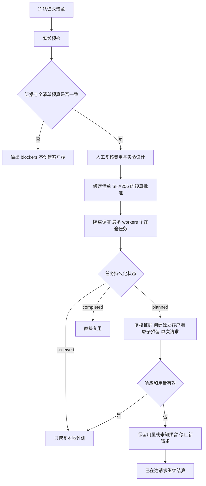

# 隔离实验调度与离线预检

当前版本提供零 API 预检入口，以及经过假客户端验证的可恢复调度函数。它没有迁移旧 benchmark，没有真实因果实验结果，也没有替用户批准任何付费请求。

## 流程



## 离线入口

从仓库根目录执行：

```bash
python3 -m experiments.preflight_session \
  --manifest /absolute/path/to/frozen-manifest.json \
  --output /absolute/path/to/new-preflight-report.json
```

输入必须是待审核的真实清单；上面的路径只是命令参数示例，不是已经生成的确认性实验清单。输出父目录须已存在，已有报告不会被覆盖。

- 退出码 `0`：格式、证据身份和预算条件通过。
- 退出码 `2`：证据缺失、预算不足、输入异常或输出已存在。
- 未就绪时仍输出 `ready=false` 和 `blockers`，便于逐项复核。
- CLI没有 `--live` 或任何付费执行开关，不自动读取 `pro.env`、实例化客户端或访问 API。
- 预检只在系统临时目录创建短生命周期 SQLite，不创建实际实验会话。

`ready=true` **不等于**价格已经由程序独立核准、Token 上界已被程序重新计算，或实验设计已获得科学有效性证明。它表示调用者提供的核验声明、文件哈希和冻结请求相互一致。

## 冻结清单

沿用 `ExperimentSession` 的请求格式：

| 字段 | 要求 |
|---|---|
| `version` | 整数 `1` |
| `provider`、`model`、`base_url` | 明确的实际端点，不靠运行时别名推断 |
| `budget_usd` | 正、有限的十进制数；建议用字符串表示 |
| `price` | `version`、输入/输出每百万 Token 的美元代理上界、`scope=proxy_not_invoice` |
| `evaluation_version` | 冻结的评分协议版本 |
| `jobs` | 非空列表，唯一 `job_id`，每项有 `task_id`、完整 `messages`、显式 `temperature/max_tokens` 和正整数 `prompt_token_limit` |
| `preflight` | 下表列出的证据与源码指纹 |

隐藏测试和参考答案保留在评测文件中，不进入请求 `messages`。字段守卫不能自动识别任意自然语言里的答案泄漏；冻结前仍须人工或专用审计。

### 证据字段

| `preflight` 字段 | 必须绑定的内容 |
|---|---|
| `driver_sha256` | `src.experiment_driver.driver_sha256()` 返回值 |
| `implementation_sha256` | `implementation_sha256()` 返回的会话、推理参数、请求账目、客户端源码哈希映射 |
| `price_evidence` | 文件 `path/sha256`、与清单一致的 `endpoint` 和 `price`、`reviewed_upper_bound=true` |
| `evaluation_evidence` | 本地评测文件 `path/sha256`，`version` 等于 `evaluation_version` |
| `prompt_bounds` | 键集合恰好等于全部 `job_id`；每项字段见下文 |

`endpoint` 是仅包含 `provider/model/base_url` 的对象。逐任务上界证据包含：

```text
path
sha256
endpoint
messages_sha256
prompt_token_limit
max_tokens
reviewed_provider_bounds
```

`messages_sha256` 使用 `src.request_ledger.fingerprint(messages)` 的规范 JSON 哈希；不能替换为字节文件哈希。`prompt_token_limit/max_tokens` 必须为整数并等于实际请求声明，`reviewed_provider_bounds` 必须明确为 `true`。

证据文件必须实际记录核验依据，例如提供方 tokenizer/chat template 的版本及源码、消息封装开销和上界推导、输出上限语义、价格生效版本及缓存计费。**不能仅创建空文件、填入哈希并设为 true，就声称完成核验。** 当前测试中的证据与价格均为合成测试输入，不是可用于生产的校准结论。

## 调度接口

公开接口在 `src/experiment_driver.py`：

```python
def run_session(
    manifest, session_path, client_factory, evaluators,
    *, approval, workers=1,
):
    ...
```

- `approval` 必须明确包含 `approved=true`、完整清单的 `fingerprint(manifest)` 和完全一致的 `budget_usd`。代码不代替人生成批准。
- `client_factory(job_id)` 是可信适配器，返回端点匹配且支持 `chat_single_attempt` 的客户端；每任务应独占其客户端及持久化 JSONL 账目，不能让活跃客户端共享同一个账目文件。
- `evaluators` 按 `task_id` 提供本地 callable，接收模型输出并返回布尔值。键集合须恰好覆盖全部任务；评分协议须对应冻结的评测文件。
- 适配器是可信本地代码，不是沙箱。程序验证文件身份，但不能证明任意 callable 真的执行了该文件描述的评分逻辑；正式实验接入仍须审计并测试实际适配器。
- 所有请求的代理预留总和须落在预算内，避免把预算耗尽后留下的有利子集当作完整实验结果。
- 每job仅一次生成。重试若确有必要，须是另一份冻结请求；不根据隐藏测试通过与否选择下一请求、答案或停止时机。
- 恢复 `received` 只做本地评测，`completed` 不再创建客户端；未决 `reserved/unknown` 会保守停止新请求，不自动释放费用或重发。
- 失败后不提交新请求，已经在途的调用允许完成并如实结算。`workers` 不是通过本轮测试推导出的生产最优并发参数。
- 返回值分开包含 `preflight`、`summary`、各job状态和脱敏错误类型。`run_complete=false` 的产物不能当作完整确认性结果。

## 费用与停机边界

费用单位是整数纳美元代理值，按 Decimal 向上取整，不是官方账单。硬预算性质以真实 prompt 上界、提供方输出上限和保守价目成立为条件。提供方违反上界时保留真实超支并停机，不能截断账目伪造预算合规。

证据在预检时以及每任务执行前重新检查，客户端创建后、发送前也检查一次。外部文件在检查后仍可能被并发修改；正式运行应将证据与清单放在受控只读位置。哈希校验不是恶意文件替换、模型身份欺骗或任意适配器行为的完整防护。

请求/账目/会话源码变化要求重新冻结和批准；旧 SQLite 会话也会拒绝不同会话实现的恢复。不要为通过检查而手动改旧数据库或清单指纹。

## 当前验收

本轮仅运行受控零 API 测试，覆盖证据漂移、预算批准、并发在途结算、未知用量停机、已收到输出恢复、CLI禁网及拒绝覆盖。准确测试数以 `paper/gap1_claim_audit_trail.md` 的本轮记录为准。

下一付费门槛仍是：构建共同候选流因果清单、冻结完整题目和提示词版本、接入真实隔离评测适配器、核验真实 Token 上界与价目、输出总请求及费用上限，然后取得用户针对该清单的预算确认。此工具不能补回历史缺失账单，也不能单凭工程测试证明 VIB 优势。

## 一键导航

| 内容 | 入口 |
|---|---|
| 最新研究事实与验收 | [审计记录](../paper/gap1_claim_audit_trail.md) |
| 离线 CLI | [preflight_session.py](../experiments/preflight_session.py) |
| 隔离调度与预检 | [experiment_driver.py](../src/experiment_driver.py) |
| 持久化状态机 | [experiment_session.py](../src/experiment_session.py) |
| 驱动回归测试 | [test_experiment_driver.py](../tests/test_experiment_driver.py) |
| 中文研究工作稿 | [paper_zh.pdf](../paper/paper_zh.pdf) |
