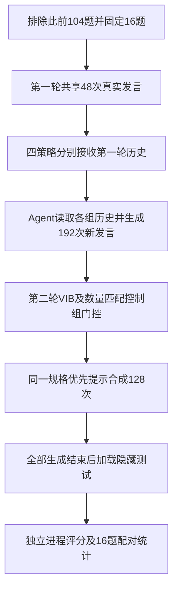

# 两轮真实反馈实验

本入口验证删除消息是否改变后续 Agent 的实际生成，不复用历史 Full 的第二轮候选。它不修改核心工作流，也不替换历史主表。

## 冻结协议

从此前24、48、32题三个不重叠批次之外，以 `seed=20261103` 固定抽16题。抽样只读任务ID，提示只使用公开题面，不按历史标签或新评分选题。

| 阶段 | 请求 | 参数 | 独立历史代理观察预算 |
|---|---:|---|---:|
| 第一轮共享候选 | 16 × 3 = 48 | temperature 0, max_tokens 256 | $0.15 |
| 第二轮各策略自产候选 | 16 × 4 × 3 = 192 | temperature 0, max_tokens 256 | $0.45 |
| 最终合成 | 16 × 4 × 2 = 128 | temperature 0, max_tokens 1024 | $0.40 |

第一轮所有策略共享真实生成的 Architect、Coder、Reviewer 发言。每轮三个Agent都读轮前历史；候选收齐后，VIB按主代码的incremental接收历史逐条判断。第二轮每组读取自己的第一轮历史，重新生成自己的候选。

随机和余弦控制组在各自候选中选k条，k取同题同轮VIB在其自产候选上的通过数。随机不放回抽样；余弦贪心最小化与已选历史的最大相似度，最后按原候选顺序呈现。匹配消息数，不匹配Token、角色构成或实际费用。第二轮k由VIB轨迹产生，属于耦合数量对照。

编码器仅加载本地 pinned MiniLM snapshot，CPU/eval，384维，float32 L2归一化，max_seq_length 256。向量、文件和库版本、逐条门控决策都留存。VIB包含现有代码差异、纠错关键词、角色beta、复杂度等启发式，不是单一公式消融。



## 执行与恢复

```bash
VIB_PRIVATE_API_KEY_ENV=PRIVATE_API_KEY_1 python -m experiments.run_feedback_experiment \
  --output-dir results/feedback_experiment_20261028 --execute
python -m experiments.analyze_feedback_experiment \
  --output-dir results/feedback_experiment_20261028
python -m scripts.check_prospective_evidence
python -m scripts.export_prospective_report
```

不带 `--execute` 只准备第一阶段；已经完整执行的目录会验证并复用所有阶段。新入口用局部 `StageClient` 适配冻结的旧执行器，将候选账目显式标为 `agent`、合成标为 `code`，没有修改模块全局状态或旧源码。

每次发送前pending落盘，原始输出在终态账目之前保存，均flush/fsync。每次只尝试一次，SDK retries为0，timeout 60秒。候选截断保留收到的非空付费原文，不修复；最终截断计失败且计费用。unknown、pending、缺失usage、401/403/429或来源漂移均停止，不重发，也不执行下游。

父阶段manifest、report及route文件指纹绑定后续manifest。阶段完整请求列表在发送前冻结；字节规划场景超过独立预算则拒绝整阶段，不缩小为有利子集，也不转移阶段预算。

## 评分与费用

只在全部368次请求已结算后加载隐藏测试。完整输出在两个独立、同种子、最小环境的解释器中检查；不一致视为评分设施错误。这是进程及凭证隔离，不是恶意代码网络或文件系统沙箱。

每题两次合成先取均值，独立统计单位为16题，不是32次输出，更不是两次团队轨迹。预声明主比较VIB减随机数量匹配，10000次任务bootstrap，另报双侧精确方向检验，alpha 0.05；其他比较探索性未校正。跨零或退化区间不表示等效，没有预声明非劣界限。

实际实验总账：共享第一轮只计一次，加四组第二轮及全部两次合成。假想单策略一次运行费用：完整第一轮 + 本策略第二轮 + 本策略两次最终合成费用的平均值。后者是测得组件构造的单策略成本口径，不是额外实际付款记录。

历史价格为2026-10-23输入$0.30/百万Token、输出$1.20/百万Token。$1为历史代理观察阈值；UTF-8字节+1024不是verified Token上界，未取得网关美元或人民币invoice，不保证实付硬上限。

## 推断边界

这是两轮反馈、单团队轨迹、固定随机子集种子，同源已审计HumanEval的探索性实验。第二轮重新生成消除了旧receiver的固定候选反馈缺口，但还不能证明多种子稳健性、等实际费用优势或VIB特有机制。模型返回ID不是官方不可变快照认证，也不能排除预训练污染。

| 内容 | 入口 |
|---|---|
| 实验协议 | [protocol.json](../results/feedback_experiment_20261028/protocol.json) |
| 阶段证据与恢复摘要 | [pipeline_report.json](../results/feedback_experiment_20261028/pipeline_report.json) |
| 第一轮接收及真实向量 | [routes_round1.json](../results/feedback_experiment_20261028/routes_round1.json) |
| 第二轮接收及真实向量 | [routes_round2.json](../results/feedback_experiment_20261028/routes_round2.json) |
| 逐题评分与成本 | [analysis.json](../results/feedback_experiment_20261028/analysis.json) |
| 禁止客户端恢复验收 | [acceptance.json](../results/feedback_experiment_20261028/acceptance.json) |
| 离线交互报告 | [report.html](../results/feedback_experiment_20261028/report.html) |
| 综合结果 | [README.md](../results/feedback_experiment_20261028/README.md) |
