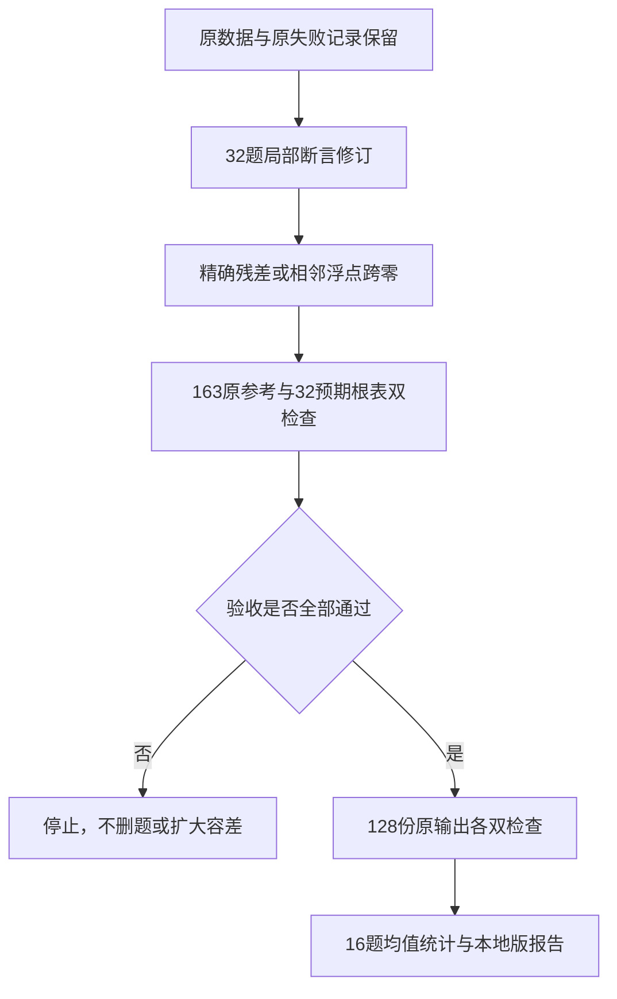

# 本地增强评分修订

本修订由用户明确授权，不覆盖发布方原文件、原失败报告或历史候选标签。结果称“本地修订增强评分”，不是官方EvalPlus成绩。

## 实测结果

164个验收参考（163原canonical加32预期根表）全部双检查通过，128份原输出完成256次独立检查。Full与VIB各32/32，随机31/32，余弦30/32；新增失败均在137题。VIB减随机+3.125pp，任务bootstrap区间[0,+9.375]，方向p=1，只有一题差异，不声称稳定优势。

新模型请求0，原生成账目和失败记录保留。全量497项测试通过，禁止评分回退的缓存验收通过；失败代码解读见[诊断说明](../results/feedback_plus_repaired_20261029/failure_analysis.md)。

## 修复范围

仅HumanEval/32的test字段变更；输入、原canonical字段以及其他163道题保持不变。原16道候选题不含32，因此这项补丁用于解除全库验收阻塞，不直接修改16题的增强测试。

错误断言将浮点根用`*`解包：

```python
assert _poly(*candidate(*inp), inp) <= 0.0001
```

只纠正参数顺序仍缺少绝对值；仅增加绝对值又会遇到真实浮点表达能力限制。因此，经用户确认，采用：

```python
assert _vib_local_root_check(inp[0], candidate(*inp))
```

判定为：用精确有理数计算多项式，绝对残差不超过`1e-4`；或返回值前后相邻浮点值的精确多项式值跨过零点。后者依据多项式连续性证明存在局部根，不任意扩大绝对阈值。非数值、NaN、Inf及不合格根返回失败。

输入217的参考根与发布方预期根相同，普通浮点求和残差约−0.002315。精确计算返回值处残差约+0.004893，下一浮点值处约−0.003838；真实根在两个相邻可表示数之间，任一候选浮点都无法达到`1e-4`绝对残差。精度保护经反例测试，不接受远离根的返回值。

## 参考验收

输入275揭示原Newton参考未收敛：返回−4.4399586099514305，残差约−111705260.2034939；发布方预期−2.3440476479552648通过精确检查。不能将此错误参考用增大容差的方式放行。

用户确认，仅32题验收参考使用发布方预期根表；886组预期根必须受同一数学oracle检查，其余163题继续使用原canonical。原Newton代码与修订oracle下的失败记录保存，不声称164个原canonical全部通过。根表只用于验收，不用于模型生成、修复或选优。



## 执行与恢复

```bash
python -m experiments.rescore_repaired_plus \
  --output-dir results/feedback_plus_repaired_20261029
python -m scripts.export_repaired_plus_report
```

修订记录包含原与派生数据SHA-256、原断言、完整helper源码、886组验收参考来源及用户确认口径。各参考/候选检查绑定数据、代码、raw和manifest指纹，中断复用已完成本地记录，不构造模型客户端。

隔离器及30秒整体超时与原本地评测相同；不是EvalPlus CLI逐输入参考时间缩放协议，也不是恶意代码网络/文件系统安全沙箱。

统计单位仍为原16题，每题两次输出先平均，不best-of-two。主方向VIB减随机沿用原方案；本修订是事后覆盖审计，不是新的预注册确认性实验。跨零或退化区间不表示等效。

## 一键导航

| 内容 | 入口 |
|---|---|
| 本地修订结果 | [离线报告](../results/feedback_plus_repaired_20261029/report.html) |
| 修订的精确记录 | [patch.json](../results/feedback_plus_repaired_20261029/patch.json) |
| 验收参考双检查 | [reference_acceptance.json](../results/feedback_plus_repaired_20261029/reference_acceptance.json) |
| 原Newton失败 | [original_task32_reference.json](../results/feedback_plus_repaired_20261029/original_task32_reference.json) |
| 缓存及原证据验收 | [acceptance.json](../results/feedback_plus_repaired_20261029/acceptance.json) |
| 128份逐项评分 | [analysis.json](../results/feedback_plus_repaired_20261029/analysis.json) |
| 原发布方数据审计 | [保留的暂停报告](../results/feedback_plus_rescore_20261029/report.html) |
