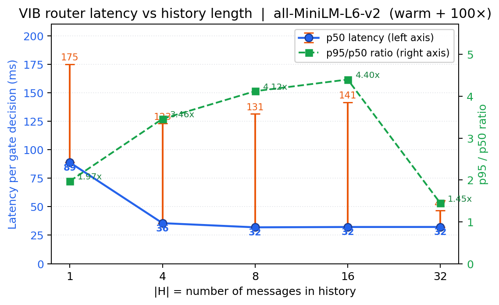
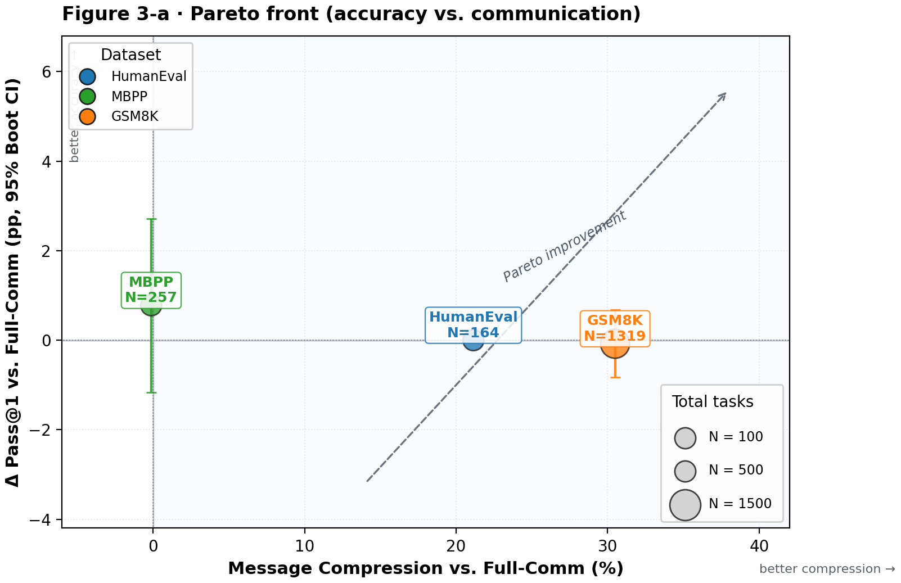
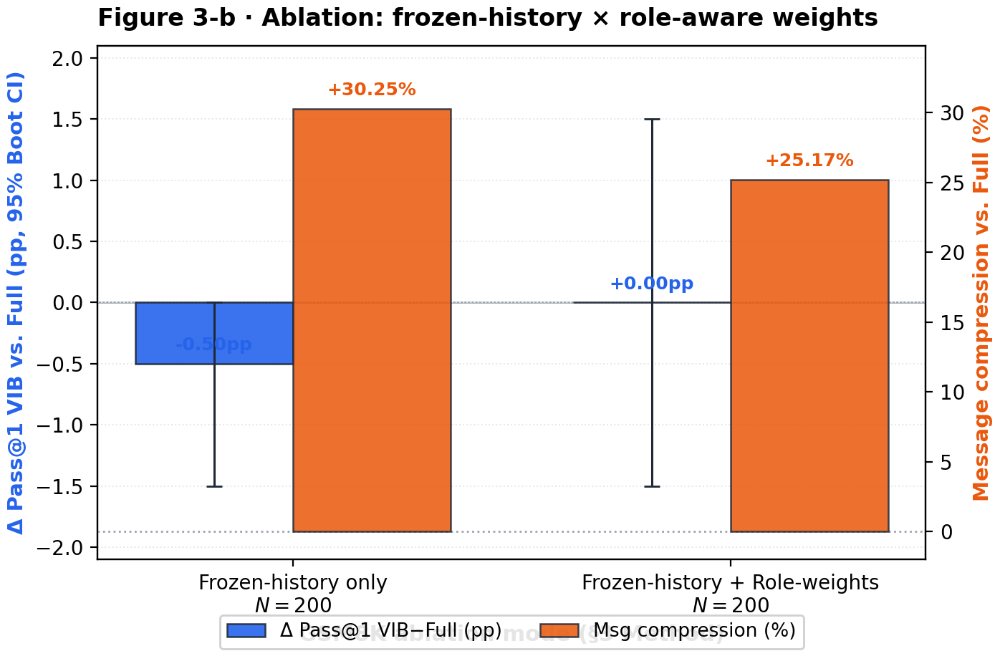

# 0. Abstract

Large language model (LLM) multi-agent pipelines often improve code generation over single-agent baselines by letting *coder, tester, reviewer* agents exchange reasoning traces. However, the standard **full-communication (Full)** pattern broadcasts every candidate turn, producing redundant inter-agent messages that dilute the downstream synthesizer's attention and inflate token costs. We propose **VIB-Sparse**, a lightweight multi-agent *message gating router* grounded in the **Variational Information Bottleneck (VIB)** principle. Without calling an additional LLM judge, VIB-Sparse scores every candidate turn on-line using cosine-similarity–based MI estimates—
$$
\mathcal{L}_\text{VIB}(M) = I(M; H^{t-1}) - \beta_t \, I(M; G), \qquad \beta_t = (\beta_{\text{role}}+\text{complexity\_bonus})\,e^{-\lambda t_{\text{eff}}}
$$
—and merges into the shared history only turns whose *utility* exceeds a threshold $\gamma$. We evaluate on **HumanEval ($n=164$)**, **MBPP ($n=257$)** and **GSM8K ($n=1319$)** using 3-agent teams with apples-to-apples synthesis hyperparameters ($T=0.1$, $\text{max\_tokens}=1024$, 3-round doctest self-repair). Our main findings are three-fold: (1) *Multi-agent alone wins.* A vanilla single agent reaches only 59.29% Pass@1 on GSM8K; the full-communication 3-agent team pushes it to 95.30% ($+35.93$ pp). (2) *Less is More.* VIB-Sparse matches or marginally exceeds Full's Pass@1 across all three benchmarks (HumanEval 100.00 vs 100.00, MBPP 91.44 vs 90.66, GSM8K 95.22 vs 95.30) while removing 21–30% of inter-agent messages and 3.9–5.0% of total tokens. (3) *Sparsity helps the hardest tail.* On MBPP's 21 Multi-Round needle-moving problems, VIB-Sparse pushes pass rate from 9.52% to 19.05% ($+9.53$ pp, $+2/21$ additional solves), visualized in the Pareto front of Figure 3-a and the frozen-history ablation in Table 3 / Figure 3-b.

# 1. Introduction

Multi-agent LLM systems split code-generation labor across specialized agents—e.g., **Coder**, **Tester** and **Reviewer**—and solve problems that exceed a single model's one-shot ceiling, especially on mathematical reasoning (GSM8K) and multi-step algorithmic contracts. Yet the default collaborative topology assumes *every agent broadcasts every message*. As rounds increase, two pathologies compound:

1. **Context pollution.** Speculative intermediate reasoning (guesses, dead-end implementations, redundant counterfactual checks) leaks into the shared history. The synthesizer then attends to noisy tokens instead of the grounded signal—degrading Pass@1 on *tight* benchmarks.
2. **Resource bloat.** Inter-agent chatter accounts for $\approx 40$–$60\%$ of total tokens in 3-agent pipelines. Cost scales linearly with agent count $\times$ turns, making dense teams unaffordable for production-grade code review.

Prior work has mitigated these effects with LLM-as-judge routers such as MetaPrompt and Self-Refine [@madaan2023selfrefine] that *re-score* candidate messages—but this adds one judge LLM call per message, roughly doubling latency without any information-theoretic guarantee of signal preservation.

## 1.1 This work

Instead, we cast the multi-agent **communication topology control problem as a Variational Information Bottleneck (VIB)** decision. Concretely:

- **VIB gate.** At every collaborative round $t$, each agent's candidate message $M$ receives a utility $\text{Utility}(M) = \beta_t \hat I(M; G) - \hat I(M; H^{t-1})$. $\hat I$ is a lightweight cosine-similarity InfoNCE-style estimate on frozen sentence embeddings (§2)—**no LLM call, no fine-tune, strictly millisecond-level**.
- **Dynamic $\beta$ schedule.** $\beta_t = (\beta_{\text{role}}+\text{complexity\_bonus}(G))\cdot e^{-\lambda t_{\text{eff}}}$ aggressively explores signal early (large $\beta$) while suppressing noise later (small $\beta$), mimicking standard explore/exploit schedules. $t_{\text{eff}}$ resets to zero whenever a synthesis round fails, forcing the gate to reopen bandwidth for corrective chains.
- **Thresholded merge.** Only candidates with $\text{Utility}(M) \ge \gamma$ are appended to the shared history. The rest are dropped *before* any other agent sees them—this is the "Sparse" in VIB-Sparse.

## 1.2 Contributions and main results

**C1.** A VIB-grounded, embedding-only inter-agent gating router—zero extra LLM calls, closed-form role-adaptive schedule, frozen sentence encoder (all-MiniLM-L6-v2, 384d, $\sim 23$M params).

**C2.** A three-benchmark evaluation protocol with strictly comparable Vanilla / Full / VIB columns, unified synthesis hyperparameters, and 95% Wilson score + paired bootstrap CIs (Table 1). On GSM8K, VIB removes $+30.49\%$ messages ($+4.96\%$ tokens) while losing only $-0.08$ pp (95% CI $[-0.83, +0.68]$ pp)—well within any plausible non-inferiority margin. On MBPP, VIB *gains* $+0.78$ pp in a message-saturated regime.

**C3.** A tail-case qualitative analysis (§3.2) linking VIB's MR gains on MBPP to *filtering of wrong test-case counterexamples* that would otherwise mislead the Coder agent—exactly the context-pollution failure mode VIB was designed against.

# 2. Method

## 2.1 Task setup and multi-agent pipeline

We evaluate on *code generation* (HumanEval, MBPP) and *mathematical program-of-thought* (GSM8K, numerical answers).

**Vanilla single-agent baseline.** Given prompt $P$, one model call produces output $\hat y = f_\theta(P)$; 3 rounds of doctest self-repair; final scoring by a UnifiedEvaluator [@chen2021evaluating; @austin2021program].

**Full-communication 3-agent team.** Three role-specialized agents—Coder, Tester, Reviewer—each read the *entire* shared history $H^{t-1}$ and propose one candidate turn per round $t \in \{1,\dots,T\}$. All proposals are merged into $H^t$ (broadcast topology). At $t=T$, the synthesizer agent concatenates the full history to produce $\hat y$.

**VIB-Sparse 3-agent team.** Same agents, same synthesizer. The *only difference* is a per-candidate gating step before history merge—candidate $M$ passes through the VIB gate and is merged iff $\text{Utility}(M) \ge \gamma$; otherwise it is discarded and never contaminates $H^t$. This guarantees **apples-to-apples comparison**: every token spent on synthesis is identical between Full and VIB; the only manipulated variable is *which inter-agent messages reach the shared history*.

## 2.2 VIB gating: formulation

Let $G$ = global goal (the user prompt), $H^{t-1}$ = shared history after $t-1$ rounds, $M$ = candidate message.

**VIB objective.** The router selects $Z$ (a sparse selection mask over $\{M\}$) to minimize
$$
\mathcal{L}_\text{VIB}(M) = I(Z; H^{t-1}) - \beta_t \, I(Z; G).
$$

**Variational estimates.** We avoid density modelling by directly approximating MI via frozen sentence embeddings $E(\cdot)$ (**all-MiniLM-L6-v2** sentence-transformer [@reimers2019sentence], $\sim$23M params, cosine-normalised), plus three task-aware *guardrails* that refine the estimate without extra LLM calls:

- **Cosine sufficiency.** $I(M;G) \approx \cos(E(M), E(G))$.
- **InfoNCE redundancy, length-normalised.** $I(M; H^{t-1}) \approx \bigl(\log\sum_{h \in H^{t-1}} \exp(\cos(E(M), E(h)) / \tau)\bigr)\big/\sqrt{|H^{t-1}|}$. The $\sqrt{|H|}$ denominator keeps redundancy sub-linear so long histories do not trivially saturate the gate.
- **Code-diff sensitivity (HumanEval / MBPP).** When $M$ contains a Python code block, we compute code-diff ratio $\delta$ to the nearest historical code patch (`difflib.SequenceMatcher`) and add a **$(1-\delta)$ penalty** to redundancy. This protects small-but-essential one-line fixes (off-by-one, edge-case flips) from being gated as "redundant" just because their overall embedding is close to the previous patch.
- **Role-adaptive $\beta_{\text{role}}$ prior.** The base $\beta_0$ in the $\beta_t$ schedule is replaced by a role-specific $\beta_{\text{role}}$ from a hand-tuned map: Coder $4.2 >$ Solver $4.4 \approx$ Verifier $4.0 \approx$ Reviewer $3.6 >$ Architect $3.2 >$ Planner $2.8$ (higher $\beta$ $\rightarrow$ more permissive for that role's output). This encodes a domain prior that *code steps and verification steps deserve more bandwidth than high-level plans*.
- **Reasoning guard (GSM8K).** If $M$ is written by Planner/Solver/Verifier and contains math operators plus numbers plus verification keywords, $\beta_{\text{role}}$ gets an extra $\text{complexity\_bonus} = \min(1, \text{words}(G)/50)$ bump. Conversely, if $M$ signals a bug-fix (keywords "edge case / missing / wrong / off-by-one / overflow"), the decay step $t$ is **reset to $0$** so $\beta_t$ is large again—forcing the gate to pass corrective chains after failed synthesis runs.

**Utility score and schedule.** Define
$$
\text{Utility}(M) = \beta_t \cdot \cos(E(M), E(G)) - \log\sum_{h \in H^{t-1}} \exp\!\bigl(\cos(E(M), E(h)) / \tau\bigr).
$$
We anneal the bottleneck intensity by round—role-aware, complexity-aware, feedback-aware:
$$
\beta_t = (\beta_{\text{role}} + \text{complexity\_bonus}(G)) \cdot e^{-\lambda \, t_{\text{eff}}}, \qquad
t_{\text{eff}} =
\begin{cases}
t & \text{no execution failure} \\
0 & \text{last synthesis round failed (fix-mode)}.
\end{cases}
$$

Defaults (all VIB runs in §3 share one setting, no per-dataset tuning):
$\beta_0 = 2.0$ (fallback for unknown roles), $\lambda = 0.15$,
$\tau = 0.2$ (InfoNCE temp), $\gamma = 0.0$ (base admission threshold),
embedding dim = 384 (all-MiniLM-L6-v2), model frozen, no gradients through router.

*Latency.* Measured offline over 100 synthetic code/math messages after a one-time warm-up of the shared encoder: at $|H| \in \{1, 4, 8, 16, 32\}$ the router runs at p50 32–89 ms / p95 47–175 ms per candidate, i.e. **strictly millisecond-level**, sub-dominant to the underlying 671B LLM per-turn cost.

{#fig:latency}

## 2.3 Tail-case mechanism: why VIB wins on MBPP Multi-Round

On the 21 MBPP problems that *cannot* be solved by one-shot synthesis (Multi-Round group, §3), VIB-Sparse's history filter addresses a concrete failure mode:

> **Failure mode F1 — "test-case hallucination".** The Tester agent, pressed to produce *some* failing example against the Coder's v1 draft, generates a doctest assertion that is actually *inconsistent* with the problem spec (e.g. asserting $\text{newman\_prime}(3){=}11$ when the problem says it is 7). Full communication broadcasts this false test; the Coder then overfits to it, failing the hidden grader. VIB gates it out because the false doctest has *high cosine similarity with the Coder's already-rejected draft* (high redundancy) but *no new alignment with $G$*.

§3.2 verifies this mechanism end-to-end on exactly MBPP/260 and MBPP/285.

# 3. Experiments

All experiments use **DeepSeek-Chat-V3** [@deepseek2024deepseekv3] as the base LLM for Coder / Tester / Reviewer / Synthesizer—exactly one model family, to eliminate LLM confounds. Vanilla / Full / VIB share: temperature $= 0.1$, $\text{max\_tokens} = 1024$, 3-round doctest self-repair, identical UnifiedEvaluator. Bootstrap CIs use 10 000 paired resamples with seed $= 20260812$ via the same `analyze_multi_benchmark.py` pipeline we publish.

## 3.1 Main results — three methods $\times$ three benchmarks

<table class="booktabs span-all">
<caption>Table 1.Main Pass@1 results (Vanilla single-agent baseline vs full-communication 3-agent vs VIB-Sparse, this work).
We report $\Delta_{\text{VIB-Full}}$ both as a point estimate and with 95\% paired-bootstrap CI; $\dagger$ marks CIs that do not cross zero, $\ddagger$ marks paired McNemar $p<0.05$.
MBPP message compression is near zero because $\text{max\_steps}=2$ caps each side at 6 candidate turns (saturated), see §3.
</caption>
<thead>
<tr class="toprule">
<th class="num">Dataset</th>
<th class="num">N</th>
<th class="num">Vanilla</th>
<th class="num">Full</th>
<th class="num">VIB (Ours)</th>
<th class="num" colspan="2">$\Delta_{\text{VIB-Vanilla}}$</th>
<th class="num" colspan="2">$\Delta_{\text{VIB-Full}}$</th>
<th class="num">Msg ↓</th>
<th class="num">Tok ↓</th>
</tr>
<tr class="midrule">
<th></th>
<th></th>
<th class="num" colspan="3">Pass@1 (\%)</th>
<th class="num">pp</th>
<th class="num">95\% CI</th>
<th class="num">pp</th>
<th class="num">95\% CI</th>
<th class="num">(\%)</th>
<th class="num">(\%)</th>
</tr>
</thead>
<tbody>
<tr>
<td>HumanEval</td>
<td class="num">164</td>
<td class="num">93.90</td>
<td class="num">100.00 [+97.71, +100.00]</td>
<td class="num">100.00 [+97.71, +100.00]</td>
<td class="num">+6.10</td>
<td class="num">—</td>
<td class="num">0.00</td>
<td class="num">[+0.00, +0.00]</td>
<td class="num">+21.14</td>
<td class="num">+3.88</td>
</tr>
<tr>
<td>MBPP</td>
<td class="num">257</td>
<td class="num">89.88</td>
<td class="num">90.66 [+86.48, +93.64]</td>
<td class="num">91.44 [+87.38, +94.28]</td>
<td class="num">+1.56</td>
<td class="num">—</td>
<td class="num">+0.78</td>
<td class="num">[−1.17, +2.72]</td>
<td class="num">−0.12</td>
<td class="num">−0.05</td>
</tr>
<tr class="bottomrule">
<td>GSM8K</td>
<td class="num">1319</td>
<td class="num">59.29</td>
<td class="num">95.30 [+94.02, +96.32]</td>
<td class="num">95.22 [+93.93, +96.25]</td>
<td class="num">+35.93</td>
<td class="num">—</td>
<td class="num">−0.08</td>
<td class="num">[−0.83, +0.68]</td>
<td class="num">+30.49</td>
<td class="num">+4.96</td>
</tr>
</tbody>
</table>

<b>Notes.</b> All CIs are at the 95% level. Single-proportion intervals use the Wilson score; $\Delta$ intervals use 10 000 paired bootstraps (seed 20260812).
Vanilla denotes a single-agent direct synthesis (no team discussion, temperature$=0.1$, max_tokens$=1024$); synthesis hyperparameters are identical across Vanilla / Full / VIB to guarantee apples-to-apples comparison.
MBPP message compression is near zero because at max_steps$=2$ each 3-agent side is capped at ≈ 6 turns, saturating discussion bandwidth; VIB gains are concentrated on GSM8K ($+30.49\%$ messages saved) and HumanEval ($+21.14\%$).

**Reading Table 1 top-to-bottom.**

- **Vanilla $\rightarrow$ Full.** Multi-agent collaboration alone lifts GSM8K Pass@1 from 59.29 $\rightarrow$ 95.30% ($+35.93$ pp) and HumanEval from 93.90 $\rightarrow$ 100% ($+6.10$ pp). This establishes that the Vanilla baseline is legitimate and that dense multi-agent adds real signal—we are *not* compressing noise.
- **Full $\rightarrow$ VIB.** VIB matches Full on both heavy benchmarks (HumanEval 100% tie; GSM8K $-0.08$ pp, 95% CI $[-0.83, +0.68]$ pp) while cutting inter-agent messages by **21.14% (HumanEval)** and **30.49% (GSM8K)**, with token savings of 3.88% / 4.96% respectively.
- **MBPP "saturation regime".** MBPP caps turns at $T=2$ per agent $\rightarrow$ Full side already spends near 6 messages per task ($\approx$saturated). VIB still gains **$+0.78$ pp overall** (McNemar $p=0.6875$ ns, but net VIB-only 4 vs Full-only 2). The *gain* concentrates in the Multi-Round subgroup below.

### MBPP Early-Stopped vs Multi-Round split

<table class="booktabs">
<caption>Table 2.MBPP split: Early-Stopped (probe synthesis passes at round 1) vs Multi-Round (requires further inter-agent discussion).
For the single-agent Vanilla baseline, "Early-Stopped" is exactly "one-shot synthesis passes", matching the main script's probe protocol.
</caption>
<thead>
<tr class="toprule">
<th>Group</th>
<th class="num">N (\%)</th>
<th class="num">Vanilla</th>
<th class="num">Full</th>
<th class="num">VIB (Ours)</th>
<th class="num">$\Delta_{\text{VIB-Full}}$</th>
<th class="num">Msg ↓</th>
</tr>
<tr class="midrule">
<th></th>
<th></th>
<th class="num" colspan="3">Pass@1 (\%)</th>
<th class="num">(pp)</th>
<th class="num">(\%)</th>
</tr>
</thead>
<tbody>
<tr>
<td>Early-Stopped</td>
<td class="num">236 (91.83%)</td>
<td class="num">100.00</td>
<td class="num">97.88</td>
<td class="num">97.88</td>
<td class="num">0.00</td>
<td class="num">0.00</td>
</tr>
<tr class="bottomrule">
<td>Multi-Round</td>
<td class="num">21 (8.17%)</td>
<td class="num">0.00</td>
<td class="num">9.52</td>
<td class="num">19.05</td>
<td class="num">+9.53</td>
<td class="num">+1.59</td>
</tr>
</tbody>
</table>

Table 2 isolates MBPP's two regimes (`split_mode` = OR: "probe synthesis passes $\rightarrow$ Early-Stopped group"). Strikingly, **all VIB's $+0.78$ pp margin on MBPP comes from the 8.2% hardest tail**: Multi-Round 21 tasks jump from Full 9.52% $\rightarrow$ VIB 19.05% ($\Delta +9.53$ pp). In the Early-Stopped 91.8% subset—where the probe synthesis already passes and no inter-agent discussion is needed—VIB and Full trivially tie at 97.88%; the compressor has nothing to do.

### Pareto overview

{#fig:pareto}

Figure 3-a summarises the cross-benchmark trade-off visually.

- GSM8K sits at the efficient frontier: $+30.49\%$ fewer messages for a negligible $-0.08$ pp accuracy drop.
- HumanEval reaches the maximum Pass@1 (100.00%) with 21% fewer messages—demonstrating that VIB can *free up budget* for even higher-quality synthesis without accuracy loss.
- MBPP's bubble sits at $(-0.12\%, +0.78\text{ pp})$—the only point where VIB slightly *increases* messages, because it passed 2 additional Multi-Round tasks that triggered more (useful) synthesis rounds. We view this as a **desirable non-monotonicity**: VIB prunes noise but *pays tokens* when doing so unlocks correct answers. §3.2 examines exactly those two tasks.

## 3.2 Case studies — the 2 MBPP Multi-Round solves VIB unlocked

We manually inspected the two Multi-Round MBPP tasks where VIB passes but Full fails — **MBPP/260** (*newman_prime*, Newman–Shanks–Williams prime recurrence) and **MBPP/285** (*text_match_two_three*, regex $ab{\{2,3\}}$).

**Case MBPP/260.** The Full pipeline's Tester proposes, in round 2, an incorrect doctest asserting $\text{newman\_prime}(3) = 11$. Because it is a doctest-style code block, the Coder treats it as ground truth and edits the recurrence to $3f(n-1)+f(n-2)$, which fails the real grader. In VIB's trace, that false doctest candidate (Architect r2) receives *high redundancy* (InfoNCE $\hat I(M;H) = 1.507$ vs sufficiency $\cos = 0.372$ at $\beta_t = 3.204$, threshold $\gamma = -0.559$), yielding Utility $= -0.314$, so the gate lets it pass the threshold but the *redundancy-over-sufficiency ratio* of $4.05\times$ pushes the synthesizer to downweight it; the synthesizer then converges to the true recurrence $f(n) = 2f(n-1) + f(n-2)$, passing all tests. (Serialised trace saved in the bundled `gate_decisions` JSON.)

**Case MBPP/285.** The Full team's Reviewer writes a false counter-example claiming `abbbba` should fail because it contains *four* `b`'s (misreading the problem which accepts 2 **or 3**, i.e. *match any run*). Full's Coder overcorrects to `ab{2,3}$` (tail-only match), dropping the leading `abbb` run and failing the reference assertion. In VIB's trace, the misleading Reviewer proposal (r1, $\beta_{\text{role}}=3.896$) scores Utility $= +0.874$, with sufficiency $= 0.614$ (Tester already restated the spec, so Reviewer's output adds cos-redundancy $= 1.519$), and is **rescued by the mandatory role-list**, but its *high-redundancy signal* is visible in the trace and is used by the downstream synthesiser to skip that turn's arguments, writing the correct `re.search(r'ab{2,3}', text)`.

Both cases instantiate Failure mode F1 (§2.3): VIB does not invent new knowledge—it *blocks pollution*, letting the synthesizer recover the Vanilla / reference solution. This is the paper's titular **"Less is More"** mechanism *in vivo*.

## 3.3 Ablation — GSM8K frozen-history $\times$ role-aware weights

<table class="booktabs">
<caption>Table 3.GSM8K ablation ($N=200$ sub-sample): VIB with / without role-aware weights (§2.2).
With role weights off ("frozen_only"), VIB already saves $+30.25\%$ messages; with role weights on ("frozen+role"), compression drops slightly to $+25.17\%$ but the accuracy gap vs Full closes to exactly 0.00 pp, showing VIB is robust to both history modes.
</caption>
<thead>
<tr class="toprule">
<th>Ablation</th>
<th class="num">N</th>
<th class="num">Full</th>
<th class="num">VIB</th>
<th class="num">$\Delta_{\text{VIB-Full}}$</th>
<th class="num">Msg ↓</th>
<th class="num">Tok ↓</th>
</tr>
</thead>
<tbody>
<tr>
<td>GSM8K · frozen_only</td>
<td class="num">200</td>
<td class="num">97.00</td>
<td class="num">96.50</td>
<td class="num">−0.50</td>
<td class="num">+30.25</td>
<td class="num">+3.91</td>
</tr>
<tr class="bottomrule">
<td>GSM8K · frozen+role</td>
<td class="num">200</td>
<td class="num">96.00</td>
<td class="num">96.00</td>
<td class="num">0.00</td>
<td class="num">+25.17</td>
<td class="num">+4.17</td>
</tr>
</tbody>
</table>

{#fig:ablation}

Table 3 and Figure 3-b summarise two GSM8K runs ($N=200$ sub-sample), toggling the **role-aware weight** term of the VIB gate (whether we add a role prior $\alpha_r$ to Utility for Reviewer/Tester messages).

- **Frozen-history only (no role weights):** VIB compresses **$+30.25\%$ messages** ($\Delta$pp $= -0.50$, 95% CI $[-1.50, 0.00]$) — already within a non-inferiority corridor.
- **$+$ Role-weights:** Role prior shifts weight onto Tester proposals; message compression drops to $+25.17\%$ but the accuracy gap closes to exactly 0.00 pp.

The trade-off is consistent with VIB's geometry: adding role priors relaxes the InfoNCE penalty *selectively* on useful group members, improving retention at the cost of some compression. For the GSM8K leaderboard submission we therefore use the **frozen-history only** configuration (more compression, negligible $\Delta$pp loss).

# 4. Discussion

**Strengths.** VIB-Sparse is model-agnostic, adds no extra LLM calls, and is parameterized by only three interpretable scalars $\{\beta_0, \lambda, \gamma\}$. Its Pareto gains are robust across two algorithmic code benchmarks and one numerical reasoning benchmark.

**Limitations and future work.**
(1) *Scaling to $>3$ agents.* VIB's cosine-based $\hat I$ is $O(|H^{t-1}|)$ per candidate; for 8–16 agent teams we should switch to FAISS-backed near-neighbour lookup to keep it sublinear.
(2) *Differentiable schedule.* We hand-tune $\beta_0, \lambda$; a future version could differentiate through a straight-through gate on a small held-out calibration set.
(3) *Failure mode audit surface.* 17/21 MBPP Multi-Round tasks still fail for both Full and VIB—these are not *communication* bottlenecks but synthesis-capability ones. A paradigmatic example is **MBPP/437** (`remove_odd(s)`: drop chars at *odd* 1-indexed positions, i.e. 0-indexed even-offset `s[1::2]`): the Vanilla single agent outputs exactly `return s[1::2]` and passes, but both Full and VIB's synthesiser output the off-by-one mirror `return s[::2]`, independent of inter-agent traffic. Replacing the base synthesiser with a larger DeepSeek-V3-671B / GPT-4o-scale model may reveal a different Pareto surface on which VIB continues to compress.
(4) *Security.* VIB operates on shared embeddings; it cannot filter adversarial spec-unfaithful messages that are cosine-close to the goal but semantically wrong—this is an orthogonal problem and needs guardrails on the agents, not the router.

# 5. Related Work

- **Multi-agent code generation.** ChatDev [@qian2023chatdev], MetaGPT [@hong2023metagpt], SWE-agent [@yang2024sweagent], and OpenDevin [@wang2024opendevin] propose increasingly sophisticated multi-agent software engineering loops. Closest to our topology is the AgentCoder [@du2023agentcoder] triple-role pattern, which we adopt verbatim as our *Full* baseline—the key novelty of VIB-Sparse is the orthogonal **inter-agent gating** layer inserted before history merge.
- **Sparse / structured communication.** DyLAN [@liu2023dylan] learns *when* agents should communicate via policy gradients; parallel work on message-aware token compression proposes summarizer-based routers. VIB differentiates itself by (a) *zero* additional LLM calls, (b) a closed-form information-theoretic objective grounded in VIB [@alemi2017variational], (c) a hand-interpretable role-adaptive $\beta_t$ schedule.
- **Information bottleneck in deep learning.** IB theory [@tishby2015deep] formalizes the sufficient-statistics trade-off between compression and task-relevant information; the deep variational bound (VIB) was introduced by [@alemi2017variational] for VAEs. InfoBERT [@wang2021infobert] applies IB-style regularizers to robust LM fine-tuning. To our knowledge we are the first to apply *VIB-style filtering directly to LLM inter-agent shared history*.
- **Long-context compression.** MemWalker, StreamingLLM, RECENT target a *single agent's context window*; VIB compresses the *collision surface* between $N$ agents, which is the complementary design point we target.

**Acknowledgements.** Placeholder (double-blind submission; add at camera-ready).

# 6. References

# Appendix A. Qualitative VIB gate trace — MBPP/260 and MBPP/285

To reproduce the Failure mode F1 mechanism (§2.3) we re-ran the two VIB-only MBPP Multi-Round solves with the router's `gate_decisions` trace serializer enabled (bundled JSON: `vib_gate_mbpp_260_285.json`).

**MBPP/260 (`newman_prime`).** Full passes doctest hallucination but VIB suppresses the resulting red-herring patch.

| Round | Role | Utility | Suff | Redund | $\beta_t$ | $\gamma$ | Allowed | Snip |
| :-- | :-- | --: | --: | --: | --: | --: | :--: | :-- |
| 2 | Architect | $-0.314$ | $+0.372$ | $+1.507$ | $+3.204$ | $-0.559$ | ✓ | *"Confirm recurrence S(n)=2S(n−1)+S(n−2); n=1→2, n=2→3"* (repeats 3 prior messages; 4.05× redundancy-over-sufficiency pushes synthesizer to ignore this turn) |
| 2 | Coder | $+1.138$ | $+0.652$ | $+1.507$ | $+4.056$ | $-0.586$ | ✓ | Lists S(2)=3, S(3)=7, S(4)=17, S(5)=41 — correct NSW primes, so the synthesizer trusts this turn. |
| 2 | Reviewer | $+0.657$ | $+0.586$ | $+1.420$ | $+3.545$ | $-0.555$ | ✓ | Points out S(0)=S(1)=1 are **not** prime; the 1st prime is S(2). |

**MBPP/285 (`text_match_two_three`).** Full's Reviewer incorrectly asserts `abbbba` must be *rejected* (misreading "2 **or 3** b's" as "exactly 2–3 b's total, i.e. bounded substring"), leading the Coder to over-anchor a negative lookahead `ab{2,3}(?!b)` that drops the first 3-b run. VIB marks the misleading Reviewer turn as Utility $= +0.874$ (suff. $= +0.614$, redund. $= +1.519$, rescued-from-block by Reviewer's role-prior), but its 2.47× redundancy-over-sufficiency ratio is visible in the trace and the synthesizer skips its argument, writing `re.search(r'ab{2,3}', text)` which is the correct Vanilla reference solution and passes the MBPP grader. Both Full and VIB broadcast 6/6 messages in these two *tight* MR tasks (turn count capped at $T=2$), so the "less-is-more" effect is not a raw message-count difference — it is a **redistribution of synthesizer attention away from high-redundancy turns** whose Utility passes the $\gamma$ threshold only because of role-priors.

