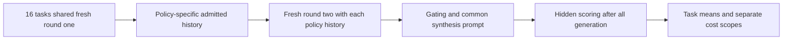

# Prospective Sparse Communication Experiments

Zhanxiang Qu, Independent Researcher. ORCID: 0009-0000-0137-9751. Date: 2026-10-28.

This supplement does not replace the bilingual manuscript's historical main tables. Cohorts are reported separately, not pooled into a retrospectively declared confirmatory sample.

## Shared-Candidate Prompt Contrast

All variants received the same archived Full candidate history. Temperature was 0 and the output cap was 1024 tokens, with two generations per task and variant. Hidden tests were loaded only after generation ended. Task means over the two generations are the independent statistical units.

| Cohort | Tasks | Current arbitration | Legacy compact | Specification priority | New requests | Historical proxy total |
|---|---:|---:|---:|---:|---:|---:|
| Exploratory pilot | 24 | 35/48 (72.9167%) | 42/48 (87.5000%) | 40/48 (83.3333%) | 144 | $0.0640848 |
| Disjoint replication | 48 | 88/96 (91.6667%) | 87/96 (90.6250%) | 88/96 (91.6667%) | 288 | $0.1181034 |

Legacy compact minus current arbitration was +14.5833 percentage points in the pilot, with an exploratory task-bootstrap interval of [+2.0833, +29.1667]. The replication prospectively fixed this contrast as primary: -1.0417 points, 95% interval [-7.2917, +5.2083], and two-sided exact directional sign-test p=1.

The pilot accuracy advantage did not replicate. These results do not establish general degradation from arbitration or a model-quality repair by compact prompting. Compact prompting reduced input tokens in both cohorts (62.66% and 64.71%), but no non-inferiority margin was prespecified. An interval crossing zero does not establish equivalence.

## Shared-Candidate Receiver Contrast

Thirty-two tasks were sampled outside the previous 72-task cohorts. Four policies received the same six historical candidates and produced two synthesized outputs each. VIB used the real local MiniLM encoder and the main code workflow's incremental gating history. Random and cosine controls matched VIB's admitted message count per task and round.

| Policy | Passed/64 | Admitted/192 | Synthesis input tokens | Synthesis output tokens | New synthesis proxy cost |
|---|---:|---:|---:|---:|---:|
| Full | 60 | 192 | 46314 | 7191 | $0.0225234 |
| VIB | 60 | 129 | 38316 | 7239 | $0.0201816 |
| Random count-matched | 60 | 129 | 38100 | 7908 | $0.0209196 |
| Cosine count-matched | 60 | 129 | 38176 | 7261 | $0.0201660 |

All four policies had identical task means and 93.75% accuracy. Every VIB-minus-random task difference was zero, giving directional p=1 and a degenerate bootstrap interval [0,0]. This is sample-statistic degeneracy, not proof of population equivalence or absence of risk.

Relative to Full, VIB admitted 32.8125% fewer messages and used 17.2691% fewer new synthesis input tokens, with a 10.3972% lower new synthesis proxy cost. These are receiver-local observations. Second-round candidates still came from historical Full generation, whose cost had already occurred. Consequently, this is not evidence of complete feedback or end-to-end savings. Simple matched controls also retained sample accuracy; no VIB-specific quality advantage was detected.

## Fresh Feedback Protocol

The new protocol samples 16 task IDs outside the preceding 104 tasks. Round one shares 48 freshly generated candidates. After each policy selects its history, second-round agents actually read their own policy's admitted history and generate 192 fresh candidates. Two final syntheses per task and policy add 128 requests, for 368 total. Independent historical-proxy observed budgets are $0.15/$0.45/$0.40.

Architect, Coder, and Reviewer read the round-start history; gating proceeds incrementally after all three candidates are received. In round two, random and cosine controls use k derived from VIB's own fresh candidates but select their own candidates. This is a coupled count-matched comparison, not token, role, or invoice matching. Nonempty paid truncated candidate text is retained; truncated final outputs fail, with no repair, regeneration, or hidden-test feedback.

## Fresh Feedback Results

All 368 requests completed before scoring. Each policy passed 32/32 final outputs, with 100% mean accuracy over 16 tasks. Every task difference was zero: the primary VIB-minus-random contrast was 0 points, directional p=1, and the task-bootstrap interval degenerated to [0,0]. This accuracy ceiling and degenerate interval do not establish equivalence.

| Policy | Admitted/96 | Round-one / round-two counts | Standalone one-synthesis proxy cost |
|---|---:|---|---:|
| Full | 96 | 48 / 48 | $0.0230670 |
| VIB | 74 | 39 / 35 | $0.0219567 |
| Random count-matched | 74 | 39 / 35 | $0.0220185 |
| Cosine count-matched | 74 | 39 / 35 | $0.0223332 |

Standalone cost includes the full shared first round, the policy's own second round, and the average cost of one final synthesis, representing 112 requests. It is a component-derived cost scope, not an additional payment record. Relative to Full, VIB admitted 22.9167% fewer messages, reduced this cost scope by 4.8134%, and reduced total input tokens by 5.8532%. Its proxy cost was only 0.2807% below random; without repeated cost experiments or intervals, this is not evidence of stable superiority over random. Simple controls also passed every output, with no detected VIB-specific quality advantage.

Actual experimental usage was 177169 input and 31450 output tokens, totaling 208619 tokens and $0.0908907 at historical proxy rates. The shared first round was charged once; the total includes all policies' second rounds and both final syntheses. Usage was complete, with no truncation, retries, or regeneration. The 128 final outputs underwent 256 isolated scoring executions. Eleven of 16 tasks had differing final text, and the 128 outputs contained 44 distinct hashes; passing every output does not establish full-domain semantic correctness.

Client-forbidden cache acceptance added zero API requests and left all six ledger hashes unchanged; all 455 repository tests passed. Feedback genuinely affected second-round generation, but the design remains two rounds, one team trajectory, one fixed random-subset seed, and 16 same-source archived tasks. It does not establish equal-actual-cost superiority or multi-seed robustness.

## Pre-Revision Source Audit

On 2026-10-29, we attempted to rescore the same 128 frozen outputs using the publisher's fixed Hugging Face revision of `evalplus/humanevalplus`. The mirrored file's SHA-256 matched the publisher's LFS object. The exported suite declares 125037 input groups, including 13243 for the selected 16 tasks. This is coverage auditing on the same tasks, not a new dataset.

All 164 publisher reference implementations underwent two independent checks, totaling 328 executions: 163 passed and HumanEval/32 failed. Its exported assertion `_poly(*candidate(*inp), inp)` tries to unpack the expected floating-point root, producing a reproducible TypeError. This is an exported scoring-source defect, not a regression in VIB output.

The frozen all-reference acceptance guard did not authorize candidate evaluation: **none of the 128 candidate outputs was rescored, and no expanded-test accuracy was published.** Original 100% labels, generated code, ledgers and costs remain unchanged; new model requests were zero. Although task 32 was outside the selected 16, we did not retrospectively relax the frozen acceptance scope or patch the oracle and claim official scores. The source was an HF exported suite, not an authenticated GitHub release or the official EvalPlus CLI, and its overall worker timeout differs from the CLI's per-input protocol. Correct scoring assets must be obtained and accepted before a separate rescoring run.

## Authorized Local Numerical Revision

The user subsequently authorized repair and explicitly confirmed two protocol extensions. First, polynomial values are evaluated as exact rational numbers. A root passes if its absolute residual is at most 1e-4, or if the exact values at its neighboring representable floats bracket a zero. Continuity certifies a local root in the latter case. The absolute threshold is retained, but numerical acceptance is extended; this is a local revision, not the unmodified protocol or an official EvalPlus score.

For input 217, the returned root matches the publisher's expected root, yet adjacent representable values cannot achieve an absolute residual of 1e-4: their exact residuals are approximately +0.004893 and -0.003838. Counterexamples reject incorrect roots, negative residuals, NaN/Inf and nonnumeric values without arbitrary tolerance inflation.

Second, the original Newton reference fails to converge on input 275, with residual approximately -1.117e8. The user authorized a task32-only acceptance reference based on the publisher's 886 expected-root pairs. Every root is checked by the revised oracle, while the other 163 canonical references remain unchanged. Original canonical data and the Newton failure record are preserved. We do not claim that all 164 original canonicals pass.

Task 32 is outside the selected 16 tasks, so the patch does not directly change candidate-cohort tests; it unblocks suite acceptance. All 128 model outputs remain frozen, without repair, selection or regeneration, and locally revised scores are stored separately. See the [local revision method](../docs/local_plus_repair.md).

The 163 original references and the task32 publisher-root table passed all 164 double-check acceptance cases; the original Newton failure under the revised oracle is stored separately. All 128 frozen outputs then underwent 256 isolated checks: Full and VIB passed 32/32 (100%), random passed 31/32 (96.875%), and cosine passed 30/32 (93.75%). All new failures concern HumanEval/137: decimal commas were misinterpreted as thousands separators, or a trailing comma was not converted and caused an exception. The other 15 tasks had no between-policy task-mean differences.

The retained primary VIB-minus-random direction was +3.125 points, with task-bootstrap 95% interval [0, +9.375] and exact directional p=1. Only one task was non-tied; this does not establish stable VIB-specific superiority or equivalence. Original 100% scores are preserved and local expanded scores reported separately. No new model requests were made and original generation ledgers and costs were unchanged. All 497 repository tests and computation-forbidden cache acceptance passed. See the [local revision report](../results/feedback_plus_repaired_20261029/README.md).

## Common Limitations

VIB is an information-bottleneck-inspired heuristic, not a learned variational mutual-information lower bound. The actual implementation includes code-difference discounts, correction keywords, role-dependent beta, public-prompt complexity, and adaptive proxies. Differences cannot all be attributed to one utility formula.

The local `all-MiniLM-L6-v2` snapshot is `1110a243fdf4706b3f48f1d95db1a4f5529b4d41`, evaluated on CPU with 384-dimensional float32 L2-normalized embeddings. Its maximum sequence length is 256; long code is tokenizer-truncated rather than represented in full.

All cohorts come from the same previously audited HumanEval archive. Non-overlapping task IDs do not create a new independent dataset or eliminate possible pretraining contamination. Returned `deepseek-v4-flash-0817` IDs verify provider declarations, not an official immutable snapshot. Temperature zero does not guarantee provider determinism.

Costs use historical proxy rates dated 2026-10-23: $0.30 per million input tokens and $1.20 per million output tokens. Unknown usage triggers a conservative stop and is never treated as zero. No actual gateway USD or RMB invoice was obtained. UTF-8 byte planning is not a verified token bound, and $1 is not a hard invoice guarantee.

Hidden scoring uses two independent same-seed interpreters with a minimal environment and no inherited credentials. Disagreement is an infrastructure error, not a voting decision. This is not a malicious-code network or filesystem sandbox.

## Research Position

Current evidence supports observed message reduction and local synthesis-input reduction, not a VIB-specific accuracy advantage or general equivalence. Previously observed historical gains remain documented, but their generation streams differed; this supplement does not retroactively turn them into a controlled causal result.

The evidence is better framed as a rigorous empirical study than as an established NeurIPS/ICLR-level methodological breakthrough. Important missing evidence includes new data, multiple team trajectories and random seeds, prespecified power and non-inferiority margins, actual invoice pricing, and equal-cost controls. Existing small-sample scores should not drive repeated tuning or favorable-seed selection.

## Evidence Navigation

| Content | Link |
|---|---|
| Corresponding Chinese supplement | [Chinese supplement](prospective_experiments_zh.md) |
| Prompt pilot | [24-task report](../results/prompt_contrast_pilot_20261028/README.md) |
| Disjoint prompt replication | [48-task report](../results/prompt_contrast_replication_20261028/README.md) |
| Shared-candidate receiver contrast | [32-task report](../results/gate_receiver_20261028/README.md) |
| Fresh two-round feedback | [16-task report](../results/feedback_experiment_20261028/README.md) |
| Expanded-test source audit; candidates not rescored | [Source audit report](../results/feedback_plus_rescore_20261029/README.md) |
| Authorized locally revised expanded scores | [Local revision results](../results/feedback_plus_repaired_20261029/README.md) |
| Execution and recovery | [Feedback documentation](../docs/feedback_experiment.md) |
| Full audit and plans | [Audit trail](gap1_claim_audit_trail.md) |
