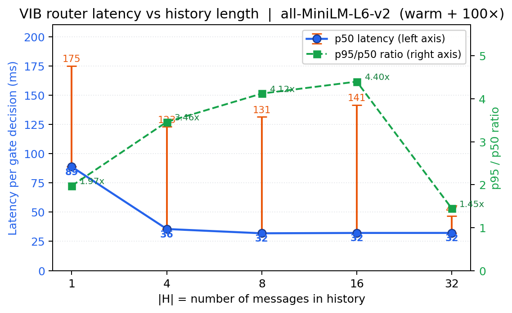
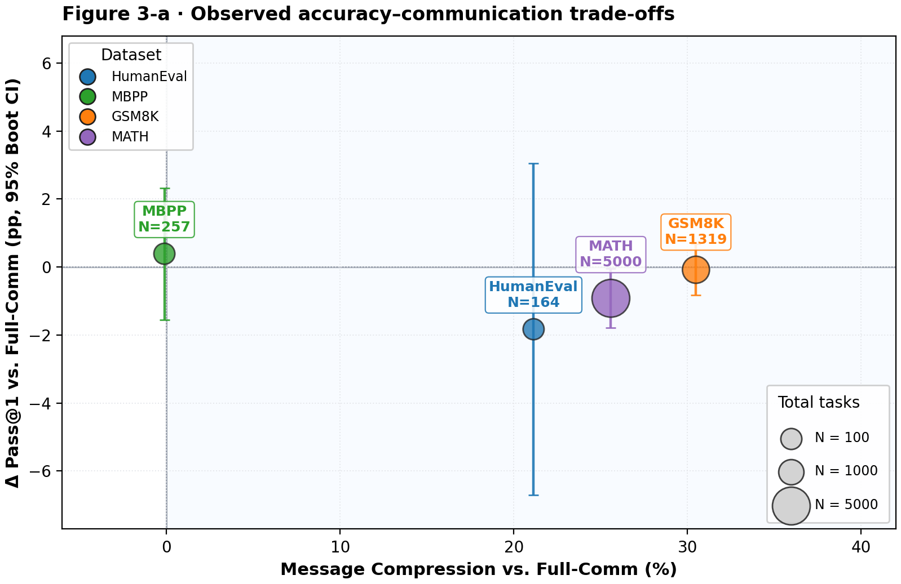

# 多智能体大语言模型消息门控的实证研究：通信节省、精度天花板与报告口径

**作者：** 屈占祥（独立研究者，ORCID: 0009-0000-0137-9751）

**中图分类号：** TP391　　**文献标识码：** A

---

## 摘要

多智能体大语言模型系统通常让各角色通过共享历史广播每一条候选消息，但并非所有消息都对最终答案有贡献。本文以"团队是否需要广播全部候选消息"为研究问题，构建了统一的实证评测框架，并以信息瓶颈思想为动机实现了一种确定性的轻量门控策略 VIB-Sparse 作为被评估的复杂门控代表；门控在候选生成之后、历史合并之前，依据候选与题目目标的相关性及其与已有历史的冗余度进行准入判断。在 HumanEval（164 题）、GSM8K（1319 题）与 MATH（5000 题）三个基准上，VIB-Sparse 的广播消息量相对完整通信分别减少 21.14%、30.49% 与 25.59%，精度差分别为 −1.83、−0.08 与 −0.92 个百分点，而总词元减少仅为 4.96% 与 4.42%。在匹配消息预算的对照中，简单余弦阈值门控与 VIB-Sparse 的精度点估计均为 97.00%。由此得到两点主要结论：其一，消息数、输入词元与完整费用三者并不同步，以消息数作为通信收益的代理会系统性高估门控的经济价值；其二，由于候选生成成本在门控之前已经发生，生成后门控存在结构性精度天花板，其收益主要体现为"节省通信"而非"提升精度"，现有证据不足以支持 VIB 机制相对简单门控的独有精度优势。

**关键词：** 多智能体大语言模型；稀疏通信；信息瓶颈；门控；成本评估；实验可复现性

---

## Abstract

**Lightweight Message Gating for Multi-Agent LLMs: An Empirical Study of Communication Savings, the Accuracy Ceiling, and Reporting Metrics**

**Abstract:** Multi-agent large language model (LLM) systems typically let each role broadcast every candidate message through a shared history, although not every message contributes to the final answer. Taking "whether a team must broadcast all candidate messages" as the research problem, this paper builds a unified empirical evaluation framework and, motivated by the information bottleneck principle, implements a deterministic lightweight gate, VIB-Sparse, as the complex-gate representative under evaluation; the gate decides admission after candidates are generated and before histories are merged, based on goal relevance and redundancy with the existing history. On HumanEval (164 tasks), GSM8K (1319 tasks) and MATH (5000 tasks), VIB-Sparse reduces broadcast messages by 21.14%, 30.49% and 25.59% relative to full communication, with accuracy gaps of −1.83, −0.08 and −0.92 percentage points, whereas total token reductions are only 4.96% and 4.42%. Under a matched message budget, a simple cosine-threshold gate matches VIB-Sparse at 97.00% Pass@1. Two main conclusions follow: first, message count, input tokens and full cost do not move in step, so using message count as a proxy for communication savings systematically overstates the economic value of gating; second, because candidate generation cost is already incurred before gating, post-generation gating has a structural accuracy ceiling and mainly saves communication rather than improving accuracy, and the evidence does not support a unique accuracy advantage of VIB over simple gates.

**Key words:** multi-agent large language model; sparse communication; information bottleneck; gating; cost evaluation; reproducibility

---

## 1 引言

随着大语言模型能力的提升，将软件开发与数学推理分解为多个智能体协同完成已成为一类重要的系统范式。ChatDev、MetaGPT、AgentCoder、SWE-agent 等代表性工作分别以不同方式划分编码、测试、评审等角色，并通过共享历史在智能体之间传递候选消息[1-4]。这类架构的一个隐含假设是：更多的讨论与更完整的上下文通常有利于最终答案。然而，消息进入上下文并不代表它对最终正确性有实际贡献，冗余或错误的建议同样会被广播，既增加后续合成阶段的输入开销，也可能干扰决策。

本文区分两个容易混淆的问题。第一是**上下文质量**问题：删除重复或错误内容能否改善答案，这需要在控制候选内容的前提下进行因果实验，而不能仅凭相似度分数推断。第二是**广播与实际费用**问题：候选消息一旦生成，其生成费用便已发生，生成之后将其丢弃只能减少后续可能使用的输入上下文，无法撤销已经发生的请求费用。将这两个问题混为一谈，往往会高估门控的收益。

基于以上区分，本文围绕三个具体问题展开研究。**RQ1**：在代码与数学两类任务上，生成后门控能够以多大的精度代价换取多少广播消息的节省？**RQ2**：与随机门控、余弦阈值门控等简单基线相比，VIB-Sparse 的复杂门控是否带来额外收益？**RQ3**：消息数下降、输入词元（Token）下降与完整费用下降三者之间是否一致，报告通信收益时应当以何种口径为准？

针对上述问题，本文构建了统一的实证评测框架，并以信息瓶颈（Information Bottleneck, IB）思想为动机实现了一种轻量门控策略 VIB-Sparse，作为被评估的复杂门控代表纳入该框架。需要强调的是，该方法属于确定性的嵌入启发式门控，其名称不表示已经拟合、优化或证明了变分互信息下界；本文的目标不是主张一种新的门控方法，而是在统一口径下检验"门控的收益究竟来自通信节省还是精度提升"。本文的贡献可归纳为三点：

（1）**口径分离**：在消息数、输入词元与完整费用三个层次上进行系统的口径审计，指出以广播消息数作为通信收益的代理会系统性高估门控的经济价值——广播消息数下降 21%–31%，而输入词元仅下降 4%–5%、净词元仅下降 1%–2%。

（2）**生成后门控的精度天花板**：论证由于候选生成成本发生在门控之前、属于沉没成本，生成后门控只能减少后续合成阶段的输入上下文，难以在精度上获得稳定正收益；辅以随机门控、余弦阈值门控与 VIB-Sparse 的对照，说明简单门控即可达到与复杂门控相当的精度。

（3）**可复现的实证审计**：对评分、参数透传、合成刷新与成本关联等实现环节进行审计，在不修改历史记录的前提下区分探索性观察与稳定方法优势，并在三个不含参考辅助早停的主基准上报告精度—广播量权衡。

本文的立场是审慎的实证研究：既如实报告 VIB-Sparse 在通信量上的可观节省，也如实披露其在精度上未表现出相对于简单门控的稳定优势，并据此给出关于协议设计与评估口径的建议。全文安排如下：第 2 节回顾相关工作；第 3 节介绍门控方法、统计口径与开销测量；第 4 节依次回答 RQ1 至 RQ3，并报告历史正收益审计、接收端重放与威胁有效性分析；第 5 节总结全文。

---

## 2 相关工作

多智能体软件工作流方面，ChatDev 通过角色化的对话流程完成软件开发[1]，MetaGPT 引入标准操作流程与结构化输出[2]，AgentCoder 使用迭代测试与优化提升代码生成质量[3]，SWE-agent 提出智能体—计算机接口以自动化软件工程任务[4]，OpenDevin 则提供了面向通用智能体的开放平台[5]。国内已有综述对基于大语言模型智能体的代码生成进行系统梳理[6]。这些工作共同确立了角色分工与共享历史在多智能体系统中的重要地位，但大多默认广播所有候选消息，较少显式讨论通信量的取舍。

通信裁剪与提示压缩方面，DyLAN 通过动态团队优化调整智能体协作结构[7]，LLMLingua 通过提示压缩加速大语言模型推理[8]，AgentPrune 提出经济化的多智能体通信管线[9]，AgentDropout 通过动态消除智能体以在保持性能的同时降低词元开销[10]。多智能体强化学习领域对通信效率已有系统梳理，其核心问题同样是在有限带宽下选择性地传递信息[11]，近期工作进一步研究了大规模情境下的图信息通信与拓扑优化[12]。这些工作表明，稀疏通信与提示压缩本身并非本文的独创，本文的定位是在统一评测框架下，对"门控收益究竟来自通信节省还是精度提升"这一具体问题给出审慎的实证回答，而非声称稀疏通信的新颖性。需要说明的是，本文未在统一框架下复现 AgentPrune 与 AgentDropout 的数值结果，上述工作仅用于定位研究问题，不构成数值竞品比较。

理论动机方面，信息瓶颈原理与深度变分信息瓶颈为信息保留与正则化提供了理论或训练框架[13,14]；在多智能体通信场景中，已有工作以深度强化学习结合互信息约束与信息瓶颈理论过滤冗余信息、自适应选择通信对象[15]。InfoBERT 则从信息论视角提升语言模型的鲁棒性[16]。本文仅借用信息瓶颈的权衡思想作为启发式动机，其实现并不估计真实分布下的互信息，也不优化相应的变分界，理论强度与上述工作不同。此外，Self-Refine 提出了迭代自反馈的强单智能体对照范式[17]，关于多智能体辩论评估的研究则强调推理预算与模型差异对结论的影响[18]，国内亦有工作将多智能体辩论机制用于复杂生成任务[19]，这些都为本文设置对照实验提供了方法参考。StreamingLLM 与 MemWalker 主要关注长上下文与记忆导航[20,21]，与本文所研究的短团队广播门控并不等同。

---

## 3 方法

### 3.1 任务与工作流

本文在代码生成与数学推理两类任务上开展实验。代码任务使用 HumanEval[22]，以可执行代码测试作为评判依据；历史 MBPP 结果[23]因涉及参考测试参与早停而被隔离，不作为主结果。数学任务使用 GSM8K[24] 与 MATH[25]，其中 MATH 的答案形式包含分数、表达式、列表、元组与区间等，不能简单取最后一个数字进行评判。

为刻画不同通信策略的影响，本文设置三种工作流。**Vanilla** 为单智能体合成，直接接收题目而不接收团队历史，作为较低推理预算的锚点，但不是等费用的单智能体对照。**Full** 在代码任务中使用 Coder、Tester、Reviewer 三个角色，在数学任务中使用 Planner、Solver、Verifier 三个角色，每轮各角色产生一个候选，同轮采用冻结历史，所有候选合并广播，讨论后由合成器生成最终答案。**VIB** 使用与 Full 完全相同的角色、提示词函数与评测器，区别仅在于候选生成后、历史合并前加入门控：只有通过准入判断的消息才进入公共历史。需要说明的是，Full 与 VIB 是分开的随机执行，二者并不共享完全相同的候选流，因此本文的对照是策略级对照，而非对同一候选流的因果干预。

工作流的概念边界需要说明：评分材料（参考答案与隐藏测试）仅用于输出完成后的评测，不进入部署决策；门控日志记录的是分数与准入结果，而非合成器的注意力，因此不能证明某条消息对最终答案存在因果贡献。三种工作流的广播消息减少与精度差的整体权衡如图 1 所示。

### 3.2 信息瓶颈动机与实现代理

令 G 表示题目目标，H 表示历史，M 表示候选消息，理想的信息瓶颈权衡可写为

L_IB(M) = I(M; H) − β_t · I(M; G)

其中 I(·;·) 表示互信息，β_t 为权衡系数。信息瓶颈与深度变分信息瓶颈提供的是理论或训练框架[13,14]；本文实现并不估计真实分布下的互信息，也不优化相应变分界，而是采用冻结的 all-MiniLM-L6-v2 编码器（384 维）构造启发式代理。目标相关性代理为候选与题目的嵌入余弦相似度

S(M, G) = cos(E(M), E(G))

历史冗余代理采用长度归一化的 log-sum-exp 形式

R(M; H) = (1/√|H|) · log Σ_{h∈H} exp( cos(E(M), E(h)) / τ )

其中 E(·) 为嵌入编码，τ 为温度参数。归一化用于避免历史长度直接导致分数饱和，但这并不证明该分数等于真实的冗余信息量。代码任务还使用候选与最后历史代码块之间的 SequenceMatcher 差异比例 δ 进行折扣，折扣因子为 max(0.2, 1 − 1.5δ)。

最终的门控效用函数为

U(M) = β_t · S(M, G) − R_adj(M)

其中 R_adj(M) 在冗余代理基础上乘以代码差异、纠错关键词、推理关键词等修正因子，并附加消息长度的对数项。门控权重与自适应温度分别定义为

β_t = (β_role + complexity_bonus(G)) · e^(−λ·t_eff)

τ_adaptive = max(τ_min, γ − α·H̄(Y))

需要强调的是，上述各项均为启发式修正，而非可靠性估计器：较大的文本改动并不一定是正确修复，纠错关键词的出现也不等于修复有效。本文主配置为 β_0=3.2、λ=0.08、τ=0.5、γ=−0.4、α=0.35、τ_min=−1，关闭数学角色权重覆盖与推理保护。由于构造器默认值与主配置不同，复现时必须显式传参；原始 gate 决策与经过角色救援后的广播决定也必须分开统计。

门控的完整准入流程如算法 1 所示，其中基础准入阈值为 γ（本文主配置 γ=−0.4），开启自适应温度时改用 τ_adaptive。

**算法 1　VIB-Sparse 门控准入流程**

输入：题目 G，已广播历史 H，本轮候选集合 {M_i}（各含角色标签与文本）

输出：本轮广播集合 B

1. 用冻结编码器计算题目嵌入 E(G) 与各候选嵌入 E(M_i)；
2. 对每个候选 M_i，计算目标相关性 S_i = cos(E(M_i), E(G))；
3. 计算历史冗余 R_i = (1/√|H|) · log Σ_{h∈H} exp(cos(E(M_i), E(h)) / τ)；
4. 按代码差异比例 δ_i 折扣：R_adj,i = R_i · max(0.2, 1−1.5δ_i)，再乘以角色、纠错关键词与推理关键词修正因子，并附加消息长度对数项；
5. 计算效用 U_i = β_t · S_i − R_adj,i，其中 β_t 按上文调度；
6. 若 U_i 不低于准入阈值 γ（自适应时取 τ_adaptive），则 M_i 进入 B；
7. 对未通过但触发角色保护条件的候选执行角色救援，按既定规则重新纳入 B；
8. 返回 B，并将其并入下一轮公共历史。

还需进一步明确门控轨迹的因果边界：门控日志记录的是分数与准入结果，既不记录合成器的注意力，也不能证明某条消息对最终答案存在因果贡献；合成器接收的是消息文本而非门控分数。若某题的所有候选均被广播，就不能把该题的成功归因于"过滤掉了错误建议"。这一边界决定了本文所有解释的限度，也是后续开展因果验证实验时必须直接面对的问题。

### 3.3 模型、评分、统计与开销

主实验使用滚动别名 deepseek-chat，旧产物无法恢复不可变的服务快照。调用层对 Agent 显式设置温度 0.2、上限 256，对代码合成设置 0.1/1024，对数学合成设置 0.1/256；由于这些参数覆盖客户端默认值，文件名中的 t0 并不证明真实温度为 0，因而本文不声称温度稳健性。

评分方面，HumanEval 通过执行 check(candidate) 判断正确性；MBPP 使用顶层断言且不传 HumanEval 的入口点。旧版合成刷新曾只定义测试函数而未调用，产生 100/100 的假象，独立重评后主实验 HumanEval 为 151/164 与 148/164。MATH 采用独立的 whole_answer_v1 匹配器，优先提取最后一个平衡的 boxed 答案，再提取显式答案标签或整条输出，不回退到最后数字；对有序列表、元组、区间开闭进行显式保留，对集合与并集进行无序比较，常见分数、根式与代数表达式由受限 AST 与 SymPy 处理，未知格式保守地整文本比较或判为失败。该匹配器并非完整的数学语义 oracle。

统计方面，单比例区间使用 Wilson 方法（表 1 中随精度一并给出），差值使用 10000 次任务配对 bootstrap（自助法）95% 区间。本文的推断以配对差值为准，不以单比例区间作等效或非劣效判断；由于没有预注册非劣效界值，区间跨零不意味着无损或等效；多重检验未作校正，因此名义显著的单项结果需谨慎解读；重复合成先按任务聚合，不把模型调用数当作独立任务数。

费用口径采用代理价：输入 0.30 美元/百万词元、输出 1.20 美元/百万词元。该价格仅用于实验预算控制，并非实付账单，本文不据此声称真实费用节省。

门控自身的开销在本机（Apple M2 Pro，CPU）上离线测量：编码器为冻结的 all-MiniLM-L6-v2，历史长度取 1、4、8、16、32，先预热 100 次。单次门控决策的 P50 为 32–89 ms、P95 为 47–175 ms（图 2），随历史长度增加而单调上升。该测量不包含 API 往返与生产环境 P99，因此只能说明门控计算不是系统的主要瓶颈，不能作为端到端延迟结论。

---

## 4 实验结果与分析

### 4.1 主结果：通信节省与精度代价（RQ1）

表 1 给出三种方法的历史表现与通信预算。就精度而言，HumanEval 上 VIB 相对 Full 少 3 题，差值 −1.83 个百分点，95% 区间为 [−6.71, +3.05]，McNemar 检验 p=0.607；GSM8K 上差值 −0.08 个百分点，区间 [−0.83, +0.68]。这些是未解决的差异，而非已通过非劣效检验。MATH 上匹配率为 78.58% 与 77.66%，差值 −0.92 个百分点，区间 [−1.78, −0.04]，p=0.045，该负差虽在名义显著性水平上不为零，但若按三次主检验作 Bonferroni 校正（×3），校正后约为 0.135，不再小于 0.05；结果还对评分覆盖口径敏感，不能据此作普遍结论。

就通信量而言，VIB 相对 Full 在三个基准上的广播消息量分别减少 21.14%、30.49% 与 25.59%，这是一致且可观的节省。然而，GSM8K 与 MATH 记录的总词元减少仅为 4.96% 与 4.42%，HumanEval 的刷新代码沿用旧费用字段，其 3.88% 只能视为历史计数差，不能视为刷新后的完整费用节省（第 4.3 节进一步分解）。这一显著落差揭示了一个关键事实：消息数下降与总费用下降之间存在不可忽视的鸿沟，候选生成费用占据主导，门控只能削减后续输入侧的开销。

| 数据集 | 题数 | Vanilla (%) | Full (%) [Wilson 95% CI] | VIB (%) [Wilson 95% CI] | Δ(Full−Vanilla) (pp) | Δ(VIB−Full) (pp) | Δ 95% CI | 广播减少 | 历史词元计数差 |
| --- | --- | --- | --- | --- | --- | --- | --- | --- | --- |
| HumanEval | 164 | 93.90 | 92.07 [86.91, 95.31] | 90.24 [84.74, 93.90] | −3.66 | −1.83 | [−6.71, +3.05] | 21.14% | 3.88% |
| GSM8K | 1319 | 59.29 | 95.30 [94.02, 96.32] | 95.22 [93.93, 96.25] | +35.93 | −0.08 | [−0.83, +0.68] | 30.49% | 4.96% |
| MATH | 5000 | 46.16 | 78.58 [77.42, 79.70] | 77.66 [76.48, 78.79] | +31.50 | −0.92† | [−1.78, −0.04] | 25.59% | 4.42% |

**表 1　三种方法的历史表现与通信预算**（†表示配对区间不跨零；MATH 主批次 McNemar 检验 p=0.045，未经多重检验校正；MATH 为保守完整答案匹配率；HumanEval 的 3.88% 为历史词元计数差，不作为完整费用节省；区间跨零不证明等效或非劣效）

关于统计功效需要补充说明：HumanEval 仅 164 题，其配对差值 95% 区间的半宽在 5 个百分点量级，这意味着本文无法排除 5 个百分点以内的真实精度差异；GSM8K 与 MATH 的样本量更大，区间相应更窄，但仍不足以支撑强非劣效主张。因此，表中"精度基本持平"应理解为点估计接近，而非经过检验的等效结论。

相对历史 Vanilla 而言，Full 在 GSM8K 与 MATH 上分别高 36.01 与 32.42 个百分点，VIB 分别高 35.93 与 31.50 个百分点，而 HumanEval 上没有同样的优势。由于团队使用了更多推理预算，这些差值不能用于隔离多智能体结构本身的收益。

### 4.2 简单门控与跨模型对照（RQ2）

为检验复杂门控是否优于简单规则，本文在一个 200 题的 GSM8K 子集上进行了消融与对照。表 2 给出关闭与开启角色权重两种配置的结果：关闭角色权重时，广播减少 30.25%，差值 −0.50 个百分点；开启角色权重时，广播减少 25.17%，差值 0.00。由于不同随机运行及 Full 精度的自然波动（约 1 个百分点），该结果不能证明选择性的角色收益。

| 消融设置 | 题数 | Full (%) | VIB (%) | Δ(VIB−Full) (pp) | 广播减少 | 历史词元计数差 |
| --- | --- | --- | --- | --- | --- | --- |
| 冻结门控（frozen_only） | 200 | 97.00 | 96.50 | −0.50 | 30.25% | 3.91% |
| 冻结门控+角色权重（frozen+role） | 200 | 96.00 | 96.00 | 0.00 | 25.17% | 4.17% |

**表 2　GSM8K 角色权重消融（两次独立随机执行，Full 基线自身亦有约 1 个百分点波动）**

表 3 给出同一网关门控模型、同一 200 题子集、同一套评测框架下的门控对照。在匹配 VIB 消息预算的条件下，余弦阈值 0.75 门控减少 29.50% 的广播，VIB 减少 30.17%，两者精度均为 97.00%，配对差值区间 [−2.50, +2.50] 个百分点；随机丢弃（p=0.698）减少 31.50% 的广播，精度 96.00%，相对 VIB 差 −1.00，区间 [−4.00, +1.50]。其余阈值的广播预算与 VIB 并不对齐，仅用于刻画阈值—预算曲线。就记录词元而言，随机门控、VIB 与余弦门控分别为 13.08%、5.08% 与 4.72%，这再次表明消息预算接近并不等于费用相等，不能据此作等费用的优越性判断。余弦阈值门控复用了同一冻结编码器，但省略了目标项、调度与 VIB 特有的修正项，因此该对照隔离的是"完整效用函数"而非"是否使用嵌入"。

| 门控策略 | 广播减少 | 历史词元计数差 | Pass@1 (%) | Δ（相对 VIB，pp） |
| --- | --- | --- | --- | --- |
| 无门控（Full） | — | — | 94.50 | −2.50 [−5.50, 0.00] |
| VIB（锚点） | 30.17% | 5.08% | 97.00 | 0.00 |
| 随机丢弃（p=0.698） | 31.50% | 13.08% | 96.00 | −1.00 [−4.00, +1.50] |
| 余弦阈值（θ=0.75） | 29.50% | 4.72% | 97.00 | 0.00 [−2.50, +2.50] |
| 余弦阈值（θ=0.80） | 20.42% | 4.12% | 96.00 | −1.00 [−4.00, +1.50] |
| 余弦阈值（θ=0.85） | 11.33% | 2.66% | 95.50 | −1.50 [−4.00, +1.00] |
| 余弦阈值（θ=0.90） | 2.42% | 0.78% | 96.00 | −1.00 [−3.50, +1.50] |

**表 3　GSM8K 门控对照（Δ 为配对 bootstrap 95% 区间；负值表示该策略劣于 VIB；区间跨零不证明等效或 VIB 的独有优势）**

表 4 报告跨模型族的迁移观察。两行在完全相同的工作流配置下运行（β_0=3.2、λ=0.08、γ=−0.4，Agent 温度 0.2、合成温度 0.1），仅更换网关门控模型。DeepSeek v4-pro 与 Qwen-3.8-Max 相对 Full 的精度差分别为 +0.50 与 +1.50 个百分点，消息减少均超过 25%，其中 Qwen 为 97.50% 与 99.00%，区间 [0.00, +3.50]，p=0.25。这些属于有限迁移观察，不构成模型无关保证，也未验证服务端快照的不可变性。

| 骨干模型 | Full (%) | VIB (%) | Δ(VIB−Full) (pp) | 广播减少 | 输入词元减少 | 净词元减少 |
| --- | --- | --- | --- | --- | --- | --- |
| DeepSeek v4-pro | 96.50 | 97.00 | +0.50 | 27.14% | 4.58% | 1.69% |
| Qwen-3.8-Max | 97.50 | 99.00 | +1.50 | 25.50% | 5.15% | 1.20% |

**表 4　GSM8K 跨模型迁移（N=200）。门控压缩的是共享上下文而非模型输出：输入词元下降 4.6%–5.2%，补全词元反而上升（DeepSeek +0.45%，Qwen +3.64%），净节省 1.2%–1.7%。该聚合现象与"输出长度反弹"一致，但本身不能证明短上下文导致更长推理。**

表 5 给出三个可解释标量的一次一因素敏感性分析。固定默认值（β_0=3.2、λ=0.08、γ=−0.4）时，三个块中加粗行是同一配置的三次重复，其离散度为精度差 1.00 个百分点、广播减少 0.91 个百分点，属该样本量下的描述性观察，不构成噪声界。15 个网格点中有 11 个相对默认重复均值的偏离落在 ±1 个百分点内，最大偏离为 1.67 个百分点；广播减少则随 β_0 增大而下降（47.6%→7.7%）、随 γ 增大而上升（5.9%→42.3%），λ 在三倍变化范围内只把广播减少从 19.6% 移至 29.2%。这一比较说明主结论对单一参数的小幅扰动不敏感，但固定子集上的单因素实验不能确立非劣效或联合参数稳健性，部署前仍需在独立任务上重新标定。

| 参数 | 取值 | Δ(VIB−Full) (pp) | 广播减少 | 历史词元计数差 | 是否在 ±1 pp 内 |
| --- | --- | --- | --- | --- | --- |
| β_0 | 1.60 | +1.00 | 47.58% | 8.25% | 是 |
| β_0 | 2.40 | −1.00 | 37.50% | 6.13% | 否 |
| β_0 | **3.20（默认）** | **0.00** | **23.58%** | **4.31%** | **是** |
| β_0 | 4.00 | +1.00 | 13.17% | 2.52% | 是 |
| β_0 | 4.80 | −0.50 | 7.67% | 1.49% | 是 |
| λ | 0.04 | 0.00 | 19.58% | 2.96% | 是 |
| λ | 0.06 | 0.00 | 20.08% | 3.81% | 是 |
| λ | **0.08（默认）** | **0.00** | **23.17%** | **4.09%** | **是** |
| λ | 0.10 | −1.00 | 25.92% | 4.48% | 否 |
| λ | 0.12 | +0.50 | 29.17% | 5.10% | 是 |
| γ | −0.80 | +1.00 | 5.92% | 1.31% | 是 |
| γ | −0.60 | +2.00 | 12.33% | 2.13% | 否 |
| γ | **−0.40（默认）** | **+1.00** | **22.67%** | **3.77%** | **是** |
| γ | −0.20 | 0.00 | 35.67% | 6.32% | 是 |
| γ | 0.00 | −1.00 | 42.33% | 7.63% | 否 |

**表 5　GSM8K 超参数敏感性（N=200，一次改变一个参数；加粗行为同一默认配置的三次重复；"是否在 ±1 pp 内"指相对三次默认重复均值的偏离）**

### 4.3 消息数、输入词元与费用的口径审计（RQ3）

本节直接回答 RQ3：三种口径是否一致。答案是否定的，而且差异具有系统性。

第一，消息数与词元数不同步。表 1 中广播消息减少为 21.14%–30.49%，同一批记录的历史词元计数差却只有 3.88%–4.96%；跨模型观察显示输入侧词元减少 4.58% 与 5.15%，但补全词元反而上升（+0.45% 与 +3.64%），净词元节省仅 1.69% 与 1.20%（表 4）。门控对照还出现方向不一致的情形：随机丢弃的广播减少（31.50%）与 VIB（30.17%）相近，但历史词元计数差为 13.08%，约为 VIB（5.08%）的两倍以上（表 3）。这说明消息条数与词元消耗之间不存在稳定比例，前者受消息数量控制，后者还取决于被保留消息的长度分布。

第二，被保留消息并非均匀抽样。VIB 的目标相关项倾向于保留与题目高度相关的长消息，随机丢弃则按比例均匀丢弃，因此在高压缩率下两者词元曲线分离得更快。这解释了为何"匹配消息预算"的实验仍可能对应不同的上下文长度。

第三，完整费用尚未测得。本文只使用代理价（输入 0.30 美元/百万词元、输出 1.20 美元/百万词元）做预算控制，该价格不是实付账单；刷新批次沿用了旧词元字段，门控与合成阶段的完整计费流水也未记录。因此本文可报告的口径是"广播消息数显著下降、输入词元小幅下降、完整费用尚未测量"，而不能声称"总费用下降 20%–30%"。

这一结论对评估实践有直接影响：若以消息数作为通信收益的代理指标，会系统性地高估门控的经济价值；较稳妥的做法是同时报告消息数、输入词元、输出词元与按实际价目结算的完整费用，并说明各自的可获得性。

### 4.4 历史正收益与实现缺陷

本文对早期三个 HumanEval 正收益批次重新执行了原入口点测试，标签完全保持不变：CLI 修正版为 Full 152/164（92.68%）、VIB 155/164（94.51%），差值 +1.83，区间 [−1.83, +5.49]，p=0.508；仲裁规则版为 Full 148/164（90.24%）、VIB 154/164（93.90%），差值 +3.66，区间 [0.00, +7.32]，p=0.109；最少角色救援版为 Full 144/164（87.80%）、VIB 149/164（90.85%），差值 +3.05，区间 [−1.83, +7.32]，p=0.302。加上刷新前主实验，共 1312 次存档代码检查未出现标签翻转。这些结果说明历史正收益是真实的，但各批次使用相同的 164 题，不能合并制造独立样本，也不能选择最好的一次来替代当前主表；最高 VIB 相对历史 Vanilla 也仅多 1 题。

审计还确认了两类实现缺陷。其一，合成刷新仅修改 output 与 passed 字段，通过复制旧 variant 保留词元字段，导致 94 份变化输出继承旧账目，因此不能声称刷新后的完整费用节省。其二，零 API 测试截获到客户端显式参数覆盖了默认温度，因而必须撤回"真实温度为零"的稳健性表述。这些缺陷不改变已有输出得分，也不自动解释历史正收益，但提示在报告通信与费用收益时须格外谨慎。

### 4.5 接收端重放与保护配置

为检验历史信息对最终合成的作用方向，本文进一步开展了接收端重放实验：在固定候选流的前提下，向合成器分别提供完整历史、各门控后的历史、仅首轮历史以及无历史等多种策略，观察最终答案的变化。在两个各 24 题的历史子集上，HumanEval 六种策略的精度依次为 Full 83.33%、随机丢弃 87.50%、余弦阈值 87.50%、VIB 85.42%、仅首轮历史 91.67%、无历史 91.67%；其中完整历史相对仅首轮的差值为 −8.33 个百分点，区间 [−20.83, 0.00]。MATH 中所有接收历史的策略均为 87.50%，而无历史仅为 39.58%。这些结果表明，完整历史在个别情形下可能引入错误，但已见任务与较小样本量不支持"协作普遍带来负收益"的结论，首轮历史在 MATH 上的贡献则十分显著。需要注意，该实验固定了候选流，因而与 4.1 节的策略级对照回答的是不同问题：前者考察"给定候选，保留多少历史"，后者考察"端到端部署哪种策略"。

此外，配置取舍实验表明，在相同 5000 题、相同完整答案匹配下，同时开启数学角色权重与推理保护的旧批次为 78.46%/78.32%，差值 −0.14，区间 [−1.04, +0.72]，消息减少 5.06%、词元减少 0.48%；主配置关闭保护时为 78.46%/77.42%，消息减少 25.39%、词元减少 4.21%。可见保护配置以更小的压缩换取接近 Full 的精度，而主配置则以更大的通信节省换取微小的精度代价，二者构成明确的取舍；但由于两批并非固定共同候选实验，不能把差值全部归因为保护机制的因果收益。

### 4.6 讨论、威胁有效性与局限

综合上述结果，本文能够支持的核心结论是：**生成后门控可以在精度基本持平的前提下稳定减少广播消息量，但该收益主要体现为"省通信"而非"提精度"**。VIB 保留了较多的团队效果，历史正收益是真实观察，但复杂门控尚未稳定超越简单规则；这既不证明 VIB 工作没有价值，也不证明恢复某个历史版本就能获得可靠的方法优势。

按照实验效度的四类划分，本文的威胁如下。**构念效度**：以嵌入余弦与 log-sum-exp 代理互信息，代理与"真实冗余"之间没有等价性证明；MATH 的整答案匹配器不能覆盖所有等价写法，未知格式可能漏判。**内部效度**：Full 与 VIB 是分开的随机执行，不共享候选流，故对照为策略级而非同一候选流的因果干预；门控日志不含注意力，无法证明单条消息的因果贡献；参数透传缺陷曾导致温度口径失真。**外部效度**：滚动模型别名使旧产物不可复现；仅三角色团队、两类任务，跨模型证据只有两条；Vanilla 不是等费用对照。**结论效度**：未预注册非劣效界值，多重检验未校正，HumanEval 样本量使区间半宽达 5 个百分点量级，384 题规模的接收端重放进一步限制了统计功效。

由此得到的主要局限包括：团队规模较小（三角色）；任务经反复调参而存在已见偏差；存在事后选择；刷新费用缺失；历史 MBPP 存在参考测试参与早停；未在统一框架下复现 AgentPrune、AgentDropout 等通信裁剪方法的数值结果，因而无法给出同类方法的直接对比。这些局限意味着，区间跨零不能视作无损，显著负差也不能脱离评分覆盖与配置差异而作普遍结论。

---

## 5 结论

本文围绕"多智能体大语言模型团队需要多少通信"这一问题，构建了统一的实证评测框架，并以信息瓶颈启发的轻量门控策略 VIB-Sparse 作为复杂门控的代表进行系统的实证评估。结果表明，门控能够在三个主基准上以较小的精度代价换取 21%–31% 的广播消息节省，但总词元节省远小于消息数下降（输入词元仅降 4%–5%，净词元 1%–2%），且简单门控在匹配预算下与 VIB 表现接近。据此，本文给出两点结论：其一，通信收益的度量必须区分消息数、输入词元与完整费用三个层次，以消息数匹配替代费用匹配会高估门控价值；其二，由于候选生成成本在门控前已经发生，生成后门控存在结构性精度天花板，其价值在于节省通信而非带来独有精度优势。这一结论对多智能体系统的协议设计与评估具有直接参考意义。后续工作应优先修复费用关联与可复现性，将门控前移到候选生成之前以同时争取精度与成本收益，开展固定候选流的单因素对照实验，并引入预算受限的等费用验证与预注册的非劣效界值，以在更可靠的基础上刻画通信与精度的真实权衡。

---

## 参考文献

[1] Qian C, Liu W, Liu H, et al. ChatDev: Communicative Agents for Software Development[C]//Proceedings of the 62nd Annual Meeting of the Association for Computational Linguistics (ACL 2024), Long Papers. 2024.

[2] Hong S, Zhuge M, Chen J, et al. MetaGPT: Meta Programming for a Multi-Agent Collaborative Framework[J]. arXiv preprint arXiv:2308.00352, 2023.

[3] Huang D, Zhang J M, Luck M, et al. AgentCoder: Multi-Agent-based Code Generation with Iterative Testing and Optimisation[J]. arXiv preprint arXiv:2312.13010, 2023.

[4] Yang J, Jimenez C E, Wettig A, et al. SWE-agent: Agent-Computer Interfaces Enable Automated Software Engineering[C]//Advances in Neural Information Processing Systems (NeurIPS). 2024.

[5] Wang X, Li B, Song Y, et al. OpenDevin: An Open Platform for AI Software Developers as Generalist Agents[J]. arXiv preprint arXiv:2407.16741, 2024.

[6] 董益宏, 姜雪, 钱家如, 等. 基于大语言模型智能体的代码生成综述[J]. 软件学报, 2026, 37(8): 3089-3115.

[7] Liu Z, Zhang Y, Li P, et al. Dynamic LLM-Agent Network: An LLM-agent Collaboration Framework with Agent Team Optimization[J]. arXiv preprint arXiv:2310.02170, 2023.

[8] Jiang H, Wu Q, Lin C Y, et al. LLMLingua: Compressing Prompts for Accelerated Inference of Large Language Models[C]//Proceedings of the 2023 Conference on Empirical Methods in Natural Language Processing (EMNLP). 2023: 5097-5110.

[9] Zhang G, Yue Y, Li Z, et al. Cut the Crap: An Economical Communication Pipeline for LLM-based Multi-Agent Systems[J]. arXiv preprint arXiv:2410.02506, 2024.

[10] Wang Z, Wang Y, Liu X, et al. AgentDropout: Dynamic Agent Elimination for Token-Efficient and High-Performance LLM-Based Multi-Agent Collaboration[C]//Proceedings of the 63rd Annual Meeting of the Association for Computational Linguistics. 2025: 24013-24035.

[11] 陈荣敏, 郭大波, 吴宏坤, 等. 多智能体深度强化学习通信七维度综述[J]. 计算机科学与探索, 2026, 20(6): 1606-1626.

[12] 李方昱, 刘金溢, 孙浩源, 等. 具有指数图信息通信的大规模情境多智能体强化学习[J]. 自动化学报, 2026, 52(6): 1304-1318.

[13] Tishby N, Zaslavsky N. Deep Learning and the Information Bottleneck Principle[C]//IEEE Information Theory Workshop (ITW). 2015.

[14] Alemi A A, Fischer I, Dillon J V, et al. Deep Variational Information Bottleneck[C]//International Conference on Learning Representations (ICLR). 2017.

[15] 高兵, 张哲婕, 邹启杰, 等. 基于深度强化学习和信息论的多智能体通信方法[J]. 航空学报, 2024, 45(18): 329862.

[16] Wang B, Wang S, Cheng Y, et al. InfoBERT: Improving Robustness of Language Models from an Information Theoretic Perspective[C]//International Conference on Learning Representations (ICLR). 2021.

[17] Madaan A, Tandon N, Gupta P, et al. Self-Refine: Iterative Refinement with Self-Feedback[C]//Advances in Neural Information Processing Systems (NeurIPS). 2023.

[18] Zhang H, Cui Z, Chen J, et al. Stop Overvaluing Multi-Agent Debate — We Must Rethink Evaluation and Embrace Model Heterogeneity[J]. arXiv preprint arXiv:2502.08788, 2025.

[19] 马杰, 张瀚驰, 渠宁, 等. 基于多智能体辩论的图文交织生成方法[J]. 计算机研究与发展, 2026, 63(9): 2264-2284.

[20] Xiao G, Tian Y, Chen B, et al. Efficient Streaming Language Models with Attention Sinks[J]. arXiv preprint arXiv:2309.17453, 2023.

[21] Chen H, Pasunuru R, Weston J, et al. Walking Down the Memory Maze: Beyond Context Limit through Interactive Reading[J]. arXiv preprint arXiv:2310.05029, 2023.

[22] Chen M, Tworek J, Jun H, et al. Evaluating Large Language Models Trained on Code[J]. arXiv preprint arXiv:2107.03374, 2021.

[23] Austin J, Odena A, Nye M, et al. Program Synthesis with Large Language Models[J]. arXiv preprint arXiv:2108.07732, 2021.

[24] Cobbe K, Kosaraju V, Bavarian M, et al. Training Verifiers to Solve Math Word Problems[J]. arXiv preprint arXiv:2110.14168, 2021.

[25] Hendrycks D, Burns C, Kadavath S, et al. Measuring Mathematical Problem Solving with the MATH Dataset[J]. arXiv preprint arXiv:2103.03946, 2021.

---

*基金项目：无。作者简介：屈占祥，独立研究者，研究方向为大语言模型多智能体系统与稀疏通信。投稿系统中作者简介栏目的出生年、性别、学历等字段，请按期刊要求另行填写。*
