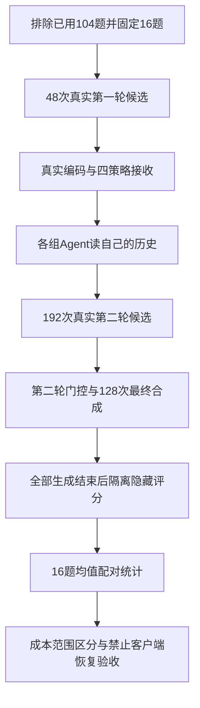

# 两轮真实反馈与前瞻实验综合报告

日期：2026-10-28。作者：屈占祥（Zhanxiang Qu），独立研究者，ORCID 0009-0000-0137-9751。

本批次从此前104题之外固定抽16题，重新生成候选并让第二轮Agent读取各策略的真实接收历史。它补齐旧接收端实验的反馈缺口，不修改历史结果、核心默认或中英文论文主表。

## 本轮真实结果

| 策略 | 成功/32 | 16题均值准确率 | 接收消息/96 | 第一轮/第二轮 | 后续输入Token¹ | 单策略一次代理费用² |
|---|---:|---:|---:|---|---:|---:|
| Full | 32 | 100% | 96 | 48 / 48 | 32614 | $0.0230670 |
| VIB | 32 | 100% | 74 | 39 / 35 | 30001 | $0.0219567 |
| 随机数量匹配 | 32 | 100% | 74 | 39 / 35 | 29301 | $0.0220185 |
| 余弦数量匹配 | 32 | 100% | 74 | 39 / 35 | 30108 | $0.0223332 |

¹ 本策略第二轮输入 + 两次最终合成输入均值，不含共享第一轮。² 完整第一轮 + 本策略第二轮 + 一次最终合成平均费用，每策略112次请求的构造口径，不是额外付款记录。

预声明主比较VIB减随机为0pp，16题全部平局，双侧精确方向p=1；10000次任务bootstrap区间退化为[0,0]。原JSON可能显示`-0.0`，数学意义仍为零，未为排版改动冻结分析。

VIB相对Full接收消息少22.9167%，单策略总输入少5.8532%（44642减至42029，包含完整共享第一轮），单策略一次合成代理费用少4.8134%。不能把消息减少比例当成推理成本减少比例。VIB相对随机代理费用仅少0.2807%，没有成本重复试验或置信区间，不能据此声称稳定优于随机。

四组全通过，出现明确的精度天花板，本批不能区分哪种策略更好。11/16题存在不同最终原文，128次输出共44个不同hash，因此并非各组简单复制同一代码；不同原文通过当前隐藏测试也不等于全输入域正确。不能将100%解释为总体无损、非劣、等效或VIB特有优势。

## 真实请求账目

| 阶段 | 请求 | 输入Token | 输出Token | 历史代理费用 | 截断 |
|---|---:|---:|---:|---:|---:|
| 第一轮共享 | 48 | 12028 | 2831 | $0.0070056 | 0 |
| 第二轮四策略 | 192 | 78907 | 12624 | $0.0388209 | 0 |
| 四策略两次合成 | 128 | 86234 | 15995 | $0.0450642 | 0 |
| 实验实际总计 | 368 | 177169 | 31450 | $0.0908907 | 0 |

总Token为208619，全部usage完整，无重试、截断或补生成。实际实验总支出中共享第一轮只计一次，各阶段规划与观察费用均在固定分配内；仍无actual invoice。

最终128份代码各执行两次独立评分，共256个评分进程。旧三轮及本轮禁止API客户端恢复验收通过，新增API0，恢复前后六份ledger SHA全部一致，逐题逐轮数量匹配通过。全量455项测试通过；新增反馈与报告19项专项通过。

## 实验协议

| 阶段 | 请求 | 历史来源 | 输出cap | 历史代理观察预算 |
|---|---:|---|---:|---:|
| 第一轮 | 48 | 空历史，共享三Agent新候选 | 256 | $0.15 |
| 第二轮 | 192 | 各策略第一轮接收历史，各自产新候选 | 256 | $0.45 |
| 最终合成 | 128 | 各策略两轮接收历史，每题合成两次 | 1024 | $0.40 |

固定采样seed20261103，全部temperature 0、单次尝试、SDK retries 0、timeout 60秒。Architect、Coder、Reviewer同读轮前历史，候选收齐后按主代码incremental接收历史逐条门控。

VIB采用现有完整启发式；Full全部接收；随机与余弦在各自候选中逐轮选k条，k等于VIB在其本轮自产候选上的通过数。第二轮是耦合数量匹配，不是独立先验固定k，也不匹配Token、角色构成或实际费用。

## 此前证据

| 实验 | 样本与调用 | 精度结果 | 可支持的结论 |
|---|---|---|---|
| 共同候选提示首轮 | 24题，144次 | 当前仲裁72.9167%，历史简洁87.5%，规格优先83.3333% | 探索性提示差异，简洁输入少62.66% |
| 不重叠提示复验 | 48题，288次 | 当前91.6667%，简洁90.625%，规格91.6667% | 首轮精度优势未复现，简洁输入少64.71% |
| 共同候选接收端 | 32题，256次 | 四组均93.75%，全部32题均值相同 | VIB少接收32.8125%消息，少用17.2691%合成输入 |

48题主比较简洁减当前为−1.0417pp，任务bootstrap95%区间[−7.2917,+5.2083]，精确方向p=1。32题VIB减随机为0，bootstrap[0,0]是全零任务差的退化，不是等效证明。接收端VIB合成历史代理费用少10.3972%，但旧候选生成成本已经发生，不能据此声称端到端成本节省。

不同批次单独报告，不合并为确认性结果。以前HumanEval真实历史正收益仍保留，但旧Full/VIB生成流不同，不能由新实验补成严格因果证明。

## 评分与成本口径

只在368次预声明生成全部结束且usage完整后加载隐藏测试。完整最终代码在两个独立、同种子、最小环境解释器中检查；不一致为设施错误，不投票。候选截断保留非空付费原文，最终截断计失败；不补生成，不用评分修复。

每题两次最终合成先取均值，不是best-of-two，也不是两次团队轨迹。主比较预声明VIB减随机数量匹配，10000次任务bootstrap与双侧精确方向检验，alpha0.05；其他比较探索性未校正。bootstrap均值差与符号方向不是同一统计量。没有非劣margin，跨零或退化区间不表示等效。

实际实验总账是第一轮共享支出一次 + 四组第二轮 + 四组两次最终合成。假想单策略一次运行费用是完整第一轮 + 本策略第二轮 + 本策略一次最终合成的平均费用，每策略对应112次请求；这不是额外实付记录，不包含其他策略费用，也不把两次合成当选优。

所有费用是实际请求usage乘历史代理价，价格日期2026-10-23：输入$0.30/百万Token，输出$1.20/百万Token。未知usage保守停机，不视为零。UTF-8字节+1024只是规划场景，不是verified Token上界；没有网关美元或人民币invoice，$1不是实付硬保证。

## 推断边界

本批次为两轮反馈、16题、单团队轨迹与固定随机子集种子。第二轮真实重生成消除了旧receiver的固定第二轮候选缺口，但仍不能证明多种子稳健性、完整全链路最优或等实际费用优势。

VIB为information-bottleneck-inspired启发式，并含代码差异、纠错关键词、角色beta、公开题面复杂度等现有机制，不能将差异全归于单一utility公式。编码器是 pinned本地MiniLM，CPU/eval，384维，float32 L2归一化；max_seq_length256会截断长消息。

样本仍来自同源已审计HumanEval。ID不重叠不等于独立新数据，也不能排除预训练污染；模型返回ID不证明官方不可变快照。隔离评分不继承凭证，但不是恶意代码网络或文件系统沙箱。

## 当前研究结论

完整反馈这一工程缺口已经补齐，且本批观测到消息和组件构造的完整单策略代理成本下降。不过三种稀疏策略同样达到满分，未发现VIB独有质量优势；本批还没有等实际费用控制或多随机种子证据。

不继续利用这16题反复调参或选择种子。下一项研究优先级应是新数据集、更多独立团队轨迹与随机子集、预声明统计功效及非劣界限、真实账单和等费用对照。当前可按严谨实证研究整理投稿，不将本轮满分直接升级为顶会方法突破。

## 一键导航

| 内容 | 入口 |
|---|---|
| 离线交互报告 | [report.html](report.html) |
| 根冻结协议与源码 | [protocol.json](protocol.json) |
| 全部阶段摘要与证据hash | [pipeline_report.json](pipeline_report.json) |
| 第一轮真实向量与路由 | [routes_round1.json](routes_round1.json) |
| 第二轮真实向量与路由 | [routes_round2.json](routes_round2.json) |
| 第一轮请求与原文 | [round1/](round1/) |
| 第二轮请求与原文 | [round2/](round2/) |
| 最终合成请求与原文 | [synthesis/](synthesis/) |
| 逐题评分与配对统计 | [analysis.json](analysis.json) |
| 禁止API客户端恢复验收 | [acceptance.json](acceptance.json) |
| 中文论文补充 | [中文补充](../../paper/prospective_experiments_zh.md) |
| English supplement | [English supplement](../../paper/prospective_experiments_en.md) |
| 执行、恢复与预算方法 | [操作文档](../../docs/feedback_experiment.md) |
| 历史事实及计划 | [审计轨迹](../../paper/gap1_claim_audit_trail.md) |
