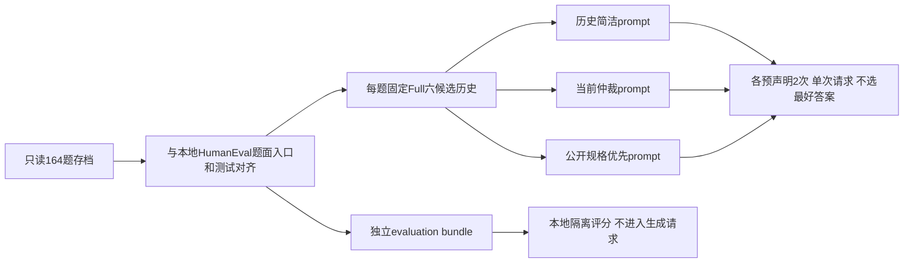

# HumanEval 真实候选流对照准备

此目录是**零 API 的实验准备产物**，不是新模型结果，也不是付费批准。原始存档、官方格式数据文件和历史标签保持不变。

## 本轮结果

| 项目 | 真实验收结果 |
|---|---|
| 任务 | 全部164题，无按旧通过/失败筛选 |
| 公开题面去重 | 164份唯一题面 |
| 候选历史去重 | 164份唯一历史，每份六条候选 |
| 对照 | 历史简洁提示、当前仲裁提示、新“公开规格优先”提示 |
| 重复与请求 | 每题每种提示2次，合计984个预声明请求 |
| 生成参数 | 全部温度0、输出上限1024，尚未发送 |
| 新模型调用 | 0 |
| 官方参考实现自检 | 164/164通过 |
| 历史Full输出重评 | 147/164通过，与旧标签差异0 |
| 隔离评分 | 每个参考实现及历史输出分别执行2次，共656次独立Python进程检查 |
| 费用及总Token | 未核验，明确保留为空值 |

独立评分验收全部完成，不会修改旧产物，也不将重复检查数当作独立任务数。历史147/164不是本轮新生成的准确率。

## 冻结设计

三组共享相同候选历史；只改变合成prompt，不重跑讨论、不修改门控。这是复用已审计题集的**探索性提示词对照**，不是独立确认、VIB对Full对照或等实际费用实验。每题重复结果未来须先任务内聚合，不能选择两次中的最好答案。

历史简洁提示来自Git `25f1288`，当前仲裁提示来自 `f97ce19`；完整commit与源码SHA256已写入清单。snapshot仅复现提示词文本，不声称复现历史模型版本、参数或自动修复循环。所有组均声明单次生成，不使用可见/隐藏测试修复或早停。

## 评分边界

评分适配器在独立的 `python -I -S` 进程中实际执行 `check(entry_point)`。子进程使用临时目录和不继承凭证的最小环境；超时和普通代码错误为失败，非协议退出及两次结果不一致为设施错误。

两次检查固定Python `random` seed，但解释器hash随机化保持默认，不能宣称所有随机源均被固定。协议和运行时版本随bundle冻结。POSIX工作进程组会被清理；其他系统仅保证工作进程终止。此处是进程与状态隔离，**不是恶意代码的文件系统/网络安全沙箱**。

## 付费前置

`draft.json` 使用专门的草案版本，不能直接作为 `ExperimentSession` 的可执行清单。当前明确 `paid_ready=false`：

1. 实际模型与端点尚未冻结。
2. 提供方价目及缓存计费尚未核验。
3. 真实prompt Token上界尚未核验。
4. 完整清单的预算尚未获得用户批准。

984次输出上限合计1,007,616 Token只是声明的输出容量，不是预计实际输出、总Token或美元费用。清单中的 `$3` 只是待核对的初始预算提案；费用未知时不能声称它足以覆盖全部请求。

这些前置完成后需要生成新的可执行manifest、通过离线预检，再针对该manifest确认预算。不要手改本目录的指纹或将reviewed字段直接设为true来跳过核验。

## 一键导航

| 内容 | 入口 |
|---|---|
| 冻结草案及984个请求 | [draft.json](draft.json) |
| 隐藏测试独立bundle | [evaluation.json](evaluation.json) |
| 准备验收摘要 | [preparation_report.json](preparation_report.json) |
| 逐题本地评分验收 | [scoring_acceptance.json](scoring_acceptance.json) |
| 历史简洁prompt源码 | [legacy_compact.py](legacy_compact.py) |
| 当前仲裁prompt源码 | [current_arbitration.py](current_arbitration.py) |
| 新规格优先prompt源码 | [specification_priority.py](specification_priority.py) |
| 离线预检及调度说明 | [使用说明](../../docs/experiment_session_driver.md) |
| 研究事实与实施记录 | [审计记录](../../paper/gap1_claim_audit_trail.md) |
